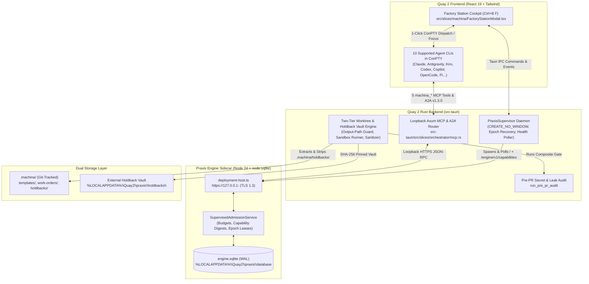

# Product Requirements Document (PRD): Machina Praxis Software Factory

**Project**: Quay 2 — Machina Praxis Integration  
**Engine Foundation**: `@aiws/engine` (`E:\Projects\AI-WS-SDK\engine`, Node 24 + `node:sqlite`)  
**Status**: Approved Specification & Interactive Cockpit Prototype Complete  
**Trackers**: [Wayfinder Map (`00-map.md`)](file:///E:/Projects/Quay2/.scratch/machina-praxis/00-map.md) | [Domain Glossary (`CONTEXT.md`)](file:///E:/Projects/Quay2/.scratch/machina-praxis/CONTEXT.md)

---

## 1. Executive Summary & Vision

**Machina Praxis** transforms Quay 2 from a multi-agent terminal multiplexer into a local-first **AI Software Factory**. While existing agent CLIs (Claude Code, Antigravity, Kiro, OpenAI Codex, GitHub Copilot, OpenCode, Pi, Gemini, Grok, Aider) excel at interactive code generation, they lack an external, deterministic supervisor that enforces:
1. **Blind Holdback Verification** (preventing reward hacking and test tampering),
2. **Bounded Correction Loops** (`INITIAL` $\rightarrow$ `CORRECTION` ordinals $1..N$ with sanitized feedback),
3. **Hard Budget & Credential Governance** (`SupervisedAdmissionService` + interactive `aiws-hold-card/1` holds), and
4. **Universal Protocol Accessibility** (any agent CLI can drive or be driven by the factory via Loopback MCP tools or `@a2a-js/sdk@1.3.0` A2A delegation).

By embedding the user's **Praxis** workflow engine (`@aiws/engine`) as a Rust-supervised Node 24 sidecar and pairing it with the **Factory Station Cockpit (`Ctrl+B F`)**, Machina Praxis delivers an industrial-grade software factory directly on the developer's Windows workstation.

---

## 2. System Architecture

---

## 3. Core Functional Specifications

### 3.1 Praxis Sidecar Packaging & Rust Supervisor ([Ticket 01](file:///E:/Projects/Quay2/.scratch/machina-praxis/issues/01-research-praxis-engine-packaging.md), [Ticket 03](file:///E:/Projects/Quay2/.scratch/machina-praxis/issues/03-spec-praxis-sidecar-supervisor-lifecycle.md))
- **Zero-Dependency Node 24 Runtime**: Praxis runs `.ts` sources directly via Node 24's built-in type-stripping and `node:sqlite` (`DatabaseSync` + `storage-worker.ts`). Single-file bundlers (`esbuild`/`pkg`) are avoided so worker thread relative URLs (`new URL('./storage-worker.ts', import.meta.url)`) remain intact inside `aiws-engine-package/1`.
- **Windowless Spawn & Dynamic Port Handshake**:
  - `PraxisSupervisor` generates ephemeral ECDSA P-256 loopback TLS 1.3 certificates (`rcgen`) and a runtime config at `%LOCALAPPDATA%\Quay2\praxis\runtime\praxis.config.mjs` with `port: 0`.
  - Spawns `node.exe --no-warnings <praxis-root>\engine\src\deployment-host.ts <config.mjs>` with Windows `CREATE_NO_WINDOW` (`0x08000000`).
  - Parses stdout line 1 (`{"origin":"https://127.0.0.1:<PORT>","profile":"aiws-deployment-probe/1","certified":false}`) within a 10s deadline.
- **Health Polling & Epoch-Fenced Crash Recovery**:
  - Polls liveness (`GET /` every 5s) and readiness (`GET /engine/v1/capabilities` every 15s).
  - On crash or 3 consecutive health failures: kills orphaned PIDs (`TerminateProcess`), respawns with exponential backoff ($1\text{s}, 2\text{s}, 4\text{s}, 8\text{s}, 16\text{s}$), increments `engine_meta.epoch`, revokes stale credential leases, and transitions in-flight stages to `INTERRUPTED` (or re-queues idempotent attempts).

### 3.2 Dual Protocol Bridge: Loopback MCP + A2A v1.3.0 ([Ticket 02](file:///E:/Projects/Quay2/.scratch/machina-praxis/issues/02-research-a2a-mcp-dual-binding-contract.md))
- **5 Governed MCP Tools** registered on Quay's loopback Axum MCP server ([`src-tauri/src/slices/orchestrator/mcp.rs`](file:///E:/Projects/Quay2/src-tauri/src/slices/orchestrator/mcp.rs)):
  1. `machina_submit_work_order`: Validates template, budget allowance, and `outputPaths`; initializes Praxis work order and Stage 1 admission.
  2. `machina_get_stage_status`: Returns real-time stage state, active `aiws-hold-card/1` holds, and sanitized diagnostic summaries.
  3. `machina_claim_attempt`: Binds an agent terminal (`X-Quay-Terminal-Id`) to an `INITIAL` or `CORRECTION` attempt ordinal, returning the confined worktree path and stage contract.
  4. `machina_submit_deliverable`: Triggers the Two-Tier Holdback Gate on the authoring worktree and records the verification outcome in Praxis SQLite.
  5. `machina_resolve_hold`: Executes an operator or supervisor hold exit action (`grant_lease`, `approve_budget`, `abort_wo`).
- **A2A v1.3.0 Agent Card (`machina-praxis`)**:
  - Advertised on Quay's A2A bus using `@a2a-js/sdk@1.3.0` semantics (`message/send`, `tasks/get`, `tasks/cancel`), backed by `a2a_inbound_tasks` deduplication in Praxis SQLite.

### 3.3 Two-Tier Worktree Holdback & Correction Validation Engine ([Ticket 04](file:///E:/Projects/Quay2/.scratch/machina-praxis/issues/04-spec-two-tier-validation-and-holdback-engine.md))
- **Stage 2 Vault Extraction & Physical Stripping**:
  - When scaffolding `.machina/worktrees/<work_order_id>/`, Quay computes a SHA-256 manifest of `.machina/holdbacks/`, copies the suite to `%LOCALAPPDATA%\Quay2\praxis\holdbacks\<work_order_id>\`, and **physically deletes** `.machina/holdbacks/` from the authoring worktree before any agent claims Stage 3.
- **Stage 4 Strict Output-Path Confinement + Composite Gate**:
  - **Confinement Check**: Verifies all modified/untracked files in `.machina/worktrees/<work_order_id>/` match the Work Order's `outputPaths` globs. Out-of-scope edits trigger `SCOPE_VIOLATION` and automatic revert.
  - **Composite Sandbox Verification**: Clones the verified diff into an ephemeral verification sandbox, mounts the external Holdback Vault, and executes:
    1. Tier 1 standard `validation: string[]` commands (`tsc`, `cargo test`, `vitest`),
    2. Tier 2 blind holdback test suite,
    3. Quay's built-in Pre-PR Secret/Leak Audit ([`run_pre_pr_audit`](file:///E:/Projects/Quay2/src-tauri/src/slices/git/commands.rs)).
- **Stage 5 Tiered Diagnostic Sanitization**:
  - **Tier 1 Failures**: Full `stderr`/`stdout` compiler and unit test output is passed to the next `CORRECTION` ordinal.
  - **Tier 2 Blind Holdback Failures**: Sanitized so the agent receives only the failed invariant ID/title and behavioral assertion summary—redacting holdback file paths, source lines, and raw input/output test vectors.

### 3.4 Operator Cockpit: Factory Station (`Ctrl+B F`) ([Ticket 05](file:///E:/Projects/Quay2/.scratch/machina-praxis/issues/05-prototype-factory-station-cockpit-ui.md))
- Implemented in [`src/slices/machina/FactoryStationModal.tsx`](file:///E:/Projects/Quay2/src/slices/machina/FactoryStationModal.tsx) and [`src/slices/machina/types.ts`](file:///E:/Projects/Quay2/src/slices/machina/types.ts), wired to `Ctrl+B F`, the Left Rail, the Stage Header, and the `Ctrl+K` Command Palette:
  - **Left Zone**: Supervised Admission Ledger meter + active Work Order queue with mini 6-stage progress bars.
  - **Center Zone**: Interactive 6-stage Pipeline DAG, high-visibility `aiws-hold-card/1` Governed Hold resolution banner, and Two-Tier Holdback Vault & Sanitized Invariant inspector.
  - **Right Zone**: Stage-to-ConPTY Agent CLI binding selector (supporting all 10 agent CLIs), 1-click **Jump / Spawn Bound ConPTY Pane**, 1-click **Dispatch Stage Contract via ConPTY**, and the **+ New Work Order** Quick-Dispatch Composer.

---

## 4. Implementation Milestones (Execution Roadmap)

1. **Milestone 1 — Rust Sidecar Supervisor Slice (`src-tauri/src/slices/machina/supervisor.rs`)**:
   - Implement `PraxisSupervisor`, ephemeral TLS cert generation (`rcgen`), `praxis.config.mjs` writer, `CREATE_NO_WINDOW` spawn, stdout probe parser, and Epoch-Fenced Crash Recovery.
2. **Milestone 2 — Two-Tier Worktree & Holdback Vault Engine (`src-tauri/src/slices/machina/vault.rs`)**:
   - Implement `.machina/holdbacks/` SHA-256 vault extraction, physical stripping from `.machina/worktrees/<id>/`, `outputPaths` glob confinement validator, and Tier 2 diagnostic sanitizer.
3. **Milestone 3 — Loopback MCP & A2A Proxy Wiring (`src-tauri/src/slices/orchestrator/mcp.rs`)**:
   - Register the 5 `machina_*` MCP tools and the `machina-praxis` A2A Agent Card handler forwarding to the Praxis loopback HTTPS endpoint.
4. **Milestone 4 — Live Backend Binding in `FactoryStationModal.tsx`**:
   - Connect the completed [`FactoryStationModal.tsx`](file:///E:/Projects/Quay2/src/slices/machina/FactoryStationModal.tsx) UI to live Tauri commands (`machina_status`, `machina_list_work_orders`, `machina_submit_work_order`, `machina_resolve_hold`) and real-time Tauri events (`machina:state-changed`, `machina:hold-created`).
