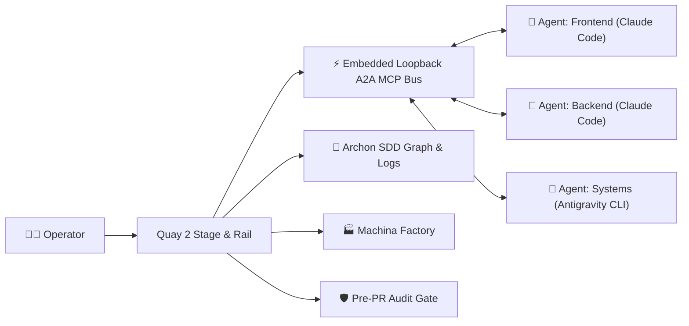

<div align="center">


# Quay 2

### The Native Windows Orchestrator & Cockpit for Autonomous Multi-Agent AI Engineering

[](https://www.gnu.org/licenses/agpl-3.0)
[](https://microsoft.com)
[](https://www.rust-lang.org)
[](https://tauri.app)
[](https://react.dev)
[](https://seanrobertwright.github.io/Quay-2/)

**Quay 2** replaces clumsy terminal multiplexer hacks with a lightning-fast, native desktop cockpit engineered from the ground up for modern autonomous AI coding agents.

[Explore the Documentation](https://seanrobertwright.github.io/Quay-2/) · [Report Bug](https://github.com/seanrobertwright/Quay-2/issues) · [Request Feature](https://github.com/seanrobertwright/Quay-2/issues) · [Contributing Guide](CONTRIBUTING.md)

</div>

---

## 🚀 Why Quay 2?

Autonomous coding agents (**Claude Code**, **Antigravity CLI**, **OpenAI Codex**, **Pi**, **PiG**, **Gemini**, **Aider**, **Kiro**) are changing how software is built. But coordinating multiple long-running agents in traditional terminal windows or text-mode multiplexers (`tmux`, `psmux`, `screen`) is tedious, error-prone, and visually cramped.

**Quay 2** gives you a command center that bridges native Windows ConPTY performance with intelligent multi-agent orchestration, live telemetry, and visual software engineering workflows.



---

## ✨ Key Features

### ⚡ Native ConPTY Performance & Zero Lag
- Built on Rust's `portable-pty` directly interfacing with the official **Windows ConPTY** API.
- Powered by `@xterm/xterm` with GPU acceleration, custom emoji width rendering, and high-throughput streaming.
- Smooth background terminal buffering: background processes continue rendering without stalling or dropping frames.

### 🤖 Universal Multi-Agent Fleet Support
- First-class support for launching and orchestrating:
  - **Claude Code** (`claude`) with direct model selection (`claude-opus-5-5`, `claude-sonnet-5-5`, `claude-haiku-5-5`, `claude-fable-5-1`, `claude-opus-4-6`, `claude-sonnet-4-6`).
  - **Antigravity CLI** (`agy`)
  - **OpenAI Codex CLI**
  - **Pi Coding Agent**
  - **PiG (Pi in Go)** (`pig`): a full peer on the A2A bus, through an extension Quay loads for each terminal. [Setup](https://seanrobertwright.github.io/Quay-2/features/pig)
  - **Google Gemini CLI**
  - **xAI Grok**
  - **Aider**
  - **Kiro CLI**
  - **GitHub Copilot CLI**
  - **OpenCode CLI**
  - **PowerShell (pwsh)**, plus any command line, such as `cmd.exe` or `wsl.exe`, as a **Custom Command**.

### 🔄 Autonomous Agent-to-Agent (A2A) MCP Bus
- Embedded loopback Model Context Protocol (MCP) server (`http://127.0.0.1:<port>/mcp`).
- Spawns Claude Code sessions with automatic MCP tool binding:
  - `quay_list_agents`: Discover the peers on the bus across projects, with their bus level (full peer, responder or listener), busy/waiting status and active tasks.
  - `quay_send_message`: Delegate subtasks or hand off diffs to peer agents with optional synchronous response blocking (up to 60s).
  - `quay_broadcast`: Send a notice to every other running peer in the caller's project, with a toast that names the sender. A worktree counts as its own project, and shell and Archon terminals are skipped.
  - `quay_get_agent_status`: Inspect health, auto-approved tool count, and active command state.
- **Operator Mission Control**: Dispatch tasks manually as the human supervisor or monitor autonomous conversations in real time.

### 📐 Archon & Spec-Driven Development (SDD) Inspector
- Embedded visual DAG canvas displaying live workflow execution nodes, dependencies, and state (`Pending`, `Running`, `Passed`, `Failed`).
- Real-time execution logs and live chat event stream mirroring the Archon WebUI.
- Built-in Architectural Decision Records (ADR) viewer and Spec Task progress checklists.
- 1-click **"Implement with Archon"** integration directly from GitHub issues.

### 🏭 Machina AI Software Factory Cockpit
- Native supervisor for the Machina deterministic software manufacturing engine.
- SQLite-backed state persistence in `%LOCALAPPDATA%\Quay2\praxis\`.
- Real-time milestone stages, deliverable gates, hold resolution, and operator claim management.

### 🧭 Praxis Builder

- Opens with `Ctrl+Shift+B P` or **Praxis Builder...** in the command palette.
- Lists the active project's Praxis definitions in `.praxis/` (graphs with their graph bindings, contracts, grants, triggers and workflow templates) and shows a graph on a canvas, laid out from `.praxis/layout/<graph-id>.json` or by dagre.
- Edit a graph on the canvas: drag a kind from the palette strip to add a node, drag from one card's handle to another to add a dependency, and drag from a decision's green `then` or red `else` handle to set that branch. The inspector beside the canvas edits the selected node's id, its kind's config, its `dependsOn`, and its `inputSchema` and `outputSchema` (as a table of field name, type and required, or as raw JSON for a schema the table can't show), shows the problems found in each field, and deletes the node. Renaming or deleting a node updates every `dependsOn`, decision branch and layout entry that names it.
- Drag a graph's nodes and press **Save** (`Ctrl+S`) to write the graph and its layout. Files are written in one canonical form, so a save that changes nothing makes no diff, and graphs get a content-digest `revision`. Unsaved drafts show `*` in the list and a dot on the project in the rail, and Quay asks before it quits with any unsaved. An invalid graph still saves, and the list marks it with an error badge.
- Lay a graph out: **Auto-arrange** (`Shift+A` in the canvas) lays the whole graph out top to bottom with dagre and fits it in view, with each decision's `then` branch on the left. With two or more nodes selected, align their left, right, top or bottom edges or their centres; with three or more, distribute them evenly across or down. These are in the toolbar's **Arrange** menu, and align and distribute are also on a node's right-click menu. A single dragged node shows guide lines and snaps to the edges and centres of the others; hold `Alt` to drag it freely. Each layout command, like each drag, is one undo step.
- Create, rename and delete definitions from the list. **New** asks for the kind, then names it in the list (`graph-1` to start) and checks the name as you type: letters, digits, `.`, `_` and `-`, up to 128 characters, no leading dot, no Windows device name, and no id another definition has, ignoring case. A new graph starts with a single END node, and nothing is written until its first save. Rename lists every file it will touch, moves the definition and its layout file, and changes the id inside (a workflow template has none). Delete names what refers to the definition and moves it, with its layout file, to the Recycle Bin or Trash. Neither can be undone in the builder.
- Open a contract to edit it as a form in sections for scope, limits, timing and delivery. The deadline is picked in your local time zone, with the zone and the UTC time shown; durations are an amount and a unit; counts and the budget (in the installation's ledger cost unit) refuse empty, negative and non-numeric values as you type. A new contract starts with its id as `missionId`, the `graphs` feature, approval required and no deadline, which is flagged until set. The **Graphs** and **Grants** sections bind definitions to the contract from a picker, which also takes an id not made yet and flags it as missing, and **Triggers** links to the triggers that name the contract. Saving writes the contract and `.praxis/bindings/<contract-id>.json` together, as one undoable draft, and renaming a bound graph or grant rewrites the bindings that list it. Each contract is checked with the SDK's `create_mission`, and its problems show on the fields.
- Open a grant to edit it as a form, under a fixed note that a grant is a proposal and takes effect only when a human approves it in Praxis. The parent grant is picked from the project's grants, or typed as an id not made yet, which is flagged as missing, and the form shows the delegation chain from the root grant down to this one with each limit. The limit (in the installation's ledger cost unit) is checked as you type against the parent grant's limit and the budget of every contract whose bindings list the grant. Each of those contracts opens a scratch mission on which the saved grants above this one that the contract also binds, then this one, are granted with the SDK's `reduce`, and the result shows under **Missions**. A new grant starts as a root grant with no subject or times, which are flagged until set. Renaming a grant rewrites the `parentId` of the grants under it.
- Open a trigger to edit it as a form that shows only the fields its kind and action use: a schedule for `SCHEDULED`, a filter and condition mode for `CONDITION` (the filter is optional for other kinds), and a wait id for `RESUME_WAIT`, which is a run-time id that isn't linked to a graph node. Changing the kind or action adds and removes those fields as one undo step. A `START_RUN` trigger notes that Praxis doesn't yet say which graph a triggered run attaches. A new trigger is a disabled `MANUAL` trigger that starts a run, and its contract comes from a picker that also takes an id not made yet and flags it as missing. Saving sets its content-digest `revision`, and renaming a contract rewrites the `contractId` of the triggers that name it. Each trigger is checked with the SDK's `registerTrigger` on a scratch mission, and its problems show on the fields.
- Author a graph's bindings, the `aiws-graph-binding/1` documents in `.praxis/graph-bindings/<id>.json` that say what each TASK, LOOP and COMPENSATION node runs. A graph's row in the list expands to its bindings, and bindings whose graph is missing are listed under **Unattached bindings**. The canvas toolbar's **Binding** picker offers None, each binding and **+ New binding…** (named `<graph-id>-<n>`, with one entry per node to fill in), and remembers the choice per graph while Quay runs. With a binding chosen, each of those nodes' cards shows bound or unbound, a missing entry is a `BINDING_INCOMPLETE` problem, and the inspector's **Runs as** section edits the node's entry: the execution kind (a TASK's follows its graph node; a LOOP or COMPENSATION chooses AGENT or TOOL), the agent id, commands as argument lists and output paths, or the protocol binding, action, resource and JSON payload, the exposure, Work or Validation with its criteria, and under **Advanced** the requirements and the longest task time. With no node selected, the **Binding** section edits the cost unit, the run's cost and active-time limits, and a raw JSON context policy. Ids are free text, suggested from the ids already used in the project's bindings, and agent ids also from its workflow templates' `agent`, and Praxis checks agents and protocol bindings when a run is attached. Each binding saves on its own with **Save binding**, which sets `graphBindingRevision` from its content and, the first time, pins `graphRevision` and `graphDigest` to the graph as saved on disk. When the graph changes on disk the binding shows **Stale**, and **Retarget to current graph** lists the entries it will drop before it re-pins the binding. Binding edits, a node rename (which rewrites the node's key in every binding of the graph) and a retarget are steps of the graph's undo history. Copy and paste carry each node's entry, **Duplicate binding** copies one, and deleting a graph offers to delete its bindings too. Bindings are shape-checked in Rust against the PROVISIONAL schema vendored from the AI-WS-SDK.
- Open a workflow template (`.praxis/templates/<name>.json`, listed under **Workflow templates**) to edit it as a form headed "Workflow template · coding profile", in sections for intent, commands, outputs, limits, and agent and cost. A template is a coding plan without a work order or run id, and the file name is its name, which `praxis run <name>` starts. A read-only strip above the form shows the coding profile's stages, Approve → Implementation → Validation → Correction → Acceptance; correction loops back to validation only when `maxCorrections` is more than 0, and is marked when each correction is approved again. Choosing a stage scrolls to its fields. The implementation, validation and correction commands are argument lists, one row per argument with the executable first, which can be added, removed and moved, or edited as a JSON array; Quay never splits a command line or runs a command. Exposure is **Not declared**, **Bounded** (with an allowance, a stop threshold that **Use 80% of allowance** fills in, and a max total cost) or **Not applicable** (with a justification), and only the chosen one's fields are saved. A new template has no corrections, two attempts and re-approval on, and its text, commands, output paths and durations are flagged until filled. Each template's shape is checked against the SDK's provisional coding-plan schema; a field a template can't have, such as `steps`, offers **Remove field**. Readiness and the host's other rules come from the host: beside **Install on host…**, a status line shows the template's state on the host, the host's reason, when it was checked, and **Check again**.
- Link the `praxis` CLI to reach a Praxis host. Quay runs `praxis` from an AI-WS-SDK checkout with Node 24 or later: run `npm link` in the checkout's `engine` folder. Quay never starts it through npm's `praxis.cmd` shim or `cmd.exe`; it follows npm's global link for `@aiws/engine` into the checkout, reads `bin.praxis` from its `package.json`, and runs `node <script>` once `node --version` says 24 or later. Reads (`workflows list`, `workflows show`, `runs` and `status`) and `run` are headless `--json` calls, bounded at 15 s for a read and 75 s for a run creation, after which Quay kills the process tree. A `praxis` whose output Quay doesn't read gets "Quay needs an update for this praxis".
- Two optional per-user settings live in `praxis-cli.json` in Quay's data folder. Quay has no screen for them, so edit the file by hand; Quay reads it when it starts. `checkout` is an AI-WS-SDK checkout to run `praxis` from in place of npm's global link: it or its `engine` folder must hold a `package.json` whose `bin.praxis` names a file inside that package. `installation` is the Praxis installation folder, passed as `--state` on every call, the terminal commands included; without it, Quay uses the installation `praxis` in a terminal uses. Each is `null` or left out when unset, or else the absolute path of an existing folder, not empty and with no space at either end. Each folder is checked again on every call, and a bad one makes the host chip read **praxis CLI not found** with a reason naming the setting. A file that isn't valid JSON, or that holds any other key, is ignored with a logged warning.
- The host chip in the builder's header shows the project's host condition as the latest call left it, each with a text label: **Host not checked yet**, **praxis CLI not found**, **No host set up**, **Host down**, **Not signed in**, **Signed in** or **Simulated host**. Pressing it opens a panel saying what to do: how to link the CLI, or **Set up host**, **Start host** or **Sign in**, each opening a terminal in the project running `praxis setup`, `serve` or `login` for you to answer, with `--state` when an installation is set and never a flag that skips a confirmation. The chip never calls `praxis` itself, except that while a failing condition holds, a workflow template is open and the window is shown, Quay checks the host again every 60 s. A simulated host gets an amber chip and a standing banner saying its approvals aren't made by a person.
- On a real host, a `praxis login` lasts about 5 minutes, because the CLI never refreshes its 5-minute token: see [praxis CLI never refreshes its 5-minute token on a real host, and stores credentials in plain text](https://github.com/seanrobertwright/AI-WS-SDK/issues/328). The next call after that says the session expired, and the chip reads **Not signed in** with **Sign in** again. Quay doesn't work around it, so sign in again whenever that happens until the CLI is fixed.
- Each workflow template has a state on the host, from one `praxis workflows list` and a `praxis workflows show <name>` for each local template the host has installed, at most two at a time. It is the first that applies of **Name the host refuses**, **Not installed**, **Invalid on host**, **Differs from host** (the host's copy has a different digest from the saved file), **Installed, not ready** (with the host's reasons) and **Installed**. A failed read shows **Couldn't check**. Quay reads every template the first time the builder is shown for a project, one template after it is saved if the host has it, everything on **Check host** and one template on **Check again**. Readings stay in memory, never on disk, are shown muted as "may be out of date" after 10 minutes, and are dropped while the host can't be used. Each row in the list shows its host state as an icon after its **changed since last commit** badge, with the state and the host's reason in its tooltip and as text for screen readers. The Workflow templates group header shows the host condition with **Check host**, and **Sign in** when not signed in. A collapsed **On host only (N)** subsection lists up to 100 host templates with no local file, by name and read-only, with no import and no delete.
- **Install on host…** on a workflow template opens a dialog that writes nothing, on the template's host state. When the host doesn't have the template, or its state isn't known, the dialog shows the saved file's absolute path with a **Copy** button, the name `<name>.json` it takes on the host, and the steps: copy the file into the template directory your host configuration names, restart the host, then run `praxis run <name>`. With the steps it lists the saved file's implementation, validation and correction commands in full, read-only. When the host's copy differs or is invalid, the same steps come with a warning that installing replaces it. When the host already has the saved file there are no steps, and for one that isn't ready, the dialog gives the host's reason. When the host refuses the name there are no steps, only the rule. When the file has uncommitted changes the dialog leads with their diff and a warning. A template that was never saved, or whose file was deleted, has no file to install, so the button stays unavailable until it is saved. Quay never writes the host's configuration or template directory, never guesses that directory, and never runs `engine:author`.
- **Template | Runs** above a workflow template switches to its runs on the host, from `praxis runs <name> --json`, newest first, with each run's status, stage, control, whether it is held, its template revision and when it was created. It lists the newest 20, and **Show more** the newest 100, the most `praxis` lists. A run awaiting approval or held is marked **Needs you** with **Open in browser**, and a simulated host's runs are marked **Simulated**. The list is read every 15 s while it is shown, or every 60 s after a failed read. It keeps the last list with the reason a read failed, and is dimmed while the host can't be used. Reading stops, with its call, as soon as the list leaves the screen or Quay's window is hidden.
- **Show** on a run draws it live on the template's stage strip, followed with `praxis status <work-order> --json`, never `praxis follow`: 3 s after a change, doubling to 15 s while nothing changes, every 15 s while it waits for a person, every 60 s after a failed read, and no more once it has ended. A run waiting for a decision gets a banner naming it, with **Open in browser**. A held run gets a hold panel with its reason, cause, notes and ways out, and **Resolve in browser**. A certificate hint from `praxis` that asks for `praxis trust` offers **Trust certificate**, which runs it in a terminal for you to answer.
- **Run** in the Runs view's header starts a run of the host's installed copy with `praxis run <name> --json`. It is unavailable, with the reason shown, while the host's copy isn't ready or isn't valid, while the name breaks the host's rule, and while a run of the template is starting. Its confirm checks the host's copy again, shows its revision and digest, says the host runs that copy and not the project's file, and warns about a differing copy, unsaved edits and uncommitted changes. **Start run** is withheld until the check ends, and while the host has no copy or can't run it. A started run is selected and followed. When a held run, or one awaiting approval, blocks new runs, the notice offers **Open in browser** for it, and **Show run** when `praxis` names its work order. A host problem says no run was started, and a refusal gives `praxis`'s own words with **Copy**. Quay never stops a creation before its 75 s bound. When it can't tell whether a run was created, it says so, and **Run** again finishes the pending creation and can't create a second run.
- Decisions on a run, such as approving, pausing, cancelling or resolving a hold, are made only in the host's browser page. Quay has no control for any of them and never runs `praxis hold` or `praxis open`. **Open in browser** and **Resolve in browser** open a page only on this machine's Praxis host: at the host's browser origin, `https://praxis-<label>.localhost:<port>/`, or at `https://127.0.0.1:<port>/`.
- Each contract is checked across records on a scratch mission: the saved contract, then the grants it binds (each parent first), the graphs it binds and the triggers that name it, as Praxis would apply them. The check reports, on the record it is about, a missing `graphs` or `triggers` feature, a trigger that expires after the contract's deadline, a binding, `parentId` or `contractId` that names no record, and anything the SDK's `reduce` refuses. It runs when the builder opens and when a record is opened or saved, re-checking only the contracts that record affects. The issues are advisory: they show in an **Across records** section of each form and as a warning badge in the list, and saving still works. A graph shows **Runs under:** chips for the contracts that bind it, and a collapsible **Run context** panel beside **Problems** lists each contract's grants and triggers and the graph's cross-record issues. A graph no contract binds gets an info issue and a shortcut that adds it to a contract's Graphs. Checking that a contract's graphs agree on a `costUnit` waits for the SDK's per-node binding records.
- Contracts, grants, graph bindings and workflow templates whose files have uncommitted changes (`git status` of `.praxis/contracts`, `.praxis/grants`, `.praxis/graph-bindings` and `.praxis/templates`, staged or not) carry a **changed since last commit** badge in the list, so an agent's edits are visible before anyone submits them. The badge opens the file's diff against the last commit. A project that isn't a git repository shows no badge. Committing a grant doesn't approve it: only a human in Praxis does.
- A file whose id doesn't match its file name is listed with a warning and offers to set the id to the file name. A workflow template holds no id, so its file name alone names it.
- Use the canvas from the keyboard alone. `Tab` moves through the nodes in file order, then the edges. `Enter` or `Space` selects the focused node, `Shift+Space` adds it to the selection, and the arrow keys move the selection 8 px (40 px with `Shift`). `Ctrl+F` opens **Go to node**, which filters by id or kind. Pressing a palette button adds a node below the one selected node, depending on it, or in the middle of the view otherwise. The inspector's **Add dependency** combobox connects nodes, and a dependency chip goes to its node. `Delete` removes the focused node or edge, and `Shift+F10` or the Menu key opens a node's menu. Screen readers hear each node's kind, id, summary, dependency count and problem count, and undo, redo, paste, delete and save are announced.
- Files that aren't valid JSON are listed with an error badge, and opening one shows the line and column of the error.
- Validates each graph offline with the AI-WS-SDK's own Rust crate, vendored in `src-tauri/vendor/aiws`. Each node shows a problem count, and a Problems list under the canvas gives every issue's node, field, message and code. Choosing an issue selects its node and zooms to it.

### 🪟 Tiling Window Management & 1-Click Swarm Presets
- Split your stage instantly:
  - Side-by-Side Horizontal Split (`Ctrl+Shift+B %`)
  - Top-and-Bottom Vertical Split (`Ctrl+Shift+B "`)
  - 2x2 Quad Grid Layout (`Ctrl+Shift+B G`)
  - Zoom Active Pane (`Ctrl+Shift+B Z`)
- **1-Click Multi-Agent Swarms** (`Ctrl+Shift+B S`):
  <!-- BEGIN GENERATED: builtin-swarm-presets. `pnpm docs:presets` writes this list from BUILTIN_SWARM_PRESETS in src/slices/orchestrator/swarmTypes.ts, and `pnpm docs:build` runs it first. Edit the presets there, not this list. -->
  - *Dev & Watcher* (`lead-dev`, `build-watcher`): Claude Code paired with an active PowerShell terminal running build watchers or tests.
  - *TDD Swarm* (`test-architect`, `feature-impl`, `test-runner`, `reviewer`): 4-way 2x2 grid pairing Test Architect, Implementer, Test Runner, and Code Reviewer.
  - *Full-Stack Pair* (`backend-agent`, `frontend-agent`): Dual Claude Code agents in side-by-side split dedicated to Backend and Frontend tasks.
  - *Bug Hunter* (`reproducer`, `tracer`, `patcher`, `verifier`): Four Claude agents in a 2x2 grid take a bug in turns: one reproduces it as a failing test, one traces the cause, one patches it and one verifies the fix.
  - *Red/Blue Team* (`red-team`, `blue-team`): Two Claude agents side by side: the red team pins each hole with a failing test, and the blue team fixes the server until every test passes.
  - *Tri-Agent Council* (`planner-agent`, `builder-agent`, `verifier-agent`, `terminal-shell`): Three collaborative Claude agents (Planner, Builder, Verifier) sharing the orchestration bus.
  - *Polyglot Agent Trio* (`claude-dev`, `agy-planner`, `codex-reviewer`, `test-runner`): Claude implements, Antigravity plans and Codex reviews, with a shell for tests. Claude and Codex talk over A2A. Antigravity answers when asked but can't start a conversation, and hands its plan back as a file.
  <!-- END GENERATED: builtin-swarm-presets -->

### 🌿 Git Worktrees Integration
- Create and manage isolated Git worktree branches without leaving Quay (`Ctrl+Shift+B W`).
- Worktrees in the navigation rail start collapsed by default to save precious vertical space.
- A smart indicator dot marks any collapsed worktree housing the active terminal.

### 🐙 GitHub Companion Drawer with Dependency Triage
- Keyboard-accessible drawer (`Ctrl+Shift+B I`) for issues and pull requests.
- Filter by label, author, or state (`open`, `closed`).
- **Native Blocked Issue Detection**: Automatically queries GitHub GraphQL issue dependencies; blocked issues display a prominent red **`BLOCKED`** tag listing their open blocker issue numbers.
- 1-click **"Implement with Claude"** and **"Implement with Archon"** prompts automatically pre-filled and launched in dedicated worktrees.

### 💰 Real-Time Token & Spend Telemetry
- High-speed transcript scanner deduplicating thousands of `.jsonl` message records across `~/.claude/projects/`.
- Instant sub-2ms disk-cached stats for Opus 5.5, Sonnet 5.5, and Haiku 5.5 pricing tiers.
- Subtle audio chimes notify you when an agent finishes its turn or requires attention.

### 🛡️ Pre-PR Audit Gate & Safety Guardrails
- Pre-PR Audit Gate (`Ctrl+Shift+B A`) scanning changed file names and the git diff for secrets, key files and personal paths. See [Pre-PR Audit Gate](https://seanrobertwright.github.io/Quay-2/features/security-audit).
- Distinct visual badges for terminals running with `--dangerously-skip-permissions`.

---

## ⌨️ Keyboard-First Workflow (`Ctrl+Shift+B` Prefix)

Quay 2 is designed for muscle memory. Inspired by `tmux`, all primary actions use the `Ctrl+Shift+B` chord:

| Shortcut | Action | Description |
| :--- | :--- | :--- |
| `Ctrl+Shift+B N` | **New Terminal** | Open agent & command launcher modal |
| `Ctrl+Shift+B 1` .. `9` | **Switch Terminal** | Jump directly to terminal slot 1 through 9 |
| `Alt+1` .. `9` | **Fast Switcher** | Quick terminal jump |
| `Ctrl+Shift+B %` | **Split Horizontal** | Stage splits side-by-side |
| `Ctrl+Shift+B "` | **Split Vertical** | Stage splits top-and-bottom |
| `Ctrl+Shift+B G` | **Quad Grid** | 2x2 multi-pane terminal grid |
| `Ctrl+Shift+B Z` | **Toggle Zoom** | Maximize/restore active pane |
| `Ctrl+Shift+B O` | **Cycle Focus** | Move focus to next pane |
| `Ctrl+Shift+B X` | **Close / Unsplit** | Return to single active terminal |
| `Ctrl+Shift+B S` | **Swarm Presets** | Launch multi-agent swarm arrangements |
| `Ctrl+Shift+B D` | **Diff Inspector** | Open the log of agents' Edit and Write tool calls |
| `Ctrl+Shift+B W` | **New Worktree** | Create an isolated branch worktree |
| `Ctrl+Shift+B I` | **GitHub Companion** | Open GitHub Issues & PR drawer |
| `Ctrl+Shift+B A` | **Pre-PR Audit** | Run secret scanner & safety gate |
| `Ctrl+Shift+B H` | **Session History** | Search and auto-resume past Claude sessions |
| `Ctrl+Shift+B T` | **Token Spend** | View token meter & turn chime settings |
| `Ctrl+Shift+B R` | **Archon & SDD** | Open Archon DAG, logs, and spec inspector |
| `Ctrl+Shift+B F` | **Machina** | Open AI Software Factory cockpit |
| `Ctrl+Shift+B P` | **Praxis Builder** | Browse the project's Praxis definitions and graphs |
| `Ctrl+Shift+B C` | **Topos** | Open the Git cockpit for the active project |
| `Ctrl+Shift+P` | **Command Palette** | Global searchable command palette. `Ctrl+K` also opens it when a terminal does not have focus |
| `Esc` | **Dismiss** | Close active modal or drawer |

---

## 📦 Installation & Setup

### Prerequisites
- **Windows 10** (build 1809 or higher) or **Windows 11**.
- **Rust Toolchain** 1.85+ (`rustup default stable`).
- **Node.js** 20+ LTS or 24+ LTS.
- **pnpm** 10+ or 12+ (`npm install -g pnpm`).
- Visual Studio C++ Build Tools (installed automatically with Visual Studio Community or Build Tools).
- *(Optional)* GitHub CLI `gh` (`winget install GitHub.cli`) for GitHub integration.

### Quick Start (Build from Source)

```powershell
# 1. Clone the repository
git clone https://github.com/seanrobertwright/Quay-2.git
cd Quay-2

# 2. Install frontend dependencies
pnpm install

# 3. Launch the development desktop app
pnpm tauri dev
```

### Packaging a Standalone Windows Binary

```powershell
pnpm tauri build
```
The optimized installer and standalone executable will be generated in `src-tauri/target/release/`.

---

## 🎓 Tutorials

Step-by-step, screenshot-led walkthroughs of the Swarm launcher and the A2A bus, each starting from a small starter project. They all live on the **[Tutorials page](https://seanrobertwright.github.io/Quay-2/tutorials/)**.

<!-- tutorials:start -->
### Swarm

| # | Tutorial | What you'll do |
| --- | --- | --- |
| 1 | [Your first swarm](https://seanrobertwright.github.io/Quay-2/tutorials/swarm/first-swarm/) | Launch Dev & Watcher and watch a Claude Code agent build a tip calculator while its tests go green. |
| 2 | [TDD Swarm kata](https://seanrobertwright.github.io/Quay-2/tutorials/swarm/tdd-swarm-kata/) | Build a password-strength checker test-first, driving a tester, an implementer and a reviewer one pane at a time. |
| 3 | [Full-Stack Pair: bookmarks app](https://seanrobertwright.github.io/Quay-2/tutorials/swarm/full-stack-pair/) | Have two agents build a bookmarks app's API and React UI side by side, then open it in your browser. |
| 4 | [Build and save a custom swarm](https://seanrobertwright.github.io/Quay-2/tutorials/swarm/custom-swarm/) | Build a two-agent Docs Squad in the swarm builder, save it, and launch it again after a restart. |
| 5 | [Bug Hunt](https://seanrobertwright.github.io/Quay-2/tutorials/swarm/bug-hunt/) | Hand a bug report to four agents that reproduce, trace, patch and verify each bug in turn. |
| 6 | [Red Team / Blue Team: notes app](https://seanrobertwright.github.io/Quay-2/tutorials/swarm/red-team-blue-team/) | Pit an attacking agent against a defending one on a notes app, then let the Pre-PR Audit Gate catch what both missed. |
| 7 | [JS to TypeScript migration](https://seanrobertwright.github.io/Quay-2/tutorials/swarm/js-to-typescript/) | Have three agents convert a JavaScript project to TypeScript, one folder each, while `tsc --watch` counts the errors down to zero. |
| 8 | [Tri-Agent Council: plan, build, verify](https://seanrobertwright.github.io/Quay-2/tutorials/swarm/tri-agent-council/) | Have a planner, a builder and a verifier take a Markdown link checker from spec to verdict. |
| 9 | [Polyglot Trio](https://seanrobertwright.github.io/Quay-2/tutorials/swarm/polyglot-trio/) | Have Antigravity plan, Claude Code build and Codex review a CSV-to-JSON converter, passing work over the A2A bus. |
| 10 | [Parallel experiments with worktrees](https://seanrobertwright.github.io/Quay-2/tutorials/swarm/parallel-worktrees/) | Try two designs at once in two git worktrees, measure them, merge the winner and throw the loser away. |

### A2A

| # | Tutorial | What you'll do |
| --- | --- | --- |
| 1 | [Hello, A2A](https://seanrobertwright.github.io/Quay-2/tutorials/a2a/hello-a2a/) | Send an agent a message from Mission Control, then watch one agent ask another a question and wait for the reply. |
| 2 | [Contract-first handoff](https://seanrobertwright.github.io/Quay-2/tutorials/a2a/contract-first-handoff/) | Have two agents agree a notes app's API over the A2A bus before either builds its half. |
| 3 | [Hands-off TDD relay](https://seanrobertwright.github.io/Quay-2/tutorials/a2a/tdd-relay/) | Type one prompt and watch a test writer hand failing tests to an implementer, who reports back when they pass. |
| 4 | [Review gate before commit](https://seanrobertwright.github.io/Quay-2/tutorials/a2a/review-gate/) | Have a reviewer agent check every change to a rate limiter until its reply ends in `APPROVED`. |
| 5 | [Fan-out / fan-in](https://seanrobertwright.github.io/Quay-2/tutorials/a2a/fan-out-fan-in/) | Have a lead agent split a static-site generator across three workers at once, then wire their parts together. |
| 6 | [Long jobs: fire, then poll](https://seanrobertwright.github.io/Quay-2/tutorials/a2a/fire-then-poll/) | Hand a three-minute benchmark to another agent without waiting, check on it, and collect the result from a file. |
| 7 | [Broadcast coordination](https://seanrobertwright.github.io/Quay-2/tutorials/a2a/broadcast/) | Have a release captain broadcast a code freeze, hold it through a failed release and lift it when the release passes. |
| 8 | [Mission Control operator run](https://seanrobertwright.github.io/Quay-2/tutorials/a2a/mission-control/) | Lead three agents from Mission Control alone as they plan, build and verify a text-stats CLI. |
| 9 | [Docs that can't lie](https://seanrobertwright.github.io/Quay-2/tutorials/a2a/docs-that-cant-lie/) | Have three agents rewrite a broken README until every code sample in it runs as written. |
| 10 | [Second opinion from Codex](https://seanrobertwright.github.io/Quay-2/tutorials/a2a/second-opinion-codex/) | Have a Claude Code agent ask a Codex agent for a review, then fix every finding it writes down. |
<!-- tutorials:end -->

---

## 📖 Documentation

Comprehensive, searchable documentation is hosted on **GitHub Pages**:

👉 **[https://seanrobertwright.github.io/Quay-2/](https://seanrobertwright.github.io/Quay-2/)**

- **[Architecture Deep-Dive](https://seanrobertwright.github.io/Quay-2/guide/architecture)**: Vertical Slice Architecture, ConPTY lifecycle, and wire protocols.
- **[A2A Orchestration Protocol](https://seanrobertwright.github.io/Quay-2/features/a2a-orchestration)**: JSON-RPC tools and autonomous multi-agent handoff recipes.
- **[Archon & SDD Workflows](https://seanrobertwright.github.io/Quay-2/features/archon-sdd)**: Visual DAG execution, live streaming logs, and ADR tracking.
- **[Machina Cockpit](https://seanrobertwright.github.io/Quay-2/features/machina-praxis)**: Software manufacturing pipeline setup.
- **[API & IPC Specification](https://seanrobertwright.github.io/Quay-2/reference/ipc-api)**: Tauri IPC command contracts and event structures.

To run the documentation locally:
```powershell
pnpm docs:dev
```

---

## 🤝 Contributing

We welcome community contributions! Please review our [`CONTRIBUTING.md`](CONTRIBUTING.md) guide for details on:
- Vertical Slice Architecture guidelines
- Coding standards (Rust MSVC & React 19)
- Typecheck, lint, and test execution (`pnpm tsc`, `cargo test`)
- Pull Request and Conventional Commit standards

---

## ⚖️ License

**Quay 2** is free software licensed under the **[GNU Affero General Public License v3.0 (AGPL-3.0)](LICENSE)**.

```text
Quay 2: Native Windows Autonomous Multi-Agent Workspace & Orchestrator
Copyright (C) 2026 Sean Robert Wright

This program is free software: you can redistribute it and/or modify
it under the terms of the GNU Affero General Public License as published by
the Free Software Foundation, either version 3 of the License, or
(at your option) any later version.

This program is distributed in the hope that it will be useful,
but WITHOUT ANY WARRANTY; without even the implied warranty of
MERCHANTABILITY or FITNESS FOR A PARTICULAR PURPOSE. See the
GNU Affero General Public License for more details.
```

> [!NOTE]
> **Copyleft Requirement**: Under AGPL-3.0, any modified versions or network-accessible deployments of this software must make their complete corresponding source code available under the same license terms. For proprietary or dual-licensing inquiries, please contact the repository owner.
