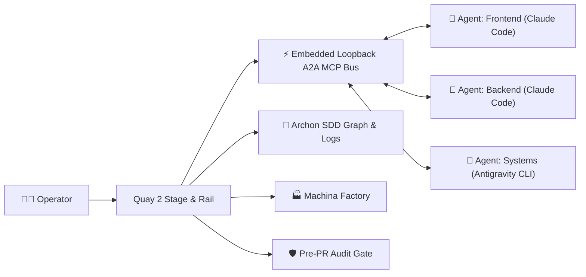

<div align="center">


# Quay 2

### The Native Windows Orchestrator & Cockpit for Autonomous Multi-Agent AI Engineering

[](https://www.gnu.org/licenses/agpl-3.0)
[](https://microsoft.com)
[](https://www.rust-lang.org)
[](https://tauri.app)
[](https://react.dev)
[](https://seanrobertwright.github.io/Quay-2/)

**Quay 2** replaces clumsy terminal multiplexer hacks with a lightning-fast, native desktop cockpit engineered from the ground up for modern autonomous AI coding agents.

[Explore the Documentation](https://seanrobertwright.github.io/Quay-2/) · [Report Bug](https://github.com/seanrobertwright/Quay-2/issues) · [Request Feature](https://github.com/seanrobertwright/Quay-2/issues) · [Contributing Guide](CONTRIBUTING.md)

</div>

---

## 🚀 Why Quay 2?

Autonomous coding agents (**Claude Code**, **Antigravity CLI**, **OpenAI Codex**, **Pi**, **PiG**, **Gemini**, **Aider**, **Kiro**) are changing how software is built. But coordinating multiple long-running agents in traditional terminal windows or text-mode multiplexers (`tmux`, `psmux`, `screen`) is tedious, error-prone, and visually cramped.

**Quay 2** gives you a command center that bridges native Windows ConPTY performance with intelligent multi-agent orchestration, live telemetry, and visual software engineering workflows.



---

## ✨ Key Features

### ⚡ Native ConPTY Performance & Zero Lag
- Built on Rust's `portable-pty` directly interfacing with the official **Windows ConPTY** API.
- Powered by `@xterm/xterm` with GPU acceleration, custom emoji width rendering, and high-throughput streaming.
- Smooth background terminal buffering: background processes continue rendering without stalling or dropping frames.

### 🤖 Universal Multi-Agent Fleet Support
- First-class support for launching and orchestrating:
  - **Claude Code** (`claude`) with direct model selection (`claude-opus-5-5`, `claude-sonnet-5-5`, `claude-haiku-5-5`, `claude-fable-5-1`, `claude-opus-4-6`, `claude-sonnet-4-6`).
  - **Antigravity CLI** (`agy`)
  - **OpenAI Codex CLI**
  - **Pi Coding Agent**
  - **PiG (Pi in Go)** (`pig`): a full peer on the A2A bus, through an extension Quay loads for each terminal. [Setup](https://seanrobertwright.github.io/Quay-2/features/pig)
  - **Google Gemini CLI**
  - **xAI Grok**
  - **Aider**
  - **Kiro CLI**
  - **GitHub Copilot CLI**
  - **OpenCode CLI**
  - **PowerShell (pwsh)**, plus any command line, such as `cmd.exe` or `wsl.exe`, as a **Custom Command**.

### 🔄 Autonomous Agent-to-Agent (A2A) MCP Bus
- Embedded loopback Model Context Protocol (MCP) server (`http://127.0.0.1:<port>/mcp`).
- Spawns Claude Code sessions with automatic MCP tool binding:
  - `quay_list_agents`: Discover the peers on the bus across projects, with their bus level (full peer, responder or listener), busy/waiting status and active tasks.
  - `quay_send_message`: Delegate subtasks or hand off diffs to peer agents with optional synchronous response blocking (up to 60s).
  - `quay_broadcast`: Send a notice to every other running peer in the caller's project, with a toast that names the sender. A worktree counts as its own project, and shell and Archon terminals are skipped.
  - `quay_get_agent_status`: Inspect health, auto-approved tool count, and active command state.
- **Operator Mission Control**: Dispatch tasks manually as the human supervisor or monitor autonomous conversations in real time.

### 📐 Archon & Spec-Driven Development (SDD) Inspector
- Embedded visual DAG canvas displaying live workflow execution nodes, dependencies, and state (`Pending`, `Running`, `Passed`, `Failed`).
- Real-time execution logs and live chat event stream mirroring the Archon WebUI.
- Built-in Architectural Decision Records (ADR) viewer and Spec Task progress checklists.
- 1-click **"Implement with Archon"** integration directly from GitHub issues.

### 🏭 Machina AI Software Factory Cockpit
- Native supervisor for the Machina deterministic software manufacturing engine.
- SQLite-backed state persistence in `%LOCALAPPDATA%\Quay2\praxis\`.
- Real-time milestone stages, deliverable gates, hold resolution, and operator claim management.

### 🧭 Praxis Builder
- Opens with `Ctrl+Shift+B P` or **Praxis Builder...** in the command palette.
- Lists the active project's Praxis definitions in `.praxis/` (graphs, contracts, grants and triggers) and shows a graph on a canvas, laid out from `.praxis/layout/<graph-id>.json` or by dagre.
- Edit a graph on the canvas: drag a kind from the palette strip to add a node, drag from one card's handle to another to add a dependency, and drag from a decision's green `then` or red `else` handle to set that branch. The inspector beside the canvas edits the selected node's id, its kind's config, its `dependsOn`, and its `inputSchema` and `outputSchema` (as a table of field name, type and required, or as raw JSON for a schema the table can't show), shows the problems found in each field, and deletes the node. Renaming or deleting a node updates every `dependsOn`, decision branch and layout entry that names it.
- Drag a graph's nodes and press **Save** (`Ctrl+S`) to write the graph and its layout. Files are written in one canonical form, so a save that changes nothing makes no diff, and graphs get a content-digest `revision`. Unsaved drafts show `*` in the list and a dot on the project in the rail, and Quay asks before it quits with any unsaved. An invalid graph still saves, and the list marks it with an error badge.
- Lay a graph out: **Auto-arrange** (`Shift+A` in the canvas) lays the whole graph out top to bottom with dagre and fits it in view, with each decision's `then` branch on the left. With two or more nodes selected, align their left, right, top or bottom edges or their centres; with three or more, distribute them evenly across or down. These are in the toolbar's **Arrange** menu, and align and distribute are also on a node's right-click menu. A single dragged node shows guide lines and snaps to the edges and centres of the others; hold `Alt` to drag it freely. Each layout command, like each drag, is one undo step.
- Files that aren't valid JSON are listed with an error badge, and opening one shows the line and column of the error.
- Validates each graph offline with the AI-WS-SDK's own Rust crate, vendored in `src-tauri/vendor/aiws`. Each node shows a problem count, and a Problems list under the canvas gives every issue's node, field, message and code. Choosing an issue selects its node and zooms to it.

### 🪟 Tiling Window Management & 1-Click Swarm Presets
- Split your stage instantly:
  - Side-by-Side Horizontal Split (`Ctrl+Shift+B %`)
  - Top-and-Bottom Vertical Split (`Ctrl+Shift+B "`)
  - 2x2 Quad Grid Layout (`Ctrl+Shift+B G`)
  - Zoom Active Pane (`Ctrl+Shift+B Z`)
- **1-Click Multi-Agent Swarms** (`Ctrl+Shift+B S`):
  <!-- BEGIN GENERATED: builtin-swarm-presets. `pnpm docs:presets` writes this list from BUILTIN_SWARM_PRESETS in src/slices/orchestrator/swarmTypes.ts, and `pnpm docs:build` runs it first. Edit the presets there, not this list. -->
  - *Dev & Watcher* (`lead-dev`, `build-watcher`): Claude Code paired with an active PowerShell terminal running build watchers or tests.
  - *TDD Swarm* (`test-architect`, `feature-impl`, `test-runner`, `reviewer`): 4-way 2x2 grid pairing Test Architect, Implementer, Test Runner, and Code Reviewer.
  - *Full-Stack Pair* (`backend-agent`, `frontend-agent`): Dual Claude Code agents in side-by-side split dedicated to Backend and Frontend tasks.
  - *Bug Hunter* (`reproducer`, `tracer`, `patcher`, `verifier`): Four Claude agents in a 2x2 grid take a bug in turns: one reproduces it as a failing test, one traces the cause, one patches it and one verifies the fix.
  - *Red/Blue Team* (`red-team`, `blue-team`): Two Claude agents side by side: the red team pins each hole with a failing test, and the blue team fixes the server until every test passes.
  - *Tri-Agent Council* (`planner-agent`, `builder-agent`, `verifier-agent`, `terminal-shell`): Three collaborative Claude agents (Planner, Builder, Verifier) sharing the orchestration bus.
  - *Polyglot Agent Trio* (`claude-dev`, `agy-planner`, `codex-reviewer`, `test-runner`): Claude implements, Antigravity plans and Codex reviews, with a shell for tests. Claude and Codex talk over A2A. Antigravity answers when asked but can't start a conversation, and hands its plan back as a file.
  <!-- END GENERATED: builtin-swarm-presets -->

### 🌿 Git Worktrees Integration
- Create and manage isolated Git worktree branches without leaving Quay (`Ctrl+Shift+B W`).
- Worktrees in the navigation rail start collapsed by default to save precious vertical space.
- A smart indicator dot marks any collapsed worktree housing the active terminal.

### 🐙 GitHub Companion Drawer with Dependency Triage
- Keyboard-accessible drawer (`Ctrl+Shift+B I`) for issues and pull requests.
- Filter by label, author, or state (`open`, `closed`).
- **Native Blocked Issue Detection**: Automatically queries GitHub GraphQL issue dependencies; blocked issues display a prominent red **`BLOCKED`** tag listing their open blocker issue numbers.
- 1-click **"Implement with Claude"** and **"Implement with Archon"** prompts automatically pre-filled and launched in dedicated worktrees.

### 💰 Real-Time Token & Spend Telemetry
- High-speed transcript scanner deduplicating thousands of `.jsonl` message records across `~/.claude/projects/`.
- Instant sub-2ms disk-cached stats for Opus 5.5, Sonnet 5.5, and Haiku 5.5 pricing tiers.
- Subtle audio chimes notify you when an agent finishes its turn or requires attention.

### 🛡️ Pre-PR Audit Gate & Safety Guardrails
- Pre-PR Audit Gate (`Ctrl+Shift+B A`) scanning changed file names and the git diff for secrets, key files and personal paths. See [Pre-PR Audit Gate](https://seanrobertwright.github.io/Quay-2/features/security-audit).
- Distinct visual badges for terminals running with `--dangerously-skip-permissions`.

---

## ⌨️ Keyboard-First Workflow (`Ctrl+Shift+B` Prefix)

Quay 2 is designed for muscle memory. Inspired by `tmux`, all primary actions use the `Ctrl+Shift+B` chord:

| Shortcut | Action | Description |
| :--- | :--- | :--- |
| `Ctrl+Shift+B N` | **New Terminal** | Open agent & command launcher modal |
| `Ctrl+Shift+B 1` .. `9` | **Switch Terminal** | Jump directly to terminal slot 1 through 9 |
| `Alt+1` .. `9` | **Fast Switcher** | Quick terminal jump |
| `Ctrl+Shift+B %` | **Split Horizontal** | Stage splits side-by-side |
| `Ctrl+Shift+B "` | **Split Vertical** | Stage splits top-and-bottom |
| `Ctrl+Shift+B G` | **Quad Grid** | 2x2 multi-pane terminal grid |
| `Ctrl+Shift+B Z` | **Toggle Zoom** | Maximize/restore active pane |
| `Ctrl+Shift+B O` | **Cycle Focus** | Move focus to next pane |
| `Ctrl+Shift+B X` | **Close / Unsplit** | Return to single active terminal |
| `Ctrl+Shift+B S` | **Swarm Presets** | Launch multi-agent swarm arrangements |
| `Ctrl+Shift+B D` | **Diff Inspector** | Open the log of agents' Edit and Write tool calls |
| `Ctrl+Shift+B W` | **New Worktree** | Create an isolated branch worktree |
| `Ctrl+Shift+B I` | **GitHub Companion** | Open GitHub Issues & PR drawer |
| `Ctrl+Shift+B A` | **Pre-PR Audit** | Run secret scanner & safety gate |
| `Ctrl+Shift+B H` | **Session History** | Search and auto-resume past Claude sessions |
| `Ctrl+Shift+B T` | **Token Spend** | View token meter & turn chime settings |
| `Ctrl+Shift+B R` | **Archon & SDD** | Open Archon DAG, logs, and spec inspector |
| `Ctrl+Shift+B F` | **Machina** | Open AI Software Factory cockpit |
| `Ctrl+Shift+B P` | **Praxis Builder** | Browse the project's Praxis definitions and graphs |
| `Ctrl+Shift+P` | **Command Palette** | Global searchable command palette. `Ctrl+K` also opens it when a terminal does not have focus |
| `Esc` | **Dismiss** | Close active modal or drawer |

---

## 📦 Installation & Setup

### Prerequisites
- **Windows 10** (build 1809 or higher) or **Windows 11**.
- **Rust Toolchain** 1.85+ (`rustup default stable`).
- **Node.js** 20+ LTS or 24+ LTS.
- **pnpm** 10+ or 12+ (`npm install -g pnpm`).
- Visual Studio C++ Build Tools (installed automatically with Visual Studio Community or Build Tools).
- *(Optional)* GitHub CLI `gh` (`winget install GitHub.cli`) for GitHub integration.

### Quick Start (Build from Source)

```powershell
# 1. Clone the repository
git clone https://github.com/seanrobertwright/Quay-2.git
cd Quay-2

# 2. Install frontend dependencies
pnpm install

# 3. Launch the development desktop app
pnpm tauri dev
```

### Packaging a Standalone Windows Binary

```powershell
pnpm tauri build
```
The optimized installer and standalone executable will be generated in `src-tauri/target/release/`.

---

## 🎓 Tutorials

Step-by-step, screenshot-led walkthroughs of the Swarm launcher and the A2A bus, each starting from a small starter project. They all live on the **[Tutorials page](https://seanrobertwright.github.io/Quay-2/tutorials/)**.

<!-- tutorials:start -->
### Swarm

| # | Tutorial | What you'll do |
| --- | --- | --- |
| 1 | [Your first swarm](https://seanrobertwright.github.io/Quay-2/tutorials/swarm/first-swarm/) | Launch Dev & Watcher and watch a Claude Code agent build a tip calculator while its tests go green. |
| 2 | [TDD Swarm kata](https://seanrobertwright.github.io/Quay-2/tutorials/swarm/tdd-swarm-kata/) | Build a password-strength checker test-first, driving a tester, an implementer and a reviewer one pane at a time. |
| 3 | [Full-Stack Pair: bookmarks app](https://seanrobertwright.github.io/Quay-2/tutorials/swarm/full-stack-pair/) | Have two agents build a bookmarks app's API and React UI side by side, then open it in your browser. |
| 4 | [Build and save a custom swarm](https://seanrobertwright.github.io/Quay-2/tutorials/swarm/custom-swarm/) | Build a two-agent Docs Squad in the swarm builder, save it, and launch it again after a restart. |
| 5 | [Bug Hunt](https://seanrobertwright.github.io/Quay-2/tutorials/swarm/bug-hunt/) | Hand a bug report to four agents that reproduce, trace, patch and verify each bug in turn. |
| 6 | [Red Team / Blue Team: notes app](https://seanrobertwright.github.io/Quay-2/tutorials/swarm/red-team-blue-team/) | Pit an attacking agent against a defending one on a notes app, then let the Pre-PR Audit Gate catch what both missed. |
| 7 | [JS to TypeScript migration](https://seanrobertwright.github.io/Quay-2/tutorials/swarm/js-to-typescript/) | Have three agents convert a JavaScript project to TypeScript, one folder each, while `tsc --watch` counts the errors down to zero. |
| 8 | [Tri-Agent Council: plan, build, verify](https://seanrobertwright.github.io/Quay-2/tutorials/swarm/tri-agent-council/) | Have a planner, a builder and a verifier take a Markdown link checker from spec to verdict. |
| 9 | [Polyglot Trio](https://seanrobertwright.github.io/Quay-2/tutorials/swarm/polyglot-trio/) | Have Antigravity plan, Claude Code build and Codex review a CSV-to-JSON converter, passing work over the A2A bus. |
| 10 | [Parallel experiments with worktrees](https://seanrobertwright.github.io/Quay-2/tutorials/swarm/parallel-worktrees/) | Try two designs at once in two git worktrees, measure them, merge the winner and throw the loser away. |

### A2A

| # | Tutorial | What you'll do |
| --- | --- | --- |
| 1 | [Hello, A2A](https://seanrobertwright.github.io/Quay-2/tutorials/a2a/hello-a2a/) | Send an agent a message from Mission Control, then watch one agent ask another a question and wait for the reply. |
| 2 | [Contract-first handoff](https://seanrobertwright.github.io/Quay-2/tutorials/a2a/contract-first-handoff/) | Have two agents agree a notes app's API over the A2A bus before either builds its half. |
| 3 | [Hands-off TDD relay](https://seanrobertwright.github.io/Quay-2/tutorials/a2a/tdd-relay/) | Type one prompt and watch a test writer hand failing tests to an implementer, who reports back when they pass. |
| 5 | [Fan-out / fan-in](https://seanrobertwright.github.io/Quay-2/tutorials/a2a/fan-out-fan-in/) | Have a lead agent split a static-site generator across three workers at once, then wire their parts together. |
| 6 | [Long jobs: fire, then poll](https://seanrobertwright.github.io/Quay-2/tutorials/a2a/fire-then-poll/) | Hand a three-minute benchmark to another agent without waiting, check on it, and collect the result from a file. |
| 10 | [Second opinion from Codex](https://seanrobertwright.github.io/Quay-2/tutorials/a2a/second-opinion-codex/) | Have a Claude Code agent ask a Codex agent for a review, then fix every finding it writes down. |
<!-- tutorials:end -->

---

## 📖 Documentation

Comprehensive, searchable documentation is hosted on **GitHub Pages**:

👉 **[https://seanrobertwright.github.io/Quay-2/](https://seanrobertwright.github.io/Quay-2/)**

- **[Architecture Deep-Dive](https://seanrobertwright.github.io/Quay-2/guide/architecture)**: Vertical Slice Architecture, ConPTY lifecycle, and wire protocols.
- **[A2A Orchestration Protocol](https://seanrobertwright.github.io/Quay-2/features/a2a-orchestration)**: JSON-RPC tools and autonomous multi-agent handoff recipes.
- **[Archon & SDD Workflows](https://seanrobertwright.github.io/Quay-2/features/archon-sdd)**: Visual DAG execution, live streaming logs, and ADR tracking.
- **[Machina Cockpit](https://seanrobertwright.github.io/Quay-2/features/machina-praxis)**: Software manufacturing pipeline setup.
- **[API & IPC Specification](https://seanrobertwright.github.io/Quay-2/reference/ipc-api)**: Tauri IPC command contracts and event structures.

To run the documentation locally:
```powershell
pnpm docs:dev
```

---

## 🤝 Contributing

We welcome community contributions! Please review our [`CONTRIBUTING.md`](CONTRIBUTING.md) guide for details on:
- Vertical Slice Architecture guidelines
- Coding standards (Rust MSVC & React 19)
- Typecheck, lint, and test execution (`pnpm tsc`, `cargo test`)
- Pull Request and Conventional Commit standards

---

## ⚖️ License

**Quay 2** is free software licensed under the **[GNU Affero General Public License v3.0 (AGPL-3.0)](LICENSE)**.

```text
Quay 2: Native Windows Autonomous Multi-Agent Workspace & Orchestrator
Copyright (C) 2026 Sean Robert Wright

This program is free software: you can redistribute it and/or modify
it under the terms of the GNU Affero General Public License as published by
the Free Software Foundation, either version 3 of the License, or
(at your option) any later version.

This program is distributed in the hope that it will be useful,
but WITHOUT ANY WARRANTY; without even the implied warranty of
MERCHANTABILITY or FITNESS FOR A PARTICULAR PURPOSE. See the
GNU Affero General Public License for more details.
```

> [!NOTE]
> **Copyleft Requirement**: Under AGPL-3.0, any modified versions or network-accessible deployments of this software must make their complete corresponding source code available under the same license terms. For proprietary or dual-licensing inquiries, please contact the repository owner.
