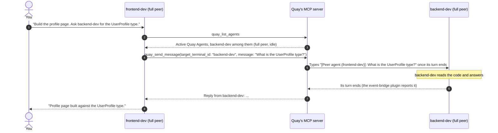

# Agent-to-Agent (A2A) Orchestration Bus

The A2A bus lets the agents in Quay's terminals message each other. Quay's bridge, on `127.0.0.1` only, runs an MCP server. The agents that have its tools can list their peers, send one of them a message, wait for its reply and broadcast a notice. **Mission Control** shows every message on the bus and lets you send your own.

---

## Peers and Their Levels

A **peer** is an agent terminal on the bus. Every peer can be sent a message. What it can do back depends on its level:

| Level | Sends messages (`quay_*` tools) | Answers a sender who waits | Shows Working and Idle | CLIs |
| :--- | :--- | :--- | :--- | :--- |
| **full peer** | Yes | Yes | Yes | Claude Code, Codex, OpenCode, PiG |
| **responder** | No | Yes | Yes | Antigravity |
| **listener** | No | No | No, its status stays **Unknown** | Copilot, Kiro, Gemini, Grok, Pi, Aider |

PowerShell, Custom Command and Archon terminals are not peers. `quay_list_agents` doesn't list them, a broadcast skips them, and a message to an Archon terminal is refused.

How each full peer gets the tools:

- **Claude Code** gets Quay's MCP server inline through `--mcp-config`. It answers through the [event-bridge plugin](../guide/installation.md#event-bridge-plugin). A Claude Code terminal counts as a listener while it shows **Unknown** because Quay hasn't heard from that plugin. Once the plugin is heard, it is a full peer again.
- **Codex** gets the server through `-c` overrides and reports each turn end through Quay's turn-end helper. See [Codex on the A2A bus](./agent-support.md#codex-on-the-a2a-bus).
- **OpenCode** gets the server through `OPENCODE_CONFIG_CONTENT`, and Quay reads its turns from the server its TUI runs.
- **PiG** loads Quay's PiG extension, `quay-pig-bridge.exe`, which ships beside Quay. The extension registers the server for that session and reports each turn's start and end, with its answer. A PiG terminal counts as a listener while it shows **Unknown** because Quay hasn't heard from the extension in the 30 seconds after its first output. Once the extension reports, it is a full peer again.

Antigravity, the responder, has no `quay_*` tools, so it never starts a conversation. Quay reads its status and its answers from the OSC 7501 sequences it prints. See [Antigravity on the A2A bus](./agent-support.md#antigravity-on-the-a2a-bus). The [CLI flags reference](../reference/cli-flags.md) lists each CLI's launch wiring.

---

## Reply or File Mailbox

One rule holds for every peer, Claude Code included:

- A **reply** is for an answer that comes back within 60 seconds of the `quay_send_message` call. The sender calls it with `wait_for_reply: true` and gets the answer as the tool's result.
- A **file mailbox** is for everything else: work that takes longer than 60 seconds, and any work you need back from a listener. The sender sends with `wait_for_reply: false` and asks the peer to write its answer to a named file, ending it with a last line the two agree on.

A file mailbox job is done when the peer is **Idle and the agreed last line is in the file**. Idle alone only says that a turn ended. The peer may still be partway through the job, or may have ended its turn without writing the file. The sender names the file and its last line when it sends the job, then polls `quay_get_agent_status` until the peer is `idle` and reads the file once the line is there.

A listener's status stays **Unknown**, because Quay can't see when it finishes. For a listener, the last line in the file is the only sign the job is done.

A sender's prompt for a file mailbox job might read:

```text
Use quay_send_message with wait_for_reply: false to ask 'bench-runner' to run the benchmark
and write the results to bench.md, ending the file with the line BENCH DONE.
Then check its status with quay_get_agent_status about every 15 seconds. Once it is idle
and bench.md ends with BENCH DONE, read bench.md and summarise it.
```

---

## A Reply, Step by Step



The sender waits at most 60 seconds from its call. A peer that takes longer is the case for a file mailbox.

---

## How a Target Is Matched

`quay_send_message` and `quay_get_agent_status` take a target the same way: an exact terminal ID or an exact session name, as `quay_list_agents` lists them. Nothing else matches: no run kind, partial name, partial ID or different letter case.

- A terminal ID reaches any terminal, in any project, even one that has exited. `quay_get_agent_status` reports an exited terminal as `exited`; a message to one is refused at once, since no agent is running to read it.
- A session name matches live terminals only. Quay restores saved terminals as exited under their old names at startup, so a name whose only match has exited is refused, and the error says so.
- A session name matches in the caller's project first, so the same name in two projects is not ambiguous for a caller in one of them. Only when the caller's project has no live match does it match in other projects. Two live matches in the same search are refused as ambiguous, listing them; pass the terminal ID instead.
- Anything else is refused at once with the list of live peers. Nothing is sent and nothing is waited on.

---

## How a Message Is Delivered

A peer's message arrives in its target's terminal as `[Peer agent (<sender>)]: <message>`, typed in with its Enter.

- Quay types a message into a Claude Code, Codex, Antigravity, OpenCode or PiG terminal only between turns, one message per turn. A message sent while that terminal is starting, working or waiting on a tool approval or another prompt waits in the terminal's queue and shows **Queued** in the Mission Control trail. When the turn ends, Quay types the next queued message and its entry moves on to **Dispatched**.
- Quay doesn't see a Codex turn start, so a message can still reach a Codex turn you started by typing into its pane. That turn doesn't answer it; the message's own turn does.
- A message to a listener, to a Claude Code terminal whose event-bridge plugin isn't reporting, to a PiG terminal whose PiG extension isn't reporting, or to an OpenCode terminal whose server Quay couldn't reach, is typed at once.
- If Quay can't type a message it sends at once, the call fails. A queued message Quay can't type shows **Failed** in the trail.
- A message to the caller itself, to an Archon terminal or to a terminal that has exited is refused.

---

## The MCP Tools

Quay's MCP server, `quay-a2a`, serves the tools below to every full peer, at the `QUAY_MCP_URL` each peer terminal gets. Each call must carry the terminal's bearer token; a call without a live terminal's token is rejected. `pnpm docs:build` checks this reference against the server's tool list, so a tool or parameter that is added, renamed or removed fails the docs build until this page matches.

### `quay_list_agents`

Lists every peer on the bus, in every project, exited ones included, each with its level.

- **Parameters**: none.
- **Response**: text, `Active Quay Agents:` followed by a JSON array. `status` is one of `starting`, `working`, `waiting`, `idle`, `exited` or `unknown`. `level` is `full peer`, `responder` or `listener`. A Claude Code terminal is a `listener` while Quay hasn't heard from its event-bridge plugin.

  ```json
  [
    {
      "terminal_id": "term-a1b2c3",
      "name": "backend-dev",
      "task_title": "Write the UserProfile type",
      "run_kind": "claude",
      "level": "full peer",
      "status": "idle",
      "current_tool": null,
      "auto_approved_count": 3,
      "project_path": "E:\\Projects\\Quay2"
    },
    {
      "terminal_id": "term-x9y8z7",
      "name": "code-reviewer",
      "task_title": null,
      "run_kind": "codex",
      "level": "full peer",
      "status": "working",
      "current_tool": null,
      "auto_approved_count": 0,
      "project_path": "E:\\Projects\\Quay2"
    }
  ]
  ```

### `quay_send_message`

Sends a message to another peer and, by default, waits for its reply.

- **Parameters**:
  - `target_terminal_id` (string, required): The target's terminal ID or session name (see [How a target is matched](#how-a-target-is-matched)).
  - `message` (string, required): The task, instruction or question.
  - `wait_for_reply` (boolean, optional, default: `true`): With `true`, the call waits up to 60 seconds for the turn the message starts to end, and returns the peer's reply. The 60 seconds count from the call, so they include any time the message spends queued or being typed. With `false`, the call returns once the message is delivered or queued.
- **Waits that end early**: A wait never runs on a peer that can't reply. The message is still delivered, and the answer comes at once:
  - on a listener, the answer says it can't reply and suggests a file mailbox;
  - on a Claude Code terminal whose event-bridge plugin isn't reporting, the answer gives the plugin's install line;
  - on a PiG terminal whose PiG extension isn't reporting, the answer names the PiG version Quay was tested with and asks for `pig --version` to compare;
  - a wait already running when such a Claude Code or PiG terminal turns Unknown ends then, with the same answer;
  - a wait already running when its target exits ends then, saying so.
- **Response**: text.
  - A reply reads `Reply from <name>:` followed by the peer's answer.
  - An OpenCode peer's answer is the text of its reply to the message, read from its server once its main session goes idle; subagent sessions don't end its turn.
  - From Antigravity, a responder, the answer is the text it reports when the turn ends, at most 199 characters: a longer one arrives cut off, with a note saying so. A turn that stops on a prompt answers with what it waits on instead, such as `blocked (permission): Trust this folder?`. See [Antigravity on the A2A bus](./agent-support.md#antigravity-on-the-a2a-bus).
  - A wait that runs past 60 seconds returns `Peer agent (<name>) received the task but is still working.`, or, if the message is still queued, `Your message to peer agent (<name>) is queued behind its current turn and will be delivered when that turn ends.` Both go on to suggest `quay_get_agent_status`. The message's trail entry stays **Queued** or **Dispatched** with a `No reply within 60s` note, and the peer's answer fills it in when the turn the message started ends. The sender doesn't get that late answer back.
  - Without a wait, the answer is `Successfully dispatched task to <name>.`

### `quay_broadcast`

Types `[Broadcast Notice]: <text>` into every other running peer in the caller's project, and raises a toast that names the sender. A worktree counts as its own project, so a broadcast from a worktree's terminal stays in that worktree. The caller never gets its own notice, and shell and Archon terminals are skipped. Each peer gets the notice the way it gets a `quay_send_message`, so a Claude Code, Codex, Antigravity or OpenCode terminal in a turn gets it when that turn ends. Nobody waits on a broadcast, so it gets no reply.

- **Parameters**:
  - `text` (string, required): The notice text.
- **Trail**: one entry per peer reached, credited to the sender and tagged **Broadcast**, for example `release-captain → feature-impl`. The toast reads **Swarm Broadcast from release-captain**.
- **Response**: text naming the peers the notice reached, for example `Sent your notice to 2 peers in your project: feature-impl, docs-writer.`, followed by the ones holding it until their current turn ends and any Quay couldn't type it into. With no other running peer in the project, it says nobody got the notice.

### `quay_get_agent_status`

Reports one terminal's level, status, current task and tool.

- **Parameters**:
  - `terminal_id` (string, required): The target's terminal ID or session name (see [How a target is matched](#how-a-target-is-matched)).
- **Response**: one line of text, for example `Agent term-2: name='backend-dev', level=full peer, status=idle, task='Write the UserProfile type', tool='none', auto_approved=3, project='E:\Projects\Quay2'`. The status is in the lowercase form `quay_list_agents` uses. The task is the first line of the prompt that started the agent's latest turn, cut to 32 characters, without the `[Peer agent (<name>)]:` prefix a peer's message arrives with.

The same server serves three work-order tools for [Machina](./machina-praxis.md), Quay's software factory. A human admits each work order, launches its author agent and merges the result.

### `machina_submit_work_order`

Submits a work order. It waits on hold until a human admits it in Machina; its branch and its worktree under `.machina/worktrees/` are created after that.

- **Parameters**:
  - `project_path` (string, required): Any path inside the git repository.
  - `title` (string, required): The work order's title.
  - `objective` (string, required): What the author agent must do.
  - `allowed_output_paths` (array of strings, required): Repo-relative globs the author may change, such as `src/slices/auth/**`.
  - `budget_usd` (number, required): The spend limit in US dollars, more than 0 and at most 10,000. The gate puts the work order on hold once its measured spend reaches it.
  - `base_branch` (string, optional): The branch to start from. Defaults to the main checkout's current branch.
  - `author_agent` (string, optional): The agent CLI that will do the work, such as `claude`. Defaults to `claude`.
  - `max_corrections` (integer, optional): How many failed gate attempts go back to the author for a correction, from 0 to 10. Defaults to 3.
  - `depends_on` (array of strings, optional): Ids of work orders this one depends on.
- **Response**: text naming the new work order's id, its status, and the branch and worktree it gets once admitted.

### `machina_get_work_order`

Reads a work order: its objective, allowed and protected paths, attempts and the latest gate findings. Holdback (Tier 2) details are withheld.

- **Parameters**:
  - `work_order_id` (string, required): The work order's id, such as `WO-3`.
- **Response**: the work order as JSON text.

### `machina_submit_deliverable`

Submits the work on a work order to the gate. The gate commits the worktree, checks the changed paths, and runs the pre-PR audit and the project's configured build, test and holdback commands, in the background. When the caller is the work order's author terminal, the verdict is typed into its terminal when the gate finishes.

- **Parameters**:
  - `work_order_id` (string, required): The work order's id, such as `WO-3`.
- **Response**: text saying the gate attempt started, or that the work order is on hold and why.

---

## Practical Recipes

### Recipe 1: A TDD Relay

Launch the **TDD Swarm** preset (see [Swarm Presets](./swarm-presets.md)). Its agents are `test-architect` and `feature-impl` (both Claude Code), `test-runner` (a PowerShell pane) and `reviewer`. This recipe leaves `reviewer` idle.

1. In `test-architect`, prompt:

   ```text
   Write failing unit tests for parseDuration in tests/parseDuration.test.ts, one per rule
   in AGENTS.md. Run them and confirm they fail. Then use quay_send_message with
   wait_for_reply: false to tell 'feature-impl': "The parseDuration tests are failing.
   Make them pass without editing the tests, then send me the one-line message GREEN."
   When GREEN arrives, run the tests again and end with RELAY DONE, or RELAY FAILED.
   ```

2. `test-architect` writes the tests, sees them fail and hands off without waiting.
3. `feature-impl` gets the hand-off when its turn ends, makes the tests pass and sends `GREEN` back as a new message.
4. `test-architect` gets `GREEN`, re-runs the tests and ends with `RELAY DONE`.

Neither hand-off waits for a reply, because neither job fits in 60 seconds. Each peer passes the next step on with a new message, and the Mission Control trail shows both.

### Recipe 2: A Review Before the PR

1. Launch a `lead-architect` agent beside your development terminals.
2. When a developer agent finishes a feature, prompt it:

   ```text
   Run git diff main > review-request.diff. Use quay_send_message with wait_for_reply: false
   to ask 'lead-architect' to review review-request.diff and write its findings to
   review.md, ending the file with the line VERDICT: APPROVE or VERDICT: CHANGES.
   Poll quay_get_agent_status until lead-architect is idle and review.md ends with a
   VERDICT: line, then address the findings before you push.
   ```

3. `lead-architect` writes its review to the file mailbox, and the developer agent picks it up once the review is done.

---

## Mission Control

Besides the agents' own messages, you can send messages yourself:

1. Click the **Mission Control** icon (the network icon) in the bottom rail toolbar, press `Ctrl+B M`, or press `Ctrl+K` and choose **Mission Control**. Press `Esc` to close it.
2. **From Agent**: select any running agent, or check **Dispatch as User**.
3. **To Agent**: select the recipient.
4. Type the message.
5. Click **Dispatch Task**. The trail shows the delivery, the time it has waited and the response, which you can copy.

Mission Control's agent list tags a responder **Responder** and a listener **Listener**. A Claude Code terminal whose event-bridge plugin isn't reporting is tagged **Listener**, with a tooltip saying so.

The **Broadcast** box sends a notice to every running peer in the active project, as `quay_broadcast` does for an agent. Its trail entries and toast credit **You**.

The trail lists the newest entry first. A message to one agent joins it as soon as Quay types it into its target, or as **Queued** when it waits in the target's queue, and its toast appears when it is typed in. A `quay_send_message` that waits for a reply shows the same way, when its message is delivered rather than when the reply lands; the reply fills in its entry when the target's turn ends.

Each entry shows its status: **Queued**, **Dispatched** once Quay types it in, **Completed** when the turn it started ends, or **Failed**. A Dispatched entry counts up from delivery, a Queued entry shows no timer, and a Completed entry shows how long its turn took. A Dispatched entry to a peer whose turn end Quay can't see, such as a listener, shows no timer either. The peer's response is labelled by whether anyone waited on it. A `quay_send_message` that waits for a reply, or a message dispatched from Mission Control, shows **Reply:**. A message nobody waited on, a `quay_send_message` with `wait_for_reply: false` or a broadcast notice, shows **Answer:**, and so does the late answer to a wait that ran out.
