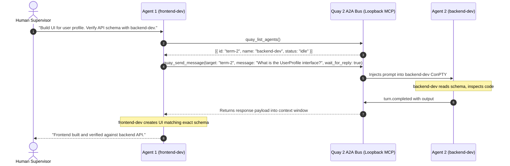

# Agent-to-Agent (A2A) Orchestration Bus

The **Agent-to-Agent (A2A) Orchestration Bus** is the autonomous collaboration backbone of Quay 2. Powered by an in-process **Model Context Protocol (MCP)** server, running agents can discover peers, delegate tasks, exchange code diffs, and broadcast notices without human intervention.

---

## Architecture Overview



---

## Native MCP Tools Available to Agents

Every session spawned in Quay 2 has these 4 tools injected into its Model Context Protocol namespace:

### 1. `quay_list_agents`
Returns a list of all active agent sessions in Quay 2.
- **Parameters**: None.
- **Response**:
  ```json
  [
    {
      "terminal_id": "term-a1b2c3",
      "name": "backend-dev",
      "status": "idle",
      "project_path": "E:\\Projects\\Quay2",
      "current_tool": null
    },
    {
      "terminal_id": "term-x9y8z7",
      "name": "code-reviewer",
      "status": "working",
      "project_path": "E:\\Projects\\Quay2",
      "current_tool": "cargo test"
    }
  ]
  ```

### 2. `quay_send_message`
Sends a task prompt or delegation message to another running agent.
- **Parameters**:
  - `target_terminal_id` (string, required): The target terminal ID (obtained from `quay_list_agents`).
  - `message` (string, required): The task description, instruction, or query.
  - `wait_for_reply` (boolean, optional, default: `true`): If `true`, the caller suspends execution for up to 60 seconds while the recipient processes the message, returning the recipient's output directly into the caller's context. If `false`, dispatches asynchronously and returns immediately.
- **Response**:
  ```json
  {
    "status": "completed",
    "reply": "Here is the UserProfile TypeScript definition: export interface UserProfile { id: string; email: string; }"
  }
  ```

### 3. `quay_broadcast`
Dispatches a system alert banner and toast notification across all active agent terminals simultaneously.
- **Parameters**:
  - `text` (string, required): Notice text to display.
  - `level` (string, optional: `"info"` | `"warning"` | `"critical"`): Severity level.

### 4. `quay_get_agent_status`
Inspects health, auto-approved tool count, and active execution status of a specific peer agent.
- **Parameters**:
  - `target_terminal_id` (string, required).

---

## Practical Recipes

### Recipe 1: Automated TDD Test-First Handoff
1. Spawn two agents: `test-author` and `feature-dev`.
2. In `test-author`, prompt:
   ```text
   Write comprehensive unit tests in tests/auth_test.rs for the JWT refresh logic.
   When the tests are failing as expected, use quay_send_message to notify 'feature-dev'
   to write the implementation until tests pass.
   ```
3. `test-author` writes tests, runs `cargo test`, confirms failure, and triggers `quay_send_message`.
4. `feature-dev` receives the notification, writes the code, runs `cargo test`, and reports success back to `test-author`.

### Recipe 2: Pre-PR Security & Architecture Review
1. Spawn `lead-architect` alongside your development terminals.
2. When a developer agent finishes a feature, instruct it:
   ```text
   Submit your git diff to 'lead-architect' via quay_send_message.
   Wait for architectural feedback before pushing.
   ```
3. The architect agent analyzes code complexity, potential leaks, and performance, returning actionable suggestions directly into the developer's session.

---

## Operator Mission Control Modal

In addition to autonomous agent-to-agent chatter, human operators can intervene at any time:

1. Click the **Mission Control** icon (the network icon) in the bottom rail toolbar, press `Ctrl+B M`, or press `Ctrl+K` and choose **Mission Control**. Press `Esc` to close it.
2. **From**: Select any running agent or check **"Dispatch as User"**.
3. **To**: Select recipient agent.
4. **Message**: Type instructions.
5. Click **Dispatch Task**: Monitor message delivery, elapsed wait time, and view formatted responses with 1-click clipboard copy.
