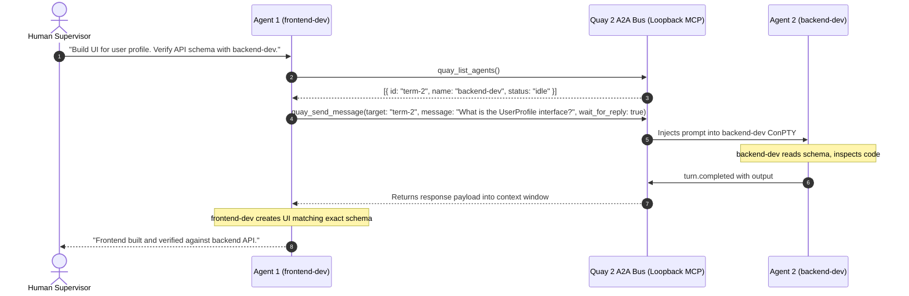

# Agent-to-Agent (A2A) Orchestration Bus

The **Agent-to-Agent (A2A) Orchestration Bus** is the autonomous collaboration backbone of Quay 2. Powered by an in-process **Model Context Protocol (MCP)** server, running agents can discover peers, delegate tasks, exchange code diffs, and broadcast notices without human intervention.

---

## Architecture Overview



---

## Native MCP Tools Available to Agents

Every session spawned in Quay 2 has these 4 tools injected into its Model Context Protocol namespace:

### 1. `quay_list_agents`
Returns the peers on the A2A bus, each with its bus level: `full peer` (sends messages and replies), `responder` (replies to a sender who waits, but can't send) or `listener` (gets messages but can't reply). Shell and Archon terminals are not peers and are not listed. A Claude Code terminal is a listener while Quay hasn't heard from its event-bridge plugin.
- **Parameters**: None.
- **Response**:
  ```json
  [
    {
      "terminal_id": "term-a1b2c3",
      "name": "backend-dev",
      "run_kind": "claude",
      "level": "full peer",
      "status": "idle",
      "project_path": "E:\\Projects\\Quay2",
      "current_tool": null
    },
    {
      "terminal_id": "term-x9y8z7",
      "name": "code-reviewer",
      "run_kind": "codex",
      "level": "full peer",
      "status": "working",
      "project_path": "E:\\Projects\\Quay2",
      "current_tool": "cargo test"
    }
  ]
  ```

### How a target is matched
`quay_send_message` and `quay_get_agent_status` take a target the same way: an exact terminal ID or an exact session name, as `quay_list_agents` lists them. Nothing else matches: no run kind, partial name, partial ID or different letter case.

- A terminal ID reaches any terminal, in any project, even one that has exited. `quay_get_agent_status` reports an exited terminal as `exited`; a message to one is refused at once, since no agent is running to read it.
- A session name matches live terminals only. Quay restores saved terminals as exited under their old names at startup, so a name whose only match has exited is refused, and the error says so.
- A session name matches in the caller's project first, so the same name in two projects is not ambiguous for a caller in one of them. Only when the caller's project has no live match does it match in other projects. Two live matches in the same search are refused as ambiguous, listing them; pass the terminal ID instead.
- Anything else is refused at once with the list of live peers. Nothing is sent and nothing is waited on.

### 2. `quay_send_message`
Sends a task prompt or delegation message to another running agent.
- **Parameters**:
  - `target_terminal_id` (string, required): The target's terminal ID or session name (see [How a target is matched](#how-a-target-is-matched)).
  - `message` (string, required): The task description, instruction, or query.
  - `wait_for_reply` (boolean, optional, default: `true`): If `true`, the caller suspends execution for up to 60 seconds while the recipient processes the message, returning the recipient's output directly into the caller's context. If `false`, dispatches asynchronously and returns immediately. A wait on a listener returns at once: the message is delivered, and the answer says the peer can't reply and suggests a file mailbox. A wait on a Claude Code terminal whose event-bridge plugin isn't reporting returns at once with the plugin's install line, and so does a wait already running when that terminal turns Unknown. A wait already running when its target exits returns then, saying so. A message to an Archon terminal, or to a terminal that has exited, is refused.
- **Delivery**: Quay types a message into a Claude Code, Codex or OpenCode terminal only between turns, one message per turn. Quay doesn't see a Codex turn start, so a message can still reach a Codex turn you started by typing into its pane; that turn doesn't answer it, the message's own turn does. A message sent while that terminal is starting, working or waiting on a tool approval waits in the terminal's queue and shows **Queued** in the Mission Control trail. When the turn ends, Quay types the next queued message and its entry moves on to **Working**. The 60-second wait counts from the call, so it includes any time the message spends queued or being typed. A wait that runs out while the message is still queued says so, and the message stays queued. A wait that runs out leaves the message's trail entry **Queued** or **Working** with a `No reply within 60s` note, and the peer's answer fills the entry in when the turn the message started ends. The sender doesn't get that late answer back. A message to any other peer, to a Claude Code terminal whose event-bridge plugin isn't reporting, or to an OpenCode terminal whose server Quay couldn't reach, is typed at once. If Quay can't type a message it sends at once, the call fails. A queued message Quay can't type shows **Failed** in the trail.
- **Response**: text. A reply reads `Reply from <name>:` followed by the peer's answer. An OpenCode peer's answer is the text of its reply to the message, read from its server once its main session goes idle; subagent sessions don't end its turn. A wait that runs past 60 seconds returns `Peer agent (<name>) received the task but is still working.`, or, if the message is still queued, `Your message to peer agent (<name>) is queued behind its current turn and will be delivered when that turn ends.` Without a wait the answer is `Successfully dispatched task to <name>.`

### 3. `quay_broadcast`
Types `[Broadcast Notice]: <text>` into every other running peer in the caller's project, and raises a toast that names the sender. A worktree counts as its own project, so a broadcast from a worktree's terminal stays in that worktree. The caller never gets its own notice, and shell and Archon terminals are skipped. Each peer gets the notice the way it gets a `quay_send_message`, so a Claude Code, Codex or OpenCode terminal in a turn gets it when that turn ends.
- **Parameters**:
  - `text` (string, required): Notice text to display.
- **Trail**: one entry per peer reached, credited to the sender and tagged **Broadcast**, for example `release-captain → feature-dev`. The toast reads **Swarm Broadcast from release-captain**.
- **Response**: text naming the peers the notice reached, for example `Sent your notice to 2 peers in your project: feature-dev, docs-writer.`, followed by the ones holding it until their current turn ends and any Quay couldn't type it into. With no other running peer in the project, it says nobody got the notice.

### 4. `quay_get_agent_status`
Inspects health, auto-approved tool count, and active execution status of a specific peer agent.
- **Parameters**:
  - `terminal_id` (string, required): The target's terminal ID or session name (see [How a target is matched](#how-a-target-is-matched)).
- **Response**: one line of text, for example `Agent term-2: name='backend-dev', level=full peer, status=idle, task='Write the UserProfile type', tool='none', auto_approved=3, project='E:\Projects\Quay2'`. The status is in the lowercase form `quay_list_agents` uses. The task is the first line of the prompt that started the agent's latest turn, cut to 32 characters, without the `[Peer agent (<name>)]:` prefix a peer's message arrives with.

---

## Practical Recipes

### Recipe 1: Automated TDD Test-First Handoff
1. Spawn two agents: `test-author` and `feature-dev`.
2. In `test-author`, prompt:
   ```text
   Write comprehensive unit tests in tests/auth_test.rs for the JWT refresh logic.
   When the tests are failing as expected, use quay_send_message to notify 'feature-dev'
   to write the implementation until tests pass.
   ```
3. `test-author` writes tests, runs `cargo test`, confirms failure, and triggers `quay_send_message`.
4. `feature-dev` receives the notification, writes the code, runs `cargo test`, and reports success back to `test-author`.

### Recipe 2: Pre-PR Security & Architecture Review
1. Spawn `lead-architect` alongside your development terminals.
2. When a developer agent finishes a feature, instruct it:
   ```text
   Submit your git diff to 'lead-architect' via quay_send_message.
   Wait for architectural feedback before pushing.
   ```
3. The architect agent analyzes code complexity, potential leaks, and performance, returning actionable suggestions directly into the developer's session.

---

## Operator Mission Control Modal

In addition to autonomous agent-to-agent chatter, human operators can intervene at any time:

1. Click the **Mission Control** icon (the network icon) in the bottom rail toolbar, press `Ctrl+B M`, or press `Ctrl+K` and choose **Mission Control**. Press `Esc` to close it.
2. **From**: Select any running agent or check **"Dispatch as User"**.
3. **To**: Select recipient agent.
4. **Message**: Type instructions.
5. Click **Dispatch Task**: Monitor message delivery, elapsed wait time, and view formatted responses with 1-click clipboard copy.

The **Broadcast** box sends a notice to every running peer in the active project, as `quay_broadcast` does for an agent. Its trail entries and toast credit **You**.

The trail lists the newest entry first. A message to one agent joins it as soon as Quay types it into its target, or as **Queued** when it waits in the target's queue, and its toast appears when it is typed in. A `quay_send_message` that waits for a reply shows the same way, when its message is delivered rather than when the reply lands; the reply fills in its entry when the target's turn ends.
