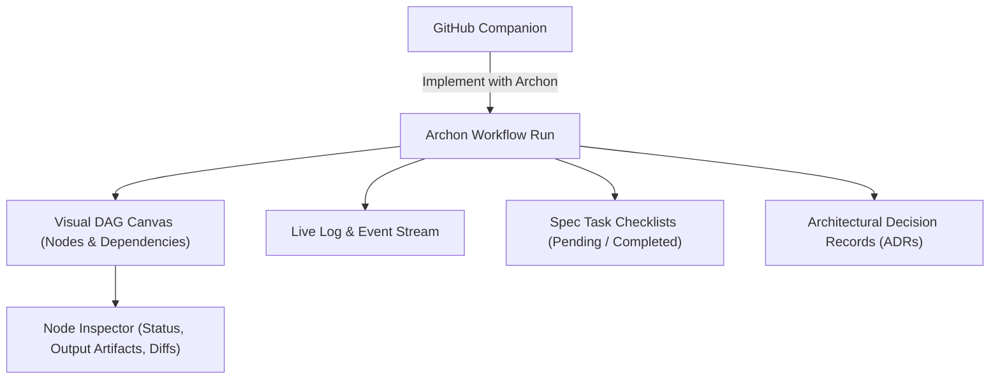

# Archon & Spec-Driven Development (SDD) Inspector

**Archon** is an autonomous software development framework that compiles functional specifications into executable Directed Acyclic Graphs (DAGs) and Architectural Decision Records (ADRs).

Quay 2 features a first-class, embedded **Archon & SDD Graph Inspector** (`Ctrl+B R`), providing visual execution tracking, live streaming logs, and spec task monitoring right inside your desktop environment.

---

## Embedded Capabilities

### 1. Interactive Visual DAG Canvas
- Renders workflow nodes with dependency arrows, execution states, and timing metrics.
- Color-coded node statuses:
  - 🔵 **Pending / Queued**: Waiting on upstream prerequisites.
  - 🟡 **Running**: Currently executing (pulsing animation).
  - 🟢 **Completed / Passed**: Verified deliverables produced.
  - 🔴 **Failed**: Execution halted; click to view exact error and stack trace.
- Click any node to open the **Node Inspector**, revealing input prompts, tool calls, and generated diffs.

### 2. Live Execution Logs & Event Stream
- Mirrors the native Archon WebUI (`http://localhost:3090/`).
- Streams real-time stdout, stderr, and agent chat messages as tasks execute.
- Auto-scroll lock keeps you at the head of the log, with manual pause on scroll up.

### 3. Spec-Driven Task Checklist
- Displays all functional specification requirements decomposed into concrete actionable subtasks.
- Real-time progress bars illustrate completion percentage across the active specification.

### 4. Architectural Decision Records (ADRs)
- Browse recorded architectural decisions, trade-offs, and ratified design choices produced during the design phase of the workflow.

---

## 1-Click "Implement with Archon" from GitHub

When browsing GitHub issues in the **GitHub Companion Drawer** (`Ctrl+B I`), Quay 2 provides a dedicated **"Implement with Archon"** button.

Clicking this button:
1. Creates an isolated git worktree branch for the issue.
2. Ingests the issue body, comments, and acceptance criteria.
3. Spawns an Archon workflow session with the pre-configured prompt.
4. Opens the visual DAG canvas so you can monitor specification generation, design ratification, test authoring, and implementation in real time.
