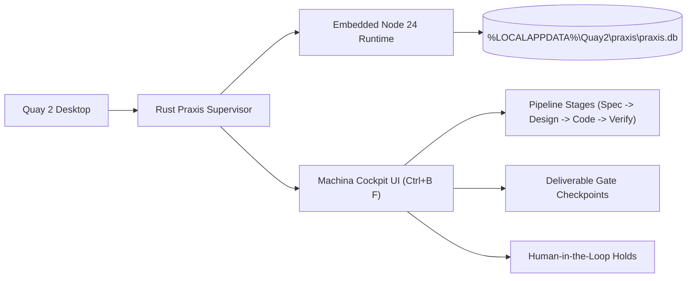

# Machina Praxis Software Factory Cockpit

**Machina Praxis** is an industrial-grade AI software manufacturing engine built on deterministic state machines, deliverable gates, and formal work orders.

Quay 2 features an embedded, native **Machina Praxis Cockpit** (`Ctrl+B F`), providing direct oversight over automated software production pipelines without external servers.

---

## Architecture & Native Sidecar Supervision

### 1. In-Process Sidecar Management
- Automatically manages headless Node.js runtimes in background mode.
- Initializes and migrates SQLite schemas in `%LOCALAPPDATA%\Quay2\praxis\praxis.db`.
- Recovers work orders and active jobs cleanly across application restarts.

### 2. Milestone Stages & Deliverable Gates
Machina Praxis divides engineering work into deterministic stages:
1. **Intake & Scope**: Validates work order requirements and capability manifests.
2. **Architecture & Contract**: Ratifies interfaces, schemas, and schemas before code is generated.
3. **Implementation**: Dispatches autonomous worker agents against isolated worktrees.
4. **Verification & Audit**: Validates deliverables through test runners, linters, and security audit gates.

### 3. Human-in-the-Loop Hold Resolution
When a deliverable fails verification or requires human discretion (e.g. destructive schema migration or unexpected breaking change), Praxis enters a **HOLD** state.

The Quay 2 Cockpit highlights held work orders in amber, allowing the operator to:
- Review the proposed deliverable diff.
- Provide clarification or revised instructions.
- Ratify and release the hold with 1 click.
