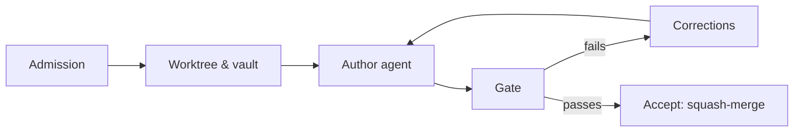

# Machina Software Factory Cockpit

**Machina is Quay's local factory.** It runs inside Quay 2 on this machine, with no host, no sign-in and no browser. An agent does each piece of work, a **work order**, in its own git worktree; your project's own checks gate it; and you **Accept** it to squash-merge it into its base branch. Every decision on a work order is made in Quay.

The **Factory Station** (`Ctrl+Shift+B F`) is Machina's cockpit. Its title reads **Machina: local**. Open it with the shortcut, the stage's **Factory** button, or **Machina Factory Station...** in the command palette.

## Machina is not Praxis

[Praxis](./praxis-builder.md) is the AI-WS-SDK's workflow engine, and it runs on a Praxis host. The two engines stay side by side and never mix (ADR 0006 in `.scratch/machina-praxis/adr/`):

| | Machina | Praxis |
| --- | --- | --- |
| Where it runs | In Quay, on this machine | On a Praxis host |
| Sign-in | None | `praxis login` |
| Its words | Work order, hold, Accept | Run, decision |
| Where you decide | In the Factory Station | In the host's browser page |
| Its surface in Quay | The Factory Station | The Praxis Builder |

A Machina work order never becomes a Praxis run, and neither surface lists or links to the other's work.

---

## How a work order moves

1. **Admission.** Out-of-scope and protected-path checks, and the work orders it depends on.
2. **Worktree & vault.** Quay creates the branch `machina/wo-<n>` in a git worktree under `.machina/worktrees/`, copies `.machina/holdbacks/` to a vault outside the repository, hides the holdbacks from the worktree and runs the setup commands.
3. **Author agent.** You launch the author agent in the worktree and send it the brief.
4. **Gate.** The gate commits the candidate, checks the changed paths, runs the pre-PR audit and the Tier 1 commands, then, only when Tier 1 is green, the Tier 2 commands with the holdbacks restored. The author sees Tier 2 failures only as `HOLDOUT_FAIL:` lines.
5. **Corrections.** A failed gate goes back to the author, up to the work order's limit.
6. **Accept.** A work order whose gate passed offers **Accept: squash-merge into** its base branch. The main checkout must be on that branch with no uncommitted changes to tracked files.

Each repository describes its gate in `.machina/factory.json`. Its commands run only after you approve that exact file in **Factory config**.

## Holds

A hold stops a work order until you resolve it in the Factory Station. Machina raises one only for a real condition: scope drift, an overlap with a protected path, too many corrections, a gate that couldn't judge, a spent budget, or a work order an agent submitted that waits for you to admit it.

## Where Machina keeps its state

Work orders are kept in `%LOCALAPPDATA%\Quay2\machina\state.json`, and holdback vaults under `%LOCALAPPDATA%\Quay2\machina\vault\`. The **Epoch** chip counts Quay starts: work cut off by a restart is marked **Interrupted** and can be resumed.
