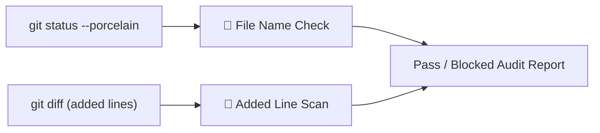

# Pre-PR Audit Gate & Safety Guardrails

Giving autonomous agents shell access requires safety guardrails. An agent running with `--dangerously-skip-permissions` can accidentally commit secrets, personal paths or key files.

**Quay 2** provides the **Pre-PR Audit Gate** (`Ctrl+B A`) to catch these leaks before code leaves your machine. The gate reads your working tree and your git diff. It does not watch the commands an agent runs in a terminal.

---

## What Does the Audit Gate Check?

The gate runs two checks against the project's main checkout. When the active terminal is in one of the project's worktrees, the gate still audits the main checkout, not the worktree.

Every finding is a **blocker** or a **warning**. The audit passes when it finds no blockers. Warnings are listed but do not block.

### 1. File Name Check

The gate runs `git status --porcelain` and checks the path of every changed, staged or untracked file. Files that git ignores are not listed, so they are not checked. Matching ignores case, and the first rule that matches a path wins:

| Path | Severity |
| :--- | :--- |
| Contains `.env`, unless it contains `.env.example` | Blocker |
| Ends in `.pem` or `.key`, or contains `id_rsa` | Blocker |
| Contains `.gemini` or `scratch/` | Warning |

### 2. Added Line Scan

The gate runs `git diff HEAD`, which covers staged and unstaged changes to tracked files. When that diff is empty, it scans `git diff HEAD~1`, the most recent commit, instead. Only added lines are scanned, so the contents of untracked files are not.

Each added line is checked for:

- **Personal paths.** The Quay 2 maintainer's own Windows username, or an absolute path under drive C's `Users` folder, written with either slash, is a blocker. A `file:///` URI that points at drive C or E is a warning.
- **Tokens and keys.** A GitHub personal access token, found by its classic or fine-grained prefix, is a blocker. So is an Anthropic API key, found by its prefix. So is an OpenSSH, RSA or unlabelled private key header. The report masks a matched token and redacts a matched key.
- **Long lines.** An added line longer than 2,500 bytes is a warning, since it is often a pasted bundle or base64 blob.

The gate checks no other key formats, and it has no command filter.

---

## Reading the Report

- The header shows **PASSED** when there are no blockers, and **AUDIT BLOCKED** when there is at least one.
- Filter the list by severity, or click the circular-arrow button in the header (tooltip **Re-run audit**) to scan again.
- **Copy Report** copies the findings as plain text.
- **Fix Violations with Claude** sends the findings to the active terminal as a prompt. When no terminal is active, it opens a new Claude Code terminal named `audit-fixer` and sends the prompt there.

Machina Praxis runs the same scan in its own gate, over the branch's diff against its base commit, and fails a candidate that has blockers.

---

## Permission Indicator Badges

These badges are separate from the audit gate:

- Any agent terminal running with `--dangerously-skip-permissions` is marked with a red **`SKIP`** badge in the navigation rail and on its pane, and a warning banner appears across the stage when it is focused.
- Terminals in standard interactive mode show no `SKIP` badge.
