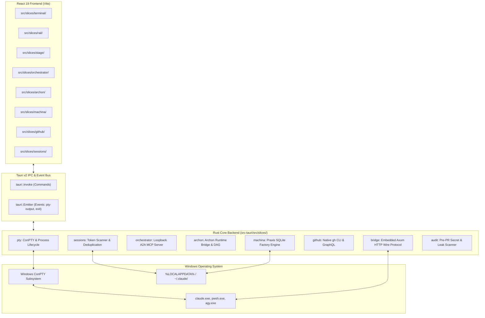

# Architecture & Vertical Slice Design

Quay 2 is engineered around **Vertical Slice Architecture (VSA)**. Instead of traditional horizontal technical layering (e.g. controllers, services, repositories) that scatters feature logic across the codebase, each domain capability in Quay 2 is implemented as a self-contained vertical slice spanning both the **Rust Tauri backend** and the **React frontend**.

---

## High-Level System Architecture

---

## Backend Feature Slices (`src-tauri/src/slices/`)

### 1. `pty` — ConPTY Process Lifecycle
- Uses `portable-pty` to create Windows Pseudo-Console handles (`CreatePseudoConsole`).
- Spawns command binaries (`claude.exe`, `agy.exe`, `pwsh.exe`, and `cmd.exe` for the npm-shim CLIs) in dedicated background threads.
- Reads ConPTY output buffers and emits asynchronous `pty-output` events to the Tauri webview.
- Handles dynamic resizing (`pty-resize`) synchronized to xterm.js dimensions.
- Monitors child exit status and notifies the frontend via `terminal-exited`.

### 2. `bridge` — Embedded Loopback Wire Protocol
- Runs a lightweight, non-blocking `axum` HTTP listener bound strictly to `127.0.0.1:<bridge_port>`.
- Ingests structured telemetry events from agent mod hooks via `POST /v1/events` (`turn.started`, `turn.completed`, `tool.started`, `tool.finished`).
- Provides long-poll command retrieval via `GET /v1/commands` for human-in-the-loop overrides.
- Verifies Bearer authentication tokens using constant-time comparisons (`subtle::ConstantTimeEq`) to prevent side-channel timing attacks.

### 3. `orchestrator` — Agent-to-Agent (A2A) MCP Bus
- Implements an embedded Model Context Protocol (MCP) server over HTTP and SSE.
- Exposes tools to running agents: `quay_list_agents`, `quay_send_message`, `quay_broadcast`, and `quay_get_agent_status`.
- Manages routing tables, message queues, and synchronous reply wait-loops (with 60-second timeouts).

### 4. `archon` — SDD Workflow Bridge
- Communicates with local Archon runtimes (port 3090 / CLI).
- Deserializes directed acyclic graphs (DAGs), node execution statuses, and architectural decision records (ADRs).
- Streams live task execution logs and chat events.

### 5. `machina` — Deterministic Factory Supervisor
- Supervises headless Node.js sidecar instances running Machina Praxis.
- Manages SQLite schema migrations in `%LOCALAPPDATA%\Quay2\praxis\praxis.db`.
- Translates factory work order events into real-time UI state.

### 6. `github` — Issue & PR Triage with Dependency Resolution
- Wraps the native `gh` CLI subprocess with optimized JSON output flags.
- Executes GraphQL queries against GitHub's native issue dependency graph (`blockedBy`).
- Filters open blockers and correlates multi-repository issue references.

### 7. `sessions` — Token Spend & Transcript Scanner
- Recursively scans `~/.claude/projects/**/*.jsonl` transcript archives.
- Performs deduplication on `message.id` across partial streaming records.
- Calculates exact costs for modern Anthropic models (`claude-opus-5-5`, `claude-sonnet-5-5`, `claude-haiku-5-5`).
- Maintains an instant disk cache in `%LOCALAPPDATA%\Quay2\token_stats_cache.json`.

### 8. `audit` — Safety & Secret Scanner
- Runs `git status --porcelain` and flags sensitive file names: `.env` paths other than `.env.example`, `.pem` and `.key` files, and `id_rsa` paths.
- Scans the added lines of the git diff for personal paths, GitHub and Anthropic tokens, private key headers and very long lines.
- Does not watch or filter terminal commands. See [Pre-PR Audit Gate](/features/security-audit).

---

## Frontend Feature Slices (`src/slices/`)

The frontend is constructed using **React 19**, **Tailwind CSS**, and `@xterm/xterm`:

- **`terminal/`**: Terminal instance rendering, auto-fit addon, proposed API emoji width alignment, selection handling, and keyboard shortcuts.
- **`rail/`**: Collapsible project and worktree navigation sidebar, active indicators, and mission control icon toolbar.
- **`stage/`**: Viewport layout engine supporting single view, horizontal split, vertical split, and 2x2 quad grid. Keeps background terminals mounted to ensure seamless buffer preservation.
- **`orchestrator/`**: UI modal for human operator task dispatch, broadcast management, and real-time message stream inspection.
- **`archon/`**: SVG-powered DAG visualization canvas, live log viewer, and spec checklist.
- **`machina/`**: Software factory cockpit with stage milestones, deliverable inspections, and worker pools.
- **`github/`**: Slide-over companion drawer with filter chips, red `BLOCKED` dependency badges, and 1-click prompt submission.

---

## Security Model & Sandboxing

1. **Localhost Binding**: All HTTP endpoints (`bridge`, `A2A MCP`) bind exclusively to loopback `127.0.0.1`. They are inaccessible from external networks.
2. **Ephemeral Ports**: Bridge ports are allocated dynamically at startup, avoiding hardcoded port collisions.
3. **Loopback Anti-CSRF Authentication**: Every launched agent process is injected with a unique, cryptographically random Bearer token (`CLAUDE_EVENTS_TOKEN`) via process environment variables.
4. **Audit Gate**: High-risk commands and credential patterns are flagged before they can be committed or pushed.
