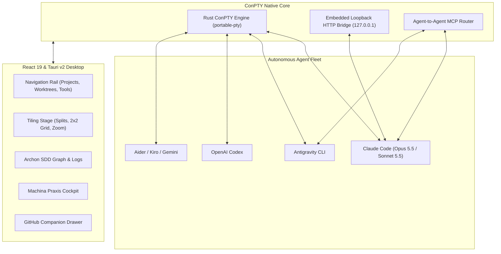

# What is Quay 2?

**Quay 2** is a high-performance Windows desktop workspace and orchestrator engineered specifically for autonomous multi-agent AI coding.

While AI coding tools such as **Claude Code**, **Antigravity CLI**, **OpenAI Codex**, **Pi**, **Google Gemini CLI**, and **Aider** have revolutionized autonomous engineering, supervising multiple long-running agents simultaneously in conventional terminal emulators or console multiplexers is fragmented and error-prone.

Quay 2 solves this by bridging the raw execution speed of the native **Windows ConPTY** API with an embedded **Agent-to-Agent (A2A) MCP orchestration bus**, an integrated **Archon & Spec-Driven Development (SDD) Graph Inspector**, a native **Machina Praxis Software Factory cockpit**, and deep **Git Worktree** isolation.

---

## The Multiplexer Problem

Developers traditionally rely on tools like `tmux`, `screen`, `psmux`, or multiple OS terminal tabs. While adequate for interactive command-line sessions, these tools fall short for autonomous agent orchestration:

| Capability | Standard Terminal / `tmux` | Quay 2 Desktop |
| :--- | :--- | :--- |
| **Windows ConPTY Integration** | Often emulated via Cygwin/MSYS or clumsy pseudo-terminals | Direct Rust `portable-pty` binding to native Windows ConPTY |
| **Agent Telemetry & Lifecycle** | Blind screen scraping; cannot tell if agent is thinking or hung | Embedded loopback HTTP bridge ingesting structured turn & tool events |
| **Inter-Agent Communication (A2A)** | Manual copy-pasting of text between terminal windows | Native loopback MCP tools (`quay_list_agents`, `quay_send_message`) |
| **Workflow DAG & Spec Tracking** | Separate browser tab needed for workflow progress | Embedded interactive DAG canvas, live logs, chat stream & ADR viewer |
| **Workspace & Branch Isolation** | Risky concurrent file edits on the same branch | Integrated 1-click Git Worktrees with collapsible rail hierarchy |
| **Issue Dependency Resolution** | Manual review on GitHub website | Native GraphQL dependency parser displaying red `BLOCKED` issue tags |
| **Token & Spend Metering** | Opaque until end-of-month billing statement | Real-time deduplicated JSONL scanner for Opus 5.5, Sonnet 5.5 & Haiku |
| **Safety & Leak Prevention** | Secrets and personal paths slip into commits unnoticed | Pre-PR Audit Gate scanning the diff for tokens, private keys, key files and personal paths |

---

## Core Pillars of Quay 2

### 1. Zero-Compromise Windows Terminal Fidelity
Built on `portable-pty` and `@xterm/xterm`, Quay 2 runs directly on Windows without WSL overhead. It supports complete ANSI escape codes, 24-bit truecolor, custom emoji width alignment, mouse tracking, and smooth background buffer persistence.

### 2. Autonomous Agent-to-Agent (A2A) Bus
Every agent spawned inside Quay is automatically enrolled in an in-process Model Context Protocol (MCP) server. When an agent needs a peer review, a database schema confirmation, or a specialized subtask, it invokes native MCP tools to collaborate with fellow agents in neighboring terminals.

### 3. Integrated Engineering Cockpit
Rather than juggling dozens of disparate browser tabs, Quay 2 embeds your entire development feedback loop:
- Visual Archon workflow graphs and execution checklists.
- Deterministic Machina Praxis factory pipelines.
- Instant Git worktree switching.
- Direct GitHub issue triage and dependency blocker resolution.
- Live cost accounting across all active and historical sessions.
