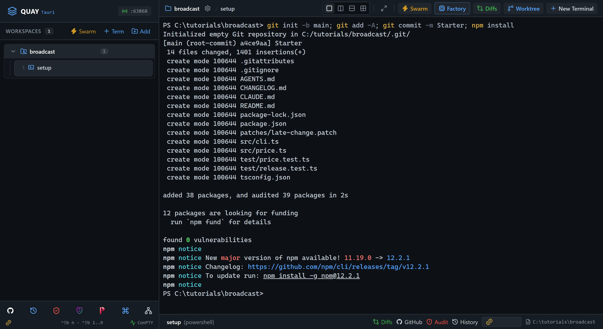
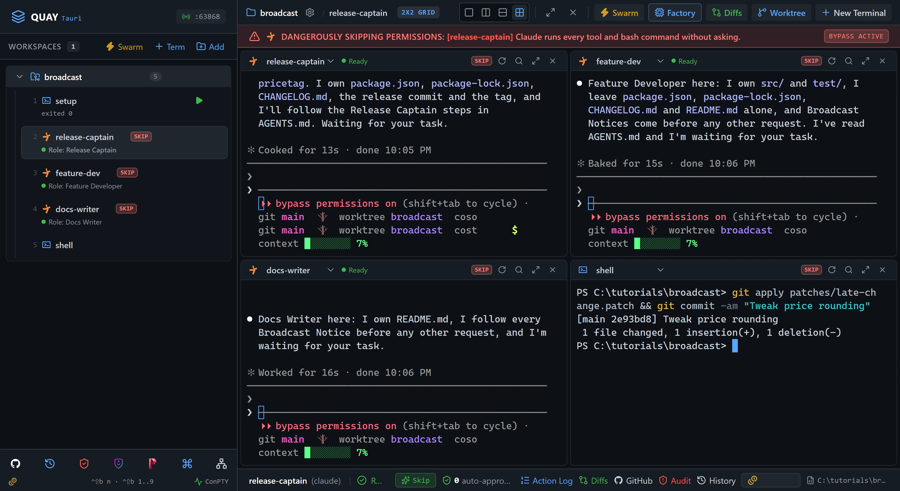
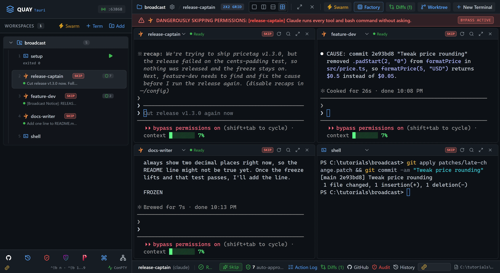
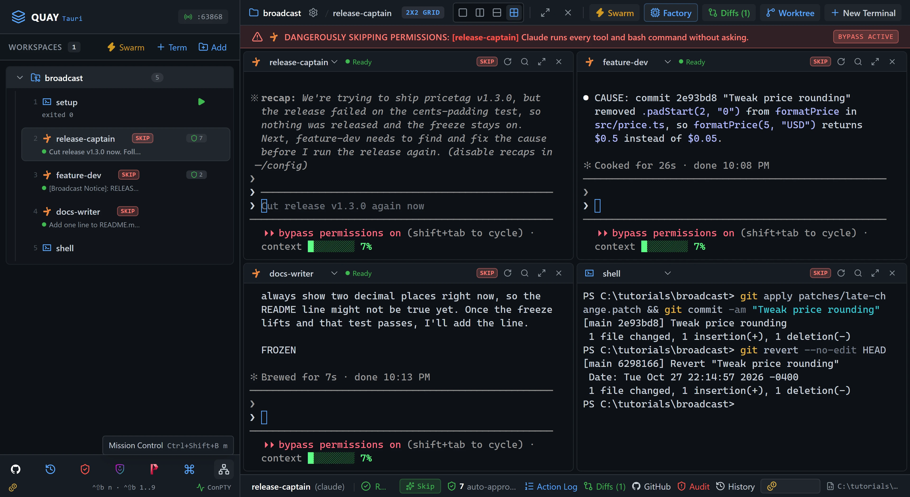

# A2A 7: Broadcast coordination

One agent, one message, the whole team. A `release-captain` agent announces a code freeze to its teammates with `quay_broadcast`, bumps the version, writes the CHANGELOG entry and runs the tests. A teammate's late commit breaks the first release, so the captain broadcasts a critical failure and the freeze holds. You revert the commit, the captain runs the release again, and its pass broadcast lifts the freeze.

::: glance
- **Time**
- **Tokens**
- **Agents** 3 × Claude + 1 × PowerShell
- **Level** Intermediate
:::

**You'll learn:** what a broadcast is, one line typed into every other agent in the project at once with nobody waiting for an answer; why broadcast text needs a fixed keyword such as `FREEZE` or `RELEASE FAIL CRITICAL`; how a team protocol in `AGENTS.md` turns a notice into behaviour; and how to read a broadcast's fan-out in Mission Control's trail.

Quay's window has two parts: the **rail**, the panel down the left that lists your projects and their terminals, and the **stage** to its right, where the terminal panes open. When the stage is split, each pane has a **header** along its top with the terminal's name and, for an agent, its status. Every `Ctrl+Shift+B` shortcut is two key presses: press `Ctrl+Shift+B`, let go, then press the next key within a second and a half. The page writes that key as a capital, but it is the plain key: `Ctrl+Shift+B N` is `Ctrl+Shift+B`, then `n`. Each Paste box names the pane its line goes into: copy the line with the box's copy button, click into that pane, press `Ctrl+V` to paste it, then press Enter to run it or send it to the agent.

Agents talk over Quay's **A2A bus**. Earlier A2A tutorials send one message to one agent with `quay_send_message`. This one uses only `quay_broadcast`, which sends one line to every other running agent in the same project. Quay types it into each agent's pane as a new prompt that starts `[Broadcast Notice]:`, shows a **Swarm Broadcast** banner at the top of each agent's pane and pops a toast in the window's corner. Plain shells get nothing. The sender doesn't wait and gets no answers back: it only learns which agents the notice reached. Every notice shows up in **Mission Control**, Quay's view of all the traffic on the bus. [A2A 1: Hello, A2A](/tutorials/a2a/hello-a2a/) walks through the bus and its four `quay_*` tools.

Quay has no freeze of its own. A broadcast is only text, so what each agent does with it comes from the **Release protocol** in the starter's `AGENTS.md`, which every agent reads. That protocol is the real lesson.

The starter project is `pricetag` 1.2.0, a tiny price-formatting library with a command line, ready to ship as 1.3.0. Its eight tests pass: five price tests, and three release tests that check `package.json` against `CHANGELOG.md`. `patches/late-change.patch` is a teammate's late change that breaks exactly one price test, so you can make the first release fail on demand.

::: before
## Before you start
- **Quay 2** is installed from the latest release ([Installing a Release](/guide/installation#installing-a-release)).
- **Claude Code** 2.1.296 or later is installed and signed in ([Claude Code](/guide/installation#claude-code)). `claude --version`
- The **event-bridge plugin** 0.1.0 or later is installed and enabled in Claude Code ([Event-bridge Plugin](/guide/installation#event-bridge-plugin)).
- **PowerShell 7** is installed ([PowerShell 7](/guide/installation#powershell-7)). `pwsh --version`
- **Node.js** 24 or later is installed, with npm ([Node.js and npm](/guide/installation#node-js-and-npm)). `node --version`
- **Git** is installed and knows your name and email ([Git](/guide/installation#git)). `git --version`
- You are using the **starter project** in a new, empty folder, because three agents run in Skip mode and can edit files without asking.
- Three agents use about three times the tokens of a one-agent run.
:::

::: step

## 1. Get the starter project

::: do
1. Download [`broadcast.zip`](/starters/broadcast.zip) and unzip it into a new, empty folder. The zip has no folder of its own, so that folder now holds `AGENTS.md`, `src` and the other files directly.
2. In Quay, click **Add** at the top of the rail, find that folder in the Open Project dialog (or type its path; Tab completes it) and click **Open**.
3. Press `Ctrl+Shift+B N` and choose **PowerShell Console**. Type `setup` in **Terminal Label (Optional)** and click **Start Terminal (Enter)**. The rail lists the new terminal under your project as `setup`.
:::

::: paste `setup`
```text
git init -b main; git add -A; git commit -m Starter; npm install
```
:::

::: see

:::

::: must
- `git commit` prints `Starter` as the message.
- `npm install` ends with `found 0 vulnerabilities`.
:::

::: may
- The commit id, and the package counts and timings `npm install` prints.
- Whether `npm install` ends with an `npm notice` block about a new version of npm.
:::

::: ifnot node or npm is not recognised
Node.js 24 or later isn't on your `PATH`. Install it as [Node.js and npm](/guide/installation#node-js-and-npm) shows, close and reopen Quay so its terminals see it, then paste the line again.
:::

::: ifnot git commit says Author identity unknown
Git doesn't know your name and email yet. Set them as [Git](/guide/installation#git) shows, then paste the line again.
:::

:::

::: step

## 2. Build the Release Crew

The crew's fourth row is a PowerShell pane called `shell`, so the 2x2 grid holds the whole crew and you can see that a broadcast skips it. You don't need `setup` any more, so close it first. You launch the crew without saving it; nothing reuses it.

::: do
1. Click into the `setup` pane, type `exit` and press Enter.
2. Press `Ctrl+Shift+B S` to open the Swarm Launcher, then click **Create Custom Swarm** in the bar under its title.
3. In **Swarm Name**, replace `Custom Swarm` with `Release Crew`. Under **Layout Arrangement**, click **2x2 Quad Grid**.
4. Click **Add Agent** twice, so the **Agents Roster** has four rows. New rows start on **Claude Code**.
5. Fill the rows as the table below shows. Each row has three controls on one line: the CLI drop-down, the role box and the narrower session-name box, which becomes the pane's name. Select all the text in a box and type over it. Set row 4's CLI drop-down to **PowerShell**.
6. Under that line, each row has a box labelled **Role prompt (optional)**. Copy each Claude Code row's role prompt from under the table with its block's copy button and paste it into that row's box. Leave row 4's box empty: a shell isn't an agent, so it says **No launch prompt**.
7. Check that the launcher's footer reads `Spawns 4 terminals`.
:::

| Row | CLI | Role | Session name |
| --- | --- | --- | --- |
| 1 | Claude Code | `Release Captain` | `release-captain` |
| 2 | Claude Code | `Feature Developer` | `feature-dev` |
| 3 | Claude Code | `Docs Writer` | `docs-writer` |
| 4 | PowerShell | `Shell` | `shell` |

Row 1, `release-captain`:

```text
You are the Release Captain. You own package.json, package-lock.json, CHANGELOG.md, the release commit and the tag. You leave src/, test/ and README.md to your teammates and never fix a failing test yourself. You work by following the Release Captain steps in AGENTS.md exactly, sending each broadcast as one line with quay_broadcast, and then stopping. Read AGENTS.md, then wait for the user's task.
```

Row 2, `feature-dev`:

```text
You are the Feature Developer. You own src/ and test/. You leave package.json, package-lock.json, CHANGELOG.md and README.md alone. You work by obeying every Broadcast Notice under the Release protocol in AGENTS.md before any other request: during a freeze you edit nothing and answer FROZEN, and when a critical failure names a test that covers your files you find its cause read-only and answer with one CAUSE: line. Read AGENTS.md, then wait.
```

Row 3, `docs-writer`:

```text
You are the Docs Writer. You own README.md. You leave src/, test/, package.json, package-lock.json and CHANGELOG.md alone. You work by obeying every Broadcast Notice under the Release protocol in AGENTS.md before any other request: during a freeze you edit nothing and answer FROZEN. Read AGENTS.md, then wait.
```

::: see

:::

::: must
- **Swarm Name** reads `Release Crew`, and **2x2 Quad Grid** is selected.
- The rows read **Claude Code** `release-captain`, **Claude Code** `feature-dev`, **Claude Code** `docs-writer` and **PowerShell** `shell`, in that order.
- The footer reads `Spawns 4 terminals`.
:::

::: may
- How the role prompts wrap in their boxes. Drag a box's corner to make it taller if you want to read it all.
- The project name in the launcher's title and footer, which is your folder's name.
:::

::: ifnot a row's CLI isn't Claude Code
Change it to **Claude Code**. This page's steps, and its screenshots, assume all three agents run Claude Code.
:::

:::

::: step

## 3. Launch the crew

::: do
1. Click **Launch Swarm Now**, the green button at the right of the launcher's footer. Don't click **Save**: this swarm isn't kept.
:::

::: see

:::

::: must
- Four panes in a 2x2 grid: `release-captain` top left, `feature-dev` top right, `docs-writer` bottom left and `shell` bottom right.
- In the rail, each agent's status line reads `Role: ` and its role.
- Each agent confirms its role in one line and waits, and its pane header shows a green dot and `Ready`.
:::

::: may
- The wording of each agent's one-line reply.
- The rail still lists `setup` first, marked `exited 0`.
- The port number in the rail header.
:::

::: ifnot a pane asks whether you trust this folder
Claude Code asks once for each new folder: `Quick safety check: Is this a project you created or one you trust?` It lists **No, exit** first, with the cursor on it, and a grid cell may show only that option. Click into each pane that asks, press the Down arrow to move to **Yes, I trust this folder**, and press Enter. That agent then confirms its role. While the question waits, the pane also shows the plugin hint, which goes away once you answer.
:::

::: ifnot a pane asks you to accept Bypass Permissions mode
Quay starts a swarm's Claude Code agents in Skip mode, which Claude Code calls Bypass Permissions mode, and Claude Code asks once before its first session in that mode. Click into each pane that asks, choose **Yes, I accept** and press Enter. That agent then confirms its role.
:::

::: ifnot a pane shows the plugin hint
Quay isn't hearing from the event-bridge plugin. Install it as the hint says, then run `/reload-plugins` in each pane that shows the hint. The hint goes away as soon as Quay hears from the plugin.
:::

:::

::: step

## 4. Plant a teammate's late change

Real releases break on the commit nobody reviewed. This patch is that commit: it drops the zero that pads a price's cents.

::: do
1. Click into the `shell` pane, bottom right.
:::

::: paste `shell`
```text
git apply patches/late-change.patch && git commit -am "Tweak price rounding"
```
:::

::: see

:::

::: must
- `git commit` prints `Tweak price rounding` as the message and `1 file changed`.
:::

::: may
- The commit id.
:::

::: ifnot git apply says the patch does not apply
The starter's line endings changed, perhaps in an editor. Paste `git checkout -- .` into `shell` to put the starter's files back, then paste the line again. The `&&` stopped `git commit` from running, so nothing was committed.
:::

:::

::: step

## 5. Start the release

::: do
1. Click into the `release-captain` pane, top left. After you paste, its input shows `[Pasted text #1]` until you press Enter.
:::

::: paste `release-captain`
```text
Cut release v1.3.0 now. Follow the Release Captain steps in AGENTS.md exactly, one broadcast line per step, and when you are done tell me the verdict in one line.
```
:::

The captain's first move is the `FREEZE` broadcast. Quay types it into `feature-dev` and `docs-writer`, and not into `shell` or back into the captain. A broadcast has no acknowledgement: the captain gets back only the names of the agents it reached, and goes straight on to the release. An agent that is busy when a notice arrives gets it as soon as its current turn ends.

::: see

:::

::: must
- In `feature-dev` and `docs-writer`, the line `[Broadcast Notice]: FREEZE v1.3.0: release in progress. Do not edit files until RELEASE PASS.` typed in as a prompt.
- No notice in `shell` or in `release-captain`.
:::

::: may
- Whether you saw the toast, `Swarm Broadcast from release-captain`, and the banner of the same name on each receiver's pane: the toast lasts seven seconds and the banners ten.
- Whether you see each receiver answer with `FROZEN` before the next notice arrives. The first release often takes under a minute, so the verdict can follow within seconds. Step 8's trail keeps both `FROZEN` answers.
- The receivers' wording above `FROZEN`.
:::

::: ifnot the toast never appears
The captain ran the steps without `quay_broadcast`. Look in its pane for `Called quay`. If it isn't there, paste `Start again from step 1 of the Release Captain steps. Send the FREEZE line with quay_broadcast.` into `release-captain`.
:::

:::

::: step

## 6. Read the verdict

::: do
1. Wait for `release-captain` to finish. It bumps the version, edits the CHANGELOG and runs `npm test`. One test fails, so it puts its three files back and broadcasts the verdict.
:::

Every broadcast toast looks the same, a pass or a failure. `CRITICAL` means something only because the Release protocol says so: it is the keyword the receivers are told to look for.

::: see

:::

::: must
- `release-captain` reports the release failed on `pads cents under ten with a zero`, and that it put back its three files and made no commit or tag.
- `feature-dev` answers with a line starting `CAUSE:` that names `src/price.ts`.
- `docs-writer` ends with `STILL FROZEN`.
:::

::: may
- The commit id in the `CAUSE:` line, and its wording.
- The captain's one-line verdict, and whether you saw the verdict's toast before it went.
- A greyed suggestion in `release-captain`'s input, such as `Cut release v1.3.0 again now`, or a `recap:` paragraph Claude Code adds after a quiet minute. Leave both.
:::

::: ifnot the captain changed src/price.ts itself
Its role forbids that. If it committed, paste `git reset --hard HEAD~1` into `shell` to drop that commit. If it didn't, paste `git restore .` into `shell`. Then paste step 5's line into `release-captain` again.
:::

:::

::: step

## 7. Watch the freeze hold

::: do
1. Click into the `docs-writer` pane, bottom left.
:::

::: paste `docs-writer`
```text
Add one line to README.md saying prices always show two decimal places.
```
:::

::: see

:::

::: must
- `docs-writer` refuses, and its last line is `FROZEN`.
- It doesn't edit `README.md`.
:::

::: may
- How `docs-writer` words its refusal.
:::

::: ifnot it edited README.md
Paste `git restore README.md` into `shell`. Then paste `A release freeze is on. Re-read the Release protocol in AGENTS.md.` into `docs-writer`.
:::

:::

::: step

## 8. Read the fan-out in Mission Control

One broadcast becomes one trail entry for each agent it reached. The trail is the only place a broadcast's answers are kept: the captain never sees them.

::: do
1. Click the **Mission Control** icon, the network icon in the toolbar at the bottom of the rail, or press `Ctrl+Shift+B M`.
2. Scroll down to **Live A2A Message Trail**. It lists the newest message first and has its own scroll bar: scroll inside it to read every entry.
:::

An entry that someone waited on shows the peer's response as its **Reply**. Nobody waits on a broadcast, so each broadcast entry shows the agent's next response as its **Answer** instead.

::: see

:::

::: must
- Two broadcasts, `FREEZE` and `RELEASE FAIL CRITICAL`, each with one entry for `release-captain → feature-dev` and one for `release-captain → docs-writer`, tagged **Broadcast**.
- Every one of those four entries reads **Completed**, with an **Answer:**. The `FREEZE` answers end `FROZEN`.
:::

::: may
- The times, how long each entry `took`, and the answers' wording.
- The order of the two entries for each broadcast.
- Older entries below them, if you've done other A2A tutorials since Quay started. The heading counts every entry, so it reads `(4)` only when these are all.
- No entry for your step 7 request: you typed it into `docs-writer` yourself, so it never went over the bus.
:::

:::

::: step

## 9. Revert the late change

::: do
1. Close Mission Control with the **×** at its top right, or press `Esc`.
2. Click into the `shell` pane, bottom right.
:::

::: paste `shell`
```text
git revert --no-edit HEAD
```
:::

::: see

:::

::: must
- `git revert` prints `Revert "Tweak price rounding"` as the message and `1 file changed`.
:::

::: may
- The commit id.
:::

:::

::: step

## 10. Release again

::: do
1. Click into the `release-captain` pane, top left.
:::

::: paste `release-captain`
```text
The late change is reverted. Run the release for v1.3.0 again from the FREEZE step, exactly as AGENTS.md says.
```
:::

::: see

:::

::: must
- A second `FREEZE` notice, then `RELEASE PASS v1.3.0: all tests passed, tagged v1.3.0. Freeze lifted.`, reach `feature-dev` and `docs-writer`, and `release-captain` reports the release committed and tagged `v1.3.0`.
- `feature-dev` and `docs-writer` both end with `THAWED`.
:::

::: may
- Whether you saw the toasts and banners before they went, and the receivers' wording above `THAWED`.
- `docs-writer` making the README edit you asked for in step 7 before it answers `THAWED`: it said it would once the freeze lifted. Nothing commits it, and step 11 doesn't check it.
- A greyed suggestion in a pane's input, such as `commit the README change`. Leave it.
- How long the release takes, often two or three minutes.
:::

::: ifnot the captain broadcasts RELEASE FAIL CRITICAL again
Paste `git log --oneline -3` into `shell`. The top line must be `Revert "Tweak price rounding"`. If it isn't, do step 9 again, then paste this step's line into `release-captain` again.
:::

:::

::: step

## 11. Check it worked

::: do
1. Click `shell` in the rail, then press `Ctrl+Shift+B Z`, or click its header's **Zoom pane** button, so it fills the stage and the whole check fits.
:::

::: paste `shell`
```text
git log --oneline -4; git tag; node src/cli.ts --version; npm test
```
:::

::: see

:::

::: must
- `git log` lists `Release v1.3.0`, `Revert "Tweak price rounding"`, `Tweak price rounding` and `Starter`, newest first.
- `git tag` prints `v1.3.0`, and `node src/cli.ts --version` prints `1.3.0`.
- Vitest ends with `Tests  8 passed (8)`.
:::

::: may
- The commit ids and the timings Vitest prints.
:::

::: done
- ✅ `git tag` lists `v1.3.0`, and the newest commit is `Release v1.3.0`.
- ✅ `node src/cli.ts --version` prints `1.3.0`.
- ✅ `npm test` reports 8 passed. Its three release tests check that the newest section of `CHANGELOG.md` is `## [1.3.0]`, matching `package.json`, with a date, under `## [Unreleased]`.
- ✅ Both receivers' last answer to a broadcast ended with `THAWED`.
:::

:::

::: next
[A2A 8: Mission Control operator run](/tutorials/a2a/mission-control/)

Lead three agents from Mission Control alone as they plan, build and verify a text-stats CLI.
:::
