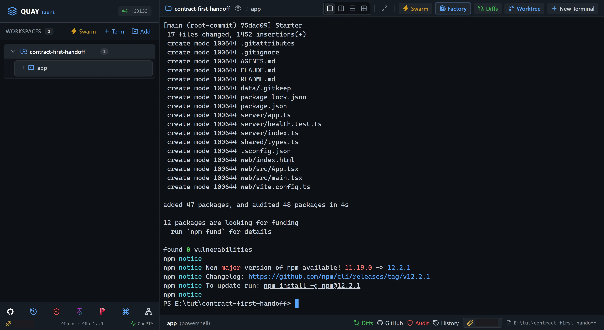
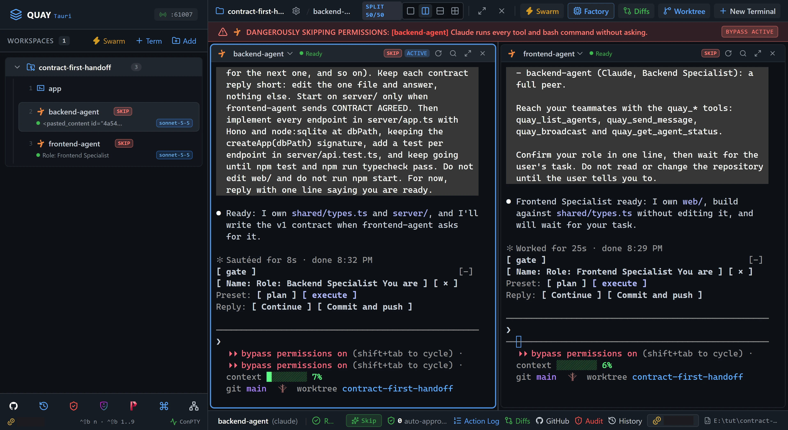
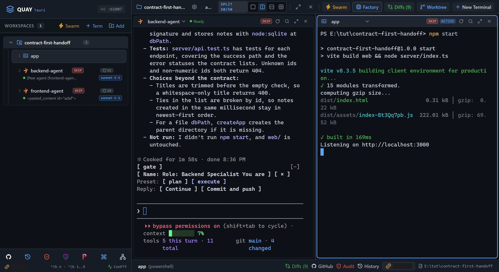
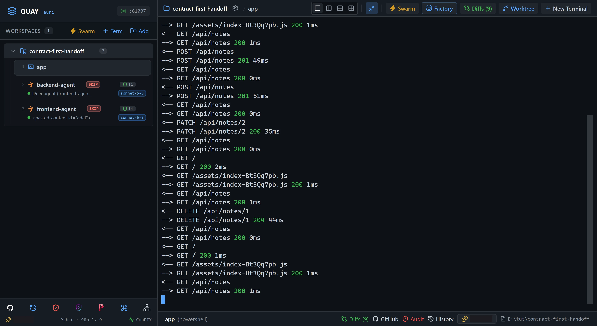

# A2A 2: Contract-first handoff

Two Claude Code agents build a notes app, and this time they agree the API between them before either writes a line of it. `backend-agent` owns `shared/types.ts` and `frontend-agent` asks for the contract over the A2A bus, asks for one change, then hands off. Both build against the agreed types, and the app works the first time you start it.

::: glance
- **Time**
- **Tokens**
- **Agents** 2 × Claude + 1 × PowerShell
- **Level** Intermediate
:::

**You'll learn:** having one agent own a contract and another negotiate it over the bus, the difference between waiting for a reply and sending without waiting, fixed last lines that make an agent's reply checkable, and reading a negotiation back in Mission Control's message trail.

Quay's window has two parts: the **rail**, the panel down the left that lists your projects and their terminals, and the **stage** to its right, where the terminal panes open. When the stage is split, each pane has a **header** along its top with the terminal's name and, for an agent, its status badge (such as `Ready` or `Working`). The pane with **focus** has a lit border, and what you type or paste goes into it. When a step gives you a line to paste into a pane, click into that pane, paste the line and press Enter to run or send it. Every `Ctrl+Shift+B` shortcut is two key presses: press `Ctrl+Shift+B`, let go, then press the next key within a second and a half. The page writes that key as a capital, but it is the plain key: `Ctrl+Shift+B N` is `Ctrl+Shift+B`, then `n`, and holding Shift on that second key makes no difference. `Ctrl+Shift+B` and a number moves focus to the terminal at that place in the rail's list for your project, so `Ctrl+Shift+B 1` is the first one listed.

## How the negotiation works

- `backend-agent` owns the contract. Only it writes `shared/types.ts`.
- `frontend-agent` never edits the contract. It asks for it, and asks for changes, with `quay_send_message` and `wait_for_reply: true`. Each answer comes back as a reply, because each one is a small edit that fits inside the 60 seconds a reply waits.
- Each contract reply ends with a fixed last line, `CONTRACT v1 READY`, then `CONTRACT v2 READY`, so you can check the round in Mission Control.
- When the contract covers what the UI needs, `frontend-agent` sends `CONTRACT AGREED. Build server/ against shared/types.ts.` with `wait_for_reply: false`. Building the API takes minutes, far past 60 seconds, so nobody waits for it. That message is the handoff.
- If a reply ever runs past 60 seconds, the contract is a file anyway: `frontend-agent` polls `quay_get_agent_status` until it reports `backend-agent` as `idle`, then reads `shared/types.ts`. That is the file mailbox, used here only as the fallback.

::: before
## Before you start
- **Quay 2** is installed from the latest release ([Installing a Release](/guide/installation#installing-a-release)).
- **Claude Code** 2.1.296 or later is installed and signed in ([Claude Code](/guide/installation#claude-code)). `claude --version`
- The **event-bridge plugin** 0.1.0 or later is installed and enabled in Claude Code ([Event-bridge Plugin](/guide/installation#event-bridge-plugin)).
- **PowerShell 7** is installed ([PowerShell 7](/guide/installation#powershell-7)). `pwsh --version`
- **Node.js** 24 or later is installed, with npm ([Node.js and npm](/guide/installation#node-js-and-npm)). `node --version`
- **Git** is installed and knows your name and email ([Git](/guide/installation#git)). `git --version`
- Your Claude Code account can use **Claude Sonnet 5.5**, because the Full-Stack Pair preset starts both agents with `--model claude-sonnet-5-5` ([Claude Code](/guide/installation#claude-code)).
- A **web browser**, and no other program using port 3000.
- You are using the **starter project**, because agents run in Skip mode and edit files without asking.
:::

::: step

## 1. Get the starter project

::: do
1. Download [`contract-first-handoff.zip`](/starters/contract-first-handoff.zip) and unzip it into a new, empty folder. The project's files, such as `package.json` and `shared/types.ts`, land straight in that folder, with no folder of their own around them.
2. In Quay, click **Add** at the top of the rail, find that folder in the Open Project dialog (or type its path; Tab completes it) and click **Open**.
3. Press `Ctrl+Shift+B N`, choose **PowerShell Console**, type `app` in **Terminal Label (Optional)** and click **Start Terminal (Enter)**.
:::

::: paste `app`
```text
git init -b main; git add -A; git commit -m Starter; npm install
```
:::

::: see

:::

::: must
- `git commit` prints `Starter` as the message.
- `npm install` ends with `found 0 vulnerabilities`.
- The rail lists a terminal named `app` under the project.
:::

::: may
- The commit id, and the package counts and timings `npm install` prints.
- An `npm notice` about a newer version of npm, after `found 0 vulnerabilities`.
:::

::: ifnot node or npm is not recognised
Node.js 24 or later isn't on your `PATH`. Install it as [Node.js and npm](/guide/installation#node-js-and-npm) shows, close and reopen Quay so its terminals see it, then paste the line again.
:::

::: ifnot git commit says Author identity unknown
Git doesn't know your name and email yet. Set them as [Git](/guide/installation#git) shows, then paste the line again.
:::

:::

::: step

## 2. Launch the Full-Stack Pair

The starter splits the app so two agents can't collide. `backend-agent` owns `shared/types.ts` and `server/`. `frontend-agent` owns `web/` and never edits `shared/types.ts`. Nobody edits `server/health.test.ts`. The starter's `AGENTS.md` says so, and both agents read it.

::: do
1. Press `Ctrl+Shift+B S` to open the Swarm Launcher.
2. Click the **Full-Stack Pair** card.
3. Click **Launch Swarm Now**.
:::

::: see

:::

::: must
- Two panes side by side: `backend-agent` on the left and `frontend-agent` on the right.
- The rail lists `backend-agent` and `frontend-agent` under the project, after `app`.
- The rail shows `Role: Backend Specialist` under `backend-agent` and `Role: Frontend Specialist` under `frontend-agent`.
- Each agent confirms its role in one line and waits for your task.
- Both pane headers show a Ready badge.
:::

::: may
- The wording of each agent's one-line reply.
- The port number in the rail header.
:::

::: ifnot a pane asks whether you trust this folder
Claude Code asks once for each new folder: `Quick safety check: Is this a project you created or one you trust?` It lists **No, exit** first, with the cursor on it. Click into each pane that asks, press the Down arrow to move to **Yes, I trust this folder**, and press Enter. That agent then confirms its role.
:::

::: ifnot an agent asks you to accept Bypass Permissions mode
Quay starts a swarm's Claude Code agents in Skip mode, which Claude Code calls Bypass Permissions mode, and Claude Code asks once before its first session in that mode. Click into the pane that asks, choose **Yes, I accept** and press Enter. It then confirms its role. If the other pane asks too, do the same there.
:::

::: ifnot a pane shows the plugin hint
Quay isn't hearing from the event-bridge plugin. Install it as the hint says, then run `/reload-plugins` in that pane. The hint goes away as soon as Quay hears from the plugin.
:::

:::

::: step

## 3. Make the backend the contract owner

This turn loads `AGENTS.md` into `backend-agent` and tells it what to do when `frontend-agent` messages it. It writes no code yet, so its contract replies in step 4 land quickly, well inside the 60 seconds a message waits for a reply.

::: do
1. Click inside `backend-agent` in the left pane.
:::

::: paste `backend-agent`
```text
Read AGENTS.md. You own shared/types.ts and server/. Write no code yet: frontend-agent will ask you for the API contract over the bus. When it asks, write the contract in shared/types.ts covering only listing, creating and deleting notes, reply with its endpoint lines, and end your reply with the line CONTRACT v1 READY. If frontend-agent asks for a change, make exactly that change in shared/types.ts, reply with the changed lines, and end with CONTRACT v2 READY (v3 for the next one, and so on). Keep each contract reply short: edit the one file and answer, nothing else. Start on server/ only when frontend-agent sends CONTRACT AGREED. Then implement every endpoint in server/app.ts with Hono and node:sqlite at dbPath, keeping the createApp(dbPath) signature, add a test per endpoint in server/api.test.ts, and keep going until npm test and npm run typecheck pass. Do not edit web/ and do not run npm start. For now, reply with one line saying you are ready.
```
:::

::: see

:::

::: must
- `backend-agent` replies with one line saying it is ready, without editing any files, and its badge goes back to Ready.
:::

::: may
- The wording of the line, and whether it read other files besides `AGENTS.md`.
:::

::: ifnot backend-agent starts writing shared/types.ts or server/ code
Press `Esc` in its pane, then paste: `Undo what you just wrote with git checkout -- . and wait for frontend-agent to ask for the contract.`
:::

:::

::: step

## 4. Let the frontend negotiate and hand off

`frontend-agent` asks `backend-agent` for the contract over the A2A bus with `wait_for_reply: true`. The message lands in `backend-agent` as a line starting `[Peer agent (frontend-agent)]:`. `backend-agent` writes the first contract into `shared/types.ts` and replies (`CONTRACT v1 READY`). `frontend-agent` finds pinning missing, asks for it, and gets `CONTRACT v2 READY`. Then it sends `CONTRACT AGREED. Build server/ against shared/types.ts.` with `wait_for_reply: false`, and both agents build at the same time.

::: do
1. Make sure `backend-agent` shows Ready, then press `Ctrl+Shift+B O` to move focus to `frontend-agent`.
:::

::: paste `frontend-agent`
```text
Read AGENTS.md. You build the notes UI in web/ only, against the contract in shared/types.ts, which backend-agent owns. First, ask backend-agent to write the first version of the contract and reply with it, with quay_send_message and wait_for_reply true, without saying what the UI needs. Then check the contract against what the UI needs: list notes with pinned notes first, add a note with a title and body, delete a note, and pin or unpin a note. If anything is missing, ask backend-agent for all of it in one message the same way and wait again. When the contract covers everything, send backend-agent exactly CONTRACT AGREED. Build server/ against shared/types.ts. with wait_for_reply false. If a reply says backend-agent is still working, or that your message is queued behind its current turn, call quay_get_agent_status on it every 15 seconds until it reports idle, then read shared/types.ts yourself. Then build the UI in web/src/App.tsx using the types from shared/types.ts and relative /api URLs, without waiting for the server. Keep going until npm run typecheck passes. Do not edit shared/ or server/, and do not run npm start. Tell me when you are done.
```
:::

::: see
![The moment of the hand-off. backend-agent, on the left, ends its last reply with CONTRACT v2 READY, then shows [Peer agent (frontend-agent)]: CONTRACT AGREED. Build server/ against shared/types.ts. under a blue Incoming A2A Task from frontend-agent banner. A toast at the top right shows frontend-agent to backend-agent, Dispatched, and both badges show Working.](./04-handoff.webp)
:::

::: must
- `backend-agent`'s pane shows at least two lines starting `[Peer agent (frontend-agent)]:`, the last one containing `CONTRACT AGREED`.
- Both badges say Working after the handoff.
- `frontend-agent` never edits `shared/types.ts`.
:::

::: may
- How the agents phrase their requests and replies, and the routes and field names they choose.
- Whether `frontend-agent` calls `quay_list_agents` first or sends straight to `backend-agent` by name.
- The time each round takes.
- The number of rounds. Usually `backend-agent` leaves pinning out of v1 and `frontend-agent` asks for it, which gives `CONTRACT v2 READY`. If v1 already covers pinning, there is no change round, and `CONTRACT AGREED` follows v1.
- A toast at the top right for each message. It shows for a few seconds; the blue **Incoming A2A Task from frontend-agent** banner in `backend-agent`'s pane stays.
:::

::: ifnot frontend-agent says the reply timed out, that backend-agent is still working, or that its message is queued
The contract edit ran past 60 seconds. The prompt tells `frontend-agent` to poll `quay_get_agent_status` and read `shared/types.ts` once it reports `backend-agent` as `idle`. Wait for it.
:::

::: ifnot frontend-agent edits shared/types.ts itself
Paste into `frontend-agent`: `Undo your own edit to shared/types.ts, so it is exactly as backend-agent last wrote it, and leave the rest of the file alone. shared/types.ts belongs to backend-agent: ask it for the change with quay_send_message and wait for its reply.`
:::

:::

::: step

## 5. Read the negotiation in Mission Control

The Live A2A Message Trail records every message passed between agents. Each entry shows the message's sender, recipient and status (`Dispatched` while being processed, `Completed` when finished). When the sender waited (`wait_for_reply: true`), the recipient's return is labelled **Reply**; when the sender did not wait (`wait_for_reply: false`), the response is labelled **Answer**.

::: do
1. Press `Ctrl+Shift+B M` to open Mission Control, or click its icon, the network icon, in the toolbar at the bottom of the rail.
2. Scroll down to **Live A2A Message Trail**. The newest entry is at the top: the hand-off, then the change, then the first request.
3. Press `Esc` to close Mission Control. The agents keep working behind it.
:::

::: see

:::

::: must
- The trail heading counts at least two messages.
- Below the top entry, one Completed entry per contract round, each with a **Reply** ending in its version: `CONTRACT v2 READY`, then `CONTRACT v1 READY`. Scroll the trail to read them.
- The top entry contains `CONTRACT AGREED` and shows Dispatched while `backend-agent` builds. When it finishes, the entry shows Completed and an **Answer**, not a Reply.
:::

::: may
- The wording of each request and reply, and the timestamps.
- The number of rounds: a third (`CONTRACT v3 READY`) if `frontend-agent` asked twice, or only v1 if it asked for no change.
:::

::: ifnot the last entry already says Completed
`backend-agent` finished building before you looked. Its answer in the trail is its build summary.
:::

:::

::: step

## 6. Watch them finish

::: do
1. `Ctrl+Shift+B O` moves focus between the panes; `Ctrl+Shift+B Z` zooms the focused one while you read it, and `Ctrl+Shift+B Z` again returns to the split.
2. Wait until both agents say they're done.
:::

::: see

:::

::: must
- `backend-agent` reports `npm test` and `npm run typecheck` passing. Scroll up in its pane if its summary runs past the top.
- `frontend-agent` reports `npm run typecheck` passing.
- Both pane headers show a Ready badge.
:::

::: may
- How long it takes (expect 3 to 15 minutes), which agent finishes first, and the number of tests.
- The port number in the rail header.
:::

::: ifnot backend-agent says a test still fails after several attempts
Click inside `backend-agent` and paste: `Run npm test, read the failing assertion, and fix server/app.ts until it passes. Keep to the contract in shared/types.ts.`
:::

::: ifnot frontend-agent reports a type error in its use of the contract
Click inside `frontend-agent` and paste: `Fix the type error in web/ against shared/types.ts as it is. If the contract itself is wrong for the UI, ask backend-agent for the change over the bus and wait for its reply.`
:::

:::

::: step

## 7. Start the app

::: do
1. Press `Ctrl+Shift+B O` until the right pane is focused.
2. Press `Ctrl+Shift+B 1` (or click `app` in the rail) to bring the `app` terminal into the right pane.
:::

::: paste `app`
```text
npm start
```
:::

::: see

:::

::: must
- The last line is `Listening on http://localhost:3000`.
:::

::: may
- The build's file sizes and timings.
:::

::: ifnot npm start fails in the Vite build
Press `Ctrl+Shift+B 3` to bring `frontend-agent` back into the right pane, and paste: `npm start fails in the Vite build. Run npm run typecheck and fix what it reports, in web/ only.` When its header shows `Ready`, press `Ctrl+Shift+B 1` and paste `npm start` into `app`.
:::

::: ifnot npm start fails with EADDRINUSE
Another program is using port 3000. Close it and paste `npm start` again, or paste `$env:PORT=3001; npm start` and use `http://localhost:3001` in step 8.
:::

:::

::: step

## 8. Check it worked

`app` logs every request the server answers: a `<--` line when it arrives and a `-->` line with its status when the answer goes back.

::: do
1. Open `http://localhost:3000` in your browser.
2. Add two notes: title `Groceries`, body `Milk, eggs`; then title `Ideas`, body `Pin me`.
3. Click the pin button or checkbox on `Ideas`, then refresh the page. `Ideas` is listed first, and both notes are still there.
4. Delete `Groceries` and refresh again. It is gone.
5. Back in Quay, read the `app` pane: every click you made is a logged request.
:::

::: see

:::

::: must
- Two `POST /api/notes` lines, one for each note you added, each with a 2xx status.
- No line in the log has a 4xx or 5xx status. This is the first run: the UI and the API agreed before you started the server.
:::

::: may
- The exact 2xx status of each request (the walk-through's server answered 201 to a create and 204 to a delete), the method and path of the pin and delete requests, the ids in them, and the timings.
- Whether the UI fetches `GET /api/notes` again after each change.
- Other `GET` lines in between, for the page and its assets.
:::

::: ifnot a request in the log has a 4xx or 5xx status
The UI and the API disagree about the contract. Press `Ctrl+C` in `app` to stop the server, press `Ctrl+Shift+B 3`, and paste into `frontend-agent`: `npm start logged a failed request. Compare web/ with shared/types.ts and fix web/ if it is off the contract. If the server is off the contract, tell backend-agent over the bus with wait_for_reply false, then call quay_get_agent_status on it every 15 seconds until it reports idle. Tell me when both sides match.` When `frontend-agent` says they match, press `Ctrl+Shift+B 1` and paste `npm start` into `app`, then repeat this step. The run no longer counts as a first-run pass, but the app gets fixed through the contract's owner.
:::

::: ifnot the page in the browser is blank
The build in step 7 didn't produce the page. Look at the build output above `Listening` in `app` for an error, and follow the If not under step 7.
:::

::: done
- ✅ A note pinned in the browser is listed first after a refresh, and a deleted note stays gone.
- ✅ The `app` pane's log showed no 4xx or 5xx request on the first `npm start`.
- ✅ Mission Control's trail shows the contract request, the change and `CONTRACT AGREED`, all from `frontend-agent` to `backend-agent`.
- ✅ With the server stopped (`Ctrl+C` in `app`), `npm test` and `npm run typecheck` pass, and `git status --short` lists changes only under `shared/`, `server/` and `web/`.
:::

:::

::: next
[A2A 3: Hands-off TDD relay](/tutorials/a2a/tdd-relay/)

Type one prompt and watch a test writer hand failing tests to an implementer, who reports back when they pass.
:::
