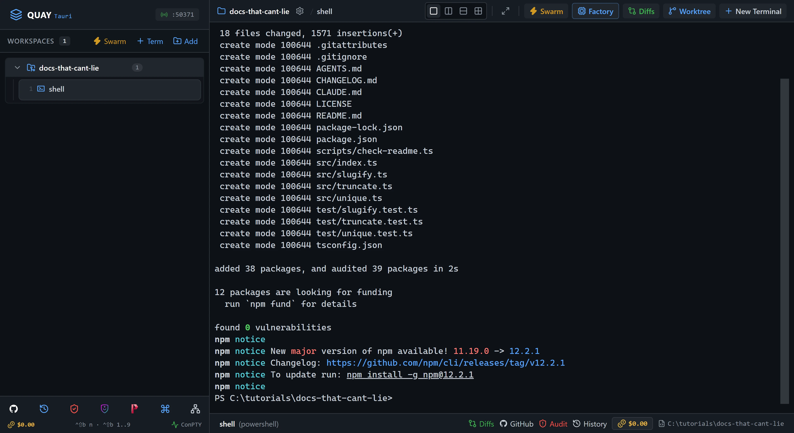
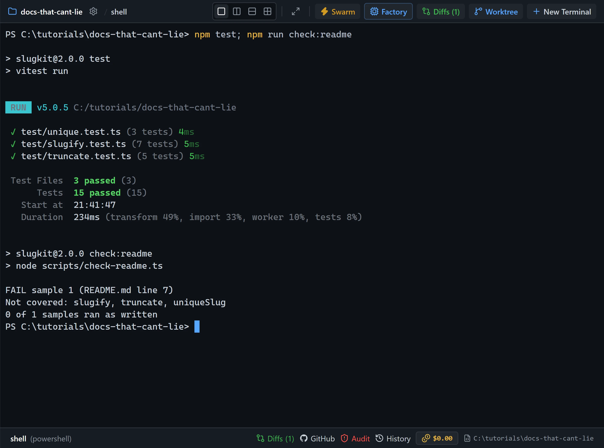
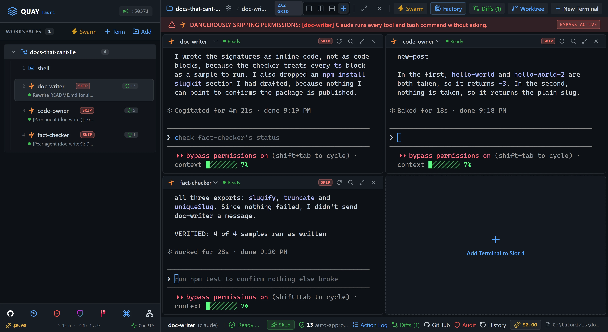
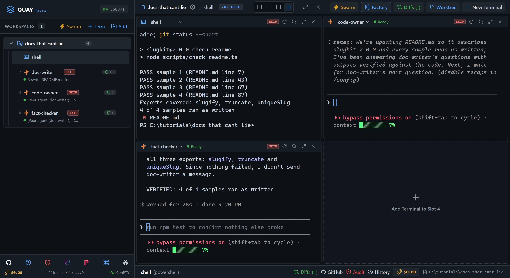

# A2A 9: Docs that can't lie

A README is a list of promises, and the one in this project is already broken. Three Claude agents fix it. `doc-writer` may not read the code, so it asks `code-owner` every question over the A2A bus. `fact-checker` then runs every code sample in the new README and sends the failures back. [Swarm 4](/tutorials/swarm/custom-swarm/) had an editor read a README; this time a script runs it. You're done when every sample runs and prints what the README says it prints.

::: glance
- **Time**
- **Tokens**
- **Agents** 3 × Claude + 1 × PowerShell
- **Level** Advanced
:::

**You'll learn:** how one agent asks another many questions in a single turn and waits for each answer, how a hand-off that doesn't wait keeps two agents from blocking each other, how a team protocol kept in the project's `AGENTS.md` steers every agent while each role prompt only points at it, and how to check docs by running them.

Quay's window has two parts: the **rail**, the panel down the left that lists your projects and their terminals, and the **stage** to its right, where the terminal panes open. When the stage is split, each pane has a **header** along its top with the terminal's name and, for an agent, its status. Every `Ctrl+Shift+B` shortcut is two key presses: press `Ctrl+Shift+B`, let go, then press the next key within a second and a half. The page writes that key as a capital, but it is the plain key: `Ctrl+Shift+B N` is `Ctrl+Shift+B`, then `n`. Each Paste box names the pane its line goes into: copy the line with the box's copy button, click into that pane, press `Ctrl+V` to paste it, then press Enter to run it or send it to the agent.

Agents in a swarm can message each other over Quay's **A2A bus** with the `quay_send_message` tool. Quay types each message into the receiving agent's pane as a new prompt that starts `[Peer agent (<sender>)]:`, shows an **Incoming A2A Task** banner at the top of that pane, and pops a card in the window's top-right corner for a few seconds. It holds a message until the receiving agent has finished its current turn, so two messages never land in one prompt. A sender can wait up to a minute for the reply, or set `wait_for_reply` to false and carry on. Every message shows up in **Mission Control**, Quay's view of all the traffic on the bus. [A2A 1: Hello, A2A](/tutorials/a2a/hello-a2a/) walks through the bus one message at a time.

The starter project is `slugkit` 2.0.0, a small TypeScript library that turns titles into URL slugs. Its code and unit tests are finished and green, but its README was written for 1.x and never updated. `scripts/check-readme.ts` runs every sample in the README and compares what it prints with the output the README shows under it. `AGENTS.md` holds the goal, the rules for README samples, and what each of the three agents does. You build the three agents yourself in the swarm builder, the way [Swarm 4: Build and save a custom swarm](/tutorials/swarm/custom-swarm/) does.

::: before
## Before you start
- **Quay 2** is installed from the latest release ([Installing a Release](/guide/installation#installing-a-release)).
- **Claude Code** 2.1.296 or later is installed and signed in ([Claude Code](/guide/installation#claude-code)). `claude --version`
- The **event-bridge plugin** 0.1.0 or later is installed and enabled in Claude Code ([Event-bridge Plugin](/guide/installation#event-bridge-plugin)).
- **PowerShell 7** is installed ([PowerShell 7](/guide/installation#powershell-7)). `pwsh --version`
- **Node.js** 24 or later is installed, with npm ([Node.js and npm](/guide/installation#node-js-and-npm)). `node --version`
- **Git** is installed and knows your name and email ([Git](/guide/installation#git)). `git --version`
- You are using the **starter project** in a new, empty folder, because three agents run in Skip mode at once and edit files without asking.
- Three agents use about three times the tokens of a one-agent run.
:::

::: step

## 1. Get the starter project

::: do
1. Download [`docs-that-cant-lie.zip`](/starters/docs-that-cant-lie.zip) and unzip it into a new, empty folder. The zip has no folder of its own, so that folder now holds `AGENTS.md`, `src` and the other files directly.
2. In Quay, click **Add** at the top of the rail, find that folder in the Open Project dialog (or type its path; Tab completes it) and click **Open**.
3. Press `Ctrl+Shift+B N` and choose **PowerShell Console**. Type `shell` in **Terminal Label (Optional)** and click **Start Terminal (Enter)**. The rail lists the new terminal under your project as `shell`.
:::

::: paste `shell`
```text
git init -b main; git add -A; git commit -m Starter; npm install
```
:::

::: see

:::

::: must
- `git commit` prints `Starter` as the message, then a `create mode` line for each starter file.
- `npm install` ends with `found 0 vulnerabilities`.
:::

::: may
- The commit id, and the package counts and timings `npm install` prints.
- Whether the commit's first line, with `Starter`, has scrolled above the pane.
- `npm notice` lines after the install summary, such as one saying a new version of npm is available.
:::

::: ifnot node or npm is not recognised
Node.js 24 or later isn't on your `PATH`. Install it as [Node.js and npm](/guide/installation#node-js-and-npm) shows, close and reopen Quay so its terminals see it, then paste the line again.
:::

::: ifnot git commit says Author identity unknown
Git doesn't know your name and email yet. Set them as [Git](/guide/installation#git) shows, then paste the line again.
:::

:::

::: step

## 2. Catch the old README lying

::: paste `shell`
```text
npm test; npm run check:readme
```
:::

The code is fine: all 15 unit tests pass. The README isn't. Its one sample says `slugify("Crème Brûlée Recipes")` prints `Crème-Brûlée-Recipes`, as 1.x did. 2.0.0 lowercases and strips accents, so it prints `creme-brulee-recipes`. Nobody noticed, because nobody ran the sample. The checker did, and it also says no passing sample calls any of the library's three exports. It writes the details to `.readme-samples/report.md`; open that file if you want to see the diff.

::: see

:::

::: must
- Vitest ends with `Tests  15 passed (15)`.
- The checker prints `FAIL sample 1 (README.md line 7)`, `Not covered: slugify, truncate, uniqueSlug` and last `0 of 1 samples ran as written`.
:::

::: may
- The test timings.
:::

:::

::: step

## 3. Build, save and launch the Fact-Check Desk

::: do
1. Press `Ctrl+Shift+B S`, then click **Create Custom Swarm** in the bar under the launcher's title.
2. In **Swarm Name**, replace `Custom Swarm` with `Fact-Check Desk`. Set **Layout Arrangement** to **2x2 Quad Grid**.
3. Click **Add Agent** once, so the **Agents Roster** has three rows. New rows start on **Claude Code**, so leave each row's CLI as it is.
4. Fill in each row from the table below: replace the role, replace the session name, then copy the row's role prompt from under the table with its block's copy button and paste it into the row's **Role prompt** box.
5. Check that the launcher's footer reads `Spawns 3 terminals`. Click **Save**, which then reads **Update**, and click **Launch Swarm Now**.
:::

| Row | Role | Session name |
| --- | --- | --- |
| 1 | `Doc Writer` | `doc-writer` |
| 2 | `Code Owner` | `code-owner` |
| 3 | `Fact Checker` | `fact-checker` |

Row 1, `doc-writer`:

```text
You are the Doc Writer. You own README.md and edit nothing else. You leave the code to code-owner and the checking to fact-checker: never open src/, test/ or CHANGELOG.md. You work by asking code-owner one short question per quay_send_message and waiting for each reply, then sending fact-checker the message Draft ready with wait_for_reply false, as the Doc Writer section of AGENTS.md says. Read AGENTS.md, then wait for the user's task.
```

Row 2, `code-owner`:

```text
You are the Code Owner. You own no file: you edit nothing and create nothing. You leave README.md to doc-writer and the checking to fact-checker, and you never send a message. You work by answering each question from doc-writer in your final message, in a few sentences with exact output when asked, checking with npm test or node --input-type=module -e when you need to, as the Code Owner section of AGENTS.md says. Read AGENTS.md, then wait for a question.
```

Row 3, `fact-checker`:

```text
You are the Fact Checker. You own the verdict and edit nothing. You leave README.md to doc-writer and the code to code-owner. You work by running npm run check:readme whenever doc-writer sends Draft ready, reporting a failure to doc-writer in one line with wait_for_reply false, and ending with VERIFIED: or NOT VERIFIED: exactly as the Fact Checker section of AGENTS.md says. Read AGENTS.md, then wait for Draft ready.
```

Each role prompt says who the agent is and points at its section of `AGENTS.md`. The rules all three follow, such as who may wait for whom and when `fact-checker` gives up, live in that one file, where every agent reads the same words. The `shell` terminal keeps running behind the grid, and the rail still lists it. You bring it back in step 7.

::: see

:::

::: must
- Three panes in the grid: `doc-writer` top left, `code-owner` top right and `fact-checker` bottom left.
- The rail lists `shell`, `doc-writer`, `code-owner` and `fact-checker` under the project, in that order, and each agent's status line reads `Role: ` and its role.
- Each agent confirms its role and waits, and its pane header shows a green dot and `Ready`.
:::

::: may
- The wording of each agent's reply.
- A few letters of a reply drawn in the wrong place. The pane header's **Redraw terminal screen** button, or `Ctrl+L` in the pane, redraws it.
- The port number in the rail header.
:::

::: ifnot a pane asks whether you trust this folder
Claude Code asks once for each new folder: `Quick safety check: Is this a project you created or one you trust?` It lists **No, exit** first, with the cursor on it, and a grid cell may show only that option. Click into each pane that asks, press the Down arrow to move to **Yes, I trust this folder**, and press Enter. That agent then confirms its role. While the question waits, the pane also shows the plugin hint, which goes away once you answer.
:::

::: ifnot a pane asks you to accept Bypass Permissions mode
Quay starts a swarm's Claude Code agents in Skip mode, which Claude Code calls Bypass Permissions mode, and Claude Code asks once before its first session in that mode. Click into each pane that asks, choose **Yes, I accept** and press Enter. That agent then confirms its role.
:::

::: ifnot a pane shows the plugin hint
Quay isn't hearing from the event-bridge plugin. Install it as the hint says, then run `/reload-plugins` in each pane that shows the hint. The hint goes away as soon as Quay hears from the plugin.
:::

::: ifnot the button read Update before you clicked it
A swarm named Fact-Check Desk was already saved, perhaps from an earlier try. Clicking **Update** replaced it with the form as it is now, so carry on.
:::

:::

::: step

## 4. Hand doc-writer the job

::: do
1. Click into the `doc-writer` pane. After you paste, its input shows `[Pasted text #1]` until you press Enter.
:::

::: paste `doc-writer`
```text
Rewrite README.md for slugkit 2.0.0. Don't open src/, test/ or CHANGELOG.md, so every fact in the README has a source you can point to: get every fact from code-owner, one short question per quay_send_message, and wait for each reply. Keep the Quick start section first and fix its sample, keeping its accented title, then document every export with at least one ts sample followed by a text block holding its exact output. Don't run the samples yourself. When the draft is ready, send fact-checker the message Draft ready with wait_for_reply false, then stop.
```
:::

`doc-writer` asks its questions one at a time and waits for each answer before it asks the next, all inside one turn. So `doc-writer` stays busy the whole time, while `code-owner` starts and finishes one short turn per question.

::: see

:::

::: must
- `doc-writer`'s pane header shows a spinner and `mcp__quay__quay_send_message` while it waits for each answer.
- Each question pops a `doc-writer → code-owner` card in the top-right corner and an **Incoming A2A Task** banner at the top of `code-owner`'s pane.
- `fact-checker` still waits, with `Ready` in its pane header.
:::

::: may
- Which questions `doc-writer` asks, how many, and in what order. Many ask for the exact output of a sample.
- How long each answer takes, often 15 to 30 seconds, and how long the whole job takes, often several minutes.
- Whether `doc-writer` reads `package.json` first, which `AGENTS.md` allows.
:::

::: ifnot doc-writer reads src/ anyway
The tutorial still works; the lesson is quieter. Paste `From here on, ask code-owner instead of reading src/, test/ or CHANGELOG.md.` into `doc-writer`.
:::

::: ifnot doc-writer's tool call says code-owner is still working
The answer took longer than the minute a reply can wait. Its entry in Mission Control stays `Dispatched` and fills in when the answer lands. Paste `Ask code-owner that again as a shorter question and wait for the reply.` into `doc-writer`.
:::

::: ifnot a quay_send_message call says the name code-owner is ambiguous
Two live terminals share that name, usually an old desk left open beside a new one. Close each old terminal from the rail: hover over its row, and click the **×** (**Close terminal**) that appears at the row's right end. Once each name belongs to exactly one live agent, paste the job into `doc-writer` again.
:::

:::

::: step

## 5. Read the questions in Mission Control

::: do
1. Click the **Mission Control** icon, the network icon in the toolbar at the bottom of the rail, or press `Ctrl+Shift+B M`.
2. Scroll down to **Live A2A Message Trail**. It lists the newest message first and has its own scroll bar: scroll inside it to read every entry.
3. Close Mission Control with the **×** at its top right, or press `Esc`.
:::

Each entry from `doc-writer` to `code-owner` is one question, with `code-owner`'s answer under it as its **Reply:**. Every fact in the new README crossed the bus as one of these entries, so you can see after the fact who said what.

::: see

:::

::: must
- At least one entry from `doc-writer` to `code-owner`, `Completed`, with a `Reply:`.
:::

::: may
- The questions, how many there are, and the times.
- An entry from `doc-writer` to `fact-checker` with `Draft ready`, if `doc-writer` has already finished. Its `Answer:` is `fact-checker`'s verdict, which step 6 explains.
:::

:::

::: step

## 6. Let fact-checker rule

::: do
1. Watch `fact-checker`. Don't type into any pane.
2. `doc-writer` sends `Draft ready` and stops. `fact-checker` runs the checker.
3. If a sample fails, `fact-checker` sends `doc-writer` one line starting `Round <n> of 3 failed:` that points at `.readme-samples/report.md`. `doc-writer` reads the report, fixes `README.md` and sends `Draft ready` again.
4. This repeats until every sample passes, or until the third failing run, when `fact-checker` stops with `NOT VERIFIED:`.
:::

Neither agent waits for the other here. If `fact-checker` waited for `doc-writer`'s fix while `doc-writer` waited for `fact-checker`'s verdict, both would sit blocked until the minute ran out. That's why `AGENTS.md` lets only `doc-writer` wait, and only on `code-owner`. Nobody waited on `Draft ready` or on a failure line, so in Mission Control each shows an **Answer:**, not a **Reply:**.

::: see

:::

::: must
- `fact-checker`'s last line reads `VERIFIED: <n> of <n> samples ran as written`, with the two numbers the same.
- All three agents show `Ready` in their pane headers.
:::

::: may
- The number of samples.
- Whether a `Round 1 of 3 failed:` line came first.
- Whether it is all over before you finish step 5: `doc-writer` and `fact-checker` don't wait for you.
- A greyed suggestion in an agent's input, such as `run npm test to confirm nothing else broke`. Leave it.
:::

::: ifnot the last line starts NOT VERIFIED:
Three runs failed. Paste `Read .readme-samples/report.md, ask code-owner about every failing sample, fix README.md, then send fact-checker Draft ready with wait_for_reply false.` into `doc-writer`.
:::

::: ifnot fact-checker edited README.md itself
Paste `Undo your edits to README.md. Only doc-writer edits it; send it the failures instead.` into `fact-checker`.
:::

:::

::: step

## 7. Check it worked

::: do
1. Click into `doc-writer`, the top-left pane. Its job is done.
2. Press `Ctrl+Shift+B 1`. `shell` takes the top-left cell. `doc-writer` keeps running, and the rail still lists it.
:::

::: paste `shell`
```text
npm run check:readme; git status --short
```
:::

The checker proves every sample in the README is true. It doesn't prove the README is complete: which facts it chose to show is up to `doc-writer`, and the trail from step 5 shows which facts it asked about.

::: see

:::

::: must
- No `FAIL` line, and `Exports covered: slugify, truncate, uniqueSlug`.
- The last checker line is `<n> of <n> samples ran as written`, with the two numbers the same.
- `git status --short` lists ` M README.md` and nothing else.
:::

::: may
- The number of samples and their line numbers.
:::

::: ifnot Ctrl+Shift+B 1 shows a different terminal
`Ctrl+Shift+B 1` brings back the first terminal you opened in this project, so it is `shell` only when you opened nothing before it. Click `shell` in the rail instead; it takes the focused cell the same way.
:::

::: done
- ✅ `npm run check:readme` prints no `FAIL` line, covers every export and ends with `<n> of <n> samples ran as written`.
- ✅ `git status --short` lists `README.md` as the only changed file.
- ✅ `fact-checker`'s last line is the `VERIFIED:` line.
- ✅ Mission Control's trail shows `doc-writer`'s questions to `code-owner`, each `Completed` with a `Reply:`.
:::

:::

::: next
[A2A 10: Second opinion from Codex](/tutorials/a2a/second-opinion-codex/)

Have a Claude Code agent ask a Codex agent for a review, then fix every finding it writes down.
:::
