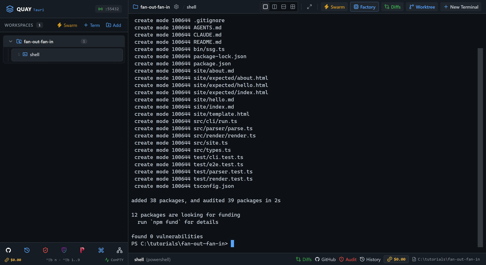
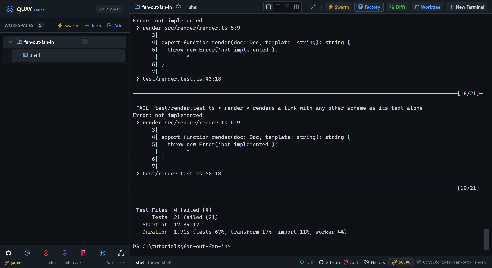
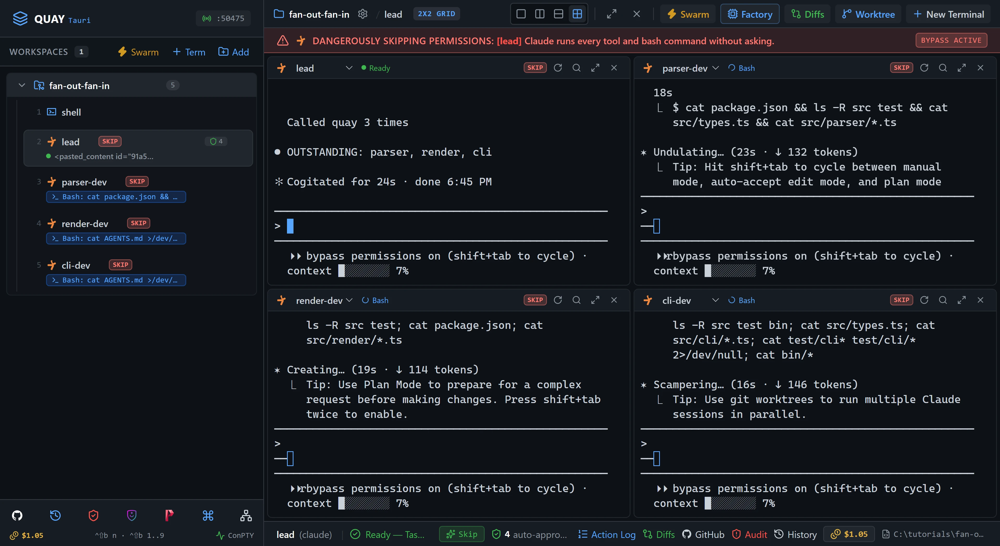
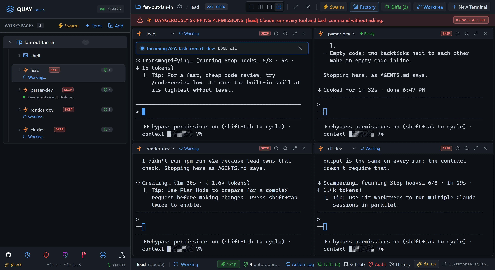
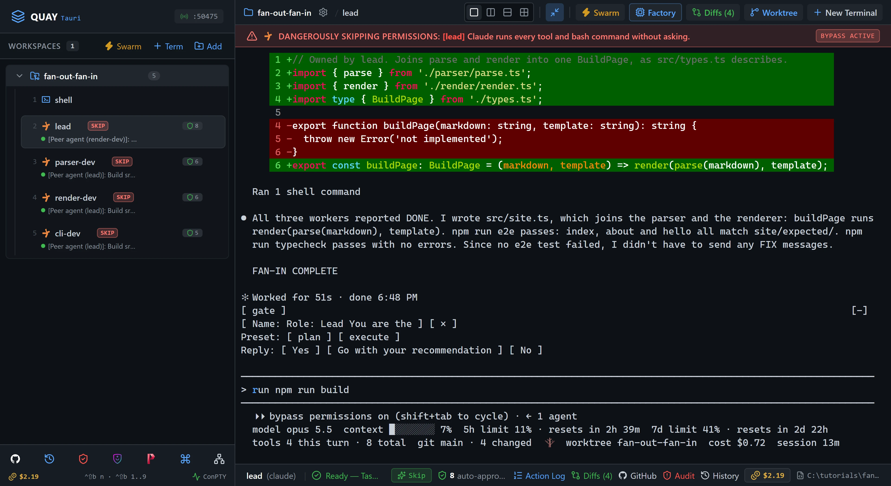
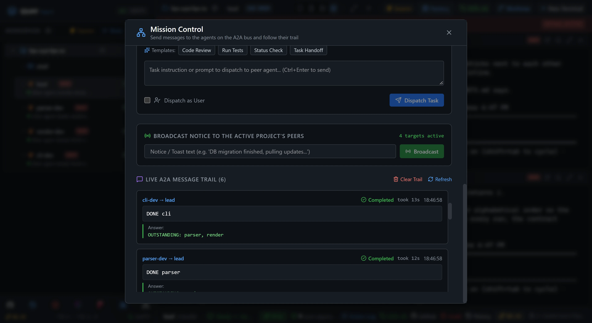
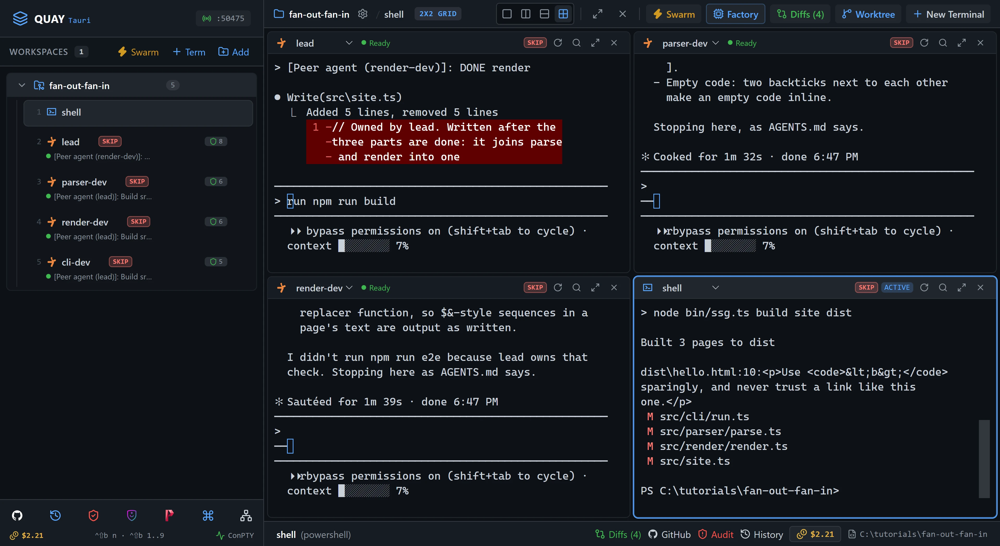

# A2A 5: Fan-out / fan-in

One `lead` agent splits a tiny static-site generator three ways and hands each part to its own worker at once. The workers build in parallel, each in its own folder, and report back when they're done. `lead` waits for all three, wires the parts together and runs the end-to-end test. You paste one prompt.

::: glance
- **Time**
- **Tokens**
- **Agents** 4 × Claude + 1 × PowerShell
- **Level** Advanced
:::

**You'll learn:** how to hand work to several agents with one prompt, collect reports that come back in any order, keep parallel agents apart by giving each one its own folder, send an integration failure back to the agent that owns the part, and read a fan-out and fan-in in Mission Control.

Quay's window has two parts: the **rail**, the panel down the left that lists your projects and their terminals, and the **stage** to its right, where the terminal panes open. When the stage is split, each pane has a **header** along its top with the terminal's name and, for an agent, its status. Every `Ctrl+Shift+B` shortcut is two key presses: press `Ctrl+Shift+B`, let go, then press the next key within a second and a half. The page writes that key as a capital, but it is the plain key: `Ctrl+Shift+B N` is `Ctrl+Shift+B`, then `n`. Each Paste box names the pane its line goes into: copy the line with the box's copy button, click into that pane, press `Ctrl+V` to paste it, then press Enter to run it or send it to the agent.

Agents in a swarm can message each other over Quay's **A2A bus** with the `quay_send_message` tool. Quay types each message into the receiving agent's pane as a new prompt that starts `[Peer agent (<sender>)]:`, shows an **Incoming A2A Task** banner at the top of that pane, and pops a card in the window's top-right corner for a few seconds. It holds a message until the receiving agent has finished its current turn, so two messages never land in one prompt. A sender can wait up to a minute for the reply, or set `wait_for_reply` to false and carry on. Every message shows up in **Mission Control**, Quay's view of all the traffic on the bus. [A2A 1: Hello, A2A](/tutorials/a2a/hello-a2a/) walks through the bus one message at a time.

The starter project is `ssg`, a static-site generator that isn't written yet. `src/types.ts` is the finished contract: it says what each part must do. The parser, the renderer and the command line are stubs, each in its own folder with its own red test file, and `src/site.ts`, which joins them, is a stub too. `AGENTS.md` says which agent owns which folder and how the workers report back. You build the four agents yourself in the swarm builder, the way [Swarm 4: Build and save a custom swarm](/tutorials/swarm/custom-swarm/) does.

::: before
## Before you start
- **Quay 2** is installed from the latest release ([Installing a Release](/guide/installation#installing-a-release)).
- **Claude Code** 2.1.296 or later is installed and signed in ([Claude Code](/guide/installation#claude-code)). `claude --version`
- The **event-bridge plugin** 0.1.0 or later is installed and enabled in Claude Code ([Event-bridge Plugin](/guide/installation#event-bridge-plugin)).
- **PowerShell 7** is installed ([PowerShell 7](/guide/installation#powershell-7)). `pwsh --version`
- **Node.js** 24 or later is installed, with npm ([Node.js and npm](/guide/installation#node-js-and-npm)). `node --version`
- **Git** is installed and knows your name and email ([Git](/guide/installation#git)). `git --version`
- You are using the **starter project** in a new, empty folder, because four agents run in Skip mode at once and edit files without asking.
- Four agents use about four times the tokens of a one-agent run.
:::

::: step

## 1. Get the starter project

::: do
1. Download [`fan-out-fan-in.zip`](/starters/fan-out-fan-in.zip) and unzip it into a new, empty folder. The zip has no folder of its own, so that folder now holds `AGENTS.md`, `src` and the other files directly.
2. In Quay, click **Add** at the top of the rail, find that folder in the Open Project dialog (or type its path; Tab completes it) and click **Open**.
3. Press `Ctrl+Shift+B N` and choose **PowerShell Console**. Type `shell` in **Terminal Label (Optional)** and click **Start Terminal (Enter)**. The rail lists the new terminal under your project as `shell`.
:::

::: paste `shell`
```text
git init -b main; git add -A; git commit -m Starter; npm install
```
:::

::: see

:::

::: must
- `git commit` prints `Starter` as the message, then a `create mode` line for each starter file.
- `npm install` ends with `found 0 vulnerabilities`.
:::

::: may
- The commit id, and the package counts and timings `npm install` prints.
- Whether the commit's first line, with `Starter`, has scrolled above the pane.
:::

::: ifnot node or npm is not recognised
Node.js 24 or later isn't on your `PATH`. Install it as [Node.js and npm](/guide/installation#node-js-and-npm) shows, close and reopen Quay so its terminals see it, then paste the line again.
:::

::: ifnot git commit says Author identity unknown
Git doesn't know your name and email yet. Set them as [Git](/guide/installation#git) shows, then paste the line again.
:::

:::

::: step

## 2. See the split

::: paste `shell`
```text
npm test
```
:::

There are four test files, and each has one owner. Each worker runs only its own file, and `lead` runs the end-to-end test once all three parts are in:

| Agent | Owns | Runs |
| --- | --- | --- |
| `lead` | `src/site.ts` | `npm run e2e`, `npm run typecheck` |
| `parser-dev` | `src/parser/` | `npm run test:parser` |
| `render-dev` | `src/render/` | `npm run test:render` |
| `cli-dev` | `src/cli/` | `npm run test:cli` |

::: see

:::

::: must
- Vitest ends with `Test Files  4 failed (4)` and `Tests  21 failed (21)`.
- The failures say `not implemented`.
:::

::: may
- The timings, and how far up the failures scroll.
:::

:::

::: step

## 3. Build and launch the Fan-out Crew

::: do
1. Press `Ctrl+Shift+B S`, then click **Create Custom Swarm** in the bar under the launcher's title.
2. In **Swarm Name**, replace `Custom Swarm` with `Fan-out Crew`. Set **Layout Arrangement** to **2x2 Quad Grid**.
3. Click **Add Agent** twice, so the **Agents Roster** has four rows. New rows start on **Claude Code**, so leave each row's CLI as it is.
4. Fill in each row from the table below: replace the role, replace the session name, then copy the row's role prompt from under the table with its block's copy button and paste it into the row's **Role prompt** box.
5. Check that the launcher's footer reads `Spawns 4 terminals`. Click **Save**, which then reads **Update**, and click **Launch Swarm Now**.
:::

| Row | Role | Session name |
| --- | --- | --- |
| 1 | `Lead` | `lead` |
| 2 | `Parser Worker` | `parser-dev` |
| 3 | `Render Worker` | `render-dev` |
| 4 | `CLI Worker` | `cli-dev` |

Row 1, `lead`:

```text
You are the lead. You hand out work over the A2A bus and integrate the results. You own src/site.ts only. Never edit a worker's folder: send its owner a one-line message instead. Read AGENTS.md, then wait for the user's task.
```

Row 2, `parser-dev`:

```text
You are a worker. You own src/parser/ and nothing else. Read AGENTS.md, then wait for a job from lead. When your test script and npm run typecheck both pass, report to lead exactly as AGENTS.md says and stop.
```

Row 3, `render-dev`:

```text
You are a worker. You own src/render/ and nothing else. Read AGENTS.md, then wait for a job from lead. When your test script and npm run typecheck both pass, report to lead exactly as AGENTS.md says and stop.
```

Row 4, `cli-dev`:

```text
You are a worker. You own src/cli/ and nothing else. Read AGENTS.md, then wait for a job from lead. When your test script and npm run typecheck both pass, report to lead exactly as AGENTS.md says and stop.
```

The `shell` terminal keeps running behind the grid, and the rail still lists it. You bring it back in step 8.

::: see

:::

::: must
- Four panes in a 2x2 grid: `lead` top left, `parser-dev` top right, `render-dev` bottom left and `cli-dev` bottom right.
- The rail lists `shell`, `lead`, `parser-dev`, `render-dev` and `cli-dev` under the project, in that order, and each agent's status line reads `Role: ` and its role.
- Each agent confirms its role in one line and waits, and its pane header shows a green dot and `Ready`.
:::

::: may
- The wording of each agent's one-line reply.
- A few letters of a reply drawn in the wrong place. The pane header's **Redraw terminal screen** button, or `Ctrl+L` in the pane, redraws it.
- The port number in the rail header.
:::

::: ifnot a pane asks whether you trust this folder
Claude Code asks once for each new folder: `Quick safety check: Is this a project you created or one you trust?` It lists **No, exit** first, with the cursor on it, and a grid cell may show only that option. Click into each pane that asks, press the Down arrow to move to **Yes, I trust this folder**, and press Enter. That agent then confirms its role. While the question waits, the pane also shows the plugin hint, which goes away once you answer.
:::

::: ifnot a pane asks you to accept Bypass Permissions mode
Quay starts a swarm's Claude Code agents in Skip mode, which Claude Code calls Bypass Permissions mode, and Claude Code asks once before its first session in that mode. Click into each pane that asks, choose **Yes, I accept** and press Enter. That agent then confirms its role.
:::

::: ifnot a pane shows the plugin hint
Quay isn't hearing from the event-bridge plugin. Install it as the hint says, then run `/reload-plugins` in each pane that shows the hint. The hint goes away as soon as Quay hears from the plugin.
:::

::: ifnot the button read Update before you clicked it
A swarm named Fan-out Crew was already saved, perhaps from an earlier try. Clicking **Update** replaced it with the form as it is now, so carry on.
:::

:::

::: step

## 4. Fan out

::: do
1. Click into the `lead` pane. After you paste, its input shows `[Pasted text #1]` until you press Enter.
:::

::: paste `lead`
```text
Fan out the three parts. With quay_send_message and wait_for_reply false, send parser-dev exactly: Build src/parser/ until npm run test:parser and npm run typecheck pass, then report DONE parser to lead. Send render-dev exactly: Build src/render/ until npm run test:render and npm run typecheck pass, then report DONE render to lead. Send cli-dev exactly: Build src/cli/ until npm run test:cli and npm run typecheck pass, then report DONE cli to lead. Then end your turn with the line OUTSTANDING: parser, render, cli. Each time a DONE message arrives while other parts are still outstanding, end your turn with one line, OUTSTANDING: and the parts not yet done. When the last part is done, write src/site.ts and run npm run e2e and npm run typecheck. If either fails because of a worker's part, send its owner one line starting FIX and naming what fails, without waiting, then end your turn; when that owner's DONE arrives, run both again. Never edit a worker's folder. When npm run e2e and npm run typecheck both pass, end with the line FAN-IN COMPLETE.
```
:::

`lead` doesn't wait for any of the three replies: each part takes a minute or more, longer than the minute a reply can wait. It sends all three jobs, says what is outstanding, and finishes its turn. As each job goes out, a card such as `lead → parser-dev` with `DISPATCHED` appears in the top-right corner, and the workers start at once.

::: see

:::

::: must
- `lead` reads `Called quay 3 times`, and its last line is `OUTSTANDING: parser, render, cli`.
- All three workers are working at once: each pane header shows a spinner and the tool it is using, such as `Bash`.
- In the rail, each worker's status line starts `[Peer agent (lead)]: Build src/`, the start of its job.
:::

::: may
- The order of the three sends, and whether you see the cards and banners before they go.
- Whether `lead` reads `AGENTS.md` again first.
- `lead`'s rail status line, which shows the start of your pasted prompt.
:::

::: ifnot lead starts writing a part itself
Press `Esc` in `lead` to stop it, then paste `Undo every change you made under src/ with git checkout -- src. Then fan out as I asked, without writing any part yourself.` into `lead`.
:::

:::

::: step

## 5. Watch the reports come back

::: do
1. Watch the grid. Each worker runs its own tests until they pass, then reports to `lead`.
:::

Quay types each `DONE` report into `lead` as a new prompt and shows it in an **Incoming A2A Task** banner at the top of `lead`'s pane. If a report comes in while `lead` is still answering the one before, Quay holds it until `lead` finishes, so `lead` answers one report per turn, even when two workers finish within seconds of each other.

::: see

:::

::: must
- Each report arrives in `lead` as `[Peer agent (<worker>)]: DONE <part>`, with an `Incoming A2A Task from <worker>` banner.
- `lead` answers each report with one `OUTSTANDING:` line that leaves out the parts already reported. Step 7 shows each answer again in Mission Control.
- Each worker ends by saying it is stopping, as `AGENTS.md` says.
:::

::: may
- The order the reports arrive in. That is the point of fan-in: `lead` can't know it in advance.
- How long each worker takes, often a minute or two, so the reports may come back seconds apart.
:::

::: ifnot a worker finishes but never reports
Its tests may still fail. Click into that worker and paste `Run your test script. When it passes, report DONE <part> to lead as AGENTS.md says.`, with `<part>` replaced by `parser`, `render` or `cli`.
:::

::: ifnot a worker edits a file outside its folder
Click into that worker and paste `Undo your changes outside your own folder with git checkout, then report DONE <part> to lead.`, with `<part>` replaced by its part.
:::

:::

::: step

## 6. Watch lead integrate

::: do
1. Watch `lead`. After the third report it writes `src/site.ts` and runs `npm run e2e`.
2. When it ends with `FAN-IN COMPLETE`, click into `lead` and press `Ctrl+Shift+B Z`, or click its header's **Zoom pane** button, to zoom it to the whole stage, and read its summary.
:::

If an end-to-end test fails, `lead` doesn't fix the part. It sends `FIX` and the failure to the part's owner and waits for that owner's `DONE` again.

::: see

:::

::: must
- `lead` wrote `src/site.ts` and no other source file.
- Its summary says `npm run e2e` and `npm run typecheck` pass.
- `lead`'s last line is `FAN-IN COMPLETE`.
:::

::: may
- Whether a `FIX` round happened first.
- How `src/site.ts` is written.
- A greyed suggestion in `lead`'s input, such as `run npm run build`. Leave it: the next step runs the build in `shell`.
- Anything your own Claude Code settings add under the input, such as a status line.
:::

::: ifnot lead sent a FIX message
This is the fan-in loop working. The owner fixes its part and reports `DONE` again, and `lead` runs `npm run e2e` and `npm run typecheck` again.
:::

:::

::: step

## 7. Read the fan-out and fan-in in Mission Control

::: do
1. Press `Ctrl+Shift+B Z` to put the grid back.
2. Click the **Mission Control** icon, the network icon in the toolbar at the bottom of the rail, or press `Ctrl+Shift+B M`.
3. Scroll down to **Live A2A Message Trail**. It lists the newest message first and has its own scroll bar: scroll inside it to read every entry.
:::

::: see

:::

::: must
- One entry from `lead` to each of `parser-dev`, `render-dev` and `cli-dev`, each `Completed` and holding that worker's job.
- One `DONE` entry from each worker to `lead`, each `Completed`, with `lead`'s reply as its `Answer:`. That reply is an `OUTSTANDING:` line, or for the last report, `lead`'s summary ending `FAN-IN COMPLETE`.
:::

::: may
- The order of the `DONE` entries, and any `FIX` entries, which make the trail longer.
- A `DONE` entry showing `Queued` for a moment while `lead` answers the report before it.
- The times, and how long each entry `took`.
:::

:::

::: step

## 8. Check it worked

::: do
1. Close Mission Control with the **×** at its top right, or press `Esc`. Click into `cli-dev`, the bottom-right pane.
2. Press `Ctrl+Shift+B 1`. `shell` takes the bottom-right cell. `cli-dev` keeps running, and the rail still lists it.
:::

::: paste `shell`
```text
npm test; npm run build; Select-String -Path dist\hello.html -Pattern '&lt;b&gt;'; git status --short
```
:::

::: see

:::

::: must
- Vitest ends with `Test Files  4 passed (4)` and `Tests  21 passed (21)`. Scroll up in the pane, or press `Ctrl+Shift+B Z` to zoom it, to see them.
- `npm run build` prints `Built 3 pages to dist`.
- `Select-String` prints the line of `dist\hello.html` that holds `<code>&lt;b&gt;</code>`.
- `git status --short` lists ` M src/cli/run.ts`, ` M src/parser/parse.ts`, ` M src/render/render.ts` and ` M src/site.ts`, and nothing outside `src/site.ts`, `src/parser/`, `src/render/` and `src/cli/`.
:::

::: may
- The timings, and the line number `Select-String` prints.
- Files a worker added inside its own folder, which `git status` lists with `??`. They belong to that worker's part.
:::

::: ifnot Ctrl+Shift+B 1 shows a different terminal
`Ctrl+Shift+B 1` brings back the first terminal you opened in this project, so it is `shell` only when you opened nothing before it. Click `shell` in the rail instead; it takes the focused cell the same way.
:::

::: done
- ✅ `lead`'s last line is `FAN-IN COMPLETE`.
- ✅ `npm test` passes all four test files, and `npm run build` prints `Built 3 pages to dist`.
- ✅ `git status --short` shows no change outside `src/site.ts`, `src/parser/`, `src/render/` and `src/cli/`.
:::

:::

::: next
[Tutorials](/tutorials/)

The next tutorial in series order, A2A 6: Long jobs: fire, then poll, isn't published yet. The Tutorials page lists every tutorial that is.
:::
