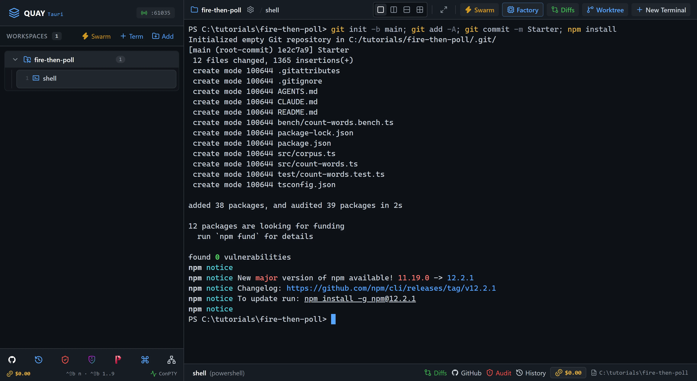
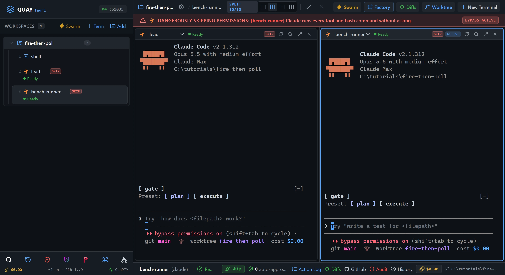
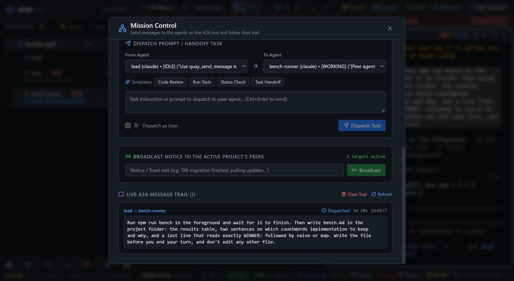
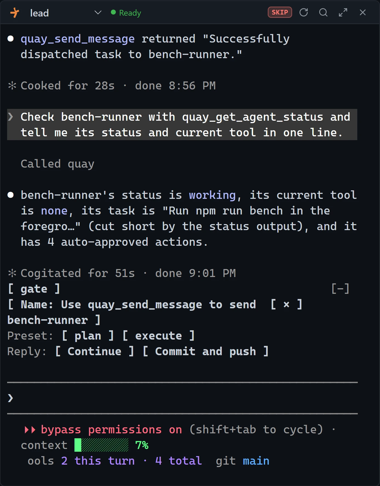
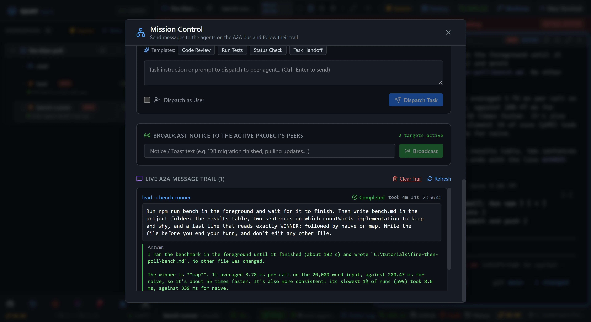
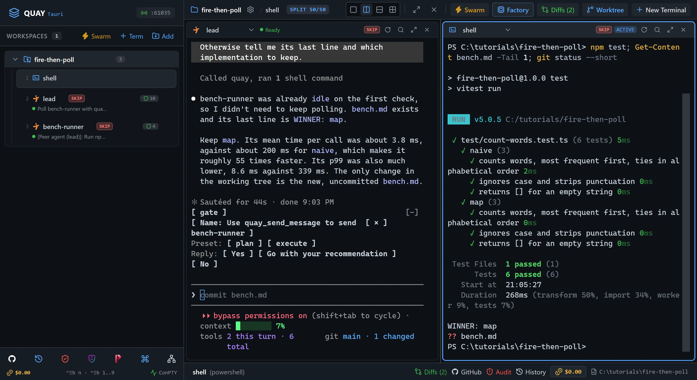

# A2A 6: Long jobs: fire, then poll

A reply only waits a minute. Hand a three-minute benchmark from one Claude Code agent, `lead`, to another, `bench-runner`, without waiting for it, check on it while it runs, and collect the result from `bench.md` when it's done.

::: glance
- **Time**
- **Tokens**
- **Agents** 2 × Claude + 1 × PowerShell
- **Level** Intermediate
:::

**You'll learn:** why a reply can't carry a long job, how `quay_send_message` with `wait_for_reply` set to false hands one over and gets the sender's prompt back at once, what `quay_get_agent_status` reports while the job runs, how a **file mailbox** carries the result and what says the job is done, and how a message nobody waited for shows in Mission Control's trail.

Quay's window has two parts: the **rail**, the panel down the left that lists your projects and their terminals, and the **stage** to its right, where the terminal panes open. When the stage is split, each pane has a **header** along its top with the terminal's name and, for an agent, its status. Every `Ctrl+Shift+B` shortcut is two key presses: press `Ctrl+Shift+B`, let go, then press the next key within a second and a half. The page writes a letter key as a capital, but it is the plain key: `Ctrl+Shift+B N` is `Ctrl+Shift+B`, then `n`, and `Ctrl+Shift+B O` is the letter o, never the digit zero. `Ctrl+Shift+B` and a number moves focus to the terminal at that place in the rail's list for your project, so `Ctrl+Shift+B 1` is the first one listed. Each Paste box names the pane its line goes into: copy the line with the box's copy button, click into that pane, press `Ctrl+V` to paste it, then press Enter to run it or send it to the agent.

Agents message each other over Quay's **A2A bus**. Quay types each message into the receiving agent's pane as a new prompt that starts `[Peer agent (<sender>)]:`, and every message shows up in the trail in **Mission Control**, Quay's view of all the traffic on the bus. A sender can wait for the reply, but only for 60 seconds. This tutorial's job takes about three minutes, so `lead` doesn't wait. It asks `bench-runner` to write its result into a file, `bench.md`, whose last line they agree on in advance. That file is the **file mailbox**. [A2A 1: Hello, A2A](/tutorials/a2a/hello-a2a/) walks through the bus and its four `quay_*` tools one message at a time.

The starter project is `fire-then-poll`, a tiny word-count library with two versions of the same function. `countWordsNaive` keeps a list of words and searches it for every word it reads; `countWordsMap` keeps a `Map`. `npm run bench` times the two for about three minutes and prints a table comparing them. Nothing in the library gets changed.

::: before
## Before you start
- **Quay 2** is installed from the latest release ([Installing a Release](/guide/installation#installing-a-release)).
- **Claude Code** 2.1.296 or later is installed and signed in ([Claude Code](/guide/installation#claude-code)). `claude --version`
- The **event-bridge plugin** 0.1.0 or later is installed and enabled in Claude Code ([Event-bridge Plugin](/guide/installation#event-bridge-plugin)).
- **PowerShell 7** is installed ([PowerShell 7](/guide/installation#powershell-7)). `pwsh --version`
- **Node.js** 24 or later is installed, with npm ([Node.js and npm](/guide/installation#node-js-and-npm)). `node --version`
- **Git** is installed and knows your name and email ([Git](/guide/installation#git)). `git --version`
- You are using the **starter project** in a new, empty folder, because both agents run in Skip mode and can edit files without asking.
:::

::: step

## 1. Get the starter project

::: do
1. Download [`fire-then-poll.zip`](/starters/fire-then-poll.zip) and unzip it into a new, empty folder. The zip has no folder of its own, so that folder now holds `AGENTS.md`, `src` and the other files directly.
2. In Quay, click **Add** at the top of the rail, find that folder in the Open Project dialog (or type its path; Tab completes it) and click **Open**.
3. Press `Ctrl+Shift+B N` and choose **PowerShell Console**. Type `shell` in **Terminal Label (Optional)** and click **Start Terminal (Enter)**. The rail lists the new terminal under your project as `shell`.
:::

::: paste `shell`
```text
git init -b main; git add -A; git commit -m Starter; npm install
```
:::

::: see

:::

::: must
- `git commit` prints `Starter` as the message.
- `npm install` ends with `found 0 vulnerabilities`.
:::

::: may
- The commit id, and the package counts and timings `npm install` prints.
- Whether `npm install` ends with an `npm notice` block about a new version of npm.
:::

::: ifnot node or npm is not recognised
Node.js 24 or later isn't on your `PATH`. Install it as [Node.js and npm](/guide/installation#node-js-and-npm) shows, close and reopen Quay so its terminals see it, then paste the line again.
:::

::: ifnot git commit says Author identity unknown
Git doesn't know your name and email yet. Set them as [Git](/guide/installation#git) shows, then paste the line again.
:::

:::

::: step

## 2. Open lead and bench-runner

::: do
1. Press `Ctrl+Shift+B N`. Under **Autonomous AI Agents**, click **Claude**. Leave **Permission Mode** on **Skip Permissions (Default)**. Type `lead` in **Terminal Label (Optional)** and click **Start Terminal (Enter)**. `lead` takes the stage, and `shell` keeps running behind it.
2. Press `Ctrl+Shift+B`, let go, then type a percent sign, `%`, which on most keyboards is `Shift+5`. The stage splits in two: `lead` stays on the left, and `shell` comes back on the right.
3. Press `Ctrl+Shift+B O` to move focus to the right pane. Its border lights up.
4. Press `Ctrl+Shift+B N` again. The dialog keeps your last choices, so **Claude** is still chosen. Replace `lead` with `bench-runner` and click **Start Terminal (Enter)**. `bench-runner` takes the right pane, and `shell` keeps running behind it.
5. Wait until both pane headers show a green dot and `Ready`.
:::

::: see

:::

::: must
- The rail lists `shell`, `lead` and `bench-runner` under the project, in that order.
- Both pane headers show a green dot and `Ready`, and neither pane shows the plugin hint, a line at the top of the pane that begins `No events from the event-bridge plugin.`
:::

::: may
- The port number in the rail header.
- Claude Code's welcome text and the model it names.
:::

::: ifnot a pane asks whether you trust this folder
Claude Code asks once for each new folder: `Quick safety check: Is this a project you created or one you trust?` It lists **No, exit** first, with the cursor on it. Click into the pane, press the Down arrow to move to **Yes, I trust this folder**, and press Enter. While the question waits, the pane also shows the plugin hint, which goes away once you answer.
:::

::: ifnot a pane asks you to accept Bypass Permissions mode
Quay started the agent in Skip mode, which Claude Code calls Bypass Permissions mode, and Claude Code asks once before its first session in that mode. Click into the pane, choose **Yes, I accept** and press Enter.
:::

::: ifnot bench-runner opened on the left, over lead
Focus was still on the left pane. Press `Ctrl+Shift+B 2` to put `lead` back on the left, then `Ctrl+Shift+B O` to move focus to the right pane and `Ctrl+Shift+B 3` to show `bench-runner` there.
:::

::: ifnot a pane shows the plugin hint
Quay isn't hearing from the event-bridge plugin. Install it as the hint says, then type `/reload-plugins` in that pane and press Enter. The hint goes away as soon as Quay hears from the plugin.
:::

:::

::: step

## 3. Fire the job

::: do
1. Click into the `lead` pane on the left. After you paste, its input shows `[Pasted text #1]` until you press Enter.
:::

::: paste `lead`
```text
Use quay_send_message to send bench-runner the job below, with wait_for_reply set to false. The job: "Run npm run bench in the foreground and wait for it to finish. Then write bench.md in the project folder: the results table, two sentences on which countWords implementation to keep and why, and a last line that reads exactly WINNER: followed by naive or map. Write the file before you end your turn, and don't edit any other file." Then tell me in one line what quay_send_message returned, and stop. Don't wait for the job.
```
:::

A reply waits at most 60 seconds, and this job takes about three minutes, so `lead` sends it without waiting and gets its prompt back at once. The answer goes into the file mailbox instead: `bench-runner` writes `bench.md`, and its last line, `WINNER:` and a name, says the job is done.

::: see

:::

::: must
- `lead` reports `Successfully dispatched task to bench-runner.` and its pane header goes back to a green dot and `Ready`.
- The job arrives in `bench-runner` prefixed `[Peer agent (lead)]:`, and `bench-runner` starts `npm run bench`: its pane header shows a spinner and the tool running it while it works.
:::

::: may
- `lead`'s wording around the line it quotes, and how long its turn takes, often half a minute.
- Whether the start of the job, with its prefix, has scrolled above `bench-runner`'s pane. The rail's status line under `bench-runner` shows the prefix too.
- The tool in `bench-runner`'s header, `Bash` or `PowerShell`.
- Whether you saw the card in the window's top-right corner, `lead → bench-runner` marked **DISPATCHED**. It leaves after a few seconds.
:::

::: ifnot lead sat for about a minute, then said bench-runner received the task but is still working
It sent the job with the default, which waits for a reply. The job still runs, so carry on from step 4. Its trail entry fills in when `bench-runner` finishes, the same as a job sent without waiting.
:::

:::

::: step

## 4. Look in on it

::: do
1. Click the **Mission Control** icon, the network icon in the toolbar at the bottom of the rail, or press `Ctrl+Shift+B M`.
2. Scroll down to **Live A2A Message Trail**. It lists the newest message first.
3. Close Mission Control with the **×** at its top right, or press `Esc`.
:::

::: see

:::

::: must
- The newest entry reads `lead → bench-runner` and holds the job text.
- It reads **Dispatched**, with no answer under it yet.
:::

::: may
- The times on the entry, including how long ago it was sent.
- Older entries below it, if you've done other A2A tutorials in this project.
:::

:::

::: step

## 5. Poll once

::: paste `lead`
```text
Check bench-runner with quay_get_agent_status and tell me its status and current tool in one line.
```
:::

::: see

:::

::: must
- `lead`'s pane shows `Called quay`, and it reports `bench-runner`'s status as `working`.
:::

::: may
- The tool `lead` names: `none`, `Bash` or `PowerShell`.
- Whether `lead` also quotes the job's first words, which `quay_get_agent_status` reports as its task, cut short.
- How long `lead` takes to answer, often most of a minute.
:::

::: ifnot the status is already idle
Either the benchmark has finished, or `bench-runner` started it in the background and ended its turn early. Go on to step 6 anyway: `lead` checks the file's last line there, not only the status.
:::

:::

::: step

## 6. Wait it out

::: paste `lead`
```text
Poll bench-runner with quay_get_agent_status about every 15 seconds until its status is idle. Then read bench.md. If the file is missing or its last line doesn't start with WINNER:, say so. Otherwise tell me its last line and which implementation to keep.
```
:::

Idle only means `bench-runner`'s turn ended, not that the job is done. A file mailbox job is done when the agent is idle **and** the agreed last line is in the file, which is why `lead` reads `bench.md` instead of trusting the status.

::: see

:::

::: must
- `lead` checks the status, then reads `bench.md` and quotes `WINNER: map`.
- `bench-runner`'s pane says it wrote `bench.md`.
:::

::: may
- How many times `lead` checks: once, if the job ended while you were on step 5, or several times, waiting between checks.
- The speed figures, and both agents' wording.
- A greyed suggestion in `lead`'s input, such as `commit bench.md`. Leave it: nothing gets committed in this tutorial.
:::

::: ifnot lead says it can't wait between checks
Poll by hand instead: paste step 5's line into `lead` every half minute until it reports `idle`, then paste `Read bench.md and tell me its last line.` into `lead`.
:::

::: ifnot lead says bench-runner is idle but bench.md is missing
`bench-runner` ended its turn before the benchmark finished. Click into `bench-runner` and paste `Wait for npm run bench to finish, then write bench.md as asked.` Then paste this step's line into `lead` again.
:::

:::

::: step

## 7. Read the trail

::: do
1. Open Mission Control again, with its icon or `Ctrl+Shift+B M`, and scroll down to **Live A2A Message Trail**.
2. Find the same `lead → bench-runner` entry. It is no longer the newest if an agent sent another message since.
:::

Mission Control records `bench-runner`'s last message as the entry's **Answer**, even though nobody waited for it. Only you see it there: `lead` had to read the file.

::: see

:::

::: must
- The `lead → bench-runner` entry reads **Completed**.
- Under **Answer:** is `bench-runner`'s last message.
:::

::: may
- The answer's wording, and how long the entry `took`.
:::

:::

::: step

## 8. Check it worked

::: do
1. Close Mission Control with the **×** at its top right, or press `Esc`. Click into `bench-runner`, the right pane.
2. Press `Ctrl+Shift+B 1`. `shell` takes the right pane. `bench-runner` keeps running, and the rail still lists it.
:::

::: paste `shell`
```text
npm test; Get-Content bench.md -Tail 1; git status --short
```
:::

::: see

:::

::: must
- Vitest ends with `Tests  6 passed (6)`.
- `Get-Content` prints `WINNER: map`.
- `git status --short` prints `?? bench.md` and nothing else.
:::

::: may
- The timings Vitest prints.
:::

::: ifnot git status lists files under src or test
`bench-runner` changed more than the job asked for. Paste `git checkout -- src test` into `shell` to put them back, then paste this step's line again. The fire-then-poll still worked.
:::

::: ifnot Ctrl+Shift+B 1 shows a different terminal
`Ctrl+Shift+B 1` brings back the first terminal you opened in this project, so it is `shell` only when you opened nothing before it. Click `shell` in the rail instead; it takes the focused pane the same way.
:::

::: done
- ✅ `lead` got its prompt back straight after firing the job, while `bench-runner` was still working.
- ✅ `lead` polled, then quoted `WINNER: map` from `bench.md`.
- ✅ Mission Control's `lead → bench-runner` entry reads **Completed**, with an **Answer**.
- ✅ The six tests still pass, and `bench.md` is the only change `git status --short` shows.
:::

:::

::: next
[Tutorials](/tutorials/)

The next tutorial in series order, A2A 7: Broadcast coordination, isn't published yet. The Tutorials page lists every tutorial that is.
:::
