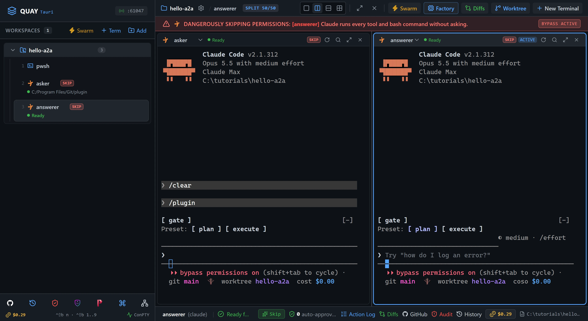
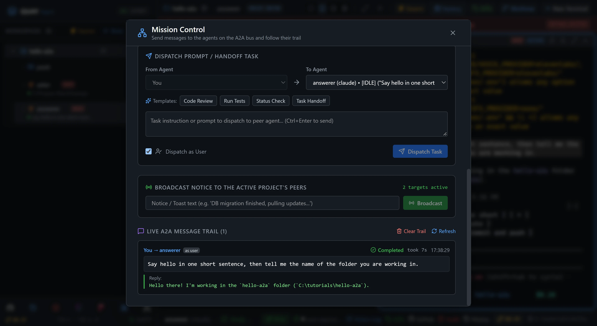
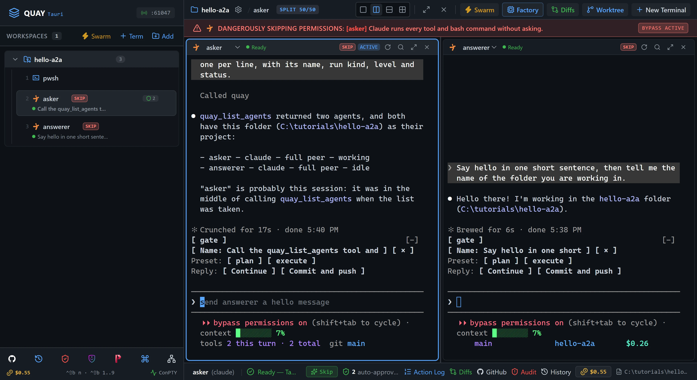
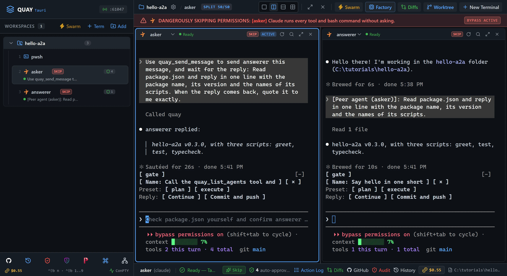
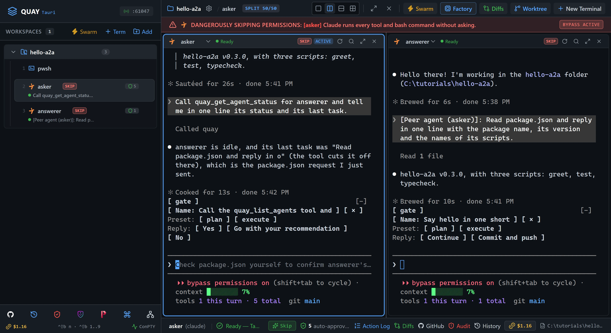
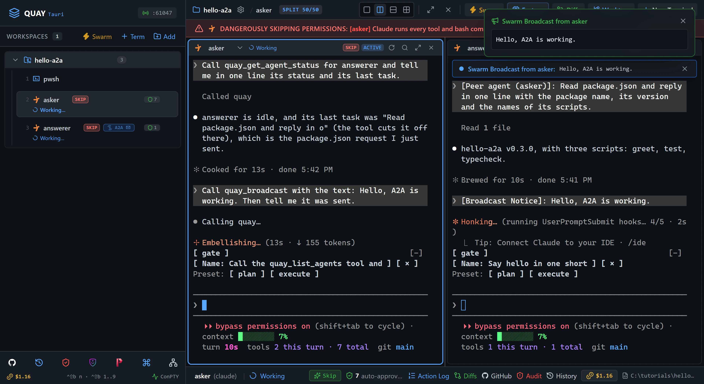

# A2A 1: Hello, A2A

Open two Claude Code agents, `asker` and `answerer`, side by side. First you send `answerer` a message yourself from Mission Control. Then `asker` finds its peer, asks it to sum up the starter's `package.json`, waits for the reply and quotes it back to you.

::: glance
- **Time**
- **Tokens**
- **Agents** 2 × Claude + 1 × PowerShell
- **Level** Starter
:::

**You'll learn:** how to check the event-bridge plugin with `/plugin`, open two Claude Code terminals side by side, send a peer a message from Mission Control with **Dispatch as User**, have one agent use the four `quay_*` tools (`quay_list_agents`, `quay_send_message` with a wait for the reply, `quay_get_agent_status` and `quay_broadcast`), and read Mission Control's trail and toasts.

Quay's window has two parts: the **rail**, the panel down the left that lists your projects and their terminals, and the **stage** to its right, where the terminal panes open. When the stage is split, each pane has a **header** along its top with the terminal's name and, for an agent, its status. Every `Ctrl+Shift+B` shortcut is two key presses: press `Ctrl+Shift+B`, let go, then press the next key within a second and a half. The page writes that key as a capital, but it is the plain key: `Ctrl+Shift+B N` is `Ctrl+Shift+B`, then `n`, and holding Shift on that second key makes no difference to a letter. `Ctrl+Shift+B` and a number moves focus to the terminal at that place in the rail's list for your project, so `Ctrl+Shift+B 1` is the first one listed. Each Paste box names the pane or the Quay field its line goes into: copy the line with the box's copy button, click into that pane or field, press `Ctrl+V` to paste it, then press Enter to send it, unless the step says which button to click.

This tutorial is about agents messaging each other over Quay's A2A bus. A **peer** is an agent terminal on the bus: here, `asker` and `answerer`. A PowerShell terminal is not a peer, so no message reaches it. **Mission Control** is the panel where you send a peer a message yourself and read the **trail**, the list of every message on the bus, newest first. The starter project is a small, finished package, `hello-a2a`, which is only there to give `answerer` something real to read. Nothing in it gets built or changed.

::: before
## Before you start
- **Quay 2** is installed from the latest release ([Installing a Release](/guide/installation#installing-a-release)).
- **Claude Code** 2.1.296 or later is installed and signed in ([Claude Code](/guide/installation#claude-code)). `claude --version`
- The **event-bridge plugin** 0.1.0 or later is installed and enabled in Claude Code ([Event-bridge Plugin](/guide/installation#event-bridge-plugin)). Step 2 checks it.
- **PowerShell 7** is installed ([PowerShell 7](/guide/installation#powershell-7)). `pwsh --version`
- **Node.js** 24 or later is installed, with npm ([Node.js and npm](/guide/installation#node-js-and-npm)). `node --version`
- **Git** is installed and knows your name and email ([Git](/guide/installation#git)). `git --version`
- You are using the **starter project**, because agents run in Skip mode and can edit files without asking. In this tutorial they only read them.
:::

::: step

## 1. Get the starter project

::: do
1. Download [`hello-a2a.zip`](/starters/hello-a2a.zip) and unzip it into a new, empty folder named `hello-a2a`, for example `C:\tutorials\hello-a2a`. The zip has no folder of its own, so that folder now holds `package.json`, `src` and the other files directly.
2. In Quay, click **Add** at the top of the rail, find that folder in the Open Project dialog (or type its path; Tab completes it) and click **Open**.
3. Press `Ctrl+Shift+B N`, choose **PowerShell Console** and click **Start Terminal (Enter)**. The rail lists the new terminal under your project as `pwsh`.
:::

::: paste PowerShell pane
```text
git init -b main; git add -A; git commit -m Starter; npm install
```
:::

::: see

:::

::: must
- `git commit` prints `Starter` as the message.
- `npm install` ends with `found 0 vulnerabilities`.
:::

::: may
- The commit id, and the package counts and timings `npm install` prints.
:::

::: ifnot node or npm is not recognised
Node.js 24 or later isn't on your `PATH`. Install it as [Node.js and npm](/guide/installation#node-js-and-npm) shows, close and reopen Quay so its terminals see it, then paste the line again.
:::

::: ifnot git commit says Author identity unknown
Git doesn't know your name and email yet. Set them as [Git](/guide/installation#git) shows, then paste the line again.
:::

:::

::: step

## 2. Open asker and check the plugin

::: do
1. Press `Ctrl+Shift+B N`. Under **Autonomous AI Agents**, click **Claude**. Leave **Permission Mode** on **Skip Permissions (Default)** and **Model** on **Default (your Claude Code /model setting)**. Type `asker` in **Terminal Label (Optional)** and click **Start Terminal (Enter)**. `asker` takes the stage, and the PowerShell terminal keeps running behind it.
2. Wait until `asker`'s pane header shows a green dot and `Ready`. Claude Code may ask first whether you trust this folder, and to accept Bypass Permissions mode; the If nots below show how to answer.
3. Paste the line below into `asker`. Claude Code opens its plugin screen.
4. Find `event-bridge` on that screen, then press `Esc` to close it.
:::

::: paste `asker`
```text
/plugin
```
:::

::: see

:::

::: must
- Claude Code's plugin screen lists `event-bridge` as installed and enabled.
- After `Esc`, `asker`'s pane header shows a green dot and `Ready`, and its pane shows no plugin hint.
:::

::: may
- Any other plugins you have installed.
- The event-bridge version, as long as it is 0.1.0 or later.
- How Claude Code lays out its plugin screen.
:::

::: ifnot asker asks whether you trust this folder
Claude Code asks once for each new folder: `Quick safety check: Is this a project you created or one you trust?` It lists **No, exit** first, with the cursor on it. Click into `asker`, press the Down arrow to move to **Yes, I trust this folder**, and press Enter.
:::

::: ifnot asker asks you to accept Bypass Permissions mode
Quay started `asker` in Skip mode, which Claude Code calls Bypass Permissions mode, and Claude Code asks once before its first session in that mode. Click into `asker`, choose **Yes, I accept** and press Enter.
:::

::: ifnot asker shows the plugin hint
The hint is one line at the top of the pane that begins `No events from the event-bridge plugin.` If Claude Code is showing a prompt in the pane, answer it, and the hint clears on its own. Otherwise click **Copy** on the hint, press `Ctrl+Shift+B 1` to bring back the PowerShell pane, paste the install line and press Enter. Press `Ctrl+Shift+B 2` to return to `asker`, type `/reload-plugins` and press Enter. The hint goes away as soon as Quay hears from the plugin.
:::

::: ifnot event-bridge is listed but disabled
Press `Esc` to close the plugin screen. Press `Ctrl+Shift+B 1` and paste `claude plugin enable event-bridge@event-bridge` into the PowerShell pane. Then press `Ctrl+Shift+B 2`, type `/reload-plugins` in `asker` and press Enter.
:::

::: ifnot the event-bridge version is older than 0.1.0
Press `Ctrl+Shift+B 1` and paste `claude plugin update event-bridge@event-bridge` into the PowerShell pane. Then press `Ctrl+Shift+B 2`, type `/reload-plugins` in `asker` and press Enter.
:::

:::

::: step

## 3. Open answerer beside it

::: do
1. Press `Ctrl+Shift+B`, let go, then type a percent sign, `%`, which on most keyboards is `Shift+5`. The page writes this as `Ctrl+Shift+B %`. It must be the percent sign: a plain `5` doesn't split the stage. The stage splits in two: `asker` stays on the left, and the PowerShell terminal from step 1 comes back on the right.
2. Press `Ctrl+Shift+B O` to move focus to the right pane. Its border lights up.
3. Press `Ctrl+Shift+B N`. The dialog keeps your last choices, so **Claude** is still chosen and **Terminal Label (Optional)** still holds `asker`. Replace `asker` with `answerer` and click **Start Terminal (Enter)**. `answerer` takes the right pane, and the PowerShell terminal keeps running behind it. A new terminal always opens in the pane that has focus, which is why the split comes first.
4. Wait until `answerer`'s pane header shows a green dot and `Ready`. Claude Code doesn't ask about this folder again, because you trusted it in step 2.
:::

::: see

:::

::: must
- The rail lists `pwsh`, `asker` and `answerer` under the project, in that order.
- Both pane headers show a green dot and `Ready`, and neither pane shows a plugin hint.
:::

::: may
- The port number in the rail header.
- Claude Code's welcome text and the model it names.
:::

::: ifnot answerer opened on the left, over asker
Focus was still on the left pane. Press `Ctrl+Shift+B 2` to put `asker` back on the left, then `Ctrl+Shift+B O` to move focus to the right pane and `Ctrl+Shift+B 3` to show `answerer` there.
:::

::: ifnot answerer shows the plugin hint
Do step 2's fix for the plugin hint, but in `answerer`: `/reload-plugins` goes into `answerer`, which `Ctrl+Shift+B 3` brings back.
:::

:::

::: step

## 4. Send answerer a message yourself

::: do
1. Click the **Mission Control** icon, the network icon in the toolbar at the bottom of the rail, or press `Ctrl+Shift+B M`. Mission Control opens over the stage.
2. Under **Dispatch Prompt / Handoff Task**, tick **Dispatch as User**. **From Agent** greys out and reads **You**.
3. Check that **To Agent** shows `answerer`. If it doesn't, choose `answerer` there.
4. Paste the line below into the message box under them, then click **Dispatch Task**. With **Dispatch as User**, the message reaches `answerer` exactly as if you had typed it into its pane. A message from another agent arrives with a `[Peer agent (<name>)]:` prefix instead, as step 6 shows.
5. Watch the **Live A2A Message Trail** further down the panel until the new entry reads **Completed**.
:::

::: paste Mission Control
```text
Say hello in one short sentence, then tell me the name of the folder you are working in.
```
:::

::: see

:::

::: must
- The entry reads `You → answerer` and carries the **as user** tag.
- Its status is **Completed**.
- Under **Reply**, `answerer` names `hello-a2a`, the folder you unzipped the starter into.
:::

::: may
- The greeting's wording.
- The times on the entry.
- Whether you saw the toast in the top right as the message left. It leaves after a few seconds.
:::

::: ifnot the trail lists older entries below yours
Mission Control's trail shows earlier messages on the bus too, from before this tutorial. Your entry is the newest, at the top. In step 9, read only the three newest entries.
:::

::: ifnot the entry stays Dispatched for more than a minute
Press `Esc` to close Mission Control and look at `answerer`'s pane. If it shows the plugin hint, do step 2's fix for it in `answerer`, then open Mission Control and dispatch the line again.
:::

:::

::: step

## 5. asker finds its peers

::: do
1. Press `Esc` to close Mission Control.
2. Click into the `asker` pane on the left.
:::

::: paste `asker`
```text
Call the quay_list_agents tool and list every agent it returns whose project is this folder, one per line, with its name, run kind, level and status.
```
:::

::: see

:::

::: must
- `asker`'s pane shows a `quay_list_agents` tool call.
- Two agents in this folder: `asker` and `answerer`, both of run kind `claude` and level `full peer`. The PowerShell terminal is not a peer, so it isn't listed.
- `answerer`'s status is `idle`. `asker`'s is `working`, because it is busy with your request.
:::

::: may
- How Claude Code shows the tool call, and how `asker` lays out the list.
- Whether `asker` also mentions agents in your other projects, or terminal ids.
:::

::: ifnot asker says it has no quay_list_agents tool
Only Claude Code terminals that Quay starts get the `quay` tools. Type `/mcp` in `asker` and press Enter: `quay` should show as connected. If it doesn't, point at `asker` in the rail, click the **×** at the right end of its row (**Close terminal**), and open it again as in step 2.
:::

:::

::: step

## 6. asker asks, and waits for the reply

::: paste `asker`
```text
Use quay_send_message to send answerer this message, and wait for the reply: Read package.json and reply in one line with the package name, its version and the names of its scripts. When the reply comes back, quote it to me exactly.
```
:::

::: see

:::

::: must
- The message arrives in `answerer`'s pane with the `[Peer agent (asker)]:` prefix, and `answerer` answers it.
- `asker`'s `quay_send_message` call returns `Reply from answerer:` and the answer.
- `asker`'s quote names `hello-a2a`, `0.3.0`, and the scripts `greet`, `test` and `typecheck`.
- At the end, both pane headers show a green dot and `Ready`.
:::

::: may
- The agents' wording.
- How long it takes, up to a minute.
- Whether `asker` calls `quay_list_agents` again first.
:::

::: ifnot asker says answerer's event-bridge plugin isn't reporting
`answerer`'s pane shows the plugin hint, so it could take the message but not reply. Do step 2's fix for it in `answerer`, then paste this step's line into `asker` again.
:::

::: ifnot asker says answerer received the task but is still working
`answerer` took longer than the 60 seconds a sender waits for a reply. Wait until `answerer`'s pane header shows a green dot and `Ready`, then paste this step's line into `asker` again. Work that takes longer goes through a file mailbox instead, which a later tutorial teaches.
:::

::: ifnot asker says Successfully dispatched task to answerer
`asker` sent the message without waiting, so no reply came back to it. Paste this step's line into `asker` again.
:::

:::

::: step

## 7. asker checks on answerer

::: paste `asker`
```text
Call quay_get_agent_status for answerer and tell me in one line its status and its last task.
```
:::

::: see

:::

::: must
- `asker`'s pane shows a `quay_get_agent_status` tool call.
- `answerer`'s status is `idle`.
- Its last task begins `Read package.json`, without the `[Peer agent (asker)]:` prefix.
:::

::: may
- The auto-approved count.
- How much of the task `asker` quotes. Quay keeps only its first 32 characters.
:::

:::

::: step

## 8. asker tells everyone

::: paste `asker`
```text
Call quay_broadcast with the text: Hello, A2A is working. Then tell me it was sent.
```
:::

::: see

:::

::: must
- `answerer`'s pane shows `[Broadcast Notice]: Hello, A2A is working.`
- `asker`'s own pane does not: a broadcast reaches every other peer, never its sender.
- `asker` says the notice reached `answerer`. A broadcast never waits for replies, so whatever `answerer` says back stays in its own pane and in the trail.
:::

::: may
- What `answerer` says back.
- Whether you saw the toast, **Swarm Broadcast from asker**. It leaves after a few seconds; the notice in `answerer`'s pane is the lasting evidence.
:::

:::

::: step

## 9. Check it worked

::: do
1. Open Mission Control again, with its icon or `Ctrl+Shift+B M`, and read the **Live A2A Message Trail**.
2. Press `Esc` to close it.
3. Press `Ctrl+Shift+B O` to move focus to the right pane, then `Ctrl+Shift+B 1` to show the PowerShell terminal there. `answerer` keeps running behind it.
:::

::: paste PowerShell pane
```text
git status --short
```
:::

::: see

:::

::: must
- The trail lists three entries, newest first: `asker → answerer` tagged **Broadcast**, then `asker → answerer`, then `You → answerer` tagged **as user**.
- The untagged `asker → answerer` entry is **Completed**, and its **Reply** names `hello-a2a` and `0.3.0`.
- `You → answerer` is **Completed**, with a **Reply**.
- `git status --short` prints nothing.
:::

::: may
- The times, and the wording of each reply.
- Whether the broadcast entry is **Completed** with `answerer`'s acknowledgement under **Answer**, or still **Dispatched** while `answerer` answers.
- The folder in the PowerShell prompt, which is wherever you unzipped the starter.
:::

::: ifnot git status lists a file
An agent changed a file it was told to leave alone. Paste `git checkout -- .` into the PowerShell pane to put the starter back, then paste `git status --short` again. The messaging still worked; the trail is the proof.
:::

::: done
- ✅ Mission Control's trail shows all three messages, and the two sent by you and by `asker` with a wait are **Completed** with a **Reply**.
- ✅ `asker`'s pane quotes a reply naming `hello-a2a` and `0.3.0`.
- ✅ `answerer`'s pane shows `[Broadcast Notice]: Hello, A2A is working.`
- ✅ `git status --short` printed nothing.
:::

:::

::: next
[Tutorials](/tutorials/)

The next tutorial in series order, A2A 2: Contract-first handoff, isn't published yet. The Tutorials page lists every tutorial that is.
:::
