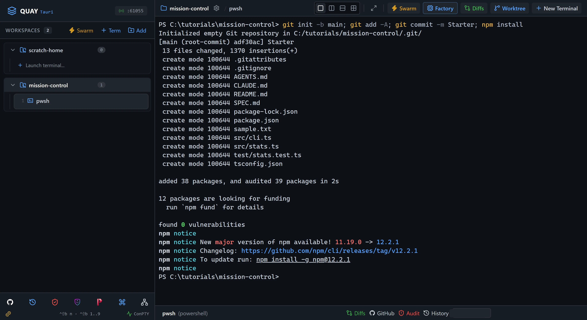
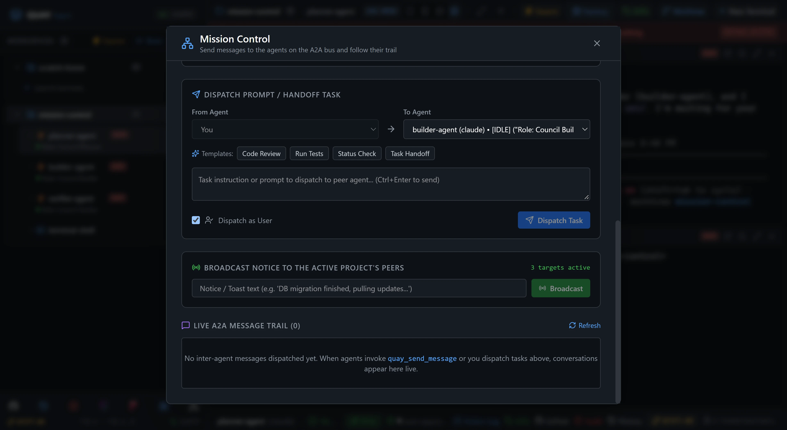
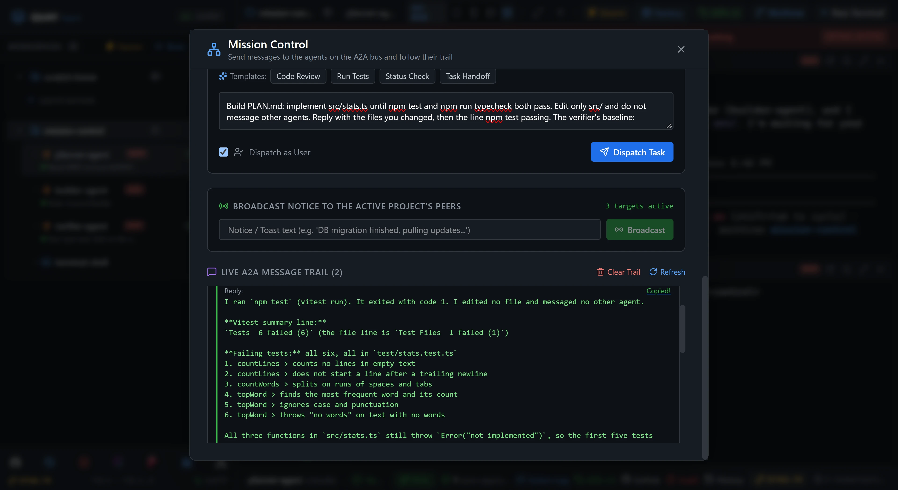
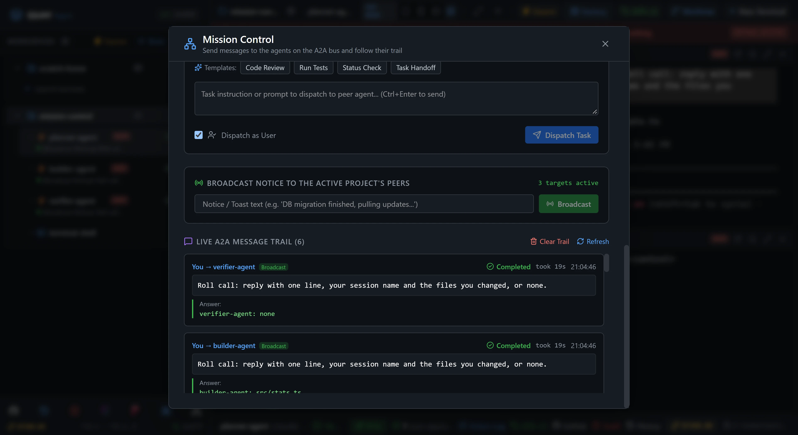

# A2A 8: Operator run

You are the lead this time. Three Claude Code agents plan, build and verify a small text-stats CLI, and every task they get comes from you, typed into each agent's **Activity** view. You run two agents at once and follow each one's work, carry one agent's result to another yourself, take a roll call with a broadcast, and read every agent's answer in the **Agents** panel before the final verdict. You never type into an agent's pane.

::: glance
- **Time**
- **Tokens**
- **Agents** 3 × Claude + 1 × PowerShell
- **Level** Intermediate
:::

**You'll learn:** how to send every task from an agent's **Activity** view, run two agents at once and follow each one's tool calls and messages, carry one agent's result to another yourself, collect one answer per agent with **Broadcast to all agents**, read each agent's latest reply in the **Agents** panel, and how a message you send waits for an agent's turn however long it takes.

Quay's window has two parts: the **rail**, the panel down the left that lists your projects and their terminals, and the **stage** to its right, where the terminal panes open. When the stage is split, each pane has a **header** along its top with the terminal's name and, for an agent, its status. Every `Ctrl+Shift+B` shortcut is two key presses: press `Ctrl+Shift+B`, let go, then press the next key within a second and a half. The page writes that key as a capital, but it is the plain key: `Ctrl+Shift+B N` is `Ctrl+Shift+B`, then `n`, and holding Shift on that second key makes no difference. `Ctrl+Shift+B` shortcuts don't work while you are typing in a field such as a message strip, so click into a pane first. Each Paste box names the pane or the Quay field its line goes into: copy the line with the box's copy button, click into that pane or field, press `Ctrl+V` to paste it, then do what the step says to send it.

The team is Quay's **Tri-Agent Council**, the same three agents and the same plan, build and verify loop as [Swarm 8: Tri-Agent Council](/tutorials/swarm/tri-agent-council/): `planner-agent` writes a plan, `builder-agent` builds it, and `verifier-agent` runs the result and gives a verdict. In Swarm 8 you briefed each agent in its own pane. Here you drive the whole loop from the **companion**, the column on the window's right edge that shows what the selected terminal is working on. Its **Activity** view lists that terminal's tool calls and the messages it sent and got on Quay's A2A bus, oldest first, and has a message strip at its foot where you send it a task yourself. There is no single list of every message: each agent's messages are in its own Activity view. The **Agents** panel, behind the robot icon on the **module bar**, the column of icons down the window's left edge, lists the agents in the project with a preview of each one's latest reply. A **peer** is an agent terminal on the bus; the Council's PowerShell pane is not one. [A2A 1: Hello, A2A](/tutorials/a2a/hello-a2a/) introduced the Activity view, and this page goes further with it.

The starter project is a text-stats CLI. `src/cli.ts` is finished, but the three functions it calls in `src/stats.ts` aren't written, so all six tests fail. `SPEC.md` says what the functions must do and ends with the exact line the CLI must print for `sample.txt`. `AGENTS.md` says which agent may change which files, and that the agents never message each other: you relay everything. All three agents run on Claude Code's default model.

::: before
## Before you start
- **Quay 2** is installed from the latest release ([Installing a Release](/guide/installation#installing-a-release)).
- **Claude Code** 2.1.296 or later is installed and signed in ([Claude Code](/guide/installation#claude-code)). `claude --version`
- The **event-bridge plugin** 0.1.0 or later is installed and enabled in Claude Code ([Event-bridge Plugin](/guide/installation#event-bridge-plugin)).
- **PowerShell 7** is installed ([PowerShell 7](/guide/installation#powershell-7)). `pwsh --version`
- **Node.js** 24 or later is installed, with npm ([Node.js and npm](/guide/installation#node-js-and-npm)). `node --version`
- **Git** is installed and knows your name and email ([Git](/guide/installation#git)). `git --version`
- You are using the **starter project**, because agents run in Skip mode and edit files without asking.
:::

::: step

## 1. Get the starter project

::: do
1. Download [`mission-control.zip`](/starters/mission-control.zip) and unzip it into a new, empty folder. The zip has no folder of its own, so that folder now holds `SPEC.md`, `src` and the other files directly.
2. In Quay, click **Add** at the top of the rail, find that folder in the Open Project dialog (or type its path; Tab completes it) and click **Open**.
3. Press `Ctrl+Shift+B N`, choose **PowerShell Console** and click **Start Terminal (Enter)**. The rail lists the new terminal under your project as `pwsh`.
:::

::: paste PowerShell pane
```text
git init -b main; git add -A; git commit -m Starter; npm install
```
:::

::: see

:::

::: must
- `git commit` prints `Starter` as the message.
- `npm install` ends with `found 0 vulnerabilities`.
:::

::: may
- The commit id, and the package counts and timings `npm install` prints.
- Whether `npm install` ends with an `npm notice` block about a new version of npm, after `found 0 vulnerabilities`.
:::

::: ifnot node or npm is not recognised
Node.js 24 or later isn't on your `PATH`. Install it as [Node.js and npm](/guide/installation#node-js-and-npm) shows, close and reopen Quay so its terminals see it, then paste the line again.
:::

::: ifnot git commit says Author identity unknown
Git doesn't know your name and email yet. Set them as [Git](/guide/installation#git) shows, then paste the line again.
:::

:::

::: step

## 2. Launch the Tri-Agent Council

::: do
1. In the rail, point at the `pwsh` terminal under your project and click the **×** at the right end of its row (**Close terminal**). The terminal closes at once. The Council brings its own PowerShell pane, `terminal-shell`, so this one isn't needed.
2. Press `Ctrl+Shift+B S`. The **Swarm builder** opens in a tab on the stage.
3. Click the **Tri-Agent Council** card.
4. Click **Launch Swarm Now**.
:::

::: see

:::

::: must
- Four panes in a 2x2 grid: `planner-agent` top-left, `builder-agent` top-right, `verifier-agent` bottom-left and `terminal-shell` bottom-right.
- The rail lists those four terminals under the project, in that order, and no others.
- In the rail, under each agent's name, its first task reads `Role: Council Planner`, `Role: Council Builder` or `Role: Council Verifier`.
- Each agent confirms its role in its pane and waits, and its pane header shows a green dot and `Ready`.
:::

::: may
- The wording of each agent's reply.
- The port number in the rail header.
:::

::: ifnot a pane asks whether you trust this folder
Claude Code asks once for each new folder: `Quick safety check: Is this a project you created or one you trust?` It lists **No, exit** first, with the cursor on it. Click into each pane that asks, press the Down arrow to move to **Yes, I trust this folder**, and press Enter. That agent then confirms its role.
:::

::: ifnot an agent asks you to accept Bypass Permissions mode
Quay starts a swarm's Claude Code agents in Skip mode, which Claude Code calls Bypass Permissions mode, and Claude Code asks before its first session in that mode. Click into each pane that asks, choose **Yes, I accept** and press Enter. That agent then confirms its role.
:::

::: ifnot an agent shows the plugin hint
Quay isn't hearing from the event-bridge plugin, so it could send that agent a task but never see its turn end. Install the plugin as the hint says, then run `/reload-plugins` in each pane that shows the hint. The hint goes away as soon as Quay hears from the plugin.
:::

::: ifnot the rail lists five terminals, pwsh first
The PowerShell terminal from step 1 is still open. Close `pwsh` as in Do 1, so only the Council's four terminals are in the project. The grid keeps its four panes.
:::

:::

::: step

## 3. Open the Agents panel

::: do
1. Click the **Agents** icon, the robot icon on the module bar down the window's left edge. The Agents panel opens in the rail's place. Leave it open for the rest of the page; the **Projects** icon at the top of the module bar brings the rail back whenever you want it.
2. Look under **Agents in the project**. Each row names an agent, its CLI and its level on the bus, and its status. `terminal-shell` isn't listed: a PowerShell pane isn't a peer, so no message reaches it.
:::

::: see

:::

::: must
- **Agents in the project** lists `planner-agent`, `builder-agent` and `verifier-agent`, each reading `claude · full peer` and `idle`, and nothing else.
- No agent has a reply preview under its row yet, because no one has sent it a message.
:::

::: may
- Whether **Waiting on you** lists the agents as having finished their turn, after confirming their roles, or reads `Nothing is waiting on you`.
:::

::: ifnot an agent reads claude · listener
Quay isn't hearing from that agent's event-bridge plugin, so it can't see the agent's turns end. Do step 2's fix for the plugin hint in that agent's pane. Its row then reads `claude · full peer`.
:::

::: ifnot Agents in the project says No agents in this project
The panel lists the agents in the project of the selected terminal, and that is another project. Click into one of the Council's panes.
:::

:::

::: step

## 4. Send two tasks at once

::: do
1. Click into `planner-agent`'s pane, top left, so it is the selected terminal, then press `Ctrl+Shift+B M`. The companion opens its **Activity** view for `planner-agent`, and the message strip at the foot of the view reads `Send planner-agent a task`.
2. Paste the line below into the message strip and press Enter (or click **Send**). The strip empties, and a new entry, **From You**, joins the view with the line you sent.
3. Without waiting, click into `verifier-agent`'s pane, bottom left, and press `Ctrl+Shift+B M`. Type or paste this shorter task into its message strip and press Enter: `Run npm test. Edit no file and do not message other agents. Reply with the Vitest summary line and the name of every failing test, then the line BASELINE.`
4. Watch `verifier-agent`'s Activity view. Its **From You** entry reads `dispatched` while the verifier works, and each tool call it makes joins the list below it. When its turn ends, the entry reads `completed`, with the verifier's reply under it. The list runs oldest first, so scroll down inside the view to follow the newest. Both agents work at the same time: `planner-agent`'s pane header shows it working too.
:::

::: paste Activity, for planner-agent
```text
Read SPEC.md and AGENTS.md, then write PLAN.md: the functions in src/stats.ts, the order to build them, and which test in test/stats.test.ts each one makes pass. Edit no other file and do not message other agents. Reply with a summary of at most five lines, then the line PLAN.md written.
```
:::

::: see

:::

::: must
- `verifier-agent`'s Activity view has an entry that reads `From You`, with the task you sent it.
- Its status reads `completed` once the verifier's turn ends.
- The verifier's reply under it says `6 failed` and ends with `BASELINE`.
:::

::: may
- The times on each entry.
- Whether you catch the verifier's entry still `dispatched`, and which agent finishes first. The verifier usually finishes in under a minute and the planner in one or two.
- Which tool calls the verifier lists, and how it lays out the failing tests.
- Whether you saw the toast in the top right as each message left.
:::

::: ifnot Ctrl+Shift+B M does nothing
Keyboard focus is still in a message strip, and `Ctrl+Shift+B` shortcuts don't work while you type in a field. Click into the agent's pane first, then press `Ctrl+Shift+B M`.
:::

::: ifnot the message strip names a different agent
The Activity view shows the selected terminal, and it was not the one you meant. Click into the right agent's pane and press `Ctrl+Shift+B M` again, then paste the line into the message strip.
:::

::: ifnot the verifier changed a file
Its task says not to. In `verifier-agent`'s Activity view, send `Undo your edits with git checkout -- src test and only report from now on. End with the line BASELINE.` from the message strip.
:::

:::

::: step

## 5. Relay the baseline to the builder

::: do
1. Click into `planner-agent`'s pane and press `Ctrl+Shift+B M`. Wait until its **From You** entry reads `completed` too. The planner's reply under it ends with `PLAN.md written`.
2. Click into `builder-agent`'s pane, top right, and press `Ctrl+Shift+B M`. Paste the line below into its message strip and press Enter.

The plan is on disk in `PLAN.md`, so the builder reads it there. The verifier's baseline exists only in its reply, so you carry it across yourself: the line ends with what you read in the verifier's Activity view in step 4. That hand relay is what the operator does.
:::

::: paste Activity, for builder-agent
```text
Build PLAN.md: implement src/stats.ts until npm test and npm run typecheck both pass. Edit only src/ and do not message other agents. Reply with the files you changed, then the line npm test passing. The verifier's baseline: npm test fails all 6 tests.
```
:::

::: see

:::

::: must
- `planner-agent`'s **From You** entry reads `completed`, and its reply ends with `PLAN.md written`.
- `builder-agent`'s Activity view has an entry that reads `From You`, with the status `dispatched` while the builder works.
- That entry's message starts `Build PLAN.md` and ends with `The verifier's baseline: npm test fails all 6 tests.`
:::

::: may
- The wording of the planner's summary, and the times.
- Which tool calls the builder has made so far.
:::

::: ifnot planner-agent's entry still reads dispatched
The planner is still writing its plan. Wait until its pane header shows a green dot and `Ready` and the entry reads `completed` before you send the builder its task, so `PLAN.md` is on disk when the builder reads it.
:::

:::

::: step

## 6. Let the long one run

::: do
1. Keep `builder-agent`'s Activity view open and watch it work. Each tool call joins the bottom of the list, reads `running` and then `done`, and its **Output** button shows what it printed. Its pane header, top right, shows what it is doing too.
2. When `builder-agent`'s header shows a green dot and `Ready`, scroll up in its Activity view to the **From You** entry, and read the builder's reply under it.

The messages live in Quay, not in the view, so picking another view or another terminal and coming back loses nothing. A message you send also waits for the agent's turn however long it takes. An agent that waits on a peer with `quay_send_message` gives up after 60 seconds, as [A2A 6: Long jobs: fire, then poll](/tutorials/a2a/fire-then-poll/) shows, but this entry completes with the builder's reply even when its turn runs for minutes.
:::

::: see

:::

::: must
- The builder's **From You** entry reads `completed`.
- Its reply names `src/stats.ts` and ends with `npm test passing`.
:::

::: may
- How long the builder took, often more than a minute.
- Which tool calls it made, and how many.
- The wording before the last line.
:::

::: ifnot the builder says a test still fails
In `builder-agent`'s Activity view, paste `Run npm test, read the failing assertion and fix src/stats.ts until it passes. Do not change the tests. End with the line npm test passing.` into the message strip and press Enter. Wait for the new entry to read `completed`.
:::

:::

::: step

## 7. Take a roll call

::: do
1. Press `Ctrl+Shift+P` to open the command palette, type `broadcast` and pick **Broadcast to all agents...**. The **Broadcast to all agents** dialog opens with one line field.
2. Paste the line below into the field and click **Broadcast**. The dialog closes.
3. Click into `verifier-agent`'s pane and press `Ctrl+Shift+B M`. Scroll to the bottom of its Activity view, where the roll call is the newest **From You** entry, and wait until it reads `completed`.

A broadcast reaches every running agent in the active project, the one the Council is in, and only that project. It goes out as you, so each agent's Activity view shows it as a **From You** entry. Quay doesn't wait for anyone, but each entry still reads `completed`, with that agent's answer under it, once the agent's turn ends.
:::

::: paste Broadcast to all agents, line field
```text
Roll call: reply with one line, your session name and the files you changed, or none.
```
:::

::: see

:::

::: must
- The dialog closes when you click **Broadcast**.
- The newest **From You** entry in `verifier-agent`'s Activity view holds the roll-call line and reads `completed`.
- The verifier's answer under it says none.
:::

::: may
- The wording of the answer.
- Whether you saw the toast in the top right, **Swarm Broadcast from You**. It leaves after a few seconds.
:::

:::

::: step

## 8. Read the roll call in the Agents panel

::: do
1. In the Agents panel on the left, look under **Agents in the project**. Under each agent's row is now a one-line preview of its latest reply, which is its roll-call answer: the planner names `PLAN.md`, the builder names `src/stats.ts`, and the verifier says none. Point at a preview to read all of it.
2. Click `builder-agent`'s preview. Quay selects `builder-agent` and opens its Activity view at that message, outlined in blue.

There is no single list of every message on the bus. To check a message between two agents, open the sender's or the receiver's Activity view. The Agents panel's previews are the quick way to read every agent's latest reply at once.
:::

::: see

:::

:::

::: step

## 9. Ask for the verdict

::: do
1. Click into `verifier-agent`'s pane, press `Ctrl+Shift+B M`, paste the line below into the message strip and press Enter.
2. Wait until the new **From You** entry reads `completed`, then read the verifier's reply under it.
:::

::: paste Activity, for verifier-agent
```text
Run npm test, npm run typecheck and node src/cli.ts sample.txt, and compare the CLI output with the last line of SPEC.md. Edit no file and do not message other agents. Reply with the three results, then VERIFIED or REJECTED on the last line.
```
:::

::: see

:::

::: must
- The newest **From You** entry in `verifier-agent`'s Activity view holds the verdict task and reads `completed`.
- Its reply quotes `Lines: 5  Words: 69  Top word: the (12)` and ends with `VERIFIED`.
:::

::: may
- How long it took, and how the verifier words the three results.
- The older entries above it, and the tool calls the verifier made.
- More entries, if you used this step's If not.
:::

::: ifnot the last line is REJECTED
Relay the report as in step 5. Read what the verifier's reply says failed, then click into `builder-agent`'s pane, press `Ctrl+Shift+B M` and type into its message strip `Fix what the verifier found. Edit only src/. End with the line npm test passing. The verifier's report:` followed by what failed, in your own words. Press Enter. When that entry reads `completed`, do this step again.
:::

:::

::: step

## 10. Check it worked

::: do
1. Click into `terminal-shell`'s pane, bottom right. The Activity views drove the agents; you check their work yourself.
:::

::: paste `terminal-shell`
```text
npm test; node src/cli.ts sample.txt; git status --short
```
:::

::: see

:::

::: must
- Vitest ends with `Tests  6 passed (6)`.
- The CLI prints `Lines: 5  Words: 69  Top word: the (12)`, the same as the last line of `SPEC.md`.
- `git status --short` lists ` M src/stats.ts` and `?? PLAN.md`, and nothing outside `src/`.
:::

::: may
- The test timings.
- The folder in the PowerShell prompt, which is wherever you unzipped the starter.
- Other files under `src/`, if `builder-agent` split its work into more files there. `AGENTS.md` lets it.
:::

::: ifnot git status lists another file
An agent changed a file it doesn't own. If `git status` marks it ` M`, paste `git checkout -- test SPEC.md sample.txt AGENTS.md README.md package.json` into `terminal-shell` to put the starter's files back. If it marks a file outside `src/` with `??`, the agent left it behind: delete it. Then paste this step's line again. If a test then fails, relay the failure to `builder-agent` from its Activity view, as in step 6's If not.
:::

::: done
- ✅ The verifier's verdict in its Activity view ended with `VERIFIED`.
- ✅ `terminal-shell` shows `Tests  6 passed (6)`, and the CLI prints the line `SPEC.md` ends with.
- ✅ `git status --short` lists `PLAN.md` and changes under `src/`, and nothing else.
- ✅ You never typed into an agent's pane: every task went through an agent's Activity view or **Broadcast to all agents**.
:::

:::

::: next
[A2A 9: Docs that can't lie](/tutorials/a2a/docs-that-cant-lie/)

Have three agents rewrite a broken README until every code sample in it runs as written.
:::
