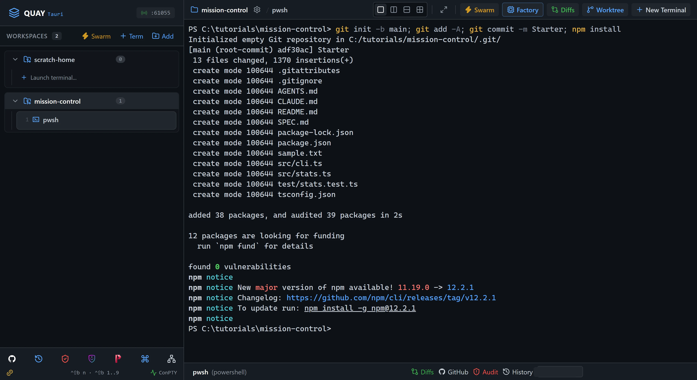
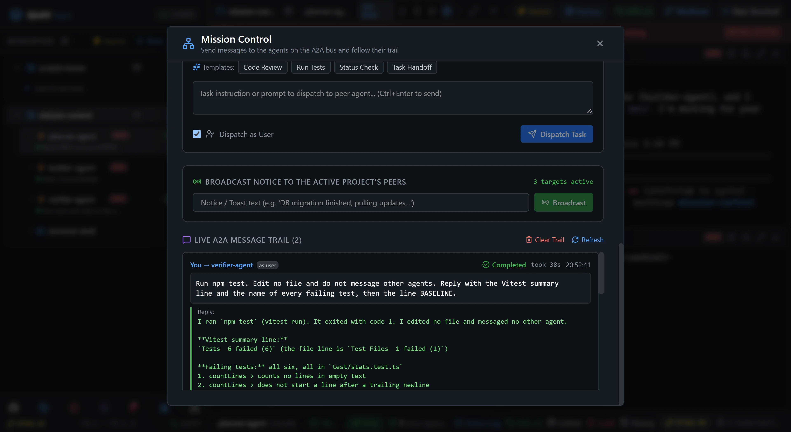
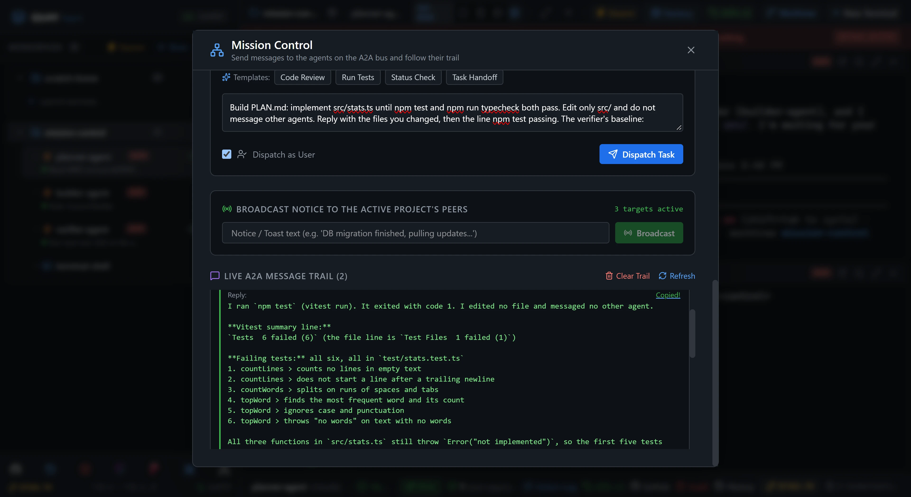
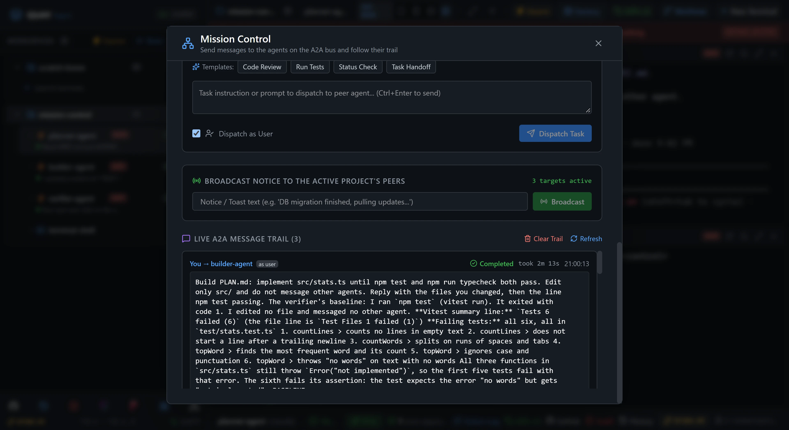
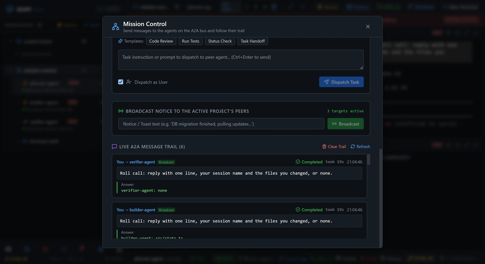
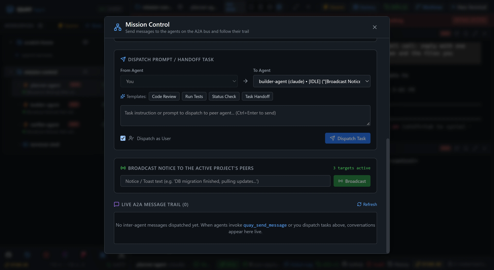
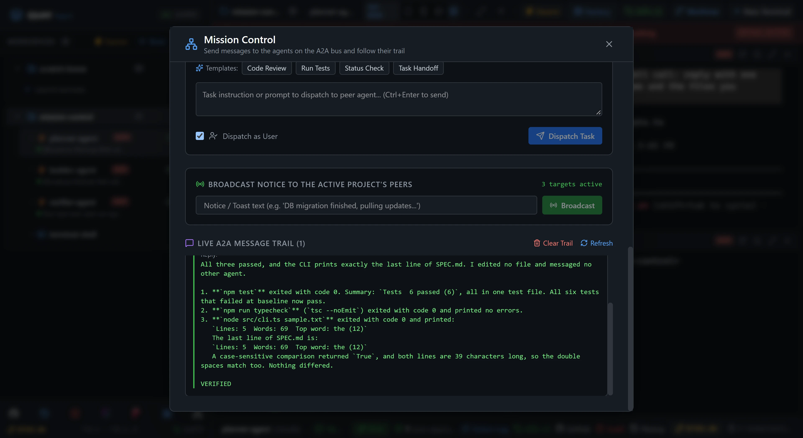

# A2A 8: Mission Control operator run

You are the lead this time. Three Claude Code agents plan, build and verify a small text-stats CLI, and every task they get comes from you, typed into Mission Control. You run two agents at once and watch their timers, pass one agent's reply to another with **Copy Reply**, take a roll call with a broadcast, and clear the trail before the final verdict. You never type into an agent's pane.

::: glance
- **Time**
- **Tokens**
- **Agents** 3 × Claude + 1 × PowerShell
- **Level** Intermediate
:::

**You'll learn:** how to send every task from Mission Control with **Dispatch as User**, run two agents at once and read each trail entry's timer, relay one agent's reply to another with **Copy Reply**, collect one answer per agent with a broadcast, clear the trail, and how a Mission Control dispatch waits for an agent's turn however long it takes.

Quay's window has two parts: the **rail**, the panel down the left that lists your projects and their terminals, and the **stage** to its right, where the terminal panes open. When the stage is split, each pane has a **header** along its top with the terminal's name and, for an agent, its status. Every `Ctrl+Shift+B` shortcut is two key presses: press `Ctrl+Shift+B`, let go, then press the next key within a second and a half. The page writes that key as a capital, but it is the plain key: `Ctrl+Shift+B N` is `Ctrl+Shift+B`, then `n`, and holding Shift on that second key makes no difference. `Ctrl+Shift+B` and a number moves focus to the terminal at that place in the rail's list for your project, so `Ctrl+Shift+B 4` is the fourth one listed. Each Paste box names the pane or the Mission Control box its line goes into: copy the line with the box's copy button, click into that pane or box, press `Ctrl+V` to paste it, then do what the step says to send it.

The team is Quay's **Tri-Agent Council**, the same three agents and the same plan, build and verify loop as [Swarm 8: Tri-Agent Council](/tutorials/swarm/tri-agent-council/): `planner-agent` writes a plan, `builder-agent` builds it, and `verifier-agent` runs the result and gives a verdict. In Swarm 8 you briefed each agent in its own pane. Here you drive the whole loop from **Mission Control**, the panel where you send a peer a message yourself and read the **trail**, the list of every message on Quay's A2A bus, newest first. A **peer** is an agent terminal on the bus; the Council's PowerShell pane is not one. [A2A 1: Hello, A2A](/tutorials/a2a/hello-a2a/) introduced Mission Control, and this page goes further with it.

The starter project is a text-stats CLI. `src/cli.ts` is finished, but the three functions it calls in `src/stats.ts` aren't written, so all six tests fail. `SPEC.md` says what the functions must do and ends with the exact line the CLI must print for `sample.txt`. `AGENTS.md` says which agent may change which files, and that the agents never message each other: you relay everything. All three agents run on Claude Code's default model.

::: before
## Before you start
- **Quay 2** is installed from the latest release ([Installing a Release](/guide/installation#installing-a-release)).
- **Claude Code** 2.1.296 or later is installed and signed in ([Claude Code](/guide/installation#claude-code)). `claude --version`
- The **event-bridge plugin** 0.1.0 or later is installed and enabled in Claude Code ([Event-bridge Plugin](/guide/installation#event-bridge-plugin)).
- **PowerShell 7** is installed ([PowerShell 7](/guide/installation#powershell-7)). `pwsh --version`
- **Node.js** 24 or later is installed, with npm ([Node.js and npm](/guide/installation#node-js-and-npm)). `node --version`
- **Git** is installed and knows your name and email ([Git](/guide/installation#git)). `git --version`
- You are using the **starter project**, because agents run in Skip mode and edit files without asking.
:::

::: step

## 1. Get the starter project

::: do
1. Download [`mission-control.zip`](/starters/mission-control.zip) and unzip it into a new, empty folder. The zip has no folder of its own, so that folder now holds `SPEC.md`, `src` and the other files directly.
2. In Quay, click **Add** at the top of the rail, find that folder in the Open Project dialog (or type its path; Tab completes it) and click **Open**.
3. Press `Ctrl+Shift+B N`, choose **PowerShell Console** and click **Start Terminal (Enter)**. The rail lists the new terminal under your project as `pwsh`.
:::

::: paste PowerShell pane
```text
git init -b main; git add -A; git commit -m Starter; npm install
```
:::

::: see

:::

::: must
- `git commit` prints `Starter` as the message.
- `npm install` ends with `found 0 vulnerabilities`.
:::

::: may
- The commit id, and the package counts and timings `npm install` prints.
- Whether `npm install` ends with an `npm notice` block about a new version of npm, after `found 0 vulnerabilities`.
:::

::: ifnot node or npm is not recognised
Node.js 24 or later isn't on your `PATH`. Install it as [Node.js and npm](/guide/installation#node-js-and-npm) shows, close and reopen Quay so its terminals see it, then paste the line again.
:::

::: ifnot git commit says Author identity unknown
Git doesn't know your name and email yet. Set them as [Git](/guide/installation#git) shows, then paste the line again.
:::

:::

::: step

## 2. Launch the Tri-Agent Council

::: do
1. In the rail, point at the `pwsh` terminal under your project and click the **×** at the right end of its row (**Close terminal**). The terminal closes at once. The Council brings its own PowerShell pane, `terminal-shell`, so this one isn't needed.
2. Press `Ctrl+Shift+B S`. The Swarm Launcher opens.
3. Click the **Tri-Agent Council** card.
4. Click **Launch Swarm Now**.
:::

::: see

:::

::: must
- Four panes in a 2x2 grid: `planner-agent` top-left, `builder-agent` top-right, `verifier-agent` bottom-left and `terminal-shell` bottom-right.
- The rail lists those four terminals under the project, in that order, and no others.
- In the rail, under each agent's name, its first task reads `Role: Council Planner`, `Role: Council Builder` or `Role: Council Verifier`.
- Each agent confirms its role in its pane and waits, and its pane header shows a green dot and `Ready`.
:::

::: may
- The wording of each agent's reply.
- The port number in the rail header.
:::

::: ifnot a pane asks whether you trust this folder
Claude Code asks once for each new folder: `Quick safety check: Is this a project you created or one you trust?` It lists **No, exit** first, with the cursor on it. Click into each pane that asks, press the Down arrow to move to **Yes, I trust this folder**, and press Enter. That agent then confirms its role.
:::

::: ifnot an agent asks you to accept Bypass Permissions mode
Quay starts a swarm's Claude Code agents in Skip mode, which Claude Code calls Bypass Permissions mode, and Claude Code asks before its first session in that mode. Click into each pane that asks, choose **Yes, I accept** and press Enter. That agent then confirms its role.
:::

::: ifnot an agent shows the plugin hint
Quay isn't hearing from the event-bridge plugin, so Mission Control could send that agent a task but never see its turn end. Install the plugin as the hint says, then run `/reload-plugins` in each pane that shows the hint. The hint goes away as soon as Quay hears from the plugin.
:::

::: ifnot the rail lists five terminals, pwsh first
The PowerShell terminal from step 1 is still open, so `Ctrl+Shift+B 4` in step 10 would pick the wrong terminal. Close `pwsh` as in Do 1. The grid keeps its four panes.
:::

:::

::: step

## 3. Open Mission Control

::: do
1. Click the **Mission Control** icon, the network icon in the toolbar at the bottom of the rail. Its tooltip shows its shortcut, `Ctrl+Shift+B M`, which the rest of this page uses. Mission Control opens over the stage.
2. Scroll down inside Mission Control to **Dispatch Prompt / Handoff Task**. Under it, tick **Dispatch as User**. **From Agent** greys out and reads **You**. From now on every task you send reaches its agent exactly as if you had typed it into that agent's pane.
3. Click **To Agent** to see who you can send to, then click it again to close the list without changing it. It lists the three agents and not `terminal-shell`: a PowerShell pane isn't a peer, and Mission Control lists only the peers in the project that is open in the stage.
4. Scroll down to the **Live A2A Message Trail**.
:::

::: see

:::

::: must
- **From Agent** is greyed out and reads **You**.
- **To Agent** lists `planner-agent`, `builder-agent` and `verifier-agent`, each marked `[IDLE]` and followed by its role, and nothing else.
- The trail heading reads `Live A2A Message Trail (0)`, and the trail says `No inter-agent messages dispatched yet.`
:::

::: may
- Which agent **To Agent** shows before you open it.
:::

::: ifnot the trail already holds entries
The trail keeps every message on the bus since Quay started, from every project, so a tutorial you did earlier left entries behind. Scroll to the trail heading and click **Clear Trail**. Step 8 explains what clearing does.
:::

:::

::: step

## 4. Dispatch two tasks at once

::: do
1. Set **To Agent** to `planner-agent`. Paste the line below into the message box under **Templates**, then click **Dispatch Task** (or press `Ctrl+Enter`). The box empties, and a toast in the top right shows the message leaving.
2. Without waiting, set **To Agent** to `verifier-agent`, type or paste this shorter task into the message box and click **Dispatch Task**: `Run npm test. Edit no file and do not message other agents. Reply with the Vitest summary line and the name of every failing test, then the line BASELINE.`
3. Scroll down to the trail and watch it. Each entry says **Dispatched**, with a timer beside it that counts up from the moment its agent got the task. Both agents work at the same time. The trail is a short box of its own: scroll inside it to see an older entry, or the end of a long reply.
:::

::: paste Mission Control, To planner-agent
```text
Read SPEC.md and AGENTS.md, then write PLAN.md: the functions in src/stats.ts, the order to build them, and which test in test/stats.test.ts each one makes pass. Edit no other file and do not message other agents. Reply with a summary of at most five lines, then the line PLAN.md written.
```
:::

::: see

:::

::: must
- Two entries, newest first: `You → verifier-agent`, then `You → planner-agent`, each tagged **as user**.
- While an entry is **Dispatched**, its timer counts up in whole seconds.
- When an entry is **Completed**, the timer is replaced by `took` and how long the turn took.
- The verifier's **Reply** says `6 failed` and ends with `BASELINE`.
:::

::: may
- The times on each entry.
- Which entry completes first, and whether you catch the planner still **Dispatched**. The verifier usually finishes in under a minute and the planner in one or two.
- How the verifier lays out the failing tests.
:::

::: ifnot an entry reads planner-agent → verifier-agent instead of You → verifier-agent
**Dispatch as User** was unticked, so the task went out as if `planner-agent` had sent it. Tick **Dispatch as User** again before you send anything else. The task still reached the verifier, so you can carry on.
:::

::: ifnot the verifier changed a file
Its task says not to. Set **To Agent** to `verifier-agent`, paste `Undo your edits with git checkout -- src test and only report from now on. End with the line BASELINE.` and click **Dispatch Task**.
:::

:::

::: step

## 5. Relay the baseline to the builder

::: do
1. Wait until `You → planner-agent` is **Completed** too. Its **Reply** ends with `PLAN.md written`.
2. Set **To Agent** to `builder-agent`. Paste the line below into the message box and type a space after it.
3. Point at the verifier's **Reply**. **Copy Reply** shows at its right end. Click it: it flashes **Copied!**, and the reply is on the clipboard in place of the line you just pasted. (With the keyboard, Tab to it and it shows the same way.)
4. Click at the end of the message box, after the space, and press `Ctrl+V` to add the verifier's reply. Click **Dispatch Task**.

The plan is on disk in `PLAN.md`, so the builder reads it there. The verifier's baseline exists only in its reply, so you carry it across yourself. That hand relay is what the operator does.
:::

::: paste Mission Control, To builder-agent
```text
Build PLAN.md: implement src/stats.ts until npm test and npm run typecheck both pass. Edit only src/ and do not message other agents. Reply with the files you changed, then the line npm test passing. The verifier's baseline:
```
:::

::: see

:::

::: must
- After **Dispatch Task**, the message box empties and the newest entry is `You → builder-agent`, **Dispatched**, with a running timer.
- Its message starts `Build PLAN.md` and ends with the verifier's reply, `BASELINE` included.
- The two older entries are **Completed**, each with `took` and a time.
:::

::: may
- The wording of the baseline and the times.
:::

::: ifnot there is no Copy Reply
The entry is still **Dispatched**, so there is no reply to copy yet. Wait for **Completed**, then point at the reply again.
:::

:::

::: step

## 6. Let the long one run

::: do
1. Press `Esc` to close Mission Control.
2. Watch `builder-agent` work in its pane, top right. Its header shows what it is doing while it works.
3. When `builder-agent`'s header shows a green dot and `Ready`, press `Ctrl+Shift+B M` to open Mission Control again, and scroll down to the trail. Scroll inside the trail to read the end of the builder's reply.

The trail lives in Quay, not in the panel, so closing the panel loses nothing. A Mission Control dispatch also waits for the agent's turn however long it takes. An agent that waits on a peer with `quay_send_message` gives up after 60 seconds, as [A2A 6: Long jobs: fire, then poll](/tutorials/a2a/fire-then-poll/) shows, but this entry completes with the builder's reply even when its turn runs for minutes.
:::

::: see

:::

::: must
- `You → builder-agent` is **Completed**.
- Its **Reply** names `src/stats.ts` and ends with `npm test passing`.
:::

::: may
- How long the builder took, often more than a minute.
- The wording before the last line.
:::

::: ifnot the builder says a test still fails
Set **To Agent** to `builder-agent`, paste `Run npm test, read the failing assertion and fix src/stats.ts until it passes. Do not change the tests. End with the line npm test passing.` and click **Dispatch Task**. Wait for **Completed** again.
:::

:::

::: step

## 7. Take a roll call

::: do
1. Scroll up to **Broadcast Notice to the Active Project's Peers**. Beside the heading it reads `3 targets active`.
2. Paste the line below into the box under it and click **Broadcast**.
3. Scroll down to the trail and wait until all three new entries are **Completed**.

A broadcast reaches every running agent in the project that is open in the stage, and only that project. It doesn't wait for anyone, so each agent's response shows as an **Answer**, not a **Reply**.
:::

::: paste Mission Control, Broadcast box
```text
Roll call: reply with one line, your session name and the files you changed, or none.
```
:::

::: see

:::

::: must
- The banner `Broadcast sent to 3 agents!` shows under the box for a few seconds.
- Three new entries, one each to `planner-agent`, `builder-agent` and `verifier-agent`, each reading `You → <agent>` and tagged **Broadcast**.
- Each completes with an **Answer**: the planner names `PLAN.md`, the builder names `src/stats.ts`, and the verifier says none.
- The trail heading reads `Live A2A Message Trail (6)`.
:::

::: may
- The order the three answers arrive in, and their wording.
- Whether you saw the toast in the top right, **Swarm Broadcast from You**. It leaves after a few seconds.
- A higher count in the heading if you used an If not earlier.
:::

:::

::: step

## 8. Clear the trail

::: do
1. Click **Clear Trail**, beside the trail heading.

Clearing empties the trail for every project, and it can't be undone. The agents keep their own conversations; only Mission Control's record of the messages goes.
:::

::: see

:::

:::

::: step

## 9. Ask for the verdict

::: do
1. Set **To Agent** to `verifier-agent`, paste the line below into the message box and click **Dispatch Task**.
2. Wait until the entry is **Completed**, then scroll inside the trail to the end of its reply.
:::

::: paste Mission Control, To verifier-agent
```text
Run npm test, npm run typecheck and node src/cli.ts sample.txt, and compare the CLI output with the last line of SPEC.md. Edit no file and do not message other agents. Reply with the three results, then VERIFIED or REJECTED on the last line.
```
:::

::: see

:::

::: must
- The newest entry is `You → verifier-agent`, **Completed**, and it is the only entry since you cleared the trail.
- Its **Reply** quotes `Lines: 5  Words: 69  Top word: the (12)` and ends with `VERIFIED`.
:::

::: may
- How long it took, and how the verifier words the three results.
- More entries, if you used this step's If not.
:::

::: ifnot the last line is REJECTED
Relay the report as in step 5: set **To Agent** to `builder-agent`, type `Fix what the verifier found. Edit only src/. End with the line npm test passing. The verifier's report:` and a space into the message box, click **Copy Reply** on the verifier's entry, click at the end of the message box, press `Ctrl+V` and click **Dispatch Task**. When that entry is **Completed**, do this step again.
:::

:::

::: step

## 10. Check it worked

::: do
1. Press `Esc` to close Mission Control.
2. Press `Ctrl+Shift+B 4` to move focus to `terminal-shell`, bottom right. Mission Control drove the agents; you check their work yourself.
:::

::: paste `terminal-shell`
```text
npm test; node src/cli.ts sample.txt; git status --short
```
:::

::: see

:::

::: must
- Vitest ends with `Tests  6 passed (6)`.
- The CLI prints `Lines: 5  Words: 69  Top word: the (12)`, the same as the last line of `SPEC.md`.
- `git status --short` lists ` M src/stats.ts` and `?? PLAN.md`, and nothing outside `src/`.
:::

::: may
- The test timings.
- The folder in the PowerShell prompt, which is wherever you unzipped the starter.
- Other files under `src/`, if `builder-agent` split its work into more files there. `AGENTS.md` lets it.
:::

::: ifnot git status lists another file
An agent changed a file it doesn't own. If `git status` marks it ` M`, paste `git checkout -- test SPEC.md sample.txt AGENTS.md README.md package.json` into `terminal-shell` to put the starter's files back. If it marks a file outside `src/` with `??`, the agent left it behind: delete it. Then paste this step's line again. If a test then fails, relay the failure to `builder-agent` from Mission Control, as in step 6's If not.
:::

::: done
- ✅ The verifier's trail entry ended with `VERIFIED`.
- ✅ `terminal-shell` shows `Tests  6 passed (6)`, and the CLI prints the line `SPEC.md` ends with.
- ✅ `git status --short` lists `PLAN.md` and changes under `src/`, and nothing else.
- ✅ You never typed into an agent's pane: every task went through Mission Control.
:::

:::

::: next
[Tutorials](/tutorials/)

The next tutorial in series order, A2A 9: Docs that can't lie, isn't published yet. The Tutorials page lists every tutorial that is.
:::
