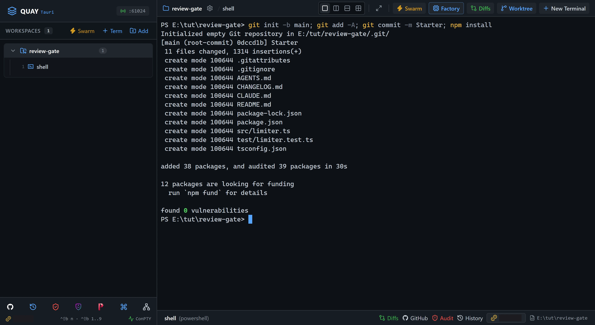
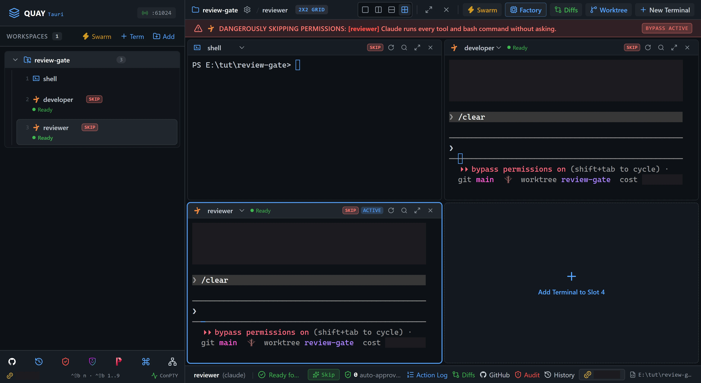
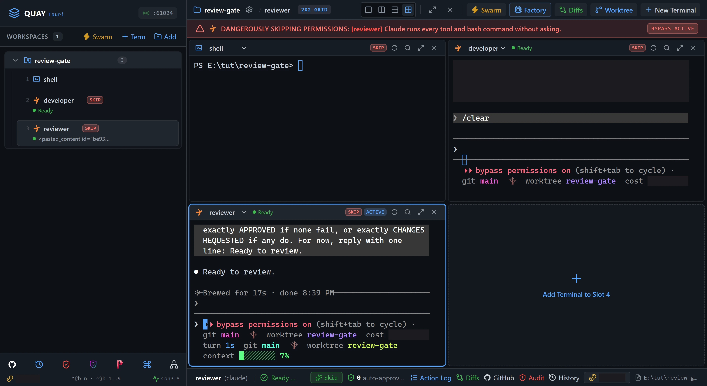
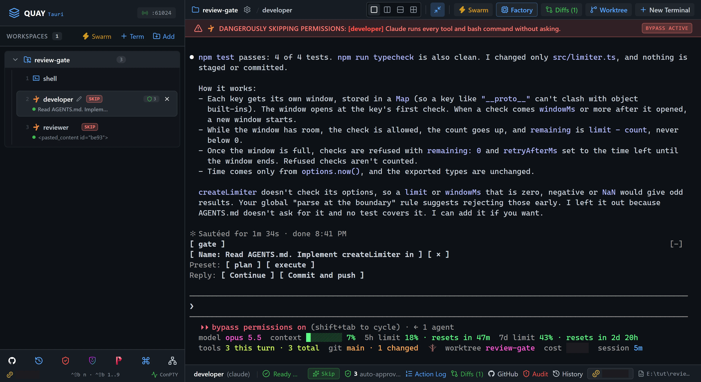
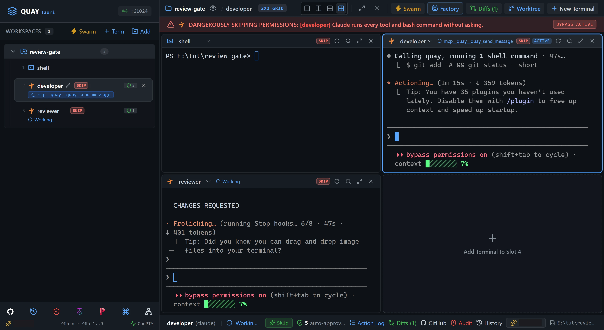
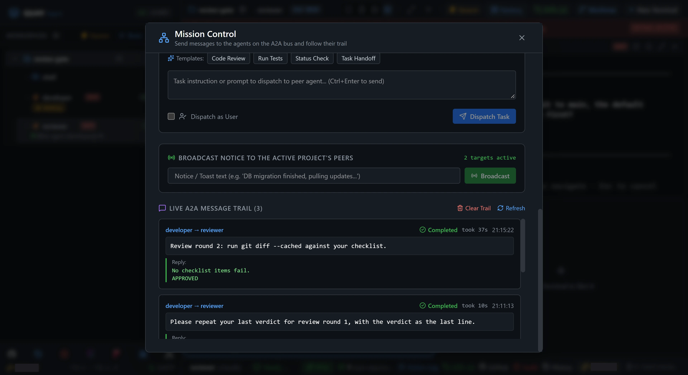

# A2A 4: Review gate before commit

One Claude Code agent writes a rate limiter. A second Claude Code agent reviews every change before it can be committed. You start the loop with one prompt, and the two agents go back and forth over Quay's A2A bus until the reviewer's reply ends in `APPROVED`.

::: glance
- **Time**
- **Tokens**
- **Agents** 2 × Claude + 1 × PowerShell
- **Level** Intermediate
:::

**You'll learn:** asking a peer for a verdict with `quay_send_message` and `wait_for_reply`, why a fixed last line makes a verdict checkable, passing work between agents by reference (staged changes in git) instead of pasting it into a message, what to do when a reply outlasts its 60 seconds, and reading a back-and-forth in Mission Control's message trail.

Quay's window has two parts: the **rail**, the panel down the left that lists your projects and their terminals, and the **stage** to its right, where the terminal panes open. When the stage is split, each pane has a **header** along its top with the terminal's name and, for an agent, its status. Every `Ctrl+Shift+B` shortcut is two key presses: press `Ctrl+Shift+B`, let go, then press the next key within a second and a half. The page writes a letter key as a capital, but it is the plain key: `Ctrl+Shift+B N` is `Ctrl+Shift+B`, then `n`. `Ctrl+Shift+B` and a number moves focus to the terminal at that place in the rail's list for your project, so `Ctrl+Shift+B 1` is the first one listed. Each Paste box names the pane its line goes into: copy the line with the box's copy button, click into that pane, press `Ctrl+V` to paste it, then press Enter to run it or send it to the agent.

Agents can message each other over Quay's **A2A bus** with the `quay_send_message` tool. Quay types each message into the receiving agent's pane as a new prompt that starts `[Peer agent (<sender>)]:`. A sender can wait up to a minute for the reply, which comes back to it with its line breaks intact. Every message shows up in **Mission Control**, Quay's view of all the traffic on the bus. [A2A 1: Hello, A2A](/tutorials/a2a/hello-a2a/) walks through the bus one message at a time.

::: before
## Before you start
- **Quay 2** is installed from the latest release ([Installing a Release](/guide/installation#installing-a-release)).
- **Claude Code** 2.1.296 or later is installed and signed in ([Claude Code](/guide/installation#claude-code)). `claude --version`
- The **event-bridge plugin** 0.1.0 or later is installed and enabled in Claude Code ([Event-bridge Plugin](/guide/installation#event-bridge-plugin)).
- **PowerShell 7** is installed ([PowerShell 7](/guide/installation#powershell-7)). `pwsh --version`
- **Node.js** 24 or later is installed, with npm ([Node.js and npm](/guide/installation#node-js-and-npm)). `node --version`
- **Git** is installed and knows your name and email ([Git](/guide/installation#git)). `git --version`
- You are using the **starter project**, because agents run in Skip mode and edit files without asking.
:::

::: step

## 1. Get the starter project

The starter is a small TypeScript library. `src/limiter.ts` is the rate limiter's contract the developer fills in, `test/limiter.test.ts` holds four tests that fail until it does, and `CHANGELOG.md` is the release log. The zip holds these files at its top level, with no folder around them, so the folder you unzip it into is the project folder you add to Quay.

::: do
1. Download [`review-gate.zip`](/starters/review-gate.zip) and unzip it into a new, empty folder.
2. In Quay, click **Add** at the top of the rail, find that folder in the Open Project dialog (or type its path; Tab completes it) and click **Open**.
3. Press `Ctrl+Shift+B N`, choose **PowerShell Console**, type `shell` in **Terminal Label (Optional)** and click **Start Terminal (Enter)**.
:::

::: paste `shell`
```text
git init -b main; git add -A; git commit -m Starter; npm install
```
:::

::: see

:::

::: must
- `git commit` prints `Starter` as the message, then a `create mode` line for each starter file.
- `npm install` ends with `found 0 vulnerabilities`.
:::

::: may
- The commit id, package count and timings.
:::

::: ifnot node or npm is not recognised
Node.js 24 or later isn't on your `PATH`. Install it as [Node.js and npm](/guide/installation#node-js-and-npm) shows, close and reopen Quay so its terminals see it, then paste the line again.
:::

::: ifnot git commit says Author identity unknown
Git doesn't know your name and email yet. Set them as [Git](/guide/installation#git) shows, then paste the line again.
:::

:::

::: step

## 2. Start the developer and the reviewer

You'll run the agents side by side in a 2x2 grid with `shell`. Both Claude panes open in Skip mode, Quay's default, so they edit files and run commands without asking for confirmation.

::: do
1. Press `Ctrl+Shift+B G` for the 2x2 grid. `shell` sits in the top-left cell and the other three are empty.
2. Press `Ctrl+Shift+B N`. Under **Autonomous AI Agents**, click **Claude**. Leave **Permission Mode** on **Skip Permissions (Default)**. **Terminal Label (Optional)** still holds `shell` from step 1: replace it with `developer` and click **Start Terminal (Enter)**. `developer` opens in the top-right cell.
3. Press `Ctrl+Shift+B N` again. The dialog keeps your last choices, so **Claude** is still chosen. Replace `developer` with `reviewer` and click **Start Terminal (Enter)**. `reviewer` opens in the bottom-left cell.
4. Wait until both Claude panes show Claude Code's prompt and each pane header shows a green dot and `Ready`. Claude Code may ask first whether you trust this folder, and to accept Bypass Permissions mode; the If nots below show how to answer.
:::

::: see

:::

::: must
- A 2x2 grid with `shell` top left, `developer` top right, `reviewer` bottom left, and an empty cell bottom right.
- The rail lists `shell`, `developer` and `reviewer` under the project, in that order.
- Both Claude pane headers show a green dot and `Ready`, and neither pane shows a plugin hint.
:::

::: may
- Whether `shell` still shows step 1's output. Changing the layout can clear it, leaving only the prompt.
- The port number in the rail header.
- Claude Code's welcome text, and anything your own Claude Code settings print under its input.
:::

::: ifnot a pane asks whether you trust this folder
Claude Code asks once for each new folder: `Quick safety check: Is this a project you created or one you trust?` It lists **No, exit** first, with the cursor on it. Click into that pane, press the Down arrow to move to **Yes, I trust this folder**, and press Enter. Only the first Claude pane asks; the second opens straight to the prompt.
:::

::: ifnot a pane asks you to accept Bypass Permissions mode
Quay starts Claude Code in Skip mode, which Claude Code calls Bypass Permissions mode, and Claude Code asks once before its first session in that mode. Click into that pane, choose **Yes, I accept** and press Enter.
:::

::: ifnot a Claude pane shows the plugin hint
The hint is one line at the top of the pane that begins `No events from the event-bridge plugin.` If Claude Code is showing a prompt in the pane, answer it, and the hint clears on its own. Otherwise click **Copy** on the hint, click into `shell`, paste the install line and press Enter. Then click into the Claude pane, type `/reload-plugins` and press Enter. The hint goes away as soon as Quay hears from the plugin. Don't go on without it: a reviewer whose plugin Quay can't hear can't send its verdict back.
:::

:::

::: step

## 3. Brief the reviewer

The reviewer never edits, stages or commits files. It reviews only the staged diff against its checklist, and replies with at most eight lines ending in `APPROVED` or `CHANGES REQUESTED`.

::: do
1. Click into `reviewer` and paste this step's prompt. It answers within half a minute.
:::

::: paste `reviewer`
```text
You are the reviewer for this project. You never edit, stage or commit files, and you never message anyone: you answer in your reply. When a peer agent asks for a review, run git diff --cached and review only that staged diff against this checklist: 1. every rule in AGENTS.md has a test, including a check made exactly windowMs after a key's first check being allowed; 2. src/ reads the time only through options.now, never Date.now() or new Date(); 3. CHANGELOG.md gains a line under Unreleased that describes the change; 4. package.json is unchanged. Do not run tests or read other files. Reply in at most eight lines: a numbered list of the checklist items that fail and why, then a last line that is exactly APPROVED if none fail, or exactly CHANGES REQUESTED if any do. For now, reply with one line: Ready to review.
```
:::

::: see

:::

::: must
- The reply in `reviewer` is `Ready to review.`
- No file is changed in the project.
:::

::: may
- The timing of the response.
:::

:::

::: step

## 4. The developer builds the limiter

Now prompt `developer` to implement the rate limiter in `src/limiter.ts` so that `npm test` passes, without staging or committing yet.

::: do
1. Click into `developer` and paste this step's prompt. Its header shows a spinner while it works, often for a minute or two.
2. When it has answered and its header reads `Ready` again, press `Ctrl+Shift+B Z`, or click its header's **Zoom pane** button, to zoom it to the whole stage, and read its summary. Press `Ctrl+Shift+B Z` again to put the grid back.
:::

::: paste `developer`
```text
Read AGENTS.md. Implement createLimiter in src/limiter.ts so that npm test passes, without changing the exported types. Do not stage or commit anything yet. Tell me when npm test passes.
```
:::

::: see

:::

::: must
- `developer` reports that `npm test` passes, 4 of 4 tests.
- It says nothing is staged or committed.
:::

::: may
- How it implemented the limiter, and how long it took, often a minute or two.
- Whether it also ran `npm run typecheck`, or offered to add more checks.
- Anything your own Claude Code settings add under the input, such as a status line.
:::

::: ifnot developer committed the change
Paste `git reset --soft HEAD~1` into `shell` to undo the commit while keeping the modified files, then carry on.
:::

:::

::: step

## 5. Run the review gate

This is the lesson. One prompt starts a loop the two agents run on their own without you.

::: do
1. Click into `developer` and paste this step's prompt.
2. Watch `developer`. It stages its work with `git add -A`, then calls `quay_send_message`, and its pane header shows `mcp__quay__quay_send_message` with a spinner while it waits for the reply.
3. Watch `reviewer`. The message lands as a new prompt, `[Peer agent (developer)]: Review round 1: run git diff --cached against your checklist.`, its header shows a spinner, and it runs `git diff --cached`. Its answer ends with its verdict.
4. Watch `developer` again. When the verdict is `CHANGES REQUESTED`, it fixes the findings, runs `npm test`, stages again and sends round 2.
:::

::: paste `developer`
```text
Now pass the review gate. Stage everything with git add -A, then call quay_send_message with target_terminal_id reviewer, wait_for_reply true, and the message: Review round 1: run git diff --cached against your checklist. Never put the diff itself in a message; the reviewer reads it from git. If the reply's last line is CHANGES REQUESTED, fix every finding, run npm test until it passes, stage again and send the same message with the next round number. If a reply has no verdict as its last line, call quay_get_agent_status for reviewer until its status is Idle, then ask it to repeat its last verdict. Stop and tell me if round 4 is not approved. As soon as a reply's last line is exactly APPROVED, commit with git commit -m "feat: add fixed-window rate limiter" and make no other change first. Then tell me the commit hash and how many rounds it took.
```
:::

::: see

:::

::: must
- The message in `reviewer` is one line starting `[Peer agent (developer)]: Review round 1`.
- The reviewer's answer is a short numbered list ending with `CHANGES REQUESTED` or `APPROVED` as its last line.
- `developer` sends each later round the same way, with the next round number, until a verdict is `APPROVED`.
:::

::: may
- The findings, and how many there are. Round 1 usually flags the missing CHANGELOG line and the missing test for a check made exactly `windowMs` after the first.
- How long each review takes, often under a minute.
- Tips and status lines Claude Code prints while an agent works.
:::

::: ifnot the message sits in reviewer's input and reviewer never starts
Quay typed the message into `reviewer` but its Enter didn't take, so the message waits in the input box under the prompt marker. Click into `reviewer` and press Enter. If `developer` has meanwhile stopped and asked you what to do, wait until `reviewer` answers and its header reads `Ready`, then paste into `developer`: `The reviewer is Ready now. Ask it to repeat its last verdict and carry on with the gate.`
:::

::: ifnot the message in reviewer is one enormous line full of plus and minus signs
The developer pasted the diff into the message, and Quay flattened its newlines. Press `Esc` in `reviewer` to stop that turn, then paste into `developer`: `Do not send the diff. Send only the round message and let the reviewer run git diff --cached itself, then carry on with the gate.`
:::

::: ifnot developer says the reviewer is still working and stops
The review took longer than 60 seconds. Wait until `reviewer`'s header reads `Ready`, then paste into `developer`: `The reviewer is Ready now. Ask it to repeat its last verdict and carry on with the gate.`
:::

::: ifnot the reviewer edits or stages a file
Paste into `reviewer`: `You never edit or stage files. Undo what you just changed, then wait for the next review request.`
:::

:::

::: step

## 6. Watch the gate close in Mission Control

Mission Control records every message sent on the A2A bus.

::: do
1. While the loop runs, click the **Mission Control** icon, the network icon in the toolbar at the bottom of the rail, or press `Ctrl+Shift+B M`.
2. Scroll down to **Live A2A Message Trail**. Each round is one `developer → reviewer` entry: the message, its status, and the reviewer's answer under **Reply:**. The trail lists the newest entry first, so the latest round sits on top, and it has its own scroll bar: scroll inside it to read the older rounds.
3. Stay until the top entry reads **Completed** with a reply ending `APPROVED`, then close the panel with the **×** at its top right, or press `Esc`.
:::

::: see

:::

::: must
- Every entry is `developer → reviewer`.
- Every reply before the top one ends `CHANGES REQUESTED`, and the top one ends `APPROVED`.
- The newest round is on top.
:::

::: may
- The number of rounds, usually two and at most four.
- The findings listed in each reply.
- The times, and how long each entry `took`.
- An entry that asks the reviewer to repeat its last verdict, if a round outlasted the 60-second wait.
:::

::: ifnot there is only one entry and it says APPROVED
The developer got every checklist item right the first time. The gate still did its job; carry on.
:::

::: ifnot an entry reads Dispatched with the note No reply within 60s
That round outlasted the 60-second wait. The entry stays open, and when `reviewer` finishes its turn, its answer fills in and the entry turns **Completed**. If `developer` carried on by checking the reviewer's status, let it run. If it stopped, use step 5's If not for a reviewer that is still working.
:::

:::

::: step

## 7. Check it worked

Once `developer` reports that the review gate passed and gives you the commit hash, check the results in `shell`.

::: do
1. Wait until `developer` reports the commit hash and the number of review rounds.
2. Click into `shell` (or press `Ctrl+Shift+B 1`).
:::

::: paste `shell`
```text
npm test; git log --oneline; git show --stat --format= HEAD; git status --short
```
:::

::: see

:::

::: must
- Vitest ends with `Test Files  1 passed (1)` and every test passing. Scroll up in the pane, or press `Ctrl+Shift+B Z` to zoom it, to see it.
- `git log --oneline` lists exactly two commits: `feat: add fixed-window rate limiter` on top, then `Starter`.
- The last commit changes `CHANGELOG.md`, `src/limiter.ts` and `test/limiter.test.ts`, and nothing else.
- `git status --short` prints nothing, so the prompt comes straight after the file list.
:::

::: may
- The commit hash, the number of tests, and the line counts. `developer` adds its own tests in the rounds, so there are more than the starter's four.
- What `developer` says in its report.
:::

::: ifnot git log shows only Starter
The developer stopped before committing. Read its last message: if round 4 was not approved, paste step 5's prompt again.
:::

::: done
- ✅ The reviewer's last reply in Mission Control ends with `APPROVED`, and no reply before it does.
- ✅ `git log --oneline` shows the `feat: add fixed-window rate limiter` commit on top of `Starter`.
- ✅ That commit touches `CHANGELOG.md`, `src/limiter.ts` and `test/limiter.test.ts` only.
- ✅ `npm test` passes and `git status --short` is empty.
:::

:::

::: next
[A2A 5: Fan-out / fan-in](/tutorials/a2a/fan-out-fan-in/)

The next tutorial in series order. Have a lead agent split a static-site generator across three workers at once, then wire their parts together.
:::
