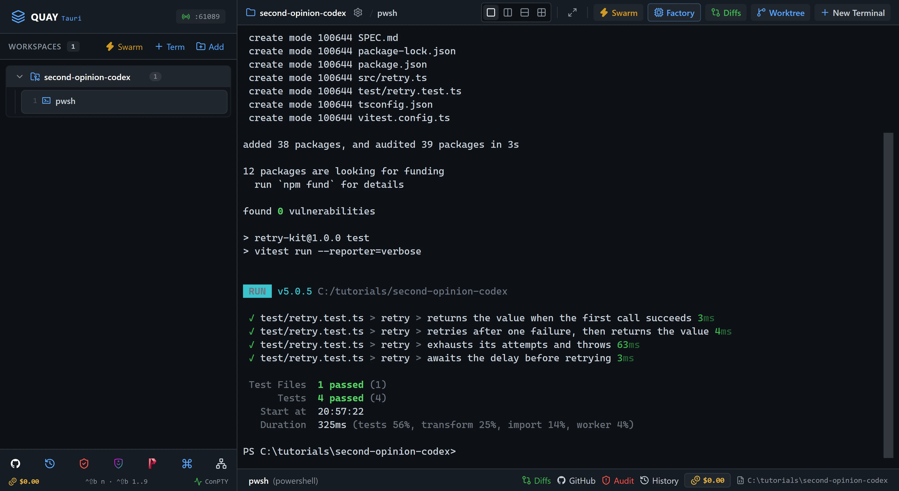
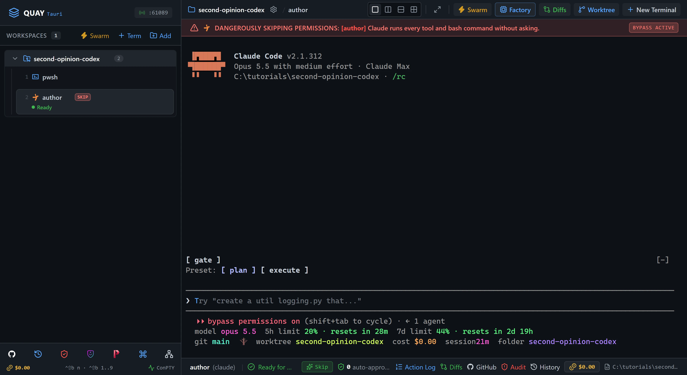
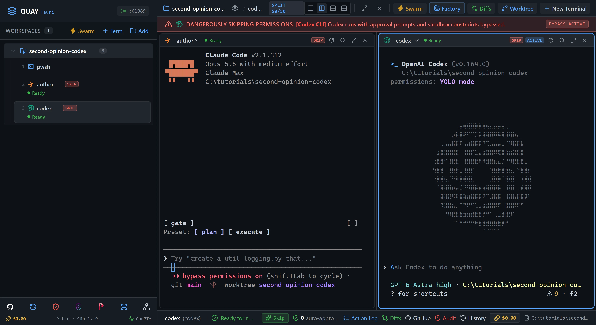
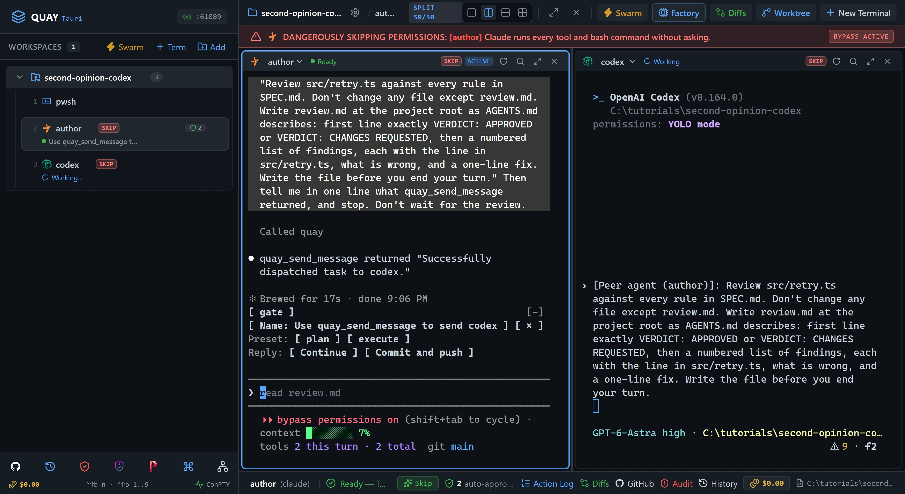
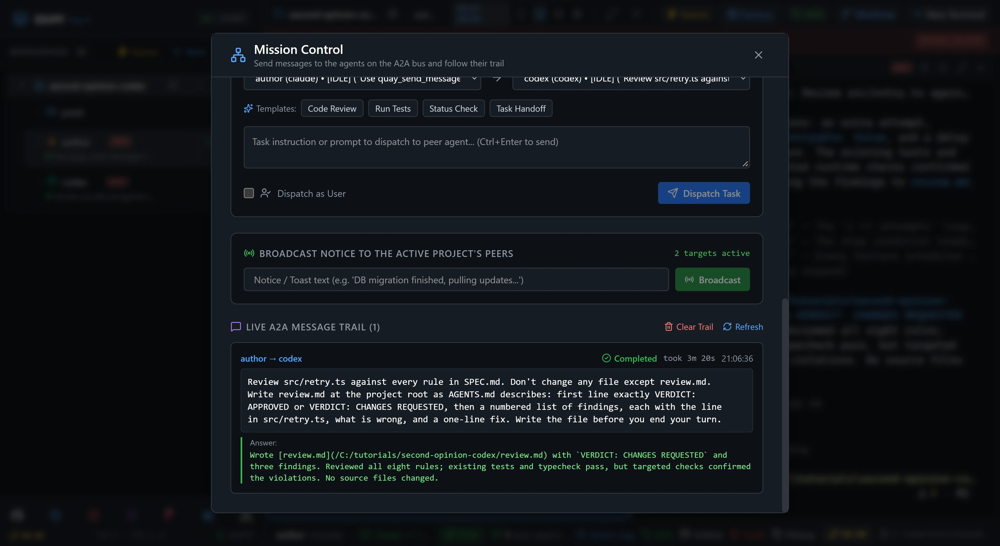
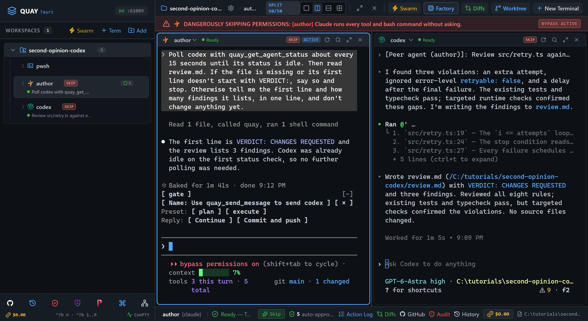
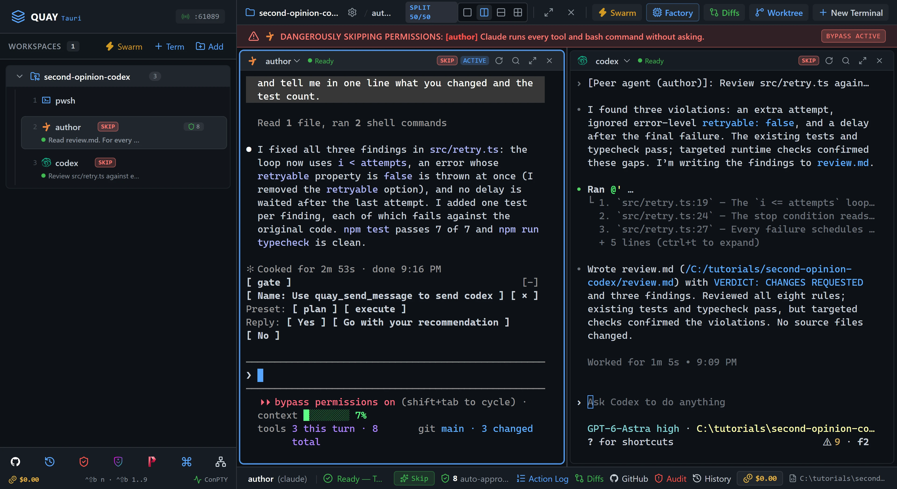

# A2A 10: Second opinion from Codex

`author`, a Claude Code agent, owns a small retry helper that it didn't write. Before it ships, `author` asks `codex`, an OpenAI Codex agent in the next pane, for a review. Codex writes its findings to `review.md`, and `author` reads the file, fixes every finding and adds the tests that were missing. Then you run tests that neither agent ever saw.

::: glance
- **Time**
- **Tokens**
- **Agents** 1 × Claude + 1 × Codex + 1 × PowerShell
- **Level** Intermediate
:::

**You'll learn:** how to open a Codex terminal in Quay and what its Skip mode means, how an agent that isn't Claude joins the A2A bus as a full peer, how to send Codex a job with `wait_for_reply` false, how to ask for an answer in a file of an agreed shape, how to poll with `quay_get_agent_status` until a peer is idle, and how to check an agent's review against tests it never saw.

This tutorial builds on [A2A 1: Hello, A2A](/tutorials/a2a/hello-a2a/), which introduces the `quay_*` tools and Mission Control's trail, and reuses its moves for a job too long to wait for: send it without waiting, poll until the peer is idle, then read the file it wrote. You don't need to have done A2A 1.

Quay's window has two parts: the **rail**, the panel down the left that lists your projects and their terminals, and the **stage** to its right, where the terminal panes open. Along the bottom of the stage, the **status strip** shows the status of the terminal that has focus. When the stage is split, each pane also has a **header** along its top with the terminal's name and, for an agent, its status. Every `Ctrl+Shift+B` shortcut is two key presses: press `Ctrl+Shift+B`, let go, then press the next key within a second and a half. The page writes a letter key as a capital, but it is the plain key: `Ctrl+Shift+B N` is `Ctrl+Shift+B`, then `n`, and `Ctrl+Shift+B O` is the letter o, never the digit zero. `Ctrl+Shift+B` and a number moves focus to the terminal at that place in the rail's list for your project, so `Ctrl+Shift+B 1` is the first one listed. Each Paste box names the pane its line goes into: copy the line with the box's copy button, click into that pane, press `Ctrl+V` to paste it, then press Enter to run it or send it to the agent.

A **peer** is an agent terminal on Quay's A2A bus. A **full peer** can send messages with the `quay_*` tools and answer a sender who waits for it. Codex is a full peer, just like Claude Code: Quay delivers messages to it, sees when its turn ends, and shows its status. A PowerShell terminal is not a peer.

The starter project, `retry-kit`, is a small, finished TypeScript package. The previous developer left in a hurry; the tests pass; `author` now owns it. `SPEC.md` is the contract both agents read, `AGENTS.md` gives them the commands, the house rules and the shape a review takes, and `CLAUDE.md` points Claude Code at `AGENTS.md`. Codex reads `AGENTS.md` on its own.

::: before
## Before you start
- **Quay 2** is installed from the latest release ([Installing a Release](/guide/installation#installing-a-release)).
- **Claude Code** 2.1.296 or later is installed and signed in ([Claude Code](/guide/installation#claude-code)). `claude --version`
- The **event-bridge plugin** 0.1.0 or later is installed and enabled in Claude Code ([Event-bridge Plugin](/guide/installation#event-bridge-plugin)). Without it Quay can't tell when `author`'s turn ends.
- **Codex CLI** 0.154.0 or later is installed, updated to its latest version with `npm install -g @openai/codex@latest`, and signed in ([Codex CLI](/guide/installation#codex-cli)). `codex --version`. Update it before you start: Codex tries to update itself when it launches, and a failed update makes its pane exit at once.
- **PowerShell 7** is installed ([PowerShell 7](/guide/installation#powershell-7)). `pwsh --version`
- **Node.js** 24 or later is installed, with npm ([Node.js and npm](/guide/installation#node-js-and-npm)). `node --version`
- **Git** is installed and knows your name and email ([Git](/guide/installation#git)). `git --version`
- You are using the **starter project**, because both agents run in Skip mode. Quay starts Codex with `--dangerously-bypass-approvals-and-sandbox`, which turns off Codex's approval prompts and its sandbox as well. In this tutorial Codex only reads files and writes `review.md`.
:::

::: step

## 1. Get the starter project

::: do
1. Download [`second-opinion-codex.zip`](/starters/second-opinion-codex.zip) and unzip it into a new, empty folder, for example `C:\tutorials\second-opinion-codex`. The zip has no folder of its own inside, so `src`, `test` and `SPEC.md` land straight in the folder you chose, and that folder is the project.
2. In Quay, click **Add** at the top of the rail, find that folder in the Open Project dialog (or type its path; Tab completes it) and click **Open**.
3. Press `Ctrl+Shift+B N`, choose **PowerShell Console** and click **Start Terminal (Enter)**. The rail lists the new terminal under your project as `pwsh`.
:::

::: paste PowerShell pane
```text
git init -b main; git add -A; git commit -m Starter; npm install; npm test
```
:::

::: see

:::

::: must
- `git commit` prints `Starter` as the message.
- `npm test` ends with `Tests  4 passed (4)`.
:::

::: may
- The commit id, and the package counts and timings `npm install` and `npm test` print.
- `npm notice` lines, such as one saying a newer npm is available.
:::

::: ifnot node or npm is not recognised
Node.js 24 or later isn't on your `PATH`. Install it as [Node.js and npm](/guide/installation#node-js-and-npm) shows, close and reopen Quay so its terminals see it, then paste the line again.
:::

::: ifnot git commit says Author identity unknown
Git doesn't know your name and email yet. Set them as [Git](/guide/installation#git) shows, then paste the line again.
:::

:::

::: step

## 2. Open author

::: do
1. Press `Ctrl+Shift+B N`. Under **Autonomous AI Agents**, click **Claude**. Leave **Permission Mode** on **Skip Permissions (Default)** and **Model** on **Default (your Claude Code /model setting)**. Type `author` in **Terminal Label (Optional)** and click **Start Terminal (Enter)**. `author` takes the stage, and the PowerShell terminal keeps running behind it.
2. Wait until the status strip at the bottom of the stage shows a green tick and `Ready for next prompt`. Claude Code may ask first whether you trust this folder, and to accept Bypass Permissions mode; the If nots below show how to answer.
:::

::: see

:::

::: must
- The rail lists `pwsh` and `author` under the project, in that order, and `author` shows `Ready`.
- The status strip shows a green tick and begins `Ready`, and `author`'s pane shows no plugin hint.
:::

::: may
- Claude Code's welcome text and the model it names.
- Lines Claude Code prints under its welcome, such as warnings about your own Claude Code settings.
- The port number in the rail header.
:::

::: ifnot author asks whether you trust this folder
Claude Code asks once for each new folder: `Quick safety check: Is this a project you created or one you trust?` It lists **No, exit** first, with the cursor on it. Click into `author`, press the Down arrow to move to **Yes, I trust this folder**, and press Enter.
:::

::: ifnot author asks you to accept Bypass Permissions mode
Quay started `author` in Skip mode, which Claude Code calls Bypass Permissions mode, and Claude Code asks once before its first session in that mode. It lists **No, exit** first, with the cursor on it. Click into `author`, press the Down arrow to move to **Yes, I accept**, and press Enter.
:::

::: ifnot author shows the plugin hint
The hint is one line at the top of the pane that begins `No events from the event-bridge plugin.` Click **Copy** on the hint, press `Ctrl+Shift+B 1` to bring back the PowerShell pane, paste the install line and press Enter. Press `Ctrl+Shift+B 2` to return to `author`, type `/reload-plugins` and press Enter. The hint goes away as soon as Quay hears from the plugin.
:::

:::

::: step

## 3. Open codex beside it

::: do
1. Press `Ctrl+Shift+B`, let go, then type a percent sign, `%`, which on most keyboards is `Shift+5`. The stage splits in two: `author` stays on the left, and the PowerShell terminal from step 1 comes back on the right.
2. Press `Ctrl+Shift+B O` to move focus to the right pane. Its border lights up.
3. Press `Ctrl+Shift+B N`. Under **Autonomous AI Agents**, click **Codex**. Leave **Permission Mode** on **Skip Permissions (Default)** and **Model** on its default. Replace `author` in **Terminal Label (Optional)** with `codex` and click **Start Terminal (Enter)**. `codex` takes the right pane. A new terminal always opens in the pane that has focus, which is why the split comes first.
4. Codex may ask whether you trust this folder, and about hooks; the If nots below show how to answer.
5. Wait until Codex shows its prompt and `codex`'s pane header shows a green dot and `Ready`.

Quay started Codex with `--dangerously-bypass-approvals-and-sandbox`, Codex's Skip mode, so its header carries the same red **SKIP** tag as `author`'s, and while `codex` has focus the red banner across the top of the stage reads `[Codex CLI] Codex runs with approval prompts and sandbox constraints bypassed.` Quay also wired Codex to the A2A bus for this terminal only, with nothing written to your Codex config, which is what makes it a full peer.
:::

::: see

:::

::: must
- The rail lists `pwsh`, `author` and `codex` under the project, in that order.
- Both pane headers show a green dot and `Ready`.
:::

::: may
- Codex's welcome text, the model it names and its version, as long as the version is 0.154.0 or later.
- The port number in the rail header.
:::

::: ifnot Codex asks Trust this folder?
Codex asks once for each new folder, under **Folder access**, with **1. Trust and continue** already selected. Click into `codex` and press Enter.
:::

::: ifnot Codex says Hooks need review
Codex asks before it runs hooks that are new or changed since you last trusted them. Click into `codex`, press the Down arrow to move to **2. Trust all and continue**, and press Enter.
:::

::: ifnot the codex pane printed Updating Codex CLI and then exited
Codex tried to update itself and the download failed. Press `Ctrl+Shift+B 1` to bring back the PowerShell pane, paste `npm install -g @openai/codex@latest` and wait for it to finish. Then point at `codex` in the rail, click the **×** at the right end of its row (**Close terminal**). Click into the right pane, and repeat this step from item 3.
:::

::: ifnot Codex asks you to sign in
Codex isn't signed in on this account. Close the `codex` terminal from the rail, sign in as [Codex CLI](/guide/installation#codex-cli) shows, then click into the right pane and repeat this step from item 3.
:::

::: ifnot codex opened on the left, over author
Focus was still on the left pane. Press `Ctrl+Shift+B 2` to put `author` back on the left, then `Ctrl+Shift+B O` to move focus to the right pane and `Ctrl+Shift+B 3` to show `codex` there.
:::

:::

::: step

## 4. Ask for the second opinion

::: do
1. Click into `author`, the left pane, and paste the prompt below.
2. Watch `codex`. Quay types the job into Codex's input box after `[Peer agent (author)]:` and marks `codex` Working. If the job is still sitting in the input box a few seconds later, with nothing under it, click into `codex` and press Enter. Quay's Enter doesn't always reach Codex after a message this long; it is a known Quay bug, [#329](https://github.com/seanrobertwright/Quay-2/issues/329).

A review is longer than a reply should carry, and `author` has nothing to do while it waits. So the job goes out with `wait_for_reply` false, names the file the answer goes in, and says what shape that file takes.
:::

::: paste `author`
```text
Use quay_send_message to send codex the job below, with wait_for_reply set to false. The job: "Review src/retry.ts against every rule in SPEC.md. Don't change any file except review.md. Write review.md at the project root as AGENTS.md describes: first line exactly VERDICT: APPROVED or VERDICT: CHANGES REQUESTED, then a numbered list of findings, each with the line in src/retry.ts, what is wrong, and a one-line fix. Write the file before you end your turn." Then tell me in one line what quay_send_message returned, and stop. Don't wait for the review.
```
:::

::: see

:::

::: must
- `author` reports `Successfully dispatched task to codex`, and its header goes back to `Ready`.
- The job appears in `codex`'s pane after `[Peer agent (author)]:`, and `codex`'s header says `Working`.
- Once the job is submitted, Codex says what it is about to do and starts reading files.
:::

::: may
- `author`'s wording, and whether it calls `quay_list_agents` first to find `codex`.
- Whether you had to press Enter in `codex`.
- What Codex prints while it works, and how long it takes: about a minute.
:::

::: ifnot author sat for about a minute, then said codex received the task but is still working
`author` waited for a reply after all. The job was delivered anyway, and Codex carries on with the review, so go on to step 5. The message's trail entry stays open and fills in when Codex's turn ends.
:::

:::

::: step

## 5. Watch it in Mission Control

::: do
1. Press `Ctrl+Shift+B M` to open Mission Control, or click its icon, the network icon, in the toolbar at the bottom of the rail.
2. Read **Peers on the A2A bus** at the top. It explains the three levels a peer can have: full peer, responder and listener.
3. Scroll down to **Agents**. It lists `author (claude)` and `codex (codex)`, each with its status. In this list a responder or a listener carries a **Responder** or **Listener** tag after its name; a full peer carries none. Neither `author` nor `codex` has one: Codex is a full peer, the same as Claude Code.
4. Scroll down to **Live A2A Message Trail**. The newest entry, at the top, is `author → codex`.
5. Press `Esc` to close Mission Control.
:::

::: see

:::

::: must
- The **Agents** list shows `author (claude)` and `codex (codex)`, with no **Responder** or **Listener** tag on either.
- The newest trail entry is `author → codex`, with the job as its message.
:::

::: may
- The entry's status: **Dispatched** while Codex works, then **Completed** once its turn ends, with Codex's closing words under **Answer:**.
- The status each agent shows in the **Agents** list.
- The times on the entry, and how long it took.
:::

::: ifnot the trail lists older entries below yours
Mission Control's trail shows earlier messages on the bus too, from before this tutorial. Yours is the newest, at the top.
:::

:::

::: step

## 6. Collect the review

Quay sees when Codex's turn ends, so `author` can poll until `codex` is idle and then read the file. Idle only says the file is ready; the file is the answer, so `author` also checks that it starts with the agreed `VERDICT:` line.

::: paste `author`
```text
Poll codex with quay_get_agent_status about every 15 seconds until its status is idle. Then read review.md. If the file is missing or its first line doesn't start with VERDICT:, say so and stop. Otherwise tell me the first line and how many findings it lists, in one line, and don't change anything yet.
```
:::

::: see

:::

::: must
- `author` quotes `VERDICT: CHANGES REQUESTED`.
- `codex`'s header reads `Ready`.
:::

::: may
- How many times `author` polls, and how long it waits between checks. If Codex has already finished, one check is enough.
- How many findings Codex lists, and every word of the review. Codex may group findings or add ones of its own.
:::

::: ifnot author says it can't wait between checks
Poll by hand: paste `Check codex with quay_get_agent_status and tell me its status in one line.` into `author` every half minute until it reports `idle`, then paste `Read review.md and tell me its first line and how many findings it lists.`
:::

::: ifnot codex is idle, but there is no review.md
Codex ended its turn without writing the file. Click into `codex`, paste `Write review.md now, as AGENTS.md describes.`, and when its header reads `Ready` again, paste this step's line into `author` again.
:::

::: ifnot review.md starts with VERDICT: APPROVED
Codex missed every planted problem. Click into `codex`, paste `Re-read SPEC.md rule by rule and check src/retry.ts against each one. Rewrite review.md.`, then paste this step's line into `author` again.
:::

:::

::: step

## 7. Act on the review

::: paste `author`
```text
Read review.md. For every finding, fix src/retry.ts so it follows SPEC.md, and add one test to test/retry.test.ts that would have failed before the fix. Don't change SPEC.md or review.md. Run npm test and npm run typecheck, and tell me in one line what you changed and the test count.
```
:::

::: see

:::

::: must
- `author` reports `npm test` passing, with more than 4 tests, and `npm run typecheck` clean.
- `author` says it changed `src/retry.ts` and added tests.
:::

::: may
- The test count: four, plus at least one per finding.
- How `author` words its fixes, and whether its summary takes more than one line.
- Suggested replies Claude Code offers after its answer. Leave them alone.
:::

::: ifnot author disagrees with a finding and leaves it
Paste `SPEC.md is the contract. Apply the finding as the spec says, or tell me which rule it conflicts with.` into `author`. A finding that really conflicts with the spec is Codex's mistake; the check suite in step 8 is the referee.
:::

:::

::: step

## 8. Check it worked

::: do
1. Download [`second-opinion-codex-check.zip`](/starters/second-opinion-codex-check.zip), the check suite: tests that neither agent saw. In File Explorer, right-click it, choose **Extract All...**, set the destination to the project folder itself, the folder that holds `src`, and click **Extract**. A `check` folder appears beside `src`.
2. Press `Ctrl+Shift+B 1` to bring the PowerShell terminal into the left pane, in place of `author`, then `Ctrl+Shift+B Z` to zoom it to the whole stage, so the output below fits.
:::

::: paste PowerShell pane
```text
npm test; npm run typecheck; npx vitest run --config check/vitest.config.ts; Get-Content review.md -TotalCount 1; git status --short
```
:::

::: see

:::

::: must
- Scrolled up: `npm test` shows every test passing, and `npm run typecheck` prints no error after its `> tsc --noEmit` line.
- The check run shows `Tests  3 passed (3)`.
- `VERDICT: CHANGES REQUESTED`.
- `git status --short` lists ` M src/retry.ts`, ` M test/retry.test.ts`, `?? check/` and `?? review.md`, and no other file under `src/`, `test/` or `check/`.
:::

::: may
- The number of tests in `npm test`, and the times beside them.
- The folder in the PowerShell prompt, which is wherever you unzipped the starter.
- A ` M package-lock.json` line, if your npm rewrote the lockfile during `npm install` in step 1.
:::

::: ifnot some check tests fail
Codex missed a problem, or `author` fixed one wrongly. Each check test's name starts with the `SPEC.md` rule it checks. Press `Ctrl+Shift+B Z` to put the stage back, then `Ctrl+Shift+B 2` to bring `author` back into the left pane, and paste `Send codex this with quay_send_message, wait_for_reply false: "A check test for SPEC.md rule <n> fails. Re-review src/retry.ts for that rule and append a finding to review.md." Then poll codex until it is idle, apply the new finding, and run npm test.` into `author`, with the rule number in place of `<n>`. If that message sits in `codex`'s input box, click into `codex` and press Enter, as in step 4. When `author` has finished, press `Ctrl+Shift+B 1`, `Ctrl+Shift+B Z`, and paste this step's line again. `check` is already in place, so don't download it a second time.
:::

::: done
- ✅ `codex` wrote `review.md`, and its first line is `VERDICT: CHANGES REQUESTED`.
- ✅ `author` read the file, changed `src/retry.ts` and `test/retry.test.ts`, and its tests and type check pass.
- ✅ The check suite passes: `Tests  3 passed (3)`.
- ✅ Mission Control's trail entry `author → codex` read **Completed** in step 5, or does when you open Mission Control again.
:::

:::

::: next
[Tutorials](/tutorials/)

This is the last tutorial in the A2A series. Build a swarm of your own with [Swarm 4: Build and save a custom swarm](/tutorials/swarm/custom-swarm/), or take a preset to a real project.
:::
