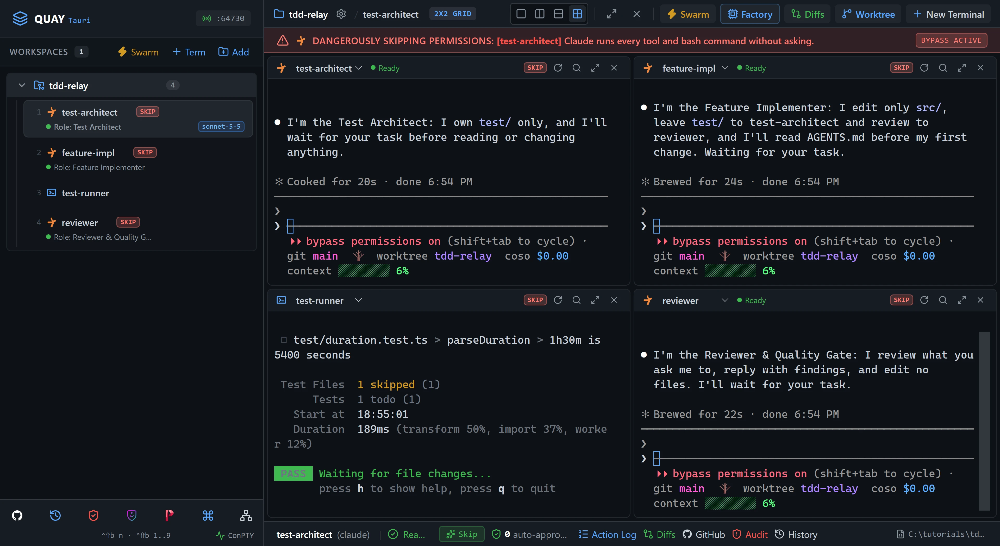

# A2A 3: Hands-off TDD relay

Launch Quay's TDD Swarm and type one prompt. `test-architect` writes failing tests for a duration parser, hands the job to `feature-impl` over the A2A bus, and `feature-impl` reports back when the tests pass. You watch. In Swarm 2 you drove each red-green round yourself, one pane at a time; this time the agents pass the work along themselves.

::: glance
- **Time**
- **Tokens**
- **Agents** 3 × Claude + 1 × PowerShell
- **Level** Intermediate
:::

**You'll learn:** how one agent hands work to another with `quay_send_message`, why a hand-off that takes minutes is sent with `wait_for_reply` false, how the receiving agent reports back with a new message of its own, and how to read the whole relay afterwards in Mission Control.

Quay's window has two parts: the **rail**, the panel down the left that lists your projects and their terminals, and the **stage** to its right, where the terminal panes open. When the stage is split, each pane has a **header** along its top with the terminal's name and, for an agent, its status. Every `Ctrl+Shift+B` shortcut is two key presses: press `Ctrl+Shift+B`, let go, then press the next key within a second and a half. The page writes that key as a capital, but it is the plain key: `Ctrl+Shift+B N` is `Ctrl+Shift+B`, then `n`. Each Paste box names the pane its line goes into: copy the line with the box's copy button, click into that pane, press `Ctrl+V` to paste it, then press Enter to run it or send it to the agent.

The starter project is a duration parser that isn't written yet: `parseDuration("1h30m")` must return `5400`, the number of seconds. `AGENTS.md` is the spec both agents work from. `test/` is `test-architect`'s and `src/` is `feature-impl`'s. The TDD Swarm's fourth agent, `reviewer`, has nothing to do in this tutorial and stays idle.

::: before
## Before you start
- **Quay 2** is installed from the latest release ([Installing a Release](/guide/installation#installing-a-release)).
- **Claude Code** 2.1.296 or later is installed and signed in ([Claude Code](/guide/installation#claude-code)). `claude --version`
- The **event-bridge plugin** 0.1.0 or later is installed and enabled in Claude Code ([Event-bridge Plugin](/guide/installation#event-bridge-plugin)). Without it Quay can't tell when an agent's turn ends, so neither hand-off is marked done.
- **PowerShell 7** is installed ([PowerShell 7](/guide/installation#powershell-7)). `pwsh --version`
- **Node.js** 24 or later is installed, with npm ([Node.js and npm](/guide/installation#node-js-and-npm)). `node --version`
- **Git** is installed and knows your name and email ([Git](/guide/installation#git)). `git --version`
- Your Claude Code sign-in can use the **claude-sonnet-5-5** model, because the TDD Swarm preset starts `test-architect` on it ([TDD Swarm](/features/swarm-presets#_2-tdd-swarm)). The other agents use Claude Code's default model.
- You are using the **starter project**, because agents run in Skip mode and edit files without asking.
:::

::: step

## 1. Get the starter project

::: do
1. Download [`tdd-relay.zip`](/starters/tdd-relay.zip) and unzip it into a new, empty folder. The zip has no folder of its own inside, so `src`, `test` and `AGENTS.md` land straight in the folder you chose, and that folder is the project.
2. In Quay, click **Add** at the top of the rail, find that folder in the Open Project dialog (or type its path; Tab completes it) and click **Open**.
3. Press `Ctrl+Shift+B N`, choose **PowerShell Console** and click **Start Terminal (Enter)**.
:::

::: paste PowerShell pane
```text
git init -b main; git add -A; git commit -m Starter; npm install
```
:::

::: see

:::

::: must
- `git commit` prints `Starter` as the message.
- `npm install` ends with `found 0 vulnerabilities`.
:::

::: may
- The commit id, and the package counts and timings `npm install` prints.
- `npm notice` lines after `found 0 vulnerabilities`, such as one saying a newer npm is available.
:::

::: ifnot node or npm is not recognised
Node.js 24 or later isn't on your `PATH`. Install it as [Node.js and npm](/guide/installation#node-js-and-npm) shows, close and reopen Quay so its terminals see it, then paste the line again.
:::

::: ifnot git commit says Author identity unknown
Git doesn't know your name and email yet. Set them as [Git](/guide/installation#git) shows, then paste the line again.
:::

:::

::: step

## 2. Launch the TDD Swarm

::: do
1. In the rail, point at the `pwsh` terminal under your project and click the **×** at the right end of its row (**Close terminal**). The terminal closes at once. The TDD Swarm brings its own PowerShell pane, so this one isn't needed.
2. Press `Ctrl+Shift+B S`. The Swarm Launcher opens with **Dev & Watcher** selected.
3. Click the **TDD Swarm** card.
4. Click **Launch Swarm Now**.
5. Wait until each of the three Claude Code panes has confirmed its role in one line.
:::

::: see

:::

::: must
- Four panes in a 2x2 grid: `test-architect` top left, `feature-impl` top right, `test-runner` bottom left and `reviewer` bottom right.
- The rail lists the same four under the project.
- `test-architect`, `feature-impl` and `reviewer` each confirm their role in one line, then wait. Each one's header says **Ready**.
- `test-runner` sits at a PowerShell prompt.
- While a Claude Code pane has focus, a red **DANGEROUSLY SKIPPING PERMISSIONS** banner runs across the top of the stage and names that pane. That is expected: swarm agents run in Skip mode.
:::

::: may
- The wording of each one-line confirmation, and how long each pane takes to start.
- The port number in the rail header.
- Which pane the red banner names.
:::

::: ifnot a Claude Code pane asks whether you trust this folder
Claude Code asks once for each new folder: `Quick safety check: Is this a project you created or one you trust?` It lists **No, exit** first, with the cursor on it. Click into each pane that asks, press the Down arrow to move to **Yes, I trust this folder**, and press Enter. That agent then confirms its role.
:::

::: ifnot a Claude Code pane asks you to accept Bypass Permissions mode
Quay starts a swarm's Claude Code agents in Skip mode, which Claude Code calls Bypass Permissions mode, and Claude Code asks once before its first session in that mode. Click into the pane that asks, choose **Yes, I accept** and press Enter. It then confirms its role. Do the same in any other pane that asks.
:::

::: ifnot a Claude Code pane shows the plugin hint
Quay isn't hearing from the event-bridge plugin. Install it as the hint says, then run `/reload-plugins` in that pane. The hint goes away as soon as Quay hears from the plugin.
:::

::: ifnot test-architect stops with an error about its model
Your Claude Code sign-in can't use `claude-sonnet-5-5`, the model the TDD Swarm preset starts `test-architect` on. Sign in to Claude Code with an account that can use it. Then close the four swarm terminals: in the rail, hover over each of `test-architect`, `feature-impl`, `test-runner` and `reviewer` and click the **×** that appears, **Close terminal**. Launch the swarm again from the start of this step.
:::

:::

::: step

## 3. Start the test watcher

::: do
1. Click inside `test-runner`, the bottom-left pane. Its border lights up.
:::

::: paste `test-runner`
```text
npm run test:watch
```
:::

::: see

:::

::: must
- `Tests  1 todo (1)`.
- A `Waiting for file changes...` line under it.
:::

::: may
- How long the run takes.
:::

::: ifnot vitest is not recognized
`npm install` didn't finish in step 1. Paste `npm install` into `test-runner`, wait for it to finish, then paste `npm run test:watch` again.
:::

:::

::: step

## 4. Send the one prompt

::: do
1. Click inside `test-architect`, the top-left pane, and paste the prompt below.
2. Take your hands off the keyboard. From here the agents hand the work on themselves. The prompt has `test-architect` send the job with `wait_for_reply` false because a wait gives up after 60 seconds, and making these tests pass takes minutes. So `test-architect` sends the job and its turn ends, and `feature-impl` reports back later with a message of its own. A chain of messages like this, each sent without waiting, is a relay.
:::

::: paste `test-architect`
```text
Read AGENTS.md. Replace the todo in test/duration.test.ts with failing Vitest tests that cover every parseDuration rule in AGENTS.md, and do not touch src/. Run npm test once to confirm the new tests fail. Then call quay_send_message with target_terminal_id feature-impl, wait_for_reply false, and exactly this message: "Tests for parseDuration in test/duration.test.ts are red. Make them all pass by editing src/duration.ts only, never test/. Run npm test until it is green, then call quay_send_message with target_terminal_id test-architect, wait_for_reply false, and the message GREEN." After sending, stop and wait. When the GREEN message arrives, run npm test once and end your reply with exactly RELAY DONE as the last line if every test passes, or RELAY FAILED if any fails. Do not message anyone after that.
```
:::

::: see

:::

::: must
- `test-runner` re-ran on its own when `test-architect` saved the tests, and every test fails: the `Tests` line shows only a `failed` count.
- `test-architect` says it sent the hand-off without waiting, and its header goes back to **Ready**.
- A blue banner across the top of `feature-impl`'s pane reads **Incoming A2A Task from test-architect:** and the start of the hand-off message, and `feature-impl` starts working.
:::

::: may
- How many tests `test-architect` writes, and their names.
- Whether `test-architect` calls `quay_list_agents` first to find `feature-impl`.
- How long it takes, and the agents' wording.
- A toast at the top right of the window, `test-architect` → `feature-impl` with the message under **TASK DELEGATION:**, shows for a few seconds as the hand-off is delivered. It may be gone before you look.
- While an agent works, its header shows what it is doing, such as **Working** or **Bash**, instead of **Ready**.
- Grey text in a Claude Code pane's input box, such as `commit this`, is a suggestion Claude Code offers. Leave it alone.
:::

::: ifnot test-architect stopped without sending, and no banner appeared in feature-impl
Paste `Now send feature-impl the message from my last prompt with quay_send_message, wait_for_reply false.` into `test-architect`.
:::

::: ifnot test-architect waited, and after 60 seconds said feature-impl received the task but is still working
It set `wait_for_reply` true. The message was delivered anyway, so the relay carries on: go on to step 5. In step 7 that trail entry shows a `No reply within 60s` note.
:::

:::

::: step

## 5. Hands off: watch it turn green

::: do
1. Watch `test-runner`. Don't type into any pane.
2. If you want a closer look at `feature-impl` while it works, click inside it and press `Ctrl+Shift+B Z` to zoom it to the whole stage. Press `Ctrl+Shift+B Z` again to put the grid back. Clicking and zooming type nothing into the pane.
:::

::: see

:::

::: must
- `test-runner` shows every test passing: the `Tests` line shows only a `passed` count.
- `feature-impl` says it changed `src/duration.ts`, and nothing under `test/`.
:::

::: may
- How `feature-impl` writes the code, and how many times `test-runner` re-runs on the way.
- How long it takes: from one to a few minutes.
- Whether step 6 has already begun in `test-architect` by the time you look.
:::

::: ifnot feature-impl edited test/
Paste `Run git checkout -- test to undo your changes there, then make the tests pass by editing src/duration.ts only.` into `feature-impl`.
:::

:::

::: step

## 6. The report comes back

::: do
1. Keep watching `test-architect`. `feature-impl`'s `GREEN` message arrives in it, and it runs the tests once more.
:::

::: see

:::

::: must
- A blue banner across the top of `test-architect`'s pane reads **Incoming A2A Task from feature-impl:** `GREEN`, then `test-architect` starts working.
- The last line of `test-architect`'s reply is `RELAY DONE`.
- `test-architect`, `feature-impl` and `reviewer` all end **Ready**.
:::

::: may
- Anything `test-architect` says before its last line, and the number of tests it reports.
- Anything `feature-impl` says after sending `GREEN`, such as a note on an edge case it left alone.
- A toast at the top right, `feature-impl` → `test-architect` with `GREEN`, for a few seconds.
:::

::: ifnot feature-impl says Ready, no banner arrived, and test-architect is still waiting
Paste `Send test-architect the message GREEN with quay_send_message, target_terminal_id test-architect, wait_for_reply false.` into `feature-impl`.
:::

::: ifnot the last line is RELAY FAILED
Paste `Send feature-impl the names of the failing tests with quay_send_message, wait_for_reply false, and ask it to fix src/duration.ts only and send GREEN again.` into `test-architect`. Then watch this step again.
:::

:::

::: step

## 7. Read the relay in Mission Control

::: do
1. Press `Ctrl+Shift+B M` to open Mission Control, or click its icon, the network icon, in the toolbar at the bottom of the rail.
2. Scroll down to **Live A2A Message Trail**. The newest entry is at the top.
3. Press `Esc` to close Mission Control when you've read it.
:::

::: see

:::

::: must
- An entry `feature-impl → test-architect` whose message is `GREEN`, **Completed**, with an **Answer:** ending `RELAY DONE`.
- Below it, an entry `test-architect → feature-impl` with the hand-off message, **Completed**. Scroll the trail to read its **Answer:**, `feature-impl`'s report.
:::

::: may
- The times and durations on each entry.
- The wording of the first entry's **Answer:**, apart from its last line.
:::

::: ifnot the trail has more than two entries
The others are from earlier work in this Quay session. Look for the two that name `test-architect` and `feature-impl`.
:::

::: ifnot an entry says Reply instead of Answer, with a No reply within 60s note
That agent waited for a reply instead of sending and moving on. The message still went through, so there is nothing to fix.
:::

:::

::: step

## 8. Check it worked

::: do
1. Click inside `test-runner` and press `q` to stop the watcher.
2. Press `Ctrl+Shift+B Z` to zoom `test-runner` to the whole stage, so the output below fits.
3. Download [`tdd-relay-check.zip`](/starters/tdd-relay-check.zip), the check suite: tests the agents never saw. In File Explorer, right-click it, choose **Extract All...**, set the destination to the project folder itself, the folder that holds `src`, and click **Extract**. A `check` folder appears beside `src`.
:::

::: paste `test-runner`
```text
npm test; npm run typecheck; npx vitest run --config check/vitest.config.ts; git status --short
```
:::

::: see

:::

::: must
- Scrolled up: `npm test` shows every test passing, and `npm run typecheck` prints no error after its `> tsc --noEmit` line.
- The check run shows `Tests  18 passed (18)`.
- `git status --short` prints three lines: ` M src/duration.ts`, ` M test/duration.test.ts` and `?? check/`.
:::

::: may
- The number of tests in `npm test`, and the times beside them.
- The folder in the PowerShell prompt, which is wherever you unzipped the starter.
:::

::: ifnot npm run typecheck says relative import paths need explicit file extensions
`test-architect` imported `../src/duration` without the `.ts` that `AGENTS.md` asks for. Press `Ctrl+Shift+B Z` to put the grid back, then paste `npm run typecheck fails on an import without .ts. Fix the imports in test/ so it passes. Do not touch src/.` into `test-architect`. When it has finished, click inside `test-runner`, press `Ctrl+Shift+B Z` to zoom it again, and paste this step's line into it again.
:::

::: ifnot some check tests fail
The relay built what its own tests asked for, not everything `AGENTS.md` says. Press `Ctrl+Shift+B Z` to put the grid back, then paste `These check tests fail: <paste the failing names>. Add tests for them to test/duration.test.ts, then hand off to feature-impl exactly as before.` into `test-architect`, with the failing names in place of the angle brackets. Paste `npm run test:watch` into `test-runner` and watch steps 5 and 6 again. When `test-architect` ends with `RELAY DONE`, click inside `test-runner`, press `q`, press `Ctrl+Shift+B Z`, and paste this step's line again. `check` is already in place, so don't download it a second time.
:::

::: done
- ✅ `test-architect`'s last line is `RELAY DONE`.
- ✅ The Mission Control trail shows `test-architect → feature-impl` and `feature-impl → test-architect`, both Completed.
- ✅ `npm test`, the type check and the check suite all pass.
- ✅ `git status --short` lists only `src/duration.ts`, `test/duration.test.ts` and `check/`.
- ✅ You typed into an agent pane once, in step 4, apart from any If not you followed.
:::

:::

::: next
[A2A 5: Fan-out / fan-in](/tutorials/a2a/fan-out-fan-in/)

The next published tutorial in series order; A2A 4 isn't published yet. Have a lead agent split a static-site generator across three workers at once, then wire their parts together.
:::
