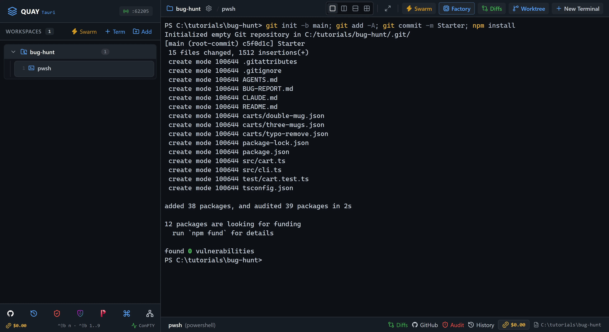

# Swarm 5: Bug Hunt

A shopping-cart library ships with a bug report naming three things that go wrong. Launch Quay's Bug Hunter swarm: four Claude Code agents take the report in turns. `reproducer` turns each complaint into a failing test, `tracer` finds the cause, `patcher` fixes it and `verifier` checks the fix. You hand over each piece of work yourself, then run a check suite none of the agents has seen.

::: glance
- **Time**
- **Tokens**
- **Agents** 4 × Claude
- **Level** Intermediate
:::

**You'll learn:** how to launch the Bug Hunter swarm from the Swarm Launcher (`Ctrl+Shift+B S`), give four agents one job each in a fixed order, hand work from one pane to the next through files the agents write, move focus around a 2x2 grid (`Ctrl+Shift+B O`), bring an earlier terminal back onto the stage (`Ctrl+Shift+B 1`), and prove a fix with tests the agents never saw.

Quay's window has two parts: the **rail**, the panel down the left that lists your projects and their terminals, and the **stage** to its right, where the terminal panes open. When the stage is split, each pane has a **header** along its top with the terminal's name and, for an agent, its status, and the pane that has focus has a lit border. Every `Ctrl+Shift+B` shortcut is two key presses: press `Ctrl+Shift+B`, let go, then press the next key within a second and a half. Each Paste box names the pane its line goes into: with that pane focused, press `Ctrl+V` to paste the line, then press Enter to run it, or to send it to the agent.

The starter project is a cart library that works in whole cents, with a command that prints a receipt for a cart file. Its seven tests pass even though the library has three bugs, because none of the tests reaches one. The agents pass their work along in files: `reproducer` writes `test/regressions.test.ts`, `tracer` writes `TRACE.md`, `patcher` changes `src/cart.ts` and `verifier` writes `VERDICT.md`. Each agent ends its reply with a fixed last line, so you can tell at a glance that it finished.

::: before
## Before you start
- **Quay 2** is installed from the latest release ([Installing a Release](/guide/installation#installing-a-release)).
- **Claude Code** 2.1.296 or later is installed and signed in ([Claude Code](/guide/installation#claude-code)). `claude --version`
- The **event-bridge plugin** 0.1.0 or later is installed and enabled in Claude Code ([Event-bridge Plugin](/guide/installation#event-bridge-plugin)).
- **PowerShell 7** is installed ([PowerShell 7](/guide/installation#powershell-7)). `pwsh --version`
- **Node.js** 24 or later is installed, with npm ([Node.js and npm](/guide/installation#node-js-and-npm)). `node --version`
- **Git** is installed and knows your name and email ([Git](/guide/installation#git)). `git --version`
- You are using the **starter project**, because agents run in Skip mode and edit files without asking.
:::

::: step

## 1. Get the starter project

::: do
1. Download [`bug-hunt.zip`](/starters/bug-hunt.zip) and unzip it into a new, empty folder. The zip has no folder of its own inside, so `src`, `test` and `BUG-REPORT.md` land straight in the folder you chose, and that folder is the project.
2. In Quay, click **Add** at the top of the rail, find that folder in the Open Project dialog (or type its path; Tab completes it) and click **Open**.
3. Press `Ctrl+Shift+B N`, choose **PowerShell Console** and click **Start Terminal (Enter)**.
:::

::: paste PowerShell pane
```text
git init -b main; git add -A; git commit -m Starter; npm install
```
:::

::: see

:::

::: must
- `git commit` prints `Starter` as the message.
- `npm install` ends with `found 0 vulnerabilities`.
:::

::: may
- The commit id, and the package counts and timings `npm install` prints.
- An `npm notice` about a newer version of npm after `found 0 vulnerabilities`.
:::

::: ifnot node or npm is not recognised
Node.js 24 or later isn't on your `PATH`. Install it as [Node.js and npm](/guide/installation#node-js-and-npm) shows, close and reopen Quay so its terminals see it, then paste the line again.
:::

::: ifnot git commit says Author identity unknown
Git doesn't know your name and email yet. Set them as [Git](/guide/installation#git) shows, then paste the line again.
:::

:::

::: step

## 2. Launch the Bug Hunter

::: do
1. Press `Ctrl+Shift+B S`. The Swarm Launcher opens with **Dev & Watcher** already selected.
2. Click the **Bug Hunter** card, on the right of the catalog's second row. The catalog scrolls it into view, and its Team Roster lists Reproducer (`reproducer`), Tracer (`tracer`), Patcher (`patcher`) and Verifier (`verifier`).
3. Click **Launch Swarm Now**.
:::

::: see

:::

::: must
- Four panes in a 2x2 grid: `reproducer` top left, `tracer` top right, `patcher` bottom left and `verifier` bottom right.
- The rail lists all four under the project, beside the PowerShell pane from step 1.
- In the rail, each agent's status line reads `Role: ` and its role: `Reproducer`, `Tracer`, `Patcher` or `Verifier`.
- Each pane shows a one-line reply confirming its role, and the agent waits for your task.
:::

::: may
- The wording of each agent's one-line reply.
- The port number in the rail header.
:::

::: ifnot a pane asks whether you trust this folder
Claude Code asks once for each new folder: `Quick safety check: Is this a project you created or one you trust?` It lists **No, exit** first, with the cursor on it, and a grid cell may show only that option. Click into each pane that asks, press the Down arrow to move to **Yes, I trust this folder**, and press Enter. That agent then confirms its role.
:::

::: ifnot a pane asks you to accept Bypass Permissions mode
Quay starts a swarm's Claude Code agents in Skip mode, which Claude Code calls Bypass Permissions mode, and Claude Code asks once before its first session in that mode. Click into each pane that asks, choose **Yes, I accept** and press Enter. That agent then confirms its role.
:::

::: ifnot a pane shows the plugin hint
Quay isn't hearing from the event-bridge plugin. Install it as the hint says, then run `/reload-plugins` in each pane that shows the hint. The hint goes away as soon as Quay hears from the plugin.
:::

:::

::: step

## 3. Hand the bug report to the reproducer

::: do
1. Click inside `reproducer`, the top-left pane. Its border lights up.
2. Press `Ctrl+Shift+B Z` to zoom it to the whole stage.
:::

::: paste `reproducer`
```text
Read AGENTS.md and BUG-REPORT.md. For each of the three complaints, write one Vitest test in test/regressions.test.ts that fails on the current code and shows the symptom exactly as reported, using the carts in carts/ where they help. Do not change anything under src/ or the existing tests. Run npm test, confirm that exactly your three new tests fail, and end your reply with the line REPRODUCED 3.
```
:::

::: see

:::

::: must
- `reproducer`'s reply covers all three complaints: the coupon, the mug added twice and the mistyped SKU.
- It says its new `test/regressions.test.ts` is the only change it made.
- Its reply ends with the line `REPRODUCED 3`.
:::

::: may
- The test names, and how each test sets up its cart.
- Whether the reply sets the complaints out as a table, and whether it prints the test counts. Step 7 runs the tests itself.
- How many times the agent printed a receipt before writing the tests.
:::

::: ifnot reproducer reports fewer than three failing tests
One complaint isn't reproduced yet. Paste `One of the complaints is not reproduced yet. Re-read BUG-REPORT.md, run the receipt command it gives, and write a test that fails the same way. End with REPRODUCED 3.` into `reproducer`.
:::

:::

::: step

## 4. Hand the failing tests to the tracer

::: do
1. Press `Ctrl+Shift+B Z` to put the grid back.
2. Press `Ctrl+Shift+B O` to move focus to `tracer`, the top-right pane.
:::

::: paste `tracer`
```text
Read BUG-REPORT.md and test/regressions.test.ts, then run npm test. For each failing test, find the code in src/ that causes it. Write TRACE.md with one section per failing test: the symptom, the function responsible, and the cause in two sentences. Do not change anything under src/ or test/. End your reply with the line TRACED 3.
```
:::

::: see

:::

::: must
- `tracer` says it wrote `TRACE.md`, and changed nothing under `src/` or `test/`.
- Its reply ends with the line `TRACED 3`.
- `TRACE.md`, in the project folder, has one section per complaint, naming `discount`, `addItem` and `removeItem` as the functions responsible.
:::

::: may
- The order of the three causes, and how each is worded.
:::

::: ifnot Ctrl+Shift+B O moved focus to a different pane
`Ctrl+Shift+B O` moves focus left to right along the top row, then along the bottom row. Press it again until `tracer`'s border lights up, or click inside `tracer`.
:::

:::

::: step

## 5. Hand the trace to the patcher

::: do
1. Press `Ctrl+Shift+B O` to move focus to `patcher`, the bottom-left pane.
:::

::: paste `patcher`
```text
Read TRACE.md and AGENTS.md. Fix the three causes in src/cart.ts with the smallest change that makes npm test pass. Do not change any file under test/, and keep every exported signature in src/cart.ts as it is. Run npm test and npm run typecheck, and when both pass end your reply with the line PATCHED.
```
:::

::: see

:::

::: must
- `patcher` says it changed no exported signature and nothing under `test/`.
- Its reply ends with the line `PATCHED`.
:::

::: may
- How each fix is written, and how many test runs it took.
- Whether the reply prints the test counts. Steps 6 and 7 run the tests again.
:::

::: ifnot patcher says a test still fails after several attempts
Paste `Run npm test, read the failing assertion and the matching section of TRACE.md, and fix src/cart.ts until it passes. Do not change the tests.` into `patcher`.
:::

::: ifnot patcher changed a test
Paste `Run git checkout -- test to undo your changes there, then make npm test pass by changing src/cart.ts only.` into `patcher`.
:::

:::

::: step

## 6. Ask the verifier for a verdict

::: do
1. Press `Ctrl+Shift+B O` to move focus to `verifier`, the bottom-right pane.
2. Press `Ctrl+Shift+B Z` to zoom it to the whole stage.
:::

::: paste `verifier`
```text
Run npm test and npm run typecheck yourself, then read git diff, BUG-REPORT.md and TRACE.md. Check that every change is under src/, that no test was changed or weakened, that each of the three complaints is fixed by the diff, and that nothing unrelated changed. Write VERDICT.md with your findings. If everything holds, end your reply with the line VERIFIED; otherwise list what is wrong in VERDICT.md and end with the line REJECTED.
```
:::

::: see

:::

::: must
- `verifier` ran `npm test` itself and reports 10 tests passed.
- Its reply ends with the line `VERIFIED`.
:::

::: may
- How `verifier` words its review, and how much of the diff it quotes.
- Whether it sets the patch aside to see the new tests fail without it, as long as it puts the patch back.
:::

::: ifnot the last line is REJECTED
`VERDICT.md` lists what `verifier` found wrong. Press `Ctrl+Shift+B Z` to put the grid back, press `Ctrl+Shift+B O` until `patcher`'s border lights up, and paste `Read VERDICT.md and fix every item it lists, changing src/cart.ts only. Run npm test and npm run typecheck, then end with PATCHED.` into `patcher`. Then do this step again, once.
:::

::: ifnot the last line is REJECTED a second time
Stop asking the agents. Open `VERDICT.md` and `src/cart.ts` in a text editor, make the change `VERDICT.md` asks for in `src/cart.ts`, save it, and go on to step 7. The check suite there has the final word, not `verifier`.
:::

:::

::: step

## 7. Check it worked

::: do
1. Press `Ctrl+Shift+B Z` to put the grid back. Focus stays on `verifier`, the bottom-right pane.
2. Press `Ctrl+Shift+B 1`. The PowerShell pane from step 1 takes the bottom-right cell. `verifier` keeps running, and the rail still lists it.
3. Download [`bug-hunt-check.zip`](/starters/bug-hunt-check.zip), the check suite: six tests the agents never saw. In File Explorer, right-click it, choose **Extract All...**, set the destination to the project folder itself, the folder that holds `src`, and click **Extract**. A `check` folder appears beside `src`.
:::

::: paste PowerShell pane
```text
npx vitest run check; npm test; npm run typecheck; git status --short
```
:::

::: see

:::

::: must
- `npx vitest run check` shows `Tests  6 passed (6)`. Scroll up in the pane, or press `Ctrl+Shift+B Z` to zoom it, to see both test runs.
- `npm test` shows `Tests  10 passed (10)`: the starter's seven tests and the reproducer's three, without the check suite.
- `npm run typecheck` prints no error after `> tsc --noEmit`.
- `git status --short` prints these five lines, in this order: ` M src/cart.ts`, `?? TRACE.md`, `?? VERDICT.md`, `?? check/` and `?? test/regressions.test.ts`.
:::

::: may
- The test timings.
- The folder in the PowerShell prompt, which is wherever you unzipped the starter.
:::

::: ifnot vitest says No test files found
The `check` folder isn't beside `src`. Extract All puts a zip in a new folder named after it unless you change the destination. Move the `check` folder out of `bug-hunt-check` and into the project folder, so it sits beside `src`, then paste the line again.
:::

::: ifnot a check test fails
The patch fixed the reproducer's tests but not all the behaviour behind them. Press `Ctrl+Shift+B O` until `patcher`'s border lights up, then paste `The check suite in check/ now exists and has failures. Run npx vitest run check, fix src/cart.ts until it passes without changing any test, and end with PATCHED.` into `patcher`. Then press `Ctrl+Shift+B O` until the PowerShell pane's border lights up and paste this step's PowerShell line, the one starting `npx vitest run check`, again.
:::

::: ifnot Ctrl+Shift+B 1 shows a different terminal
`Ctrl+Shift+B 1` brings back the first terminal you opened in this project, so it is the PowerShell pane only when you opened nothing before it. Click `pwsh`, the PowerShell pane, in the rail instead; it takes the focused cell the same way.
:::

::: done
- ✅ `npx vitest run check` passes all six tests.
- ✅ `npm test` passes all ten tests.
- ✅ `npm run typecheck` prints no errors.
- ✅ `git status --short` lists `src/cart.ts` as the only modified file.
:::

:::

::: next
[Tutorials](/tutorials/)

The next tutorial in series order, Swarm 6: Red Team / Blue Team: notes app, isn't published yet. The Tutorials page lists every tutorial that is.
:::
