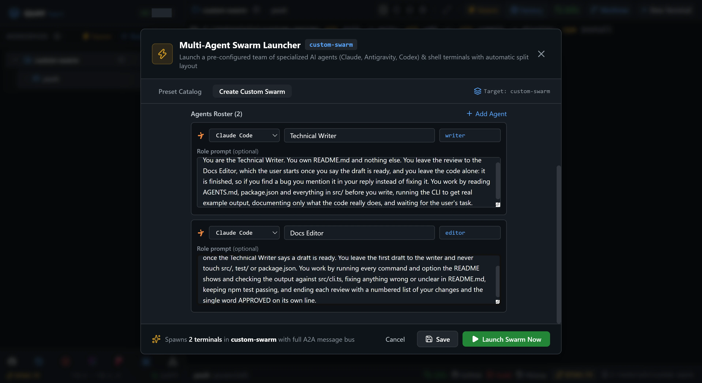
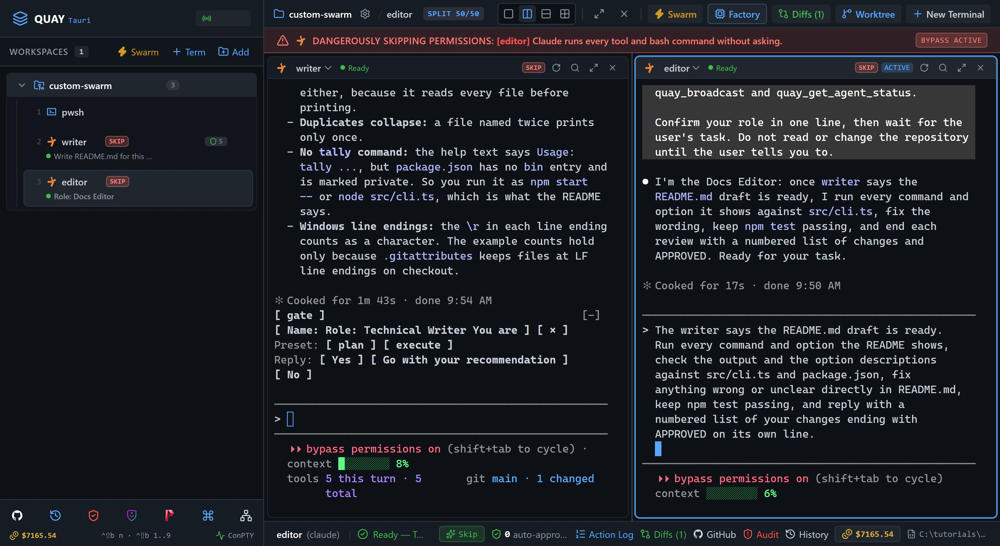
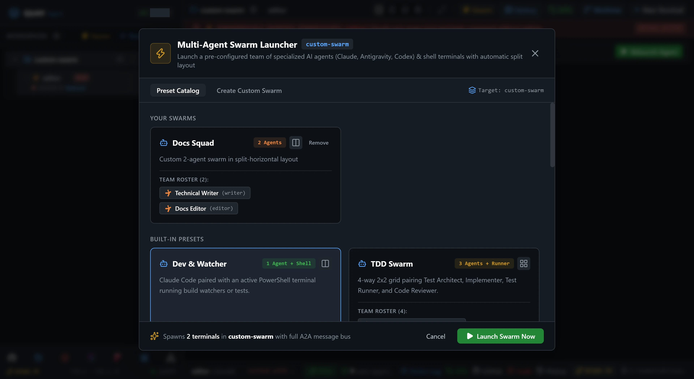

# Swarm 4: Build and save a custom swarm

No built-in preset fits every job, so you build your own. In the swarm builder you put together a two-agent Docs Squad: `writer` drafts the README for a small command-line tool, and `editor` checks every command in it against the code. You save the squad, quit Quay, start it again and launch the same squad from the catalog.

::: glance
- **Time**
- **Tokens**
- **Agents** 2 × Claude
- **Level** Starter
:::

**You'll learn:** how to build a custom swarm in the Swarm Launcher (`Ctrl+B S`, **Create Custom Swarm**), name its agents and their sessions, write a role prompt for each agent, save the swarm so it survives a restart, and launch it again from the Preset Catalog.

Quay's window has two parts: the **rail**, the panel down the left that lists your projects and their terminals, and the **stage** to its right, where the terminal panes open. When the stage is split, each pane has a **header** along its top with the terminal's name and, for an agent, its status. Every `Ctrl+B` shortcut is two key presses: press `Ctrl+B`, let go, then press the next key within a second and a half.

::: before
## Before you start
- **Quay 2** is installed from the latest release ([Installing a Release](/guide/installation#installing-a-release)).
- **Claude Code** 2.1.296 or later is installed and signed in ([Claude Code](/guide/installation#claude-code)). `claude --version`
- The **event-bridge plugin** 0.1.0 or later is installed and enabled in Claude Code ([Event-bridge Plugin](/guide/installation#event-bridge-plugin)).
- **PowerShell 7** is installed ([PowerShell 7](/guide/installation#powershell-7)). `pwsh --version`
- **Node.js** 24 or later is installed, with npm ([Node.js and npm](/guide/installation#node-js-and-npm)). `node --version`
- **Git** is installed and knows your name and email ([Git](/guide/installation#git)). `git --version`
- You are using the **starter project**, because agents run in Skip mode and edit files without asking.
:::

::: step

## 1. Get the starter project

The starter is `tally`, a finished command-line tool that counts the lines, words and characters in files. `src/` holds the finished code, `README.md` is a stub waiting to be replaced, and `test/readme.test.ts` checks the README the squad writes.

::: do
1. Download [`custom-swarm.zip`](/starters/custom-swarm.zip) and unzip it into a new, empty folder.
2. In Quay, click **Add** at the top of the rail, click **Browse...**, pick that folder and click **Add Project**.
3. Press `Ctrl+B N`, choose **PowerShell Console** and click **Start Terminal (Enter)**.
:::

::: paste PowerShell pane
```text
git init -b main; git add -A; git commit -m Starter; npm install
```
:::

::: see

:::

::: must
- `git commit` prints `Starter` as the message.
- `npm install` ends with `found 0 vulnerabilities`.
:::

::: may
- The commit id, and the package counts and timings `npm install` prints.
:::

::: ifnot node or npm is not recognised
Node.js 24 or later isn't on your `PATH`. Install it as [Node.js and npm](/guide/installation#node-js-and-npm) shows, close and reopen Quay so its terminals see it, then paste the line again.
:::

::: ifnot git commit says Author identity unknown
Git doesn't know your name and email yet. Set them as [Git](/guide/installation#git) shows, then paste the line again.
:::

:::

::: step

## 2. Open the swarm builder

::: do
1. Press `Ctrl+B S`. The Swarm Launcher opens on the **Preset Catalog**, the swarms that come with Quay.
2. Click **Create Custom Swarm** in the bar under the launcher's title.
3. In **Swarm Name**, replace `Custom Swarm` with `Docs Squad`.
4. Leave **Layout Arrangement** on **Side-by-Side Split**.
:::

Under the layout is the **Agents Roster**. Each row is one terminal in the swarm: the CLI that runs in it, the agent's role, the session name that labels its pane, and a **Role prompt** box. A role prompt is what the agent reads first, and the box's grey placeholder names its four parts: who you are, what you own, what you leave to teammates, and how you work.

::: see

:::

::: must
- **Create Custom Swarm** is selected in the bar under the title.
- The roster has two rows, `Agent 1` with session name `agent-1` and `Agent 2` with `agent-2`, both on **Claude Code**.
- Each row has a box labelled **Role prompt (optional)**, whose placeholder lists `Who you are`, `What you own`, `What you leave to teammates` and `How you work`.
- An **Add Agent** link sits beside the roster's heading.
:::

::: may
- The project name in the launcher's title and footer, which is your folder's name.
:::

:::

::: step

## 3. Define the writer

::: do
1. In the first row, leave the CLI on **Claude Code**.
2. Replace the role `Agent 1` with `Technical Writer`.
3. Replace the session name `agent-1` with `writer`.
4. Click the first row's **Role prompt** box and paste the role prompt below. It follows the four parts in the placeholder's order.
:::

::: paste first row's Role prompt
```text
You are the Technical Writer. You own README.md and nothing else. You leave the review to the Docs Editor, which the user starts once you say the draft is ready, and you leave the code alone: it is finished, so if you find a bug you mention it in your reply instead of fixing it. You work by reading AGENTS.md, package.json and everything in src/ before you write, running the CLI to get real example output, documenting only what the code really does, and waiting for the user's task.
```
:::

::: see

:::

::: must
- The first row reads **Claude Code**, `Technical Writer` and `writer`.
- Its **Role prompt** box starts `You are the Technical Writer.`
:::

::: may
- How the role prompt wraps in the box. Drag the box's corner to make it taller if you want to read it all.
:::

:::

::: step

## 4. Define the editor

::: do
1. In the second row, leave the CLI on **Claude Code**.
2. Replace the role `Agent 2` with `Docs Editor`.
3. Replace the session name `agent-2` with `editor`.
4. Click the second row's **Role prompt** box and paste the role prompt below.
:::

::: paste second row's Role prompt
```text
You are the Docs Editor. You own the final wording of README.md, and you may edit it directly once the Technical Writer says a draft is ready. You leave the first draft to the writer and never touch src/, test/ or package.json. You work by running every command and option the README shows and checking the output against src/cli.ts, fixing anything wrong or unclear in README.md, keeping npm test passing, and ending each review with a numbered list of your changes and the single word APPROVED on its own line.
```
:::

You write only the role prompt. When the swarm launches, Quay adds the rest of each agent's launch prompt itself: a `Role:` line, a team briefing that names the other agent, and an instruction to confirm its role and wait for your task.

::: see

:::

::: must
- The second row reads **Claude Code**, `Docs Editor` and `editor`.
- Its **Role prompt** box starts `You are the Docs Editor.`
- The footer reads `Spawns 2 terminals`.
:::

::: may
- How the role prompts wrap in their boxes.
:::

:::

::: step

## 5. Save and launch the squad

::: do
1. Click **Save**, in the launcher's footer between **Cancel** and **Launch Swarm Now**. Once Docs Squad is saved, the button reads **Update**.
2. Click **Launch Swarm Now**.
:::

Save keeps Docs Squad in Quay's settings on this computer, for your Windows user, until you remove it. Saving again under the same name replaces it, which is why the button now reads **Update**. **Launch Swarm Now** starts the swarm as the form shows it.

::: see

:::

::: must
- Two panes side by side: `writer` on the left and `editor` on the right.
- `writer`'s first line reads `Role: Technical Writer`, and `editor`'s reads `Role: Docs Editor`.
- Each agent confirms its role in one line and waits for your task.
:::

::: may
- The wording of each agent's one-line reply.
:::

::: ifnot an agent asks you to accept Bypass Permissions mode
Quay starts a swarm's Claude Code agents in Skip mode, which Claude Code calls Bypass Permissions mode, and Claude Code asks once before its first session in that mode. Click into the pane, choose **Yes, I accept** and press Enter. The agent then confirms its role.
:::

::: ifnot a pane shows the plugin hint
Quay isn't hearing from the event-bridge plugin. Install it as the hint says, then run `/reload-plugins` in that pane. The hint goes away as soon as Quay hears from the plugin.
:::

::: ifnot the button read Update before you clicked it
A swarm named Docs Squad was already saved, perhaps from an earlier try. Clicking **Update** replaced it with the form as it is now, so carry on.
:::

:::

::: step

## 6. Brief the writer

::: do
1. Click into the `writer` pane.
:::

::: paste `writer`
```text
Write README.md for this project from scratch, replacing the stub. Read AGENTS.md, package.json and everything in src/ first, run the CLI on LICENSE and on package.json to get real example output, and cover every section and option AGENTS.md lists. Keep going until npm test passes. Do not edit anything except README.md. Tell me when the draft is ready.
```
:::

::: see

:::

::: must
- `writer` edits only `README.md`.
- `writer` tells you the draft is ready, with `npm test` passing all 10 tests.
- At the end, both pane headers show a green dot and `Ready`.
:::

::: may
- The tools `writer`'s pane header names while it works, beside a spinner.
- Which files it reads first, how many tool calls it makes, and how long it takes.
- The wording of its reply.
:::

::: ifnot writer says a README test still fails
Paste `Run npm test, read the failing assertion in test/readme.test.ts, and fix README.md until it passes. Do not change the tests.` into `writer`.
:::

:::

::: step

## 7. Brief the editor

::: do
1. Wait for `writer` to say the draft is ready.
2. Press `Ctrl+B O` to move focus to `editor`. `Ctrl+B O` moves focus to the other pane each time you press it, and the focused pane's border lights up.
:::

::: paste `editor`
```text
The writer says the README.md draft is ready. Run every command and option the README shows, check the output and the option descriptions against src/cli.ts and package.json, fix anything wrong or unclear directly in README.md, keep npm test passing, and reply with a numbered list of your changes ending with APPROVED on its own line.
```
:::

::: see

:::

::: must
- `editor`'s last line is `APPROVED`.
- `editor` edits only `README.md`.
- At the end, both pane headers show a green dot and `Ready`.
:::

::: may
- How many changes `editor` lists, and what they are. An empty list and `APPROVED` is a pass too.
:::

::: ifnot editor lists problems but doesn't end with APPROVED
Paste `Fix those in README.md yourself, run npm test, and end your reply with APPROVED.` into `editor`.
:::

:::

::: step

## 8. Quit and restart Quay

::: do
1. Close Quay with the window's close button. Quay doesn't ask first, and both agents stop with it.
2. Start Quay again from the Start menu.
:::

Quay brings back your project, your saved swarm and every terminal you had open, but none of them is running. The rail lists each one as `exited 0` with a **Relaunch** button, and a pane shows its old output under a **Session Inactive** ribbon. Don't relaunch `writer` or `editor`: a relaunched terminal gets no launch prompt, so the agent would start without its role or its team briefing. The next step launches them fresh from the saved swarm instead.

::: see

:::

::: must
- The project is in the rail.
- The rail lists `writer` and `editor` under it as `exited 0`.
:::

::: may
- Which terminal the stage shows.
:::

::: ifnot writer and editor aren't in the rail
Quay didn't bring them back, which is fine: go on to the next step and skip its first two actions.
:::

:::

::: step

## 9. Launch the saved squad again

::: do
1. In the rail, point at the exited `writer` and click the **×** at the end of its row to close it.
2. Close the exited `editor` the same way.
3. Press `Ctrl+B S`. The Swarm Launcher opens on the Preset Catalog, with **Docs Squad** under **Your swarms** at the top.
4. Click the **Docs Squad** card. It opens in the builder with your two rows and their role prompts, and the save button reads **Update**.
5. Click **Launch Swarm Now**.
:::

To remove a saved swarm later, click **Remove** on its card in the Preset Catalog, then **Remove?** to confirm.

::: see

:::

::: must
- A **Docs Squad** card under **Your swarms**, with the badge `2 Agents`.
- Its roster reads `Technical Writer (writer)` and `Docs Editor (editor)`.
- After the launch, `writer` and `editor` open side by side and confirm their roles again, as in step 5.
:::

::: may
- Other cards under **Your swarms**, if you saved other swarms before this one.
:::

::: ifnot there is no Docs Squad card
Saved swarms belong to your Windows user. If you skipped **Save** in step 5, or run Quay as a different user, build the squad again from step 2 to step 5.
:::

:::

::: step

## 10. Check it worked

::: do
1. Press `Ctrl+B O` until `editor`, on the right, has focus and its border lights up.
2. Press `Ctrl+B N`, choose **PowerShell Console**, type `check` in **Terminal Label (Optional)** and click **Start Terminal (Enter)**. The `check` pane takes the right side of the stage.
:::

::: paste `check`
```text
npm test; git status --short
```
:::

::: see

:::

::: must
- `npm test` shows `Tests  10 passed (10)`.
- `git status --short` prints one line, ` M README.md`.
:::

::: may
- The test timings.
- The folder in the PowerShell prompt, which is wherever you unzipped the starter.
:::

::: done
- ✅ The Preset Catalog lists Docs Squad under Your swarms, and launching it brought up `writer` and `editor`, each confirming its role.
- ✅ `editor`'s last reply ended with `APPROVED`.
- ✅ `npm test` shows `Tests  10 passed (10)`.
- ✅ `git status --short` lists `README.md` as the only modified file.
:::

:::

::: next
[Tutorials](/tutorials/)

The next tutorial in series order, Swarm 5: Bug Hunt, isn't published yet. The Tutorials page lists every tutorial that is.
:::
