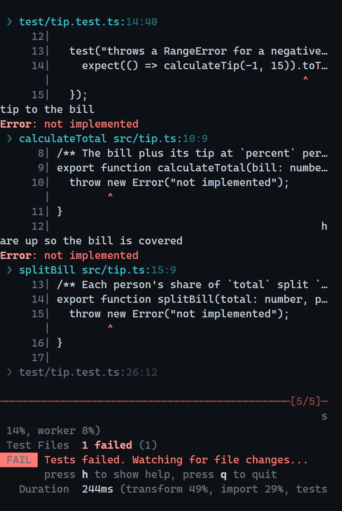
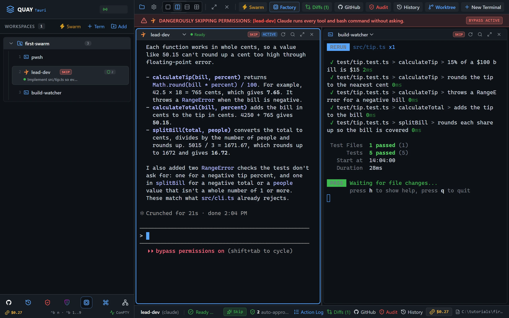
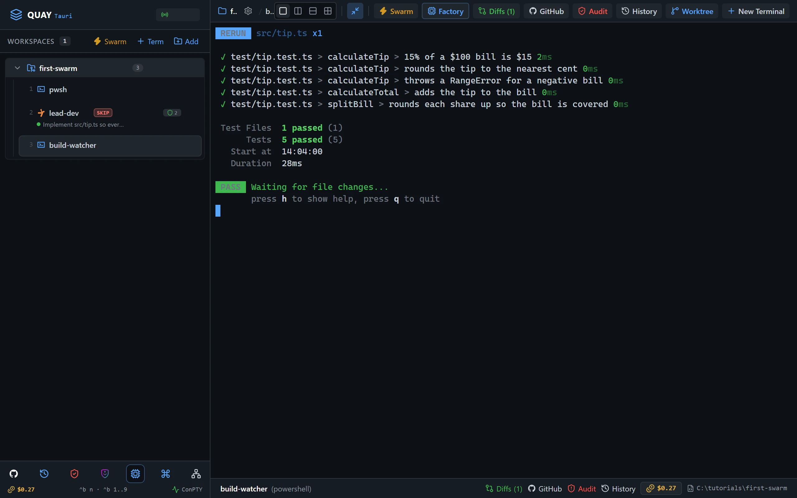
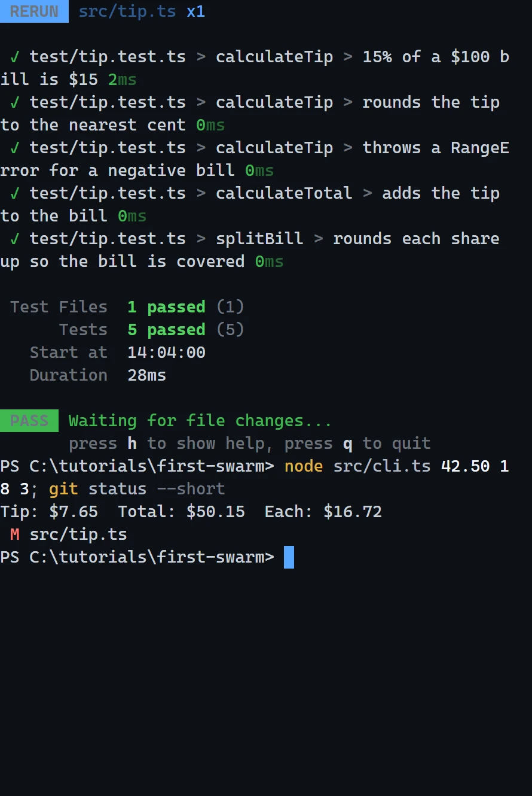

# Swarm 1: Your first swarm

Launch Quay's Dev & Watcher swarm: a Claude Code agent beside a PowerShell pane that runs your tests on every save. The agent builds a tip calculator while you watch its tests go green.

::: glance
- **Time**
- **Tokens**
- **Agents** 1 × Claude + 1 × PowerShell
- **Level** Starter
:::

**You'll learn:** how to launch a swarm from the Swarm Launcher (`Ctrl+Shift+B S`), work in a side-by-side split, move focus between panes (`Ctrl+Shift+B O`) and zoom a pane to the whole stage (`Ctrl+Shift+B Z`).

Quay's window has two parts: the **rail**, the panel down the left that lists your projects and their terminals, and the **stage** to its right, where the terminal panes open. When the stage is split, each pane has a **header** along its top with the terminal's name and, for an agent, its status. Every `Ctrl+Shift+B` shortcut is two key presses: press `Ctrl+Shift+B`, let go, then press the next key within a second and a half.

::: before
## Before you start
- **Quay 2** is installed from the latest release ([Installing a Release](/guide/installation#installing-a-release)).
- **Claude Code** 2.1.296 or later is installed and signed in ([Claude Code](/guide/installation#claude-code)). `claude --version`
- The **event-bridge plugin** 0.1.0 or later is installed and enabled in Claude Code ([Event-bridge Plugin](/guide/installation#event-bridge-plugin)).
- **PowerShell 7** is installed ([PowerShell 7](/guide/installation#powershell-7)). `pwsh --version`
- **Node.js** 24 or later is installed, with npm ([Node.js and npm](/guide/installation#node-js-and-npm)). `node --version`
- **Git** is installed and knows your name and email ([Git](/guide/installation#git)). `git --version`
- You are using the **starter project**, because agents run in Skip mode and edit files without asking.
:::

::: step

## 1. Get the starter project

::: do
1. Download [`first-swarm.zip`](/starters/first-swarm.zip) and unzip it into a new, empty folder.
2. In Quay, click **Add** at the top of the rail, find that folder in the Open Project dialog (or type its path; Tab completes it) and click **Open**.
3. Press `Ctrl+Shift+B N`, choose **PowerShell Console** and click **Start Terminal (Enter)**.
:::

::: paste PowerShell pane
```text
git init -b main; git add -A; git commit -m Starter; npm install
```
:::

::: see

:::

::: must
- `git commit` prints `Starter` as the message.
- `npm install` ends with `found 0 vulnerabilities`.
:::

::: may
- The commit id, and the package counts and timings `npm install` prints.
:::

::: ifnot node or npm is not recognised
Node.js 24 or later isn't on your `PATH`. Install it as [Node.js and npm](/guide/installation#node-js-and-npm) shows, close and reopen Quay so its terminals see it, then paste the line again.
:::

::: ifnot git commit says Author identity unknown
Git doesn't know your name and email yet. Set them as [Git](/guide/installation#git) shows, then paste the line again.
:::

:::

::: step

## 2. Launch the swarm

::: do
1. Press `Ctrl+Shift+B S`. The Swarm Launcher opens with **Dev & Watcher** already selected.
2. Click **Launch Swarm Now**.
:::

::: see

:::

::: must
- Two panes side by side: `lead-dev` on the left and `build-watcher` on the right.
- The rail lists `lead-dev` and `build-watcher` under the project, beside the PowerShell pane from step 1.
- `lead-dev`'s first line reads `Role: Lead Developer`, and it waits for your task.
:::

::: may
- The wording of `lead-dev`'s one-line reply.
- The port number in the rail header.
:::

::: ifnot lead-dev asks whether you trust this folder
Claude Code asks once for each new folder: `Quick safety check: Is this a project you created or one you trust?` It lists **No, exit** first, with the cursor on it. Click into `lead-dev`, press the Down arrow to move to **Yes, I trust this folder**, and press Enter. It then confirms its role.
:::

::: ifnot lead-dev asks you to accept Bypass Permissions mode
Quay starts a swarm's Claude Code agents in Skip mode, which Claude Code calls Bypass Permissions mode, and Claude Code asks once before its first session in that mode. Click into `lead-dev`, choose **Yes, I accept** and press Enter. It then confirms its role.
:::

::: ifnot lead-dev shows the plugin hint
Quay isn't hearing from the event-bridge plugin. Install it as the hint says, then run `/reload-plugins` in `lead-dev`. The hint goes away as soon as Quay hears from the plugin.
:::

:::

::: step

## 3. Start the watcher

::: do
1. Press `Ctrl+Shift+B O` to move focus to `build-watcher`. Its border lights up.
:::

::: paste `build-watcher`
```text
npm test
```
:::

::: see

:::

::: must
- `Tests  5 failed (5)`.
- A `Waiting for file changes...` line under it.
:::

::: may
- How long the run takes, and the times beside each test.
:::

::: ifnot vitest is not recognized
`npm install` didn't finish in step 1. Paste `npm install` into `build-watcher`, wait for it to finish, then paste `npm test` again.
:::

:::

::: step

## 4. Give lead-dev the job

::: do
1. Press `Ctrl+Shift+B O` to move focus back to `lead-dev`.
:::

::: paste `lead-dev`
```text
Implement src/tip.ts so every test in test/tip.test.ts passes. Don't run the tests yourself: the build-watcher pane is running them, and I'm watching it. Tell me when you believe they all pass.
```
:::

::: see

:::

::: must
- `build-watcher` shows `Tests  5 passed (5)`.
- At the end, `lead-dev`'s pane header shows a green dot and `Ready`.
- `lead-dev` tells you it believes the tests pass.
:::

::: may
- The tools `lead-dev`'s pane header names while it works, beside a spinner.
- How many times the watcher re-runs on the way.
- `lead-dev`'s wording, and how long it takes.
:::

::: ifnot lead-dev runs the tests itself anyway
It still works; the lesson is just quieter. When it finishes, paste `Thanks. From now on leave test runs to the watcher.` into `lead-dev`.
:::

::: ifnot the watcher never re-runs
Vitest re-runs when a file under the project changes. Check that `lead-dev` edited `src/tip.ts` and didn't write a new file somewhere else.
:::

:::

::: step

## 5. Zoom in on the result

::: do
1. Press `Ctrl+Shift+B O` to move focus to `build-watcher`.
2. Press `Ctrl+Shift+B Z` to zoom it to the whole stage, and read the five passing tests.
3. Press `Ctrl+Shift+B Z` again to put the split back.
:::

::: see

:::

::: must
- `build-watcher` fills the stage.
- Five test names, each with a green ✓.
:::

::: may
- The times beside each test.
:::

::: ifnot Ctrl+Shift+B Z did nothing
The `Ctrl+Shift+B` prefix lasts a second and a half. Press `Ctrl+Shift+B`, let go, then press `Z` straight after.
:::

::: ifnot Ctrl+Shift+B Z zoomed lead-dev instead
Focus was still on `lead-dev`. Press `Ctrl+Shift+B Z` to put the split back, then `Ctrl+Shift+B O` to move focus to `build-watcher`, and zoom again.
:::

:::

::: step

## 6. Check it worked

::: do
1. With focus still on `build-watcher`, press `q` to stop the watcher.
:::

::: paste `build-watcher`
```text
node src/cli.ts 42.50 18 3; git status --short
```
:::

::: see

:::

::: must
- The CLI prints `Tip: $7.65  Total: $50.15  Each: $16.72`.
- `git status --short` prints one line, ` M src/tip.ts`.
:::

::: may
- The folder in the PowerShell prompt, which is wherever you unzipped the starter.
:::

::: done
- ✅ `build-watcher` showed `Tests  5 passed (5)`.
- ✅ The CLI prints `Tip: $7.65  Total: $50.15  Each: $16.72`.
- ✅ `git status --short` lists `src/tip.ts` as the only modified file.
:::

:::

::: next
[Swarm 2: TDD Swarm kata](/tutorials/swarm/tdd-swarm-kata/)

The next tutorial in series order. Build a password-strength checker test-first with four panes in a 2x2 grid, and drive the red, green, review loop yourself.
:::
