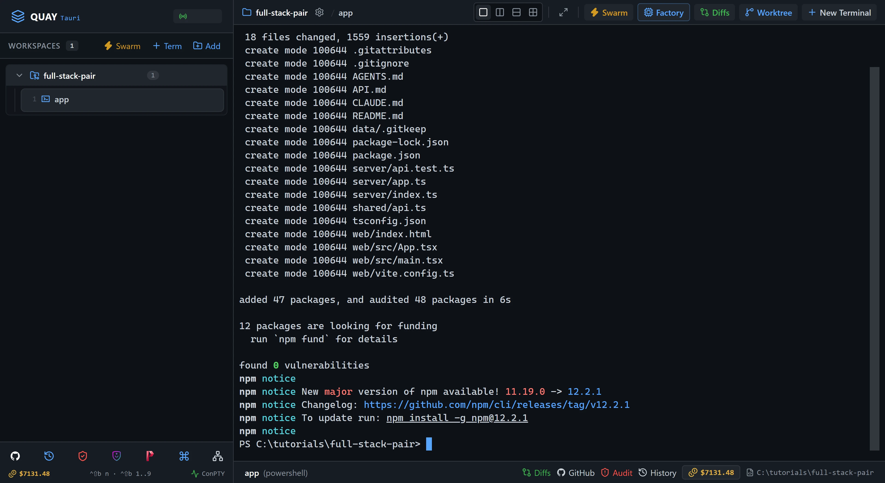
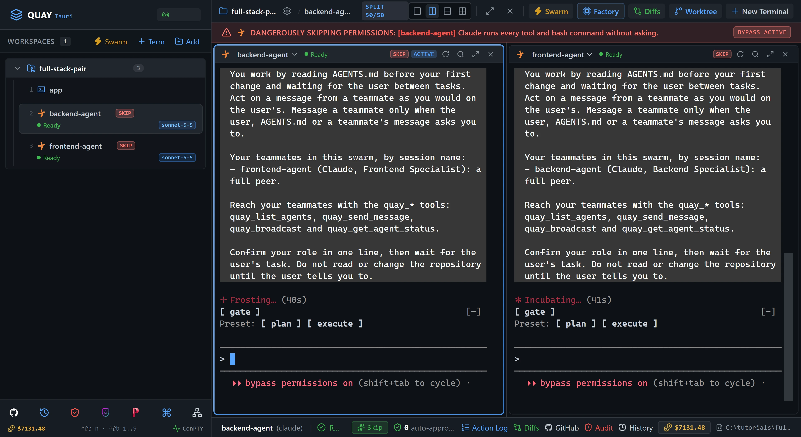
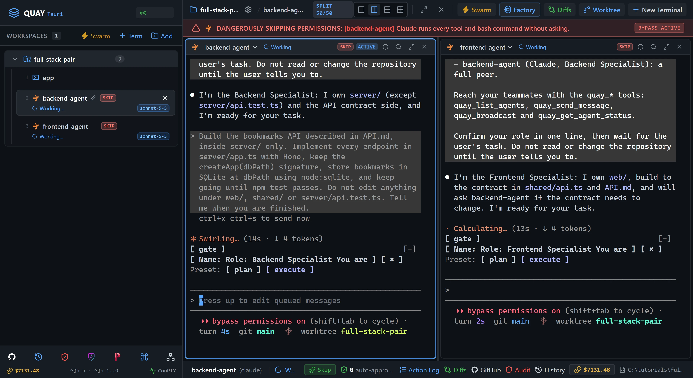
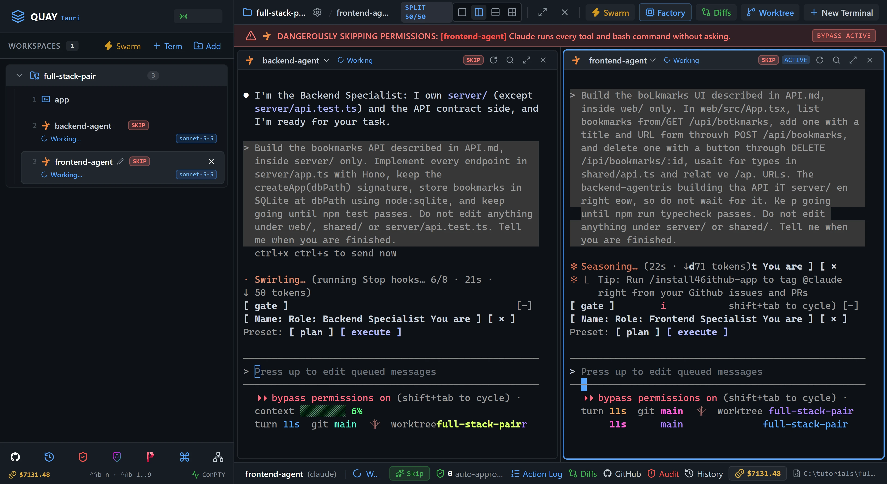
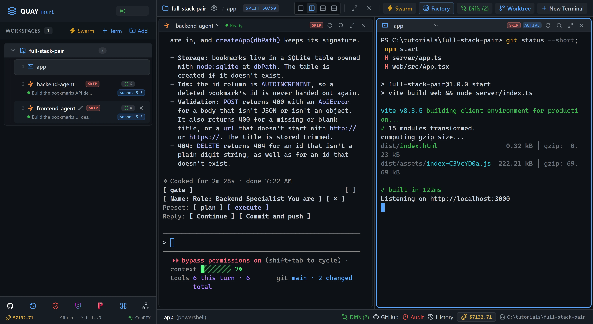
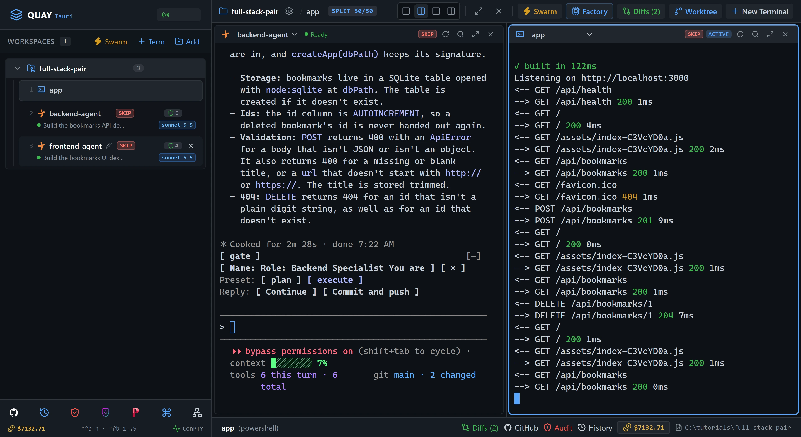

# Swarm 3: Full-Stack Pair: bookmarks app

<!-- Draft for #188. Every still is a placeholder until the walk-through. The captions, Must match
     and May differ are written from the outline and a reference build of the starter, and are
     rewritten from the walk-through's screenshots before the page is published. -->

Two Claude Code agents build one web app at the same time: `backend-agent` writes the API in `server/` while `frontend-agent` writes the React page in `web/`. You hand each its half, watch them work side by side, then start the app and use it in your browser.

::: glance
- **Time**
- **Tokens**
- **Agents** 2 × Claude + 1 × PowerShell
- **Level** Intermediate
:::

**You'll learn:** how to launch the Full-Stack Pair preset, give two agents parallel tasks that can't collide, move focus (`Ctrl+B O`) and zoom (`Ctrl+B Z`) while both work, and bring a hidden terminal back into a pane (`Ctrl+B 1`).

Quay's window has two parts: the **rail**, the panel down the left that lists your projects and their terminals, and the **stage** to its right, where the terminal panes open. When the stage is split, each pane has a **header** along its top with the terminal's name and, for an agent, its status. The pane with **focus** has a lit border, and what you type or paste goes into it. When a step gives you a line to paste into a pane, click into that pane, paste the line and press Enter to run or send it. Every `Ctrl+B` shortcut is two key presses: press `Ctrl+B`, let go, then press the next key within a second and a half.

::: before
## Before you start
- **Quay 2** is installed from the latest release ([Installing a Release](/guide/installation#installing-a-release)).
- **Claude Code** 2.1.296 or later is installed and signed in ([Claude Code](/guide/installation#claude-code)). `claude --version`
- The **event-bridge plugin** 0.1.0 or later is installed and enabled in Claude Code ([Event-bridge Plugin](/guide/installation#event-bridge-plugin)).
- **PowerShell 7** is installed ([PowerShell 7](/guide/installation#powershell-7)). `pwsh --version`
- **Node.js** 24 or later is installed, with npm ([Node.js and npm](/guide/installation#node-js-and-npm)). `node --version`
- **Git** is installed and knows your name and email ([Git](/guide/installation#git)). `git --version`
- Your Claude Code account can use **Claude Sonnet 5.5**, because the Full-Stack Pair preset starts both agents with `--model claude-sonnet-5-5` ([Claude Code](/guide/installation#claude-code)).
- A **web browser**, and no other program using port 3000.
- You are using the **starter project**, because agents run in Skip mode and edit files without asking.
:::

::: step

## 1. Get the starter project

::: do
1. Download [`full-stack-pair.zip`](/starters/full-stack-pair.zip) and unzip it into a new, empty folder. The project's files, such as `API.md` and `package.json`, land straight in that folder, with no folder of their own around them.
2. In Quay, click **Add** at the top of the rail, click **Browse...**, pick that folder and click **Add Project**.
3. Press `Ctrl+B N`, choose **PowerShell Console**, type `app` in **Terminal Label (Optional)** and click **Start Terminal (Enter)**.
:::

::: paste `app`
```text
git init -b main; git add -A; git commit -m Starter; npm install
```
:::

::: see

:::

::: must
- `git commit` prints `Starter` as the message.
- `npm install` ends with `found 0 vulnerabilities`.
- The rail lists a terminal named `app` under the project.
:::

::: may
- The commit id, and the package counts and timings `npm install` prints.
:::

::: ifnot node or npm is not recognised
Node.js 24 or later isn't on your `PATH`. Install it as [Node.js and npm](/guide/installation#node-js-and-npm) shows, close and reopen Quay so its terminals see it, then paste the line again.
:::

::: ifnot git commit says Author identity unknown
Git doesn't know your name and email yet. Set them as [Git](/guide/installation#git) shows, then paste the line again.
:::

:::

::: step

## 2. Launch the Full-Stack Pair

The starter splits the app so two agents can't collide. `API.md` is the contract both halves build to, and `shared/api.ts` holds its types. `backend-agent` owns `server/` and `frontend-agent` owns `web/`. Nobody edits `shared/`, `API.md` or `server/api.test.ts`, the contract tests that tell the backend when it's done. The starter's `AGENTS.md` says so, and both agents read it.

::: do
1. Press `Ctrl+B S` to open the Swarm Launcher.
2. Click the **Full-Stack Pair** card.
3. Click **Launch Swarm Now**.
:::

::: see

:::

::: must
- Two panes side by side: `backend-agent` on the left and `frontend-agent` on the right.
- The rail lists `backend-agent` and `frontend-agent` under the project, after `app`.
- `backend-agent`'s first line reads `Role: Backend Specialist`, and `frontend-agent`'s reads `Role: Frontend Specialist`. Each confirms its role and waits for your task.
:::

::: may
- The wording of each agent's one-line reply.
- The port number in the rail header.
:::

::: ifnot an agent asks you to accept Bypass Permissions mode
Quay starts a swarm's Claude Code agents in Skip mode, which Claude Code calls Bypass Permissions mode, and Claude Code asks once before its first session in that mode. Click into the pane that asks, choose **Yes, I accept** and press Enter. It then confirms its role. If the other pane asks too, do the same there.
:::

::: ifnot a pane shows the plugin hint
Quay isn't hearing from the event-bridge plugin. Install it as the hint says, then run `/reload-plugins` in that pane. The hint goes away as soon as Quay hears from the plugin.
:::

:::

::: step

## 3. Brief the backend agent

::: do
1. Check that `backend-agent`, the left pane, has focus. If its border isn't lit, click inside it.
:::

::: paste `backend-agent`
```text
Build the bookmarks API described in API.md, inside server/ only. Implement every endpoint in server/app.ts with Hono, keep the createApp(dbPath) signature, store bookmarks in SQLite at dbPath using node:sqlite, and keep going until npm test passes. Do not edit anything under web/, shared/ or server/api.test.ts. Tell me when you're done.
```
:::

::: see

:::

::: must
- `backend-agent`'s pane header shows a spinner.
- Every file `backend-agent` creates or edits is under `server/`.
:::

::: may
- The tool name beside the spinner, which changes as it works.
- Which files it reads first, how many steps it takes, and how long.
:::

:::

::: step

## 4. Brief the frontend agent

Don't wait for `backend-agent` to finish. The two halves meet only at the contract, so `frontend-agent` can start now.

::: do
1. Press `Ctrl+B O` to move focus to `frontend-agent`, the right pane. Its border lights up.
:::

::: paste `frontend-agent`
```text
Build the bookmarks UI described in API.md, inside web/ only. In web/src/App.tsx, list bookmarks from GET /api/bookmarks, add one with a title and URL form through POST /api/bookmarks, and delete one with a button through DELETE /api/bookmarks/:id, using the types in shared/api.ts and relative /api URLs. The backend-agent is building the API in server/ right now, so don't wait for it. Keep going until npm run typecheck passes. Do not edit anything under server/ or shared/. Tell me when you're done.
```
:::

::: see

:::

::: must
- Both pane headers show a spinner at the same time.
- Every file `frontend-agent` creates or edits is under `web/`.
:::

::: may
- Which agent finishes first.
- The tool names beside the spinners.
:::

:::

::: step

## 5. Watch them finish

::: do
1. Press `Ctrl+B Z` to zoom the focused pane to the whole stage while you read it, and `Ctrl+B Z` again to put the split back.
2. Press `Ctrl+B O` to move focus to the other pane, and zoom it the same way.
3. Wait until both pane headers show a green dot and `Ready`, and each agent says it's done.
:::

::: see

:::

::: must
- `backend-agent` reports `npm test` passing, 8 tests.
- `frontend-agent` reports `npm run typecheck` passing.
- Both pane headers show a green dot and `Ready`.
:::

::: may
- How long each agent takes.
- The wording of the summaries, and whether an agent ran extra checks of its own.
:::

::: ifnot backend-agent says a test still fails after several attempts
Click inside `backend-agent` and paste `Run npm test, read the failing assertion, and fix server/app.ts until it passes. Do not change the tests.`
:::

::: ifnot an agent edited the other agent's folder
Click inside that agent and paste `Undo your changes outside your own folder with git checkout, then finish inside your own folder only.`
:::

::: ifnot Ctrl+B Z did nothing
The `Ctrl+B` prefix lasts a second and a half. Press `Ctrl+B`, let go, then press `Z` straight after.
:::

:::

::: step

## 6. Start the app

The `app` terminal from step 1 is still running, just not on the stage. `Ctrl+B 1` to `Ctrl+B 9` pick a terminal by its place under the project in the rail: `app` is first, `backend-agent` second and `frontend-agent` third. Picking one that isn't on the stage puts it into the focused pane.

::: do
1. Press `Ctrl+B O` until the right pane has focus.
2. Press `Ctrl+B 1`. `app` takes the right pane's place, and `frontend-agent` keeps running behind it.
:::

::: paste `app`
```text
git status --short; npm start
```
:::

::: see

:::

::: must
- Every line `git status --short` prints names a file under `server/` or `web/`.
- The Vite build ends with a `✓ built in` line.
- The last line is `Listening on http://localhost:3000`.
:::

::: may
- Which files `git status --short` lists, and whether each is ` M` or `??`.
- The build's file names, sizes and timings.
:::

::: ifnot git status lists a file outside server/ and web/
An agent edited a file it doesn't own. Press `Ctrl+C` in `app` to stop the server, then put that file back with `git checkout -- <file>`, and run `npm start` again.
:::

::: ifnot npm start fails in the Vite build
Press `Ctrl+B 3` to bring `frontend-agent` back into the right pane, and paste `npm start fails in the Vite build. Run npm run typecheck and fix what it reports, in web/ only.` When its header shows `Ready`, press `Ctrl+B 1` and paste `npm start` into `app`.
:::

::: ifnot npm start fails with EADDRINUSE
Another program is using port 3000. Close it and paste `npm start` again, or paste `$env:PORT=3001; npm start` and use `http://localhost:3001` in step 7.
:::

:::

::: step

## 7. Check it worked

`app` logs every request the server answers: a `<--` line when it arrives and a `-->` line with its status when the answer goes back.

::: do
1. Open `http://localhost:3000` in your browser. The page lists no bookmarks yet.
2. Add a bookmark with the title `Example` and the URL `https://example.com`. It appears in the list.
3. Refresh the page. The bookmark is still listed.
4. Delete it. It leaves the list. Refresh again, and it stays gone.
5. Back in Quay, read the `app` pane. Each thing you did in the browser is a request in its log.
:::

::: see

:::

::: must
- A `--> POST /api/bookmarks 201` line.
- After it, a `--> GET /api/bookmarks 200` line from the refresh.
- After that, a `--> DELETE /api/bookmarks/1 204` line, or the same with another number.
:::

::: may
- The time after each status.
- The number in the `DELETE` line.
- Other `GET` lines in between, for the page and its files.
:::

::: ifnot the page in the browser is blank
The build in step 6 didn't produce the page. Look at the build output above `Listening` in `app` for an error, and follow the If not under step 6.
:::

::: ifnot a request in the log has a 4xx or 5xx status
The UI and the API disagree about the contract. Press `Ctrl+C` in `app` to stop the server, press `Ctrl+B 3`, and paste `npm start logged a failed request. Compare web/src/App.tsx with API.md and fix web/ only.` into `frontend-agent`. Then press `Ctrl+B 1` and paste `npm start` into `app` again.
:::

:::

::: step

## 8. Run the tests yourself

`backend-agent` said the contract tests pass. Run them yourself, and check that the server saved its bookmarks to a file in the project folder, `data/bookmarks.db`. The server is still running in `app`, so stop it first.

::: do
1. Click inside `app` and press `Ctrl+C`. The server stops and the prompt comes back.
:::

::: paste `app`
```text
npm test; Test-Path data/bookmarks.db
```
:::

::: see

:::

::: must
- Vitest's summary reads `Tests  8 passed (8)`.
- The last line is `True`.
:::

::: may
- The order of the tests and the timings.
:::

::: ifnot a test fails
Press `Ctrl+B 2` to bring `backend-agent` into the right pane, and paste `npm test fails. Read the failing assertion and fix server/app.ts until it passes. Do not change the tests.` When its header shows `Ready`, press `Ctrl+B 1` and paste the line above into `app` again.
:::

::: ifnot Test-Path prints False
The server kept its bookmarks somewhere else. Press `Ctrl+B 2` to bring `backend-agent` into the right pane, and paste `data/bookmarks.db is missing after npm start. Make createApp store bookmarks in SQLite at the dbPath it is given, in server/ only.` When its header shows `Ready`, press `Ctrl+B 1`, paste `npm start` into `app`, add a bookmark again in the browser, and repeat this step.
:::

::: done
- ✅ A bookmark you added in the browser was still listed after a refresh, and gone after you deleted it.
- ✅ The `app` pane logged `--> POST /api/bookmarks 201`, then `--> GET /api/bookmarks 200`, then a `DELETE` answered `204`.
- ✅ In step 6, `git status --short` listed changes only under `server/` and `web/`.
- ✅ `npm test` showed `Tests  8 passed (8)`, and `data/bookmarks.db` exists in the project folder.
:::

:::

::: next
[Tutorials](/tutorials/)

The next tutorial in series order, Swarm 4: Build and save a custom swarm, isn't published yet. The Tutorials page lists every tutorial that is.
:::
