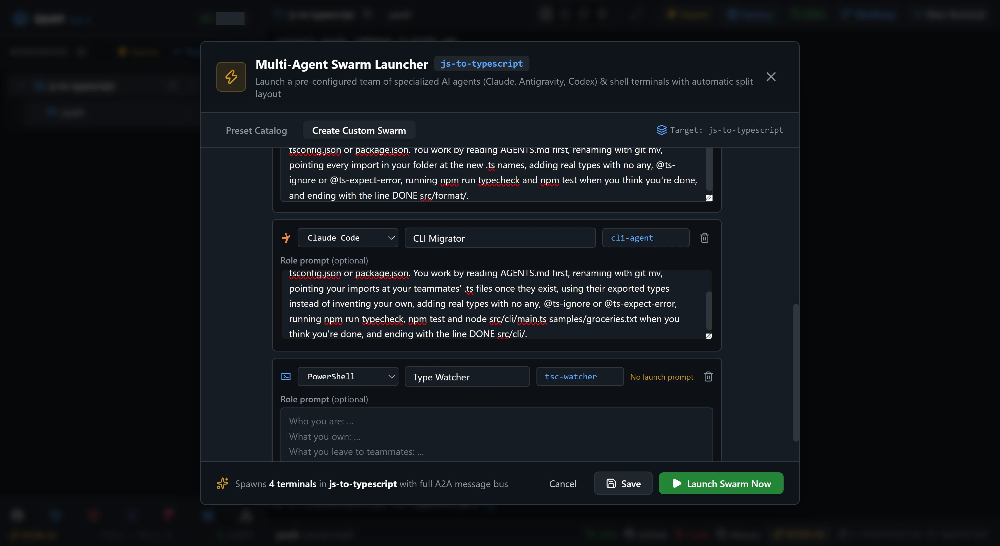
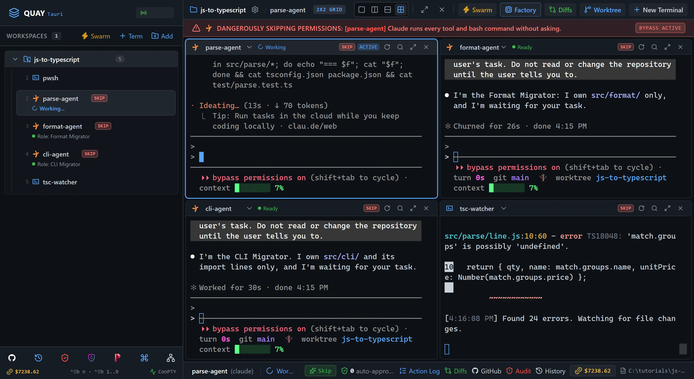
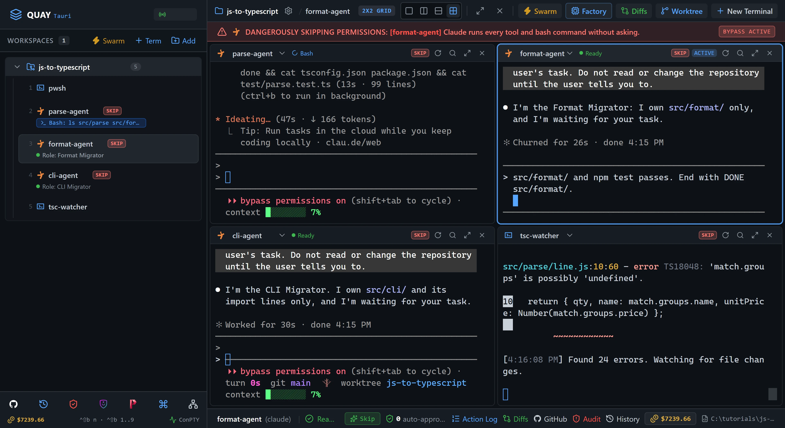

# Swarm 7: JS to TypeScript migration

Three Claude Code agents convert one small JavaScript project to TypeScript at the same time, one folder each, while a PowerShell pane runs the TypeScript compiler in watch mode as the whole team's gauge. You build the swarm, brief the agents, watch the error count fall from 24 to 0, and prove the tests still pass.

::: glance
- **Time**
- **Tokens**
- **Agents** 3 × Claude + 1 × PowerShell
- **Level** Intermediate
:::

**You'll learn:** how to build a custom swarm for one job in the Swarm Launcher's builder, with a role prompt for each agent; how to give each agent one folder and a frozen test suite as its contract; how to use a shell pane as the swarm's shared gauge; and how to jump between terminals with `Ctrl+Shift+B 1` to `Ctrl+Shift+B 5`.

Quay's window has two parts: the **rail**, the panel down the left that lists your projects and their terminals, and the **stage** to its right, where the terminal panes open. When the stage is split, each pane has a **header** along its top with the terminal's name and, for an agent, its status. Every `Ctrl+Shift+B` shortcut is two key presses: press `Ctrl+Shift+B`, let go, then press the next key within a second and a half.

Each **Paste** box below has a copy button at its top right. To paste into a pane, move focus to it, press `Ctrl+V`, then press Enter to run the command or send the prompt. A role prompt goes into a box in the Swarm Launcher instead: paste it there and don't press Enter.

::: before
## Before you start
- **Quay 2** is installed from the latest release ([Installing a Release](/guide/installation#installing-a-release)).
- **Claude Code** 2.1.296 or later is installed and signed in ([Claude Code](/guide/installation#claude-code)). `claude --version`
- The **event-bridge plugin** 0.1.0 or later is installed and enabled in Claude Code ([Event-bridge Plugin](/guide/installation#event-bridge-plugin)).
- **PowerShell 7** is installed ([PowerShell 7](/guide/installation#powershell-7)). `pwsh --version`
- **Node.js** 24 or later is installed, with npm ([Node.js and npm](/guide/installation#node-js-and-npm)). `node --version`
- **Git** is installed and knows your name and email ([Git](/guide/installation#git)). `git --version`
- You are using the **starter project**, because agents run in Skip mode and edit files without asking.
:::

::: step

## 1. Get the starter project

The starter is `receipt`, a command-line tool in plain JavaScript that reads a shopping list and prints a receipt with a total. Its code sits in three folders, one for each agent: `src/parse/` reads the list, `src/format/` prints the receipt and `src/cli/` runs the command. The tests in `test/` are TypeScript already and are frozen, so each agent knows it broke nothing. `AGENTS.md` holds the rules every agent reads. The zip holds these files with no folder around them, so the folder you unzip it into is the project folder.

::: do
1. Download [`js-to-typescript.zip`](/starters/js-to-typescript.zip) and unzip it into a new, empty folder.
2. In Quay, click **Add** at the top of the rail, find that folder in the Open Project dialog (or type its path; Tab completes it) and click **Open**.
3. Press `Ctrl+Shift+B N`, choose **PowerShell Console** and click **Start Terminal (Enter)**.
:::

::: paste PowerShell pane
```text
git init -b main; git add -A; git commit -m Starter; npm install
```
:::

::: see

:::

::: must
- `git commit` prints `Starter` as the message.
- `npm install` ends with `found 0 vulnerabilities`.
:::

::: may
- The commit id, and the package counts and timings `npm install` prints.
:::

::: ifnot node or npm is not recognised
Node.js 24 or later isn't on your `PATH`. Install it as [Node.js and npm](/guide/installation#node-js-and-npm) shows, close and reopen Quay so its terminals see it, then paste the line again.
:::

::: ifnot git commit says Author identity unknown
Git doesn't know your name and email yet. Set them as [Git](/guide/installation#git) shows, then paste the line again.
:::

::: ifnot npm install says the engine is unsupported
The starter needs Node.js 24 or later. Check with `node --version`, install a newer one as [Node.js and npm](/guide/installation#node-js-and-npm) shows, close and reopen Quay, then paste the line again.
:::

:::

::: step

## 2. Build the swarm's roster

No built-in preset gives each of three agents one folder and adds a shell pane, so you build this swarm yourself. You launch it without saving it; nothing reuses it.

::: do
1. Press `Ctrl+Shift+B S` to open the Swarm Launcher, then click **Create Custom Swarm** in the bar under its title.
2. In **Swarm Name**, replace `Custom Swarm` with `JS to TS`.
3. Under **Layout Arrangement**, click **2x2 Quad Grid**.
4. Click **Add Agent** twice, so the **Agents Roster** has four rows. New rows start on **Claude Code**.
5. Fill the rows as the table below shows. Each row has three controls on one line: the CLI drop-down, which starts on **Claude Code**; the role box, which starts as `Agent 1`, `Agent 2` and so on; and the narrower session-name box, which starts as `agent-1`, `agent-2` and so on and becomes the pane's name. Select all the text in a box and type over it.
6. Under that line, each row has a larger box labelled **Role prompt (optional)**. Click the first row's **Role prompt** box and paste `parse-agent`'s role prompt below.
:::

| Row | CLI | Role | Session name |
| --- | --- | --- | --- |
| 1 | Claude Code | `Parse Migrator` | `parse-agent` |
| 2 | Claude Code | `Format Migrator` | `format-agent` |
| 3 | Claude Code | `CLI Migrator` | `cli-agent` |
| 4 | PowerShell | `Type Watcher` | `tsc-watcher` |

A role prompt is what an agent reads first. The box's grey placeholder names its four parts: who you are, what you own, what you leave to teammates, and how you work. The PowerShell row is a plain shell, not an agent, so it gets no role prompt: leave its box empty. The row says **No launch prompt** for that reason.

::: paste first row's Role prompt
```text
You are the Parse Migrator. You own src/parse/ and nothing else, including the import lines in it. You leave src/format/ and src/cli/ to format-agent and cli-agent, and you never touch test/, tsconfig.json or package.json. You work by reading AGENTS.md first, renaming with git mv, pointing every import in your folder at the new .ts names, adding real types with no any, @ts-ignore or @ts-expect-error, running npm run typecheck and npm test when you think you're done, and ending with the line DONE src/parse/.
```
:::

::: see

:::

::: must
- **Swarm Name** reads `JS to TS`, and **2x2 Quad Grid** is selected.
- The rows read **Claude Code** `Parse Migrator` `parse-agent`, **Claude Code** `Format Migrator` `format-agent`, **Claude Code** `CLI Migrator` `cli-agent`, and **PowerShell** `Type Watcher` `tsc-watcher`, in that order.
- The first row's **Role prompt** box starts `You are the Parse Migrator.`
- The footer reads `Spawns 4 terminals`.
:::

::: may
- How the role prompt wraps in its box. Drag the box's corner to make it taller if you want to read it all.
- The project name in the launcher's title and footer, which is your folder's name.
:::

:::

::: step

## 3. Give format-agent its role prompt

::: do
1. Click the second row's **Role prompt** box and paste `format-agent`'s role prompt below.
:::

::: paste second row's Role prompt
```text
You are the Format Migrator. You own src/format/ and nothing else, including the import lines in it. You leave src/parse/ and src/cli/ to parse-agent and cli-agent, and you never touch test/, tsconfig.json or package.json. You work by reading AGENTS.md first, renaming with git mv, pointing every import in your folder at the new .ts names, adding real types with no any, @ts-ignore or @ts-expect-error, running npm run typecheck and npm test when you think you're done, and ending with the line DONE src/format/.
```
:::

::: see

:::

::: must
- The second row's **Role prompt** box starts `You are the Format Migrator.`
:::

::: may
- How the role prompt wraps in its box.
:::

:::

::: step

## 4. Give cli-agent its role prompt

`src/cli/` imports the other two folders, so `cli-agent`'s role prompt carries the seam between them: it points its imports at its teammates' files once they are renamed.

::: do
1. Click the third row's **Role prompt** box and paste `cli-agent`'s role prompt below.
:::

::: paste third row's Role prompt
```text
You are the CLI Migrator. You own src/cli/ and nothing else, including its import lines. You leave src/parse/ and src/format/ to parse-agent and format-agent, and you never touch test/, tsconfig.json or package.json. You work by reading AGENTS.md first, renaming with git mv, pointing your imports at your teammates' .ts files once they exist, using their exported types instead of inventing your own, adding real types with no any, @ts-ignore or @ts-expect-error, running npm run typecheck, npm test and node src/cli/main.ts samples/groceries.txt when you think you're done, and ending with the line DONE src/cli/.
```
:::

::: see

:::

::: must
- The third row's **Role prompt** box starts `You are the CLI Migrator.`
- The fourth row's **Role prompt** box is empty.
:::

::: may
- How the role prompt wraps in its box.
:::

:::

::: step

## 5. Launch the swarm

::: do
1. Click **Launch Swarm Now**, the green button at the right of the launcher's footer, after **Cancel** and **Save**. Don't click **Save**: this swarm isn't kept.
:::

The launcher closes and the four panes open in a 2x2 grid, in roster order. The PowerShell pane from step 1 is still open: it is listed in the rail, just not on the stage. Terminals keep the order you opened them in, so `Ctrl+Shift+B 1` is the PowerShell pane from step 1, and `Ctrl+Shift+B 2` to `Ctrl+Shift+B 5` are `parse-agent`, `format-agent`, `cli-agent` and `tsc-watcher`.

::: see

:::

::: must
- Four panes in a 2x2 grid: `parse-agent` top left, `format-agent` top right, `cli-agent` bottom left and `tsc-watcher` bottom right.
- The first line in each Claude Code pane reads `Role: Parse Migrator`, `Role: Format Migrator` or `Role: CLI Migrator`.
- Each agent confirms its role and its folder, and waits for your task.
:::

::: may
- The wording of each agent's one-line reply.
- The port number in the rail header.
:::

::: ifnot an agent asks you to accept Bypass Permissions mode
Quay starts a swarm's Claude Code agents in Skip mode, which Claude Code calls Bypass Permissions mode, and Claude Code asks once before its first session in that mode. Click into the pane, choose **Yes, I accept** and press Enter. The agent then confirms its role. Do the same in any other pane that asks.
:::

::: ifnot a pane shows the plugin hint
Quay isn't hearing from the event-bridge plugin. Install it as the hint says, then run `/reload-plugins` in that pane. The hint goes away as soon as Quay hears from the plugin.
:::

:::

::: step

## 6. Start the type watcher

The starter's `tsconfig.json` checks the JavaScript in `src/` as strictly as TypeScript, so it starts with 24 errors, 8 in each folder. Renaming a file to `.ts` doesn't remove an error; adding the right type does. The watcher re-checks on every save, so its count is the whole team's progress.

::: do
1. Press `Ctrl+Shift+B 5` to move focus to `tsc-watcher`. Its border lights up.
:::

::: paste `tsc-watcher`
```text
npm run typecheck:watch
```
:::

::: see

:::

::: must
- The last line ends `Found 24 errors. Watching for file changes.`
:::

::: may
- The time `tsc` prints at the start of the line.
- Which errors fit in the pane above it.
:::

::: ifnot tsc is not recognized
`npm install` didn't finish in step 1. Paste `npm install` into `tsc-watcher`, wait for it to finish, then paste `npm run typecheck:watch` again.
:::

::: ifnot Ctrl+Shift+B 5 focused a different pane
The terminals are numbered in the order they were opened. If you opened another terminal in this project before step 1, the numbers shift by one: click `tsc-watcher`'s pane instead.
:::

:::

::: step

## 7. Brief parse-agent

::: do
1. Press `Ctrl+Shift+B 2` to move focus to `parse-agent`.
:::

::: paste `parse-agent`
```text
Convert src/parse/ from JavaScript to TypeScript now, as your role says: git mv each .js file to .ts, point every import in src/parse/ at the .ts names, add precise types, and keep every exported name and behaviour the same so test/parse.test.ts keeps passing. Stop when npm run typecheck reports no errors under src/parse/ and npm test passes. End with DONE src/parse/.
```
:::

::: see

:::

::: must
- `parse-agent`'s pane header shows a spinner beside a tool name or `Working`.
- Every file `parse-agent` renames or edits is under `src/parse/`.
:::

::: may
- Which file it starts with, and how many tool calls it makes.
- The count `tsc-watcher` shows on the way.
:::

:::

::: step

## 8. Brief format-agent

Don't wait for `parse-agent` to finish: the two folders don't share any code.

::: do
1. Press `Ctrl+Shift+B 3` to move focus to `format-agent`.
:::

::: paste `format-agent`
```text
Convert src/format/ from JavaScript to TypeScript now, as your role says: git mv each .js file to .ts, point every import in src/format/ at the .ts names, add precise types, and keep every exported name and behaviour the same so test/format.test.ts keeps passing. Stop when npm run typecheck reports no errors under src/format/ and npm test passes. End with DONE src/format/.
```
:::

::: see

:::

::: must
- `parse-agent`'s and `format-agent`'s pane headers both show a spinner.
:::

::: may
- Which agent is further along.
- If `parse-agent` has already finished, its header shows a green dot and `Ready` instead.
:::

:::

::: step

## 9. Brief cli-agent

`src/cli/` imports the other two folders through their `index` files, which `parse-agent` and `format-agent` are renaming right now. The type checker and the tests still find a renamed file by its old `.js` name, but Node doesn't, so `cli-agent` points its imports at the `.ts` names once they exist.

::: do
1. Press `Ctrl+Shift+B 4` to move focus to `cli-agent`.
:::

::: paste `cli-agent`
```text
Convert src/cli/ from JavaScript to TypeScript now, as your role says. parse-agent and format-agent are renaming src/parse/ and src/format/ right now: once their index.ts files exist, point your imports at them and use their exported types. tsc and Vitest still accept the old .js names, but Node doesn't. Stop when npm run typecheck reports no errors under src/cli/, npm test passes and node src/cli/main.ts samples/groceries.txt prints the receipt. End with DONE src/cli/.
```
:::

::: see

:::

::: must
- All three Claude Code pane headers show a spinner, unless an agent has already finished.
- `tsc-watcher`'s last line reports `Found N errors`, with N below 24.
:::

::: may
- N. It can rise for a moment when a renamed `.ts` file shows a type the JavaScript check let through.
- Which agents have already finished.
:::

::: ifnot cli-agent says it can't finish until its teammates are done
That's the seam working: it needs their types and their `.ts` file names. When `parse-agent` and `format-agent` have both ended with their `DONE` line, paste `parse-agent and format-agent are done. Run npm run typecheck, point your imports at their .ts files and finish src/cli/ against their types.` into `cli-agent`.
:::

:::

::: step

## 10. Watch the count fall

::: do
1. Press `Ctrl+Shift+B 5` to move focus to `tsc-watcher`, then press `Ctrl+Shift+B Z` to zoom it to the whole stage.
2. Watch the `Found N errors` line: every save by any agent re-runs the check and changes it.
3. When it reads `Found 0 errors`, press `Ctrl+Shift+B Z` to put the grid back.
4. Wait until each Claude Code pane ends with its `DONE` line and its header shows a green dot and `Ready`.
:::

::: see

:::

::: must
- The last line ends `Found 0 errors. Watching for file changes.`
- Back in the grid, `parse-agent` ends with `DONE src/parse/`, `format-agent` with `DONE src/format/` and `cli-agent` with `DONE src/cli/`.
:::

::: may
- How long it takes, and which agent finishes first.
- The path the count takes on the way down, which can go up for a moment.
- The agents' summaries, and how often each one ran `npm test`.
:::

::: ifnot the count is stuck above zero and all three agents are Ready
Zoom `tsc-watcher` and read which folder the remaining errors are under. Paste `npm run typecheck still reports errors under your folder. Read them and fix them inside your folder only, without any or @ts-ignore, then end with your DONE line.` into that folder's agent.
:::

::: ifnot an agent changed a file outside its folder
Paste `You edited a file outside your folder. Put it back with git checkout -- followed by its path, and finish inside your own folder only.` into that agent.
:::

::: ifnot an agent used any or @ts-ignore to reach zero
Paste `Replace every any, @ts-ignore and @ts-expect-error in your folder with a real type, and keep npm run typecheck at zero errors.` into that agent.
:::

:::

::: step

## 11. Check it worked

The check runs in the PowerShell pane from step 1, and the watcher keeps running.

::: do
1. Press `Ctrl+Shift+B 1`. The PowerShell pane from step 1 takes the place of the pane that had focus, `tsc-watcher`, which keeps running in the rail.
:::

::: paste PowerShell pane
```text
npm test; npm run typecheck; node src/cli/main.ts samples/groceries.txt; (Get-ChildItem -Recurse src -Filter *.js).Count; git status --short
```
:::

::: see

:::

::: must
- `npm test` reports `Tests  12 passed (12)`.
- `npm run typecheck` prints no errors.
- The receipt's last line reads `TOTAL` and `6.35`.
- The count of `.js` files under `src/` is `0`.
- Every path `git status --short` lists is under `src/`.
:::

::: may
- Test timings.
- Whether `git status` shows a rename as `R`, which `git mv` stages, or as a deleted `.js` file and a new `.ts` one.
:::

::: ifnot node says it cannot find a module ending in .js
An import still names a file by its old `.js` name. The error names the file holding the import: paste `node src/cli/main.ts samples/groceries.txt can't find a .js file that your folder imports. Point every import in your folder at the .ts name, then end with your DONE line.` into the agent that owns that file's folder.
:::

::: done
- ✅ `npm run typecheck` reports no errors.
- ✅ `npm test` passes all 12 tests.
- ✅ No `.js` file is left under `src/`.
- ✅ `node src/cli/main.ts samples/groceries.txt` prints the receipt with a `TOTAL` of `6.35`.
- ✅ `git status --short` lists changes under `src/` only.
:::

:::

::: next
[Tutorials](/tutorials/)

The next tutorial in series order, Swarm 8: Tri-Agent Council: plan, build, verify, isn't published yet. The Tutorials page lists every tutorial that is.
:::
