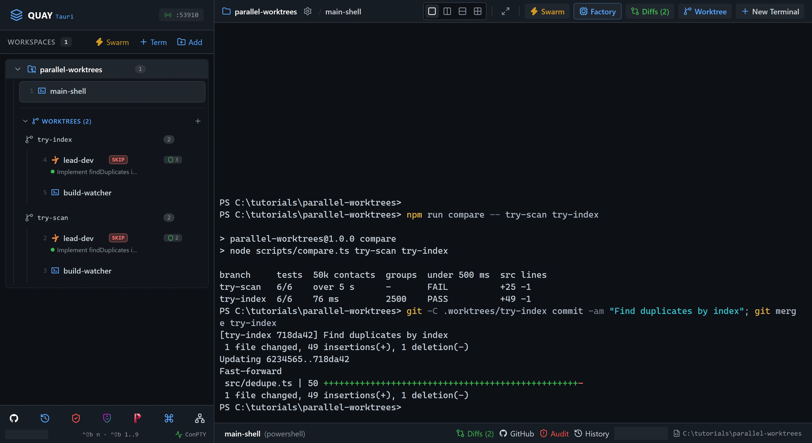

# Swarm 10: Parallel experiments with worktrees

Not sure which of two designs is better? Try both at once. You give each idea its own git worktree and its own Dev & Watcher swarm, let two Claude Code agents build in parallel without touching each other's files, measure the results, merge the winner and throw the other away.

::: glance
- **Time**
- **Tokens**
- **Agents** 2 × Claude + 3 × PowerShell
- **Level** Advanced
:::

**You'll learn:** how to make git worktrees from Quay (`Ctrl+Shift+B W`), launch a swarm into a worktree, flip between experiments in the rail, read each agent's edits in the Diff Inspector (`Ctrl+Shift+B D`), and merge one branch while removing every worktree.

Quay's window has two parts: the **rail**, the panel down the left that lists your projects and their terminals, and the **stage** to its right, where the terminal panes open. When the stage is split, each pane has a **header** along its top with the terminal's name and, for an agent, its status. Every `Ctrl+Shift+B` shortcut is two key presses: press `Ctrl+Shift+B`, let go, then press the next key within a second and a half. Each prompt the page gives you goes into the pane it names: click inside that pane, paste the prompt, and press Enter to run it or, in a Claude Code pane, to send it.

A **git worktree** is a second folder checked out on its own branch of the same repository, so two agents can each change "the same" file without touching the other's copy. Quay puts each worktree in `.worktrees/<branch>` inside your project and lists it in the rail under the project's **Worktrees** list. The stage shows the terminals of one folder at a time: the project's, or one worktree's. This tutorial explains worktrees, not git, so it assumes you know what a branch and a merge are.

The experiment is rigged so that one design wins, which lets this page name the winner. In real work you won't know which one wins until you measure.

::: before
## Before you start
- **Quay 2** is installed from the latest release ([Installing a Release](/guide/installation#installing-a-release)).
- **Claude Code** 2.1.296 or later is installed and signed in ([Claude Code](/guide/installation#claude-code)). `claude --version`
- The **event-bridge plugin** 0.1.0 or later is installed and enabled in Claude Code ([Event-bridge Plugin](/guide/installation#event-bridge-plugin)).
- **PowerShell 7** is installed ([PowerShell 7](/guide/installation#powershell-7)). `pwsh --version`
- **Node.js** 24 or later is installed, with npm ([Node.js and npm](/guide/installation#node-js-and-npm)). `node --version`
- **Git** is installed and knows your name and email ([Git](/guide/installation#git)). `git --version`
- You are using the **starter project**, because agents run in Skip mode and edit files without asking.
:::

::: step

## 1. Get the starter project

::: do
1. Download [`parallel-worktrees.zip`](/starters/parallel-worktrees.zip) and unzip it into a new, empty folder.
2. In Quay, click **Add** at the top of the rail, find that folder in the Open Project dialog (or type its path; Tab completes it) and click **Open**.
3. Press `Ctrl+Shift+B N`, choose **PowerShell Console** and click **Start Terminal (Enter)**.
:::

::: paste PowerShell pane
```text
git init -b main; git add -A; git commit -m Starter; npm install
```
:::

::: see

:::

::: must
- `git commit` prints `Starter` as the message.
- `npm install` ends with `found 0 vulnerabilities`.
:::

::: may
- The commit id, and the package counts and timings `npm install` prints.
- An `npm notice` about a newer version of npm after `found 0 vulnerabilities`.
:::

::: ifnot node or npm is not recognised
Node.js 24 or later isn't on your `PATH`. Install it as [Node.js and npm](/guide/installation#node-js-and-npm) shows, close and reopen Quay so its terminals see it, then paste the line again.
:::

::: ifnot git commit says Author identity unknown
Git doesn't know your name and email yet. Set them as [Git](/guide/installation#git) shows, then paste the line again.
:::

:::

::: step

## 2. Make two worktrees

::: do
1. Rename the PowerShell pane, so it can't be mixed up with the swarms' panes later: in the rail, hover over `pwsh` under the project and click the pencil icon that appears beside its name (**Rename session**). Type `main-shell` and press Enter.
2. Press `Ctrl+Shift+B W`. The **New Git Worktree** dialog opens.
3. Type `try-scan` as the **Branch Name**. Leave **Create as new branch** ticked, with `main` in the **from** box beside it.
4. Untick **Launch Claude Code terminal immediately**. You'll launch a whole swarm there instead.
5. Click **Create Worktree**.
6. Do 2 to 5 again with `try-index` as the **Branch Name**.
7. In the rail, click **Worktrees (2)** under the project to show the list.
:::

::: paste `main-shell`
```text
git worktree list
```
:::

::: see

:::

::: must
- The rail lists `try-scan` and `try-index` under **Worktrees (2)**.
- `git worktree list` prints three lines: the project folder ending `[main]`, `.worktrees/try-index` ending `[try-index]`, and `.worktrees/try-scan` ending `[try-scan]`.
:::

::: may
- The commit ids, which are all the same.
- The order of the two worktrees, in the rail and in `git worktree list`.
- The folder in front of `.worktrees`, which is wherever you unzipped the starter.
:::

::: ifnot the dialog says Git worktree add failed: invalid reference: main
The project's first branch isn't called `main`. Paste `git branch -m main` into `main-shell`, then make the worktrees again.
:::

::: ifnot a Claude Code terminal named wt-try-scan or wt-try-index opened
**Launch Claude Code terminal immediately** was still ticked, and the dialog ticks it again each time it opens. Close that terminal: in the rail, hover over it and click the **×** that appears, **Close terminal**.
:::

:::

::: step

## 3. Launch the first experiment

::: do
1. Click `try-scan` under **Worktrees** in the rail. The stage empties and says **No Terminal in this Project**: this worktree has no terminals yet.
2. Press `Ctrl+Shift+B S`. The Swarm Launcher opens with **Dev & Watcher** selected. Check that it says **Target: try-scan**.
3. Click **Launch Swarm Now**. Dev & Watcher opens two panes side by side in `try-scan`: `lead-dev`, a Claude Code agent, on the left, and `build-watcher`, a PowerShell pane for running the tests, on the right.
4. Wait until `lead-dev` has confirmed its role. Quay tells each agent it launches what its job is, and the agent answers in one line, then waits for your task. In the rail, the line under `lead-dev` changes to `Role: Lead Developer`.
5. Press `Ctrl+Shift+B O` to move focus to `build-watcher`. Its border lights up.
:::

::: paste `build-watcher`
```text
npm ci; npm test
```
:::

::: see

:::

::: must
- In the rail, the line under `lead-dev` reads `Role: Lead Developer`, and its pane header shows a green dot and `Ready`.
- `build-watcher` shows `Tests  6 failed (6)`, with `Tests failed. Watching for file changes...` under it.
- The rail lists `lead-dev` and `build-watcher` under `try-scan`, not under the project beside `main-shell`.
:::

::: may
- The wording of `lead-dev`'s one-line reply.
- The package counts and timings `npm ci` prints.
:::

::: ifnot the launcher's Target isn't try-scan
The launcher launches into the folder selected in the rail. Press `Esc` to close it, click `try-scan` under **Worktrees** in the rail, and press `Ctrl+Shift+B S` again.
:::

::: ifnot lead-dev asks whether you trust this folder
Claude Code asks once for each new folder, and each worktree is a new folder: `Quick safety check: Is this a project you created or one you trust?` It lists **No, exit** first, with the cursor on it. Click into `lead-dev`, press the Down arrow to move to **Yes, I trust this folder**, and press Enter. It then confirms its role.
:::

::: ifnot lead-dev asks you to accept Bypass Permissions mode
Quay starts a swarm's Claude Code agents in Skip mode, which Claude Code calls Bypass Permissions mode, and Claude Code asks once before its first session in that mode. Click into `lead-dev`, choose **Yes, I accept** and press Enter. It then confirms its role.
:::

::: ifnot lead-dev shows No events from the event-bridge plugin
That line, across the top of `lead-dev`'s pane, means Quay isn't hearing from the event-bridge plugin. If Claude Code is asking you something in `lead-dev`, answer it first. Otherwise install the plugin as [Event-bridge Plugin](/guide/installation#event-bridge-plugin) shows, then run `/reload-plugins` in `lead-dev`. The line goes away as soon as Quay hears from the plugin.
:::

:::

::: step

## 4. Brief the first experiment

::: do
1. Press `Ctrl+Shift+B O` to move focus back to `lead-dev`.
:::

::: paste `lead-dev`
```text
Implement findDuplicates in src/dedupe.ts so every test in test/dedupe.test.ts passes. Use the simplest approach you can: compare every pair of contacts and merge the groups they belong to. Keep it short and plain. Edit only src/dedupe.ts. Don't run the tests yourself: the build-watcher pane is running them, and I'm watching it. Tell me when you believe they all pass.
```
:::

::: see

:::

::: must
- While it works, `lead-dev`'s pane header shows a spinner beside the tool it is using, or beside `Working`.
:::

::: may
- How far `lead-dev` has got. You don't wait for it to finish: the next step starts the second experiment while this one works.
- The tool its pane header names.
:::

:::

::: step

## 5. Launch the second experiment

::: do
1. Click `try-index` under **Worktrees** in the rail. The stage empties again and says **No Terminal in this Project**. `try-scan`'s swarm keeps working out of sight: in the rail, its `lead-dev` row shows a spinner and `Working...` until it finishes.
2. Press `Ctrl+Shift+B S`. Check that the launcher says **Target: try-index**, with **Dev & Watcher** selected.
3. Click **Launch Swarm Now**, and wait until this `lead-dev` has confirmed its role in one line.
4. Press `Ctrl+Shift+B O` to move focus to `build-watcher`.
:::

::: paste `build-watcher`
```text
npm ci; npm test
```
:::

::: see

:::

::: must
- `build-watcher` shows `Tests  6 failed (6)`.
- The rail lists a `lead-dev` and a `build-watcher` under `try-scan`, and another pair under `try-index`.
:::

::: may
- Whether `try-scan`'s `lead-dev` row in the rail still shows a spinner, or has already finished.
- The package counts and timings `npm ci` prints.
:::

::: ifnot the launcher's Target isn't try-index
Press `Esc` to close it, click `try-index` under **Worktrees** in the rail, and press `Ctrl+Shift+B S` again.
:::

:::

::: step

## 6. Brief the second experiment

::: do
1. Press `Ctrl+Shift+B O` to move focus back to `lead-dev`.
:::

::: paste `lead-dev`
```text
Implement findDuplicates in src/dedupe.ts so every test in test/dedupe.test.ts passes. Build it for speed: index the contacts by normalized email and by normalized phone in Maps, and join matching contacts with a union-find, so the work is one pass over the list. Edit only src/dedupe.ts. Don't run the tests yourself: the build-watcher pane is running them, and I'm watching it. Tell me when you believe they all pass.
```
:::

::: see

:::

::: must
- While it works, this `lead-dev`'s pane header shows a spinner beside the tool it is using, or beside `Working`.
:::

::: may
- How far each `lead-dev` has got, and whether `try-scan`'s has already finished.
:::

:::

::: step

## 7. Flip between the experiments

::: do
1. Click `try-scan` under **Worktrees** in the rail, then `try-index`. The stage swaps between the two swarms each time.
2. Keep flipping now and then until both `build-watcher` panes show every test passing and both `lead-dev`s say they believe the tests pass.
:::

::: see

:::

::: must
- Each `build-watcher` shows `Tests  6 passed (6)`.
- Each `lead-dev`'s pane header shows a green dot and `Ready`.
:::

::: may
- Which experiment finishes first, and how long each takes.
- Each `lead-dev`'s wording.
- How many times each watcher re-runs on the way.
:::

::: ifnot a lead-dev edits the test file
Paste `Undo your changes under test/ with git checkout -- test, then make the tests pass by editing src/dedupe.ts only.` into that `lead-dev`.
:::

::: ifnot a lead-dev runs the tests itself anyway
It still works; the lesson is just quieter. When it finishes, paste `Thanks. From now on leave test runs to the watcher.` into that `lead-dev`.
:::

:::

::: step

## 8. Read each experiment's edits

::: do
1. Press `Ctrl+Shift+B D`. The **Visual Diff & File Changes** drawer opens, listing every edit both agents made.
2. Type `try-scan` in **Filter files...**, click an entry and read the change. An entry marked `Write` shows the whole file the agent wrote. On an entry marked `Edit`, you can switch between **Unified** and **Side-by-Side**.
3. Change the filter to `try-index` and read that experiment's changes.
4. Press `Esc` to close the drawer.
:::

::: see

:::

::: must
- Under each filter, every entry is `dedupe.ts`, and each names `lead-dev`.
:::

::: may
- How many entries there are, whether each is `Edit` or `Write`, and their `+` and `-` counts.
:::

::: ifnot the drawer says No file modifications recorded yet
Quay isn't hearing from the event-bridge plugin, which reports each edit. Check that it is installed and enabled, as [Event-bridge Plugin](/guide/installation#event-bridge-plugin) shows. The drawer only lists edits made while Quay was hearing from the plugin.
:::

:::

::: step

## 9. Measure both

::: do
1. Click the project's name in the rail. The stage shows `main-shell`.
:::

::: paste `main-shell`
```text
npm run compare -- try-scan try-index
```
:::

::: see

:::

::: must
- Both rows show `6/6` under `tests`.
- The `try-scan` row shows `FAIL` under `under 500 ms`.
- The `try-index` row shows `2500` under `groups` and `PASS` under `under 500 ms`.
:::

::: may
- The times, and whether `try-scan` shows a time or `over 5 s`.
- The `src lines` counts.
:::

::: ifnot try-scan shows PASS too
Its `lead-dev` didn't compare every pair as its prompt asked. Both designs meet the bar, so either could win; the rest of this page keeps `try-index`.
:::

::: ifnot a row says no worktree
`compare` looks for each branch in `.worktrees/<branch>`. Check the branch names under **Worktrees** in the rail and type them as they are there.
:::

:::

::: step

## 10. Keep the winner

::: do
1. Stay in `main-shell`. You commit only the winner: `try-scan`'s change is thrown away in the next step.
:::

::: paste `main-shell`
```text
git -C .worktrees/try-index commit -am "Find duplicates by index"; git merge try-index
```
:::

::: see

:::

::: must
- The commit prints `Find duplicates by index` and `1 file changed`.
- The merge says `Fast-forward`, and lists `src/dedupe.ts` as the one file changed.
:::

::: may
- The commit ids, and the line counts.
:::

::: ifnot the merge says Already up to date
The commit didn't happen, so `try-index` holds nothing new. Read the commit's message above it, then paste the line again.
:::

:::

::: step

## 11. Clean up and check it worked

::: do
1. In the rail, hover over `try-index` under **Worktrees** and click the trash icon that appears on its row. Its tooltip says **Remove worktree try-index**. Quay asks `Remove worktree "try-index"? Any active terminals in this worktree will be closed.`: click **OK**. Its two terminals close and its row goes.
2. Do the same for `try-scan`: hover over its row, click its trash icon and click **OK**. This time Quay shows **Worktree not removed**, with git's error: `try-scan` still holds `lead-dev`'s uncommitted change to `src/dedupe.ts`, and nothing has been closed yet. Click **Remove anyway** to throw the experiment away. Its two terminals close and its row goes.
:::

::: paste `main-shell`
```text
git branch -D try-scan; git branch -d try-index; git worktree list; npm run compare -- main; git log --oneline
```
:::

::: see
![main-shell: Deleted branch lines for try-scan and try-index, one worktree line ending in [main], a compare row for main that reads 6/6, 2500 and PASS, and the two commits Find duplicates by index and Starter. The rail lists only main-shell under the project.](./11-cleaned-up.webp)
:::

::: must
- Two `Deleted branch` lines, one for `try-scan` and one for `try-index`.
- `git worktree list` prints one line, ending `[main]`.
- The `main` row shows `6/6`, `2500` and `PASS`.
- `git log --oneline` prints two lines: `Find duplicates by index`, then `Starter`.
:::

::: may
- The time on the `main` row, and its `src lines` count.
- The commit ids.
:::

::: ifnot Worktree not removed shows for try-index too
`try-index` has a change step 10 didn't commit. Its `src/dedupe.ts` is already merged into `main`, so click **Remove anyway**.
:::

::: done
- ✅ The `main` row of `npm run compare` reads `6/6`, `2500` and `PASS`.
- ✅ `git worktree list` shows only the project folder.
- ✅ `git log --oneline` shows `Find duplicates by index` on top of `Starter`.
- ✅ The rail lists no worktrees under the project: only `main-shell` is left.
:::

:::

::: next
[A2A 1: Hello, A2A](/tutorials/a2a/hello-a2a/)

The next tutorial in series order. Send an agent a message from Mission Control, then watch one agent ask another a question and wait for the reply.
:::
