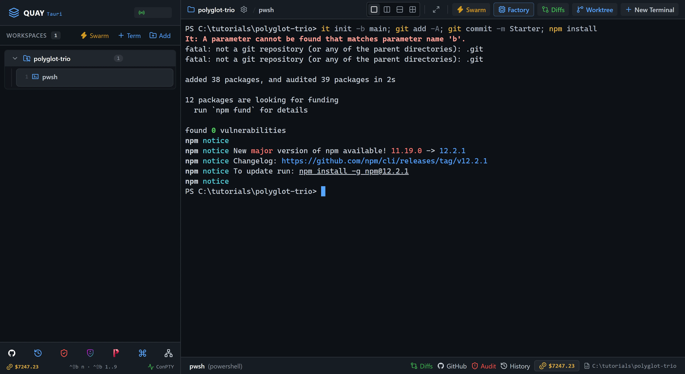
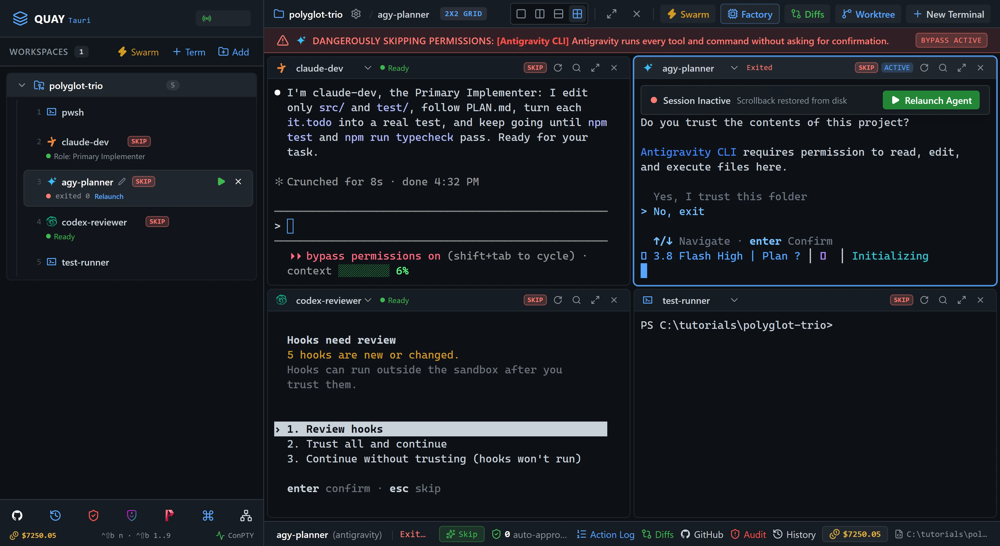
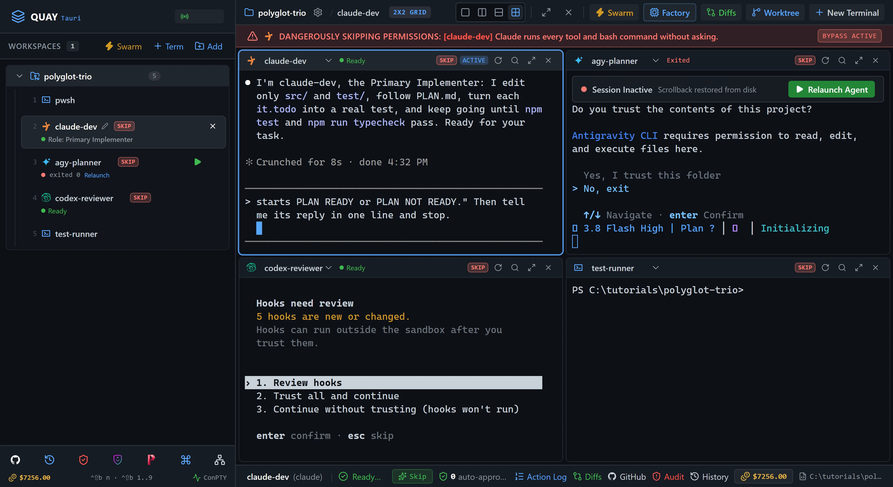
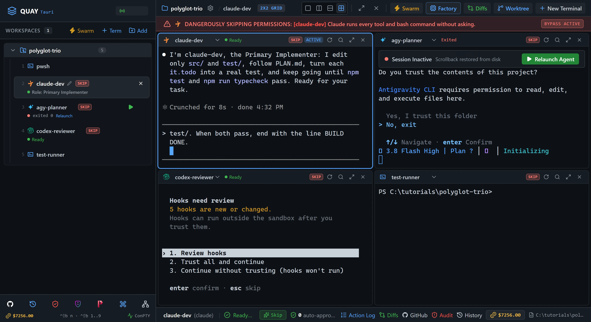
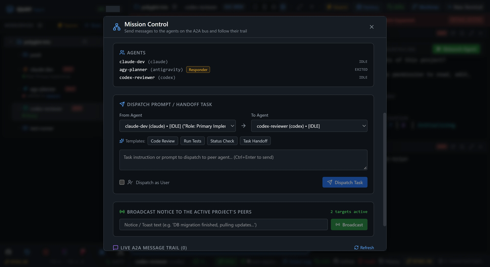
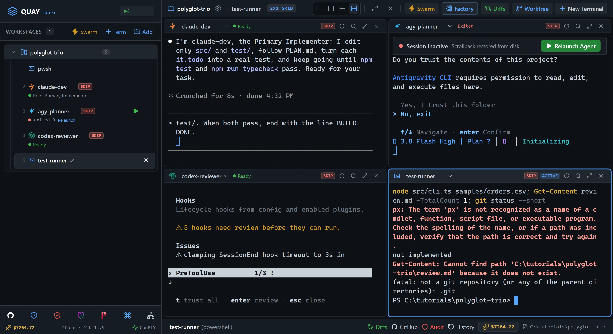

# Swarm 9: Polyglot Trio

Three agents from three vendors build one small tool. Antigravity plans a CSV-to-JSON converter, Claude Code builds it, and Codex reviews it and sends Claude the fixes. You launch them with one click, watch them pass work across the A2A bus, and finish by running tests none of them saw.

::: glance
- **Time**
- **Tokens**
- **Agents** 1 × Claude + 1 × Antigravity + 1 × Codex + 1 × PowerShell
- **Level** Advanced
:::

**You'll learn:** how to launch the Polyglot Agent Trio preset; what a full peer and a responder are, and how Mission Control shows them; how to give an agent its role by hand when its CLI takes no launch prompt; how to ask a responder a short question and get its reply; how a plan and a review travel as files while the A2A bus carries only the short messages; and how a non-Claude agent sends a message.

Quay's window has two parts: the **rail**, the panel down the left that lists your projects and their terminals, and the **stage** to its right, where the terminal panes open. When the stage is split, each pane has a **header** along its top with the terminal's name and, for an agent, its status. Every `Ctrl+B` shortcut is two key presses: press `Ctrl+B`, let go, then press the next key within a second and a half. `Ctrl+B` followed by a digit moves focus to that terminal, counting down the rail from 1. To paste a step's line into a pane, copy it with the button beside it, right-click in the pane and choose **Paste**, then press `Enter` to send it.

Every agent on the A2A bus is a **peer**, and Quay can type a message into any of them. A **full peer** can also send messages with the `quay_*` tools and answer a sender who waits for it. A **responder** can answer a sender who waits, but it has no `quay_*` tools, so it never starts a conversation. In this tutorial Claude Code and Codex are full peers and Antigravity is a responder.

::: before
## Before you start
- **Quay 2** is installed from the latest release ([Installing a Release](/guide/installation#installing-a-release)).
- **Claude Code** 2.1.296 or later is installed and signed in ([Claude Code](/guide/installation#claude-code)). `claude --version`
- The **event-bridge plugin** 0.1.0 or later is installed and enabled in Claude Code ([Event-bridge Plugin](/guide/installation#event-bridge-plugin)).
- **PowerShell 7** is installed ([PowerShell 7](/guide/installation#powershell-7)). `pwsh --version`
- **Node.js** 24 or later is installed, with npm ([Node.js and npm](/guide/installation#node-js-and-npm)). `node --version`
- **Git** is installed and knows your name and email ([Git](/guide/installation#git)). `git --version`
- **Codex CLI** 0.154.0 or later is installed, updated to its latest version with `npm install -g @openai/codex@latest`, and signed in ([Codex CLI](/guide/installation#codex-cli)). `codex --version`
- **Antigravity CLI** 1.4.2 or later is installed and signed in ([Antigravity CLI](/guide/installation#antigravity-cli)). `agy --version`
- You are using the **starter project**, because agents run in Skip mode and edit files without asking.
:::

::: step

## 1. Get the starter project

The starter is a CSV-to-JSON converter with nothing inside it yet. `SPEC.md` is the contract all three agents read: eight numbered rules, then the exact JSON the finished tool prints for `samples/orders.csv`. `AGENTS.md` says which agent may edit which file and how a review is laid out.

::: do
1. Download [`polyglot-trio.zip`](/starters/polyglot-trio.zip) and unzip it into a new, empty folder.
2. In Quay, click **Add** at the top of the rail, click **Browse...**, pick that folder and click **Add Project**.
3. Press `Ctrl+B N`, choose **PowerShell Console** and click **Start Terminal (Enter)**.
:::

::: paste PowerShell pane
```text
git init -b main; git add -A; git commit -m Starter; npm install
```
:::

::: see

:::

::: must
- `git commit` prints `Starter` as the message.
- `npm install` ends with `found 0 vulnerabilities`.
:::

::: may
- The commit id, and the package counts and timings `npm install` prints.
:::

::: ifnot node or npm is not recognised
Node.js 24 or later isn't on your `PATH`. Install it as [Node.js and npm](/guide/installation#node-js-and-npm) shows, close and reopen Quay so its terminals see it, then paste the line again.
:::

::: ifnot git commit says Author identity unknown
Git doesn't know your name and email yet. Set them as [Git](/guide/installation#git) shows, then paste the line again.
:::

:::

::: step

## 2. Launch the Polyglot Trio

The four panes this step opens are four different programs: Claude Code, Antigravity, Codex and PowerShell. The launcher starts all three agents in Skip mode, so each runs its tools without asking you first.

::: do
1. Press `Ctrl+B S` to open the Swarm Launcher.
2. Select the **Polyglot Agent Trio** card. The `agy-planner` row is marked **No launch prompt**: Antigravity can't take a first message on its command line, so it starts without its role. You give it one in step 4.
3. Click **Launch Swarm Now**.
4. If a pane asks whether you trust this folder, click into that pane and choose to trust it. Antigravity and Codex may each ask, the first time they open a folder.
5. Wait until the headers of `claude-dev`, `agy-planner` and `codex-reviewer` all read `Ready`, which is how Quay shows an agent waiting for its next task.
:::

::: see

:::

::: must
- Four panes in a 2x2 grid: `claude-dev` top left, `agy-planner` top right, `codex-reviewer` bottom left and `test-runner` bottom right.
- The rail lists the PowerShell pane from step 1, then `claude-dev`, `agy-planner`, `codex-reviewer` and `test-runner`.
- `claude-dev` and `codex-reviewer` each confirm their role in one line. `agy-planner` shows no role.
- The headers of `claude-dev`, `agy-planner` and `codex-reviewer` each carry a red **SKIP** tag.
:::

::: may
- Each CLI's welcome text, model name and version.
- The wording of each role confirmation.
- The port number in the rail header.
:::

::: ifnot claude-dev asks you to accept Bypass Permissions mode
Quay starts a swarm's Claude Code agents in Skip mode, which Claude Code calls Bypass Permissions mode, and Claude Code asks once before its first session in that mode. Click into `claude-dev`, choose **Yes, I accept** and press Enter. It then confirms its role.
:::

::: ifnot the codex-reviewer pane printed Updating Codex CLI and then exited
Codex tried to update itself and the download failed. Press `Ctrl+B 5` to move focus to `test-runner`, paste `npm install -g @openai/codex@latest` and wait for it to finish. Then close the four swarm terminals and do this step again: in the rail, point at each of `claude-dev`, `agy-planner`, `codex-reviewer` and `test-runner` and click the **×** (**Close terminal**) that appears on its row. Relaunching only `codex-reviewer` wouldn't give it its role, because Quay sends a launch prompt only when the whole swarm launches.
:::

::: ifnot agy-planner asks you to sign in
Antigravity isn't signed in on this account. Sign in as [Antigravity CLI](/guide/installation#antigravity-cli) shows, then close the four swarm terminals and do this step again: in the rail, point at each of `claude-dev`, `agy-planner`, `codex-reviewer` and `test-runner` and click the **×** (**Close terminal**) that appears on its row.
:::

::: ifnot claude-dev shows the plugin hint
Quay isn't hearing from the event-bridge plugin. Install it as the hint says, then run `/reload-plugins` in `claude-dev`. The hint goes away as soon as Quay hears from the plugin.
:::

:::

::: step

## 3. Meet the team in Mission Control

All three agents are on the A2A bus, but not on the same terms. Mission Control's agent list shows each one's level.

::: do
1. Press `Ctrl+B M` to open **Mission Control**.
2. Read the **Agents** list. `claude-dev` and `codex-reviewer` carry no tag: they are full peers. `agy-planner` is tagged **Responder**. `test-runner` and the PowerShell pane from step 1 aren't listed, because a shell isn't a peer.
3. Press `Esc` to close Mission Control.
:::

::: see

:::

::: ifnot claude-dev is tagged Listener
Quay isn't hearing from `claude-dev`'s event-bridge plugin yet, and until it does, `claude-dev` can't answer. Fix it as the plugin hint in step 2 says, then open Mission Control again.
:::

:::

::: step

## 4. Give the planner its role and the job

Antigravity got no launch prompt, so `agy-planner` doesn't know who it is yet. Its role arrives as your first message, with the job.

::: do
1. Press `Ctrl+B 3` to move focus to `agy-planner`.
:::

::: paste `agy-planner`
```text
You are the planner on this team. You create and edit only PLAN.md and never change any other file. Read SPEC.md and AGENTS.md, then write PLAN.md: the functions src/csv.ts and src/cli.ts need, the order to build them, and the test cases test/csv.test.ts should hold, at least one per rule in SPEC.md, each naming its rule. When PLAN.md is written, end your answer with the line PLAN.md written.
```
:::

::: see

:::

::: must
- `agy-planner`'s last line is `PLAN.md written`.
- `agy-planner`'s header reads `Ready`.
:::

::: may
- How long the plan is and how it names the functions.
- What Antigravity prints while it works.
:::

::: ifnot agy-planner shows a plan of its own and waits for you to approve it
Antigravity can stop for you to review its plan even in Skip mode, which covers only its tool prompts. Click into `agy-planner`'s pane and choose the option that approves the plan, as Antigravity's prompt lists them, then press `Enter`. It goes on to write `PLAN.md`.
:::

::: ifnot agy-planner changed a file other than PLAN.md
Paste `Undo every change except PLAN.md, and from now on edit only PLAN.md.` into `agy-planner`, and wait until its header reads `Ready` again.
:::

:::

::: step

## 5. Ask the planner, and wait for the answer

A responder can't send a message, but it can answer one. `claude-dev` asks `agy-planner` a short question and waits, and Quay hands Antigravity's answer back to `claude-dev` as its **reply**. A reply carries at most 199 characters of Antigravity's answer, and only an answer ready within 60 seconds of the question, so the question asks for one short line. That's why the plan itself stays in `PLAN.md`: a plan is too long for a reply.

::: do
1. Press `Ctrl+B 2` to move focus to `claude-dev`.
:::

::: paste `claude-dev`
```text
Use quay_send_message to ask agy-planner this, with wait_for_reply set to true: "Is PLAN.md complete, with at least one test case for every rule in SPEC.md? Answer in one short line that starts PLAN READY or PLAN NOT READY." Then tell me its reply in one line and stop.
```
:::

::: see

:::

::: must
- The question appears in `agy-planner`'s pane after `[Peer agent (claude-dev)]:`.
- `claude-dev` quotes a reply that starts `PLAN READY`.
:::

::: may
- The rest of the reply's wording.
- Whether `claude-dev` calls `quay_list_agents` first.
:::

::: ifnot the reply starts blocked (permission)
Antigravity stopped to ask you something. Press `Ctrl+B 3`, answer it in `agy-planner`'s pane, wait until its header reads `Ready`, then press `Ctrl+B 2` and paste the line into `claude-dev` again.
:::

::: ifnot the reply starts PLAN NOT READY
Press `Ctrl+B 3` and paste `Finish PLAN.md so every rule in SPEC.md has a test case, then end with the line PLAN.md written.` into `agy-planner`. When it ends with `PLAN.md written`, press `Ctrl+B 2` and paste the line into `claude-dev` again.
:::

::: ifnot claude-dev says agy-planner received the task but is still working
Antigravity took longer than 60 seconds, so the wait ended before its answer. Wait until `agy-planner`'s header reads `Ready`, then paste the line into `claude-dev` again.
:::

:::

::: step

## 6. Build the plan

::: do
1. With focus still on `claude-dev`, press `Ctrl+B Z` to zoom it to the whole stage, then paste the line below into it.
2. When `claude-dev` ends with `BUILD DONE`, press `Ctrl+B Z` again to put the grid back.
:::

::: paste `claude-dev`
```text
Read PLAN.md and build it in src/ and test/: replace every it.todo in test/csv.test.ts with a real test, and make npm test and npm run typecheck pass. Edit nothing outside src/ and test/. When both pass, end with the line BUILD DONE.
```
:::

::: see

:::

::: must
- `claude-dev`'s last line is `BUILD DONE`.
- Its summary reports that `npm test` and `npm run typecheck` pass.
:::

::: may
- How long it takes, how many tests it wrote, and whether it split the code into more files under `src/`.
:::

::: ifnot claude-dev edited SPEC.md, PLAN.md or a file under samples
Paste `Undo your changes outside src/ and test/ with git checkout, and finish inside src/ and test/ only.` into `claude-dev`, and wait for `BUILD DONE`.
:::

:::

::: step

## 7. Codex reviews, then hands Claude the fixes

This time the message goes the other way, and Codex starts it. Codex is a full peer, so it can do what Antigravity can't: start a conversation. The review is long, so it travels as `review.md`, and the message only tells `claude-dev` to read it. Nobody waits for a reply.

::: do
1. Press `Ctrl+B 4` to move focus to `codex-reviewer`.
:::

::: paste `codex-reviewer`
```text
Review src/ against every rule in SPEC.md. Write review.md at the project root as AGENTS.md describes, and change no other file. Then use quay_send_message to send claude-dev this, with wait_for_reply set to false: "Read review.md and fix every finding in src/ and test/. Run npm test and npm run typecheck, and end with the line FIXES DONE." Then tell me the first line of review.md and stop.
```
:::

::: see

:::

::: must
- `codex-reviewer` quotes a first line that starts `VERDICT:`.
- The message appears in `claude-dev`'s pane after `[Peer agent (codex-reviewer)]:`, and `claude-dev`'s header shows a spinner while it works on it.
:::

::: may
- The verdict and every finding. Codex may approve a build that Claude got right; the check suite in step 9 decides, not the verdict.
- Whether Codex calls `quay_list_agents` first.
:::

::: ifnot codex-reviewer stops to ask before it calls quay_send_message
Quay starts Codex with its `quay_*` tools already approved, so this means your Quay is older than the latest release. Approve the call once in `codex-reviewer`'s pane and carry on.
:::

::: ifnot codex-reviewer waited about a minute, then said claude-dev is still working
Codex waited for a reply after all. The message still reached `claude-dev`, so carry on with step 8.
:::

:::

::: step

## 8. Watch the fixes land

::: do
1. Press `Ctrl+B 2` to move focus to `claude-dev`, and wait until it ends with `FIXES DONE`.
2. Press `Ctrl+B M` to open Mission Control, and read the message trail, newest first: `codex-reviewer → claude-dev`, then `claude-dev → agy-planner`.
3. Press `Esc` to close Mission Control.
:::

::: see

:::

::: must
- `claude-dev`'s last line is `FIXES DONE`.
- The trail's two entries, `codex-reviewer → claude-dev` above `claude-dev → agy-planner`, both read Completed.
:::

::: may
- What `claude-dev` changed. After `VERDICT: APPROVED` it may report that nothing needed fixing.
- The times on the trail's entries.
:::

:::

::: step

## 9. Check it worked

The check suite is six tests none of the agents saw. Each runs the finished converter on a CSV file of its own and checks one of `SPEC.md`'s rules.

::: do
1. Download [`polyglot-trio-check.zip`](/starters/polyglot-trio-check.zip). Unzip it into the project folder itself, not into a new folder inside it, so that `check` sits beside `src`.
2. Press `Ctrl+B 5` to move focus to `test-runner`.
:::

::: paste `test-runner`
```text
npx vitest run check; node src/cli.ts samples/orders.csv; Get-Content review.md -TotalCount 1; git status --short
```
:::

::: see

:::

::: must
- Vitest reports `Tests  6 passed (6)`.
- The JSON matches the end of `SPEC.md` line for line.
- The verdict line starts `VERDICT:`.
- `git status --short` lists `?? PLAN.md`, `?? check/` and `?? review.md`, and every other line names a file under `src/` or `test/`.
:::

::: may
- The timings Vitest prints.
- Which files under `src/` and `test/` changed.
:::

::: ifnot some check tests fail
A rule slipped past the plan, the build and the review, and each failing test's name starts with the rule it checks. Press `Ctrl+B 4` and paste `A check test for a SPEC.md rule fails. Run npx vitest run check, re-review src/ for each rule that fails, add a finding to review.md for it, and send claude-dev the same message as before.` into `codex-reviewer`. Wait for `FIXES DONE` in `claude-dev`, then press `Ctrl+B 5` and paste the line into `test-runner` again.
:::

::: done
- ✅ `agy-planner` wrote `PLAN.md` and answered `claude-dev` with a reply that starts `PLAN READY`.
- ✅ `codex-reviewer` wrote `review.md`, starting `VERDICT:`, and sent `claude-dev` a message.
- ✅ The check suite passes, `Tests  6 passed (6)`, and the converter prints the JSON `SPEC.md` ends with.
- ✅ Mission Control's trail shows both messages Completed.
:::

:::

::: next
[Tutorials](/tutorials/)

The next tutorial in series order, Swarm 10: Parallel experiments with worktrees, isn't published yet. The Tutorials page lists every tutorial that is.
:::
