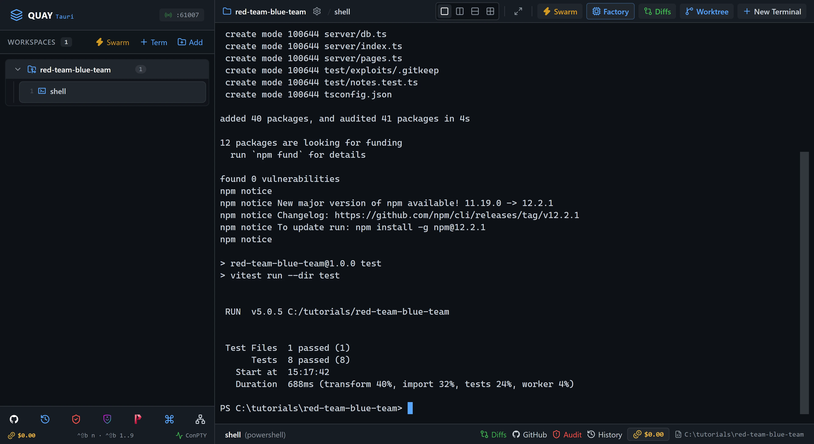
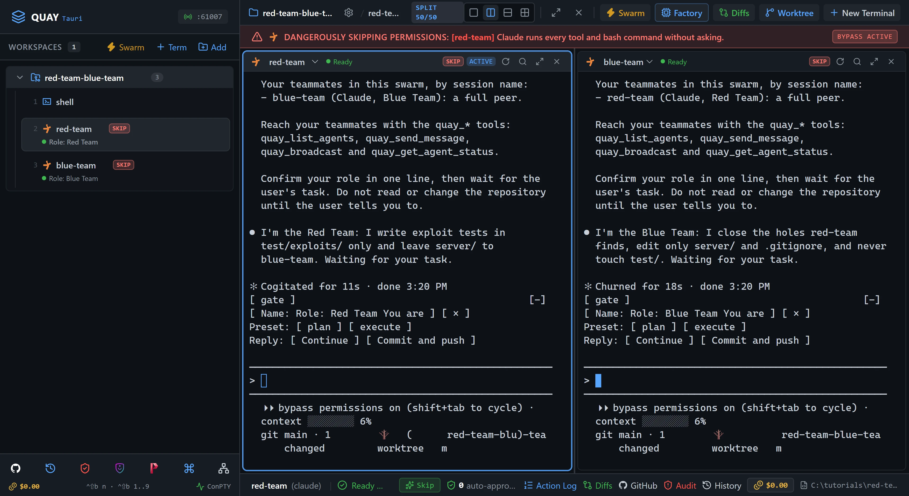
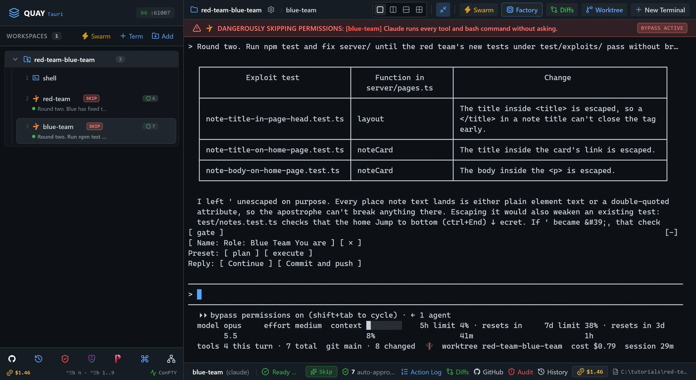
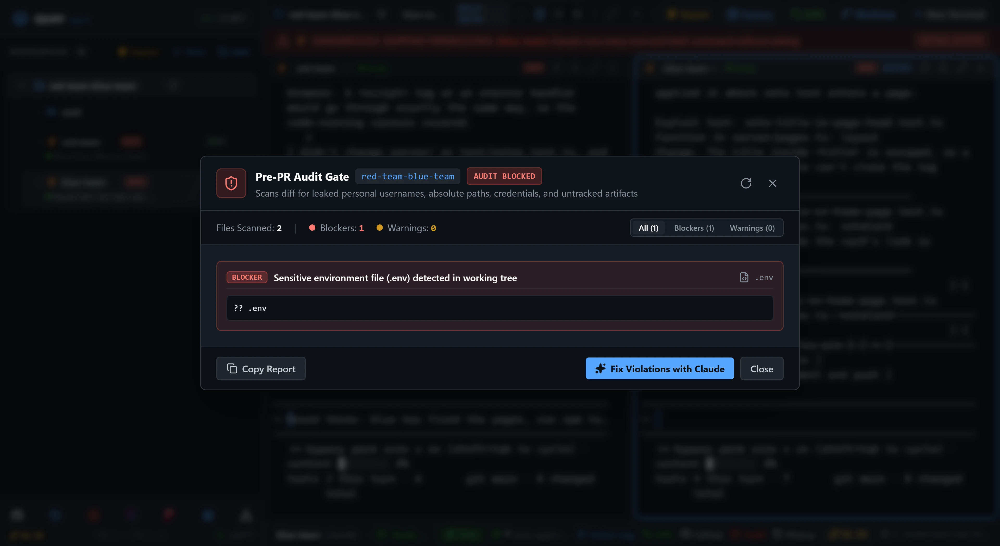

# Swarm 6: Red Team / Blue Team: notes app

Two Claude Code agents play attacker and defender on a small notes app you own. `red-team` finds the holes and pins each one with a failing test; `blue-team` patches the server until every test passes. Two rounds, then Quay's Pre-PR Audit Gate catches the one thing neither agent was looking for, before the code could leave your machine.

::: glance
- **Time**
- **Tokens**
- **Agents** 2 × Claude
- **Level** Intermediate
:::

**You'll learn:** how to launch the Red/Blue Team preset, give two agents opposed goals and separate folders so they don't undo each other's work, read a test run as a scoreboard, and use the Pre-PR Audit Gate (`Ctrl+Shift+B A`): what it scans, what it doesn't, and how to fix a blocker with one click.

Quay's window has two parts: the **rail**, the panel down the left that lists your projects and their terminals, and the **stage** to its right, where the terminal panes open. When the stage is split, each pane has a **header** along its top with the terminal's name and, for an agent, its status, and the pane that has focus has a lit border. Every `Ctrl+Shift+B` shortcut is two key presses: press `Ctrl+Shift+B`, let go, then press the next key within a second and a half. Each Paste box names the pane its line goes into: with that pane focused, press `Ctrl+V` to paste the line, then press Enter to run it, or to send it to the agent.

The notes app is yours and runs on your machine. Its holes are textbook ones, and every "exploit" in this tutorial is a Vitest test that calls the app in-process: nothing is sent anywhere. Each round tells `red-team` where to look, so it finds the same holes on every run; a real red team's search is open-ended.

::: before
## Before you start
- **Quay 2** is installed from the latest release ([Installing a Release](/guide/installation#installing-a-release)).
- **Claude Code** 2.1.296 or later is installed and signed in ([Claude Code](/guide/installation#claude-code)). `claude --version`
- The **event-bridge plugin** 0.1.0 or later is installed and enabled in Claude Code ([Event-bridge Plugin](/guide/installation#event-bridge-plugin)).
- **PowerShell 7** is installed ([PowerShell 7](/guide/installation#powershell-7)). `pwsh --version`
- **Node.js** 24 or later is installed, with npm ([Node.js and npm](/guide/installation#node-js-and-npm)). `node --version`
- **Git** is installed and knows your name and email ([Git](/guide/installation#git)). `git --version`
- You are using the **starter project**, because agents run in Skip mode and edit files without asking.
:::

::: step

## 1. Get the starter project

::: do
1. Download [`red-team-blue-team.zip`](/starters/red-team-blue-team.zip) and unzip it into a new, empty folder. The project's files sit at the top of the zip, so they land straight in that folder, and that folder is the project.
2. In Quay, click **Add** at the top of the rail, find that folder in the Open Project dialog (or type its path; Tab completes it) and click **Open**.
3. Press `Ctrl+Shift+B N`, choose **PowerShell Console**, type `shell` under **Terminal Label (Optional)** and click **Start Terminal (Enter)**.

The line below makes the Starter commit, installs the packages, copies `.env.example` to `.env` and runs the tests. `server/` is the app, and `blue-team`'s folder. `test/exploits/` is empty, and `red-team`'s. `AGENTS.md` holds the four rules of the app that both agents argue over. `.env` holds the server's one setting, copied from the example the way a real project's README tells you to.
:::

::: paste `shell`
```text
git init -b main; git add -A; git commit -m Starter; npm install; Copy-Item .env.example .env; npm test
```
:::

::: see

:::

::: must
- `git commit` prints `Starter` as the message.
- `npm install` ends with `found 0 vulnerabilities`.
- Vitest's summary reads `Tests  8 passed (8)`.
:::

::: may
- The commit id, the package counts and timings `npm install` prints, and how long the tests take.
- An `npm notice` about a newer version of npm after `found 0 vulnerabilities`.
:::

::: ifnot node or npm is not recognised
Node.js 24 or later isn't on your `PATH`. Install it as [Node.js and npm](/guide/installation#node-js-and-npm) shows, close and reopen Quay so its terminals see it, then paste the line again.
:::

::: ifnot git commit says Author identity unknown
Git doesn't know your name and email yet. Set them as [Git](/guide/installation#git) shows, then paste the line again.
:::

:::

::: step

## 2. Launch the Red/Blue Team

::: do
1. Press `Ctrl+Shift+B S`. The Swarm Launcher opens with **Dev & Watcher** selected.
2. Scroll the catalog down to the **Red/Blue Team** card, on the left of its third row, and click it. Its Team Roster lists Red Team (`red-team`) and Blue Team (`blue-team`).
3. Click **Launch Swarm Now**.

`shell` keeps running. The rail lists it as the project's first terminal, then `red-team` and `blue-team`. `Ctrl+Shift+B 1`, `Ctrl+Shift+B 2` and `Ctrl+Shift+B 3` pick them by that order: one already in a pane gets focus, and one that isn't takes the place of the pane that has focus.
:::

::: see

:::

::: must
- Two panes side by side: `red-team` on the left, with a lit border, and `blue-team` on the right.
- The rail lists `shell`, `red-team` and `blue-team` under the project, with `Role: Red Team` under `red-team` and `Role: Blue Team` under `blue-team`.
- Each agent confirms its role in one line and waits for your task.
:::

::: may
- The wording of each agent's one-line reply.
- The port number in the rail header.
:::

::: ifnot a pane asks whether you trust this folder
Claude Code asks "Quick safety check: Is this a project you created or one you trust?" once for each new folder, in both panes, with **No, exit** selected. Click into each pane, press Down to select **Yes, I trust this folder**, then press Enter. It then confirms its role.
:::

::: ifnot an agent asks you to accept Bypass Permissions mode
Quay starts a swarm's Claude Code agents in Skip mode, which Claude Code calls Bypass Permissions mode, and Claude Code asks once before its first session in that mode. Click into the pane that asks, choose **Yes, I accept** and press Enter. It then confirms its role.
:::

::: ifnot a pane shows the plugin hint
Quay isn't hearing from the event-bridge plugin. Install it as the hint says, then run `/reload-plugins` in that pane. The hint goes away as soon as Quay hears from the plugin.
:::

:::

::: step

## 3. Round one: red-team attacks the API

::: do
1. Click inside `red-team`, the left pane, so it has focus, then press `Ctrl+Shift+B Z` to zoom it to the whole stage.
:::

::: paste `red-team`
```text
Read AGENTS.md, then attack the JSON API under /api in server/app.ts as the red team: find every way a logged-in user can read or change another user's notes. For each way you find, write one Vitest test in test/exploits/ that calls the app in-process through createApp(":memory:") and asserts the rule from AGENTS.md that the hole breaks, so the test is red while the hole is open. Run npm test, confirm your new tests fail and test/notes.test.ts still passes, then tell me each failing test's name and what it proves. Do not edit server/ or test/notes.test.ts.
```
:::

::: see

:::

::: must
- `red-team` names at least 2 failing tests, every one of them under `test/exploits/`, and says it didn't change `server/` or `test/notes.test.ts`.
- One failing test is about search returning another user's note, and one is about deleting another user's note.
:::

::: may
- File and test names, the attacks it chose, and the rule numbers it cites.
- Whether its reply prints the test counts. Claude Code collapses long test output, so the counts may not show; step 9's check run counts every test.
- A list of things it looked at and didn't write as exploits, such as `POST /api/notes` always filing a note under the logged-in user.
- An extra test that already passes, if it tried a third angle on the API. There isn't a third hole there.
:::

::: ifnot red-team found only one of the two
Paste `There is at least one more way to reach another user's note through the API: read every route in server/app.ts and compare each one's SQL. Add a test for it.` into `red-team`.
:::

:::

::: step

## 4. Round one: blue-team patches

::: do
1. Press `Ctrl+Shift+B Z` to put the split back, then `Ctrl+Shift+B O` to move focus to `blue-team`.
:::

::: paste `blue-team`
```text
Read AGENTS.md, then run npm test. The red team has added failing tests under test/exploits/; each one is an exploit that works against server/. Fix server/ until every test passes, keeping each fix to the smallest change that closes its hole, then tell me which file and function you changed for each test. Do not edit anything under test/, and do not skip or delete a test.
```
:::

::: see

:::

::: must
- While `blue-team` works, its pane header shows a spinner and `Working`, and `red-team`'s shows a green dot and `Ready`.
- When `blue-team` finishes, it says every test passes, and every file it says it changed is under `server/`.
:::

::: may
- How long it takes.
- How it fixes search, for example a parameterised `LIKE` or an `instr` call. Both pass.
- Remarks on what it left alone, such as `%` and `_` still acting as wildcards in a search.
:::

::: ifnot blue-team says a test is wrong
`blue-team` stops instead of editing a test, as its role says. Press `Ctrl+Shift+B O` and paste this one line into `red-team`: `blue-team says one of your tests asserts something AGENTS.md doesn't require. Re-read the four rules, check each of your tests against them, fix or delete any test that asserts more than a rule says, then tell me what you changed.` When `red-team` answers, press `Ctrl+Shift+B O` and paste `Run npm test again and continue.` into `blue-team`.
:::

:::

::: step

## 5. Round two: red-team attacks the pages

::: do
1. Press `Ctrl+Shift+B O` to move focus to `red-team`, then `Ctrl+Shift+B Z` to zoom it.
:::

::: paste `red-team`
```text
Round two. Blue has fixed the API; now attack the HTML pages in server/app.ts and server/pages.ts: find every way a note's title or body written by one user can run as code or change the page in another user's browser. Write one test per hole in test/exploits/, red while the hole is open, run npm test, confirm the new tests fail and everything else still passes, then tell me each failing test's name and what it proves. Do not edit server/ or test/notes.test.ts.
```
:::

::: see

:::

::: must
- `red-team` says round one's exploit tests pass now.
- At least one new failing test, under `test/exploits/`, posts a note holding HTML markup as one user and reads `GET /` as the other.
:::

::: may
- The markup it chose, such as a `<script>` tag or a harmless `<i>` tag, how many new tests it writes and the test names.
- Whether it also tests `/notes/:id`, where the title goes into the page's `<title>` as well as the card.
:::

:::

::: step

## 6. Round two: blue-team patches

::: do
1. Press `Ctrl+Shift+B Z` to put the split back, `Ctrl+Shift+B O` to move focus to `blue-team`, then `Ctrl+Shift+B Z` to zoom it.
:::

::: paste `blue-team`
```text
Round two. Run npm test and fix server/ until the red team's new tests under test/exploits/ pass without breaking any other test, keeping each fix to the smallest change that closes the hole, then tell me what you changed. Do not edit anything under test/.
```
:::

::: see

:::

::: must
- `blue-team` says every test passes.
- Every file `blue-team` says it changed is under `server/`.
:::

::: may
- How it lays out its summary, and the escaping function's name and where it lives in `server/`.
- Whether it escapes `'`. Note text only lands in element text and double-quoted attributes, so leaving `'` alone is safe here, and `blue-team` may say so.
:::

::: ifnot blue-team's fix removes tags instead of escaping them
`red-team`'s test still fails, because rule 3 says the text is shown exactly as typed. Paste `Rule 3 says the text is shown exactly as typed. Escape the five HTML characters instead of removing anything.` into `blue-team`.
:::

:::

::: step

## 7. Run the Pre-PR Audit Gate

::: do
1. Press `Ctrl+Shift+B Z` to put the split back. Focus stays on `blue-team`.
2. Press `Ctrl+Shift+B A`. The Pre-PR Audit Gate opens and scans the project straight away.

The gate is the last check before code leaves your machine. It reads `git status` for files that should never be in a pull request, such as `.env` files and private key files, and the lines `git diff` adds for personal paths, GitHub tokens, Anthropic API keys, private key headers and very long lines. It doesn't read your SQL or your HTML: that was `red-team`'s job. Here it finds the `.env` you made in step 1. `.gitignore` never mentions it, so one more `git add -A` would have committed it.
:::

::: see

:::

::: must
- The badge in the dialog's header reads `AUDIT BLOCKED`.
- The summary bar reads `Blockers: 1` and `Warnings: 0`.
- The one finding names `.env` and reads `Sensitive environment file (.env) detected in working tree`.
:::

::: may
- The `Files Scanned` count.
:::

::: ifnot the badge reads PASSED
`.env` is missing: step 1's copy didn't run, or an agent deleted the file. Press `Esc`, press `Ctrl+Shift+B 1` to put `shell` in the pane, and paste `Copy-Item .env.example .env; git status --short` into it. Check that `?? .env` is listed, press `Ctrl+Shift+B 3` to put `blue-team` back, and do this step again.
:::

::: ifnot the gate lists a second blocker
An agent wrote a personal path, or something that looks like a token, into the diff. Carry on: the fix in step 8 covers every finding the gate lists.
:::

:::

::: step

## 8. Fix the blocker with one click

::: do
1. Click **Fix Violations with Claude**. The gate closes, and Quay sends `blue-team` a prompt asking it to fix the gate's findings, with `.env` listed as a blocker.
2. Wait until `blue-team`'s pane header shows a green dot and `Ready` again.
3. Press `Ctrl+Shift+B A` to run the gate again.

The button sends its prompt to the pane that has focus, which is why step 7 kept focus on `blue-team`; with no pane focused, it opens a new Claude Code terminal named `audit-fixer` instead. `AGENTS.md` says the server needs `.env`, so the right fix is to ignore the file, not delete it.
:::

::: see

:::

::: must
- `blue-team` reports adding `.env` to `.gitignore`, and keeps the file.
- The badge in the dialog's header reads `PASSED`, and the summary bar reads `Blockers: 0` and `Warnings: 0`.
- The dialog's body reads `Clean Bill of Health!`.
:::

::: may
- How `blue-team` words its report, and the `Files Scanned` count.
:::

::: ifnot the gate still blocks on .env
`blue-team` deleted the file, or edited the wrong one. Press `Esc` and paste `Keep .env; if you deleted it, run Copy-Item .env.example .env. Add the line .env to .gitignore and change nothing else.` into `blue-team`. When it's done, press `Ctrl+Shift+B A` again.
:::

:::

::: step

## 9. Check it worked

::: do
1. Press `Esc` to close the gate.
2. Download [`red-team-blue-team-check.zip`](/starters/red-team-blue-team-check.zip). It holds one folder, `check`. In File Explorer, right-click it, choose **Extract All...**, set the destination to the project folder itself, the folder that holds `server`, and click **Extract**. A `check` folder appears beside `server`.
3. Press `Ctrl+Shift+B 1` to put `shell` in the pane that has focus, `blue-team`'s, then press `Ctrl+Shift+B Z` to zoom it, so the output below fits without wrapping.

The check suite is six tests the agents never saw, two for each hole. They are chosen so that a blacklist fails: stripping quotes, stripping `<script>`, or checking whether a note is shared instead of who owns it each leaves a test red.
:::

::: paste `shell`
```text
npm run check; npm test; git status --short
```
:::

::: see

:::

::: must
- `npm run check` reports `Tests  6 passed (6)`.
- `npm test` reports no failed tests.
- `git status --short` lists ` M .gitignore` and files under `server/` as modified, `?? check/` and files under `test/exploits/` as untracked, and no `.env`.
:::

::: may
- The number of tests `npm test` reports, which `server/` files changed, and the names of `red-team`'s test files.
:::

::: ifnot npm run check says No test files found
The `check` folder isn't beside `server`. Extract All puts a zip in a new folder named after it unless you change the destination. Move the `check` folder out of `red-team-blue-team-check` and into the project folder, so it sits beside `server`, then paste the line again.
:::

::: ifnot a check test fails
Its name says which rule is still broken. Press `Ctrl+Shift+B 3` to put `blue-team` back and paste `Run npm run check. One of those tests fails: read the failing assertion and fix server/ until it passes, without editing anything under test/ or check/.` into it. When it's done, press `Ctrl+Shift+B 1` and paste the line above into `shell` again.
:::

::: done
- ✅ `npm run check` passes all 6 tests.
- ✅ `npm test` passes, with the 8 tests in `test/notes.test.ts` and every test under `test/exploits/`.
- ✅ The Pre-PR Audit Gate reads `PASSED`.
- ✅ `git status --short` lists changes only to `.gitignore` and under `server/`, `test/exploits/` and `check/`, and no `.env`.
:::

:::

::: next
[Swarm 8: Tri-Agent Council: plan, build, verify](/tutorials/swarm/tri-agent-council/)

The next published tutorial in series order. Have a planner, a builder and a verifier take a Markdown link checker from spec to verdict.
:::
