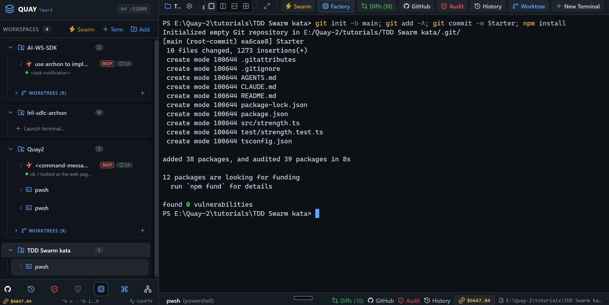
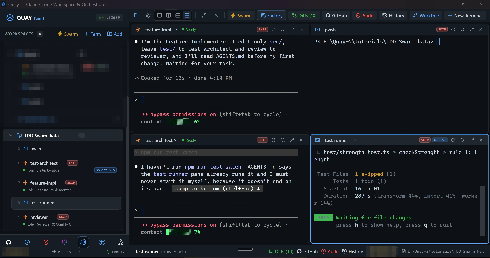
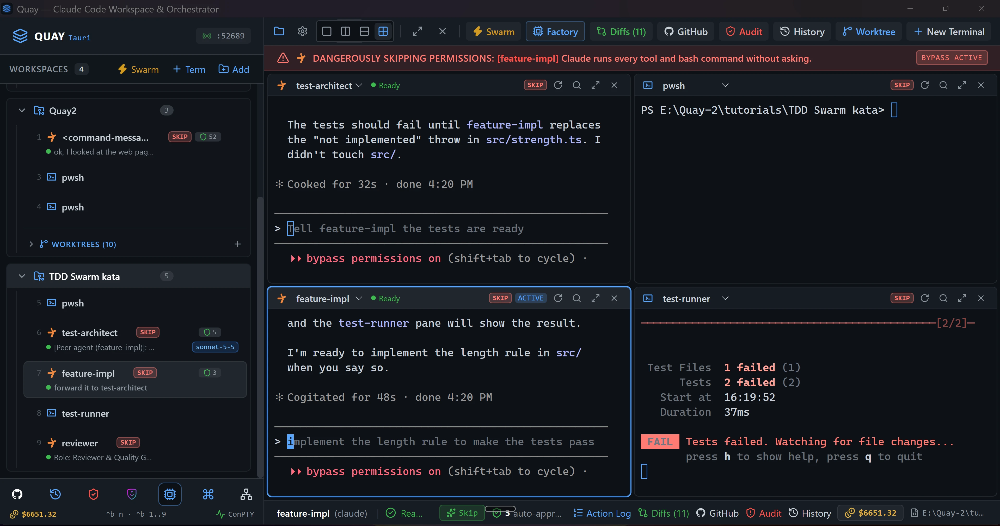
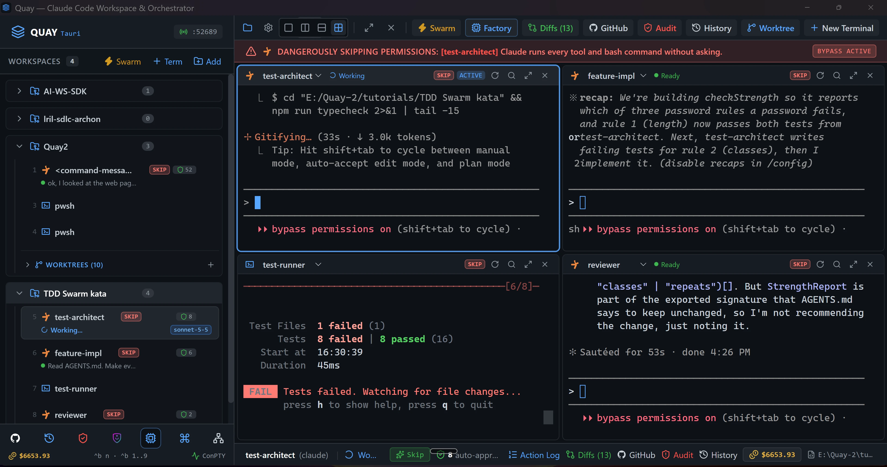
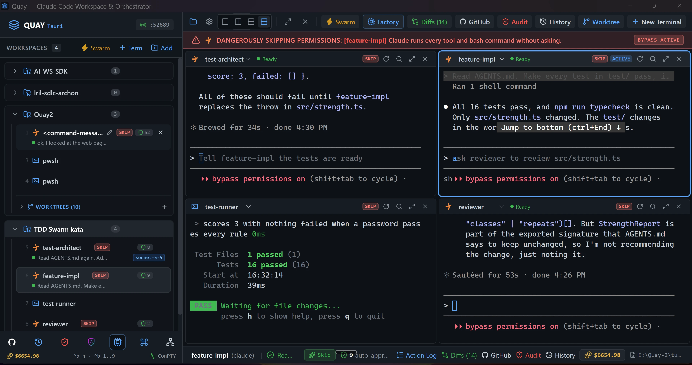
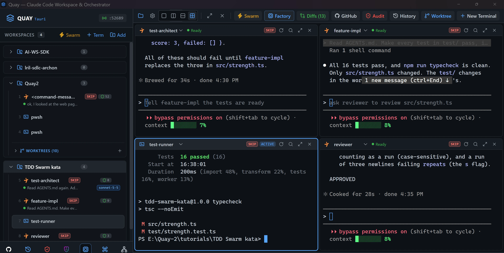

# Swarm 2: TDD Swarm kata

Build a password-strength checker the test-first way with Quay's TDD Swarm: one Claude Code agent writes the tests, a second makes them pass, a PowerShell pane re-runs them on every save, and a third agent reviews the result. You drive the loop yourself, one pane at a time.

::: glance
- **Time**
- **Tokens**
- **Agents** 3 × Claude + 1 × PowerShell
- **Level** Starter
:::

**You'll learn:** how to launch a four-pane preset in a 2x2 grid, move between its panes, zoom one pane to read it (`Ctrl+B Z`), and run a red, green, review loop by hand. A2A 3 automates this same loop.

Quay's window has two parts: the **rail**, the panel down the left that lists your projects and their terminals, and the **stage** to its right, where the terminal panes open. When the stage is split, each pane has a **header** along its top with the terminal's name and, for an agent, its status. Every `Ctrl+B` shortcut is two key presses: press `Ctrl+B`, let go, then press the next key within a second and a half. Each prompt the page gives you goes into the pane it names: click inside that pane, paste the prompt, and press Enter to run it or, in a Claude Code pane, to send it.

::: before
## Before you start
- **Quay 2** is installed from the latest release ([Installing a Release](/guide/installation#installing-a-release)).
- **Claude Code** 2.1.296 or later is installed and signed in ([Claude Code](/guide/installation#claude-code)). `claude --version`
- The **event-bridge plugin** 0.1.0 or later is installed and enabled in Claude Code ([Event-bridge Plugin](/guide/installation#event-bridge-plugin)).
- **PowerShell 7** is installed ([PowerShell 7](/guide/installation#powershell-7)). `pwsh --version`
- **Node.js** 24 or later is installed, with npm ([Node.js and npm](/guide/installation#node-js-and-npm)). `node --version`
- **Git** is installed and knows your name and email ([Git](/guide/installation#git)). `git --version`
- Your Claude Code sign-in can use the **claude-sonnet-5-5** model, because the TDD Swarm preset starts `test-architect` on it ([TDD Swarm](/features/swarm-presets#_2-tdd-swarm)).
- You are using the **starter project**, because agents run in Skip mode and edit files without asking.
:::

::: step

## 1. Get the starter project

::: do
1. Download [`tdd-swarm-kata.zip`](/starters/tdd-swarm-kata.zip) and unzip it into a new, empty folder.
2. In Quay, click **Add** at the top of the rail, click **Browse...**, pick that folder and click **Add Project**.
3. Press `Ctrl+B N`, choose **PowerShell Console** and click **Start Terminal (Enter)**.
:::

::: paste PowerShell pane
```text
git init -b main; git add -A; git commit -m Starter; npm install
```
:::

::: see

:::

::: must
- `git commit` prints `Starter` as the message.
- `npm install` ends with `found 0 vulnerabilities`.
:::

::: may
- The commit id, and the package counts and timings `npm install` prints.
:::

::: ifnot node or npm is not recognised
Node.js 24 or later isn't on your `PATH`. Install it as [Node.js and npm](/guide/installation#node-js-and-npm) shows, close and reopen Quay so its terminals see it, then paste the line again.
:::

::: ifnot git commit says Author identity unknown
Git doesn't know your name and email yet. Set them as [Git](/guide/installation#git) shows, then paste the line again.
:::

:::

::: step

## 2. Launch the TDD Swarm

::: do
1. Press `Ctrl+B S`. The Swarm Launcher opens with **Dev & Watcher** selected.
2. Click the **TDD Swarm** card.
3. Click **Launch Swarm Now**.
4. Wait until each of the three Claude Code panes has confirmed its role in one line.
:::

::: see

:::

::: must
- Four panes in a 2x2 grid: `test-architect` top left, `feature-impl` top right, `test-runner` bottom left and `reviewer` bottom right.
- The rail lists all four under the project, beside the PowerShell pane from step 1.
- `test-architect`, `feature-impl` and `reviewer` each confirm their role in one line, then wait for your task.
- `test-runner` sits at a PowerShell prompt.
- While a Claude Code pane has focus, a red **DANGEROUSLY SKIPPING PERMISSIONS** banner runs across the top of the stage and names that pane. That is expected: swarm agents run in Skip mode.
:::

::: may
- The wording of each one-line confirmation, and how long each pane takes to start.
- The port number in the rail header.
- Which pane the red banner names, and whether it shows at all while `test-runner` has focus.
:::

::: ifnot a Claude Code pane asks you to accept Bypass Permissions mode
Quay starts a swarm's Claude Code agents in Skip mode, which Claude Code calls Bypass Permissions mode, and Claude Code asks once before its first session in that mode. Click into the pane that asks, choose **Yes, I accept** and press Enter. It then confirms its role. Do the same in any other pane that asks.
:::

::: ifnot a Claude Code pane shows the plugin hint
Quay isn't hearing from the event-bridge plugin. Install it as the hint says, then run `/reload-plugins` in that pane. The hint goes away as soon as Quay hears from the plugin.
:::

::: ifnot test-architect stops with an error about its model
Your Claude Code sign-in can't use `claude-sonnet-5-5`, the model the TDD Swarm preset starts `test-architect` on. Sign in to Claude Code with an account that can use it. Then close the four swarm terminals: in the rail, hover over each of `test-architect`, `feature-impl`, `test-runner` and `reviewer` and click the **×** that appears, **Close terminal**. Launch the swarm again from the start of this step.
:::

:::

::: step

## 3. Start the test watcher

::: do
1. Close the PowerShell pane from step 1, which you don't need again: in the rail, hover over `pwsh` under the project and click the **×** that appears, **Close terminal**.
2. Click inside `test-runner`, the bottom-left pane. Its border lights up.
:::

::: paste `test-runner`
```text
npm run test:watch
```
:::

::: see

:::

::: must
- `Tests  1 todo (1)`.
- A `Waiting for file changes...` line under it.
:::

::: may
- How long the run takes.
:::

::: ifnot vitest is not recognized
`npm install` didn't finish in step 1. Paste `npm install` into `test-runner`, wait for it to finish, then paste `npm run test:watch` again.
:::

::: ifnot test-architect says it hasn't run npm run test:watch
You pasted the line into `test-architect`, which never starts the watcher itself. Find the pane whose header says `test-runner`, click inside it, and paste the line there.
:::

::: ifnot the panes moved, or step 1's pwsh pane is in the grid
The toolbar's **2x2 Grid Layout** button and `Ctrl+B G` both rebuild the grid: the pane that has focus goes top left and the rest follow in rail order, step 1's `pwsh` included. Close `pwsh` as this step's first line says, then go by the name in each pane's header. From here on a pane may sit somewhere other than where the page says; its name is what counts.
:::

:::

::: step

## 4. Round 1, red: test-architect writes the first tests

::: do
1. Click inside `test-architect`, the top-left pane.
:::

::: paste `test-architect`
```text
Read AGENTS.md. In test/strength.test.ts, replace the todo with failing Vitest tests for rule 1 (length) only: an 11-character password must fail it and a 12-character password must pass it, checking both score and failed. Pick passwords that pass rules 2 and 3, so these tests still hold once every rule is written. Do not touch src/.
```
:::

::: see

:::

::: must
- `test-runner` re-ran on its own when `test-architect` saved the file.
- Every test fails and none passes: the `Tests` line shows only a `failed` count.
- `test-architect` names `test/strength.test.ts` as the file it changed, and nothing under `src/`.
:::

::: may
- How many tests `test-architect` writes, and their names.
- The failure text, as long as every test fails.
- `test-architect`'s wording, and how long it takes.
- `test-architect` may message `feature-impl` on its own, and `feature-impl` may answer that it's ready and waiting for you. Its rail line then starts with `[Peer agent`. Nothing changes in `src/` until your prompt in step 5.
- Grey text in a Claude Code pane's input box, such as `Tell feature-impl the tests are ready`, is a suggestion Claude Code offers. Ignore it and paste the next prompt as usual.
:::

::: ifnot a test already passes
That test doesn't call `checkStrength`, which still throws. Paste `Every test must fail until src/strength.ts is written. Fix the ones that pass. Do not touch src/.` into `test-architect`.
:::

::: ifnot test-runner never re-runs
Vitest re-runs when a file under the project changes. Check that `test-architect` edited `test/strength.test.ts` and didn't write a new file somewhere else.
:::

:::

::: step

## 5. Round 1, green: feature-impl makes them pass

::: do
1. Click inside `feature-impl`, the top-right pane.
:::

::: paste `feature-impl`
```text
Read AGENTS.md. Make every test in test/ pass with the simplest correct implementation of checkStrength in src/strength.ts, covering rule 1 only for now. Do not edit test/.
```
:::

::: see

:::

::: must
- `test-runner` shows every test passing: the `Tests` line shows only a `passed` count.
- `feature-impl` names `src/strength.ts` as the file it changed, and nothing under `test/`.
:::

::: may
- How `feature-impl` writes the code, and its wording.
- How many times `test-runner` re-runs on the way.
:::

:::

::: step

## 6. Review round 1

::: do
1. Click inside `reviewer`, the bottom-right pane, and paste the prompt below.
2. When `reviewer` has replied, press `Ctrl+B Z` to zoom it to the whole stage, and read its findings.
3. Press `Ctrl+B Z` again to put the grid back.
:::

::: paste `reviewer`
```text
Read AGENTS.md, src/strength.ts and test/strength.test.ts. Review them for correctness, missed edge cases and readability. Reply with a numbered list of findings, most important first. Do not edit any file.
```
:::

::: see

:::

::: must
- `reviewer` fills the stage while zoomed.
- Its reply is a numbered list.
- Back in the grid, `test-runner` hasn't re-run since step 5, because `reviewer` changed no file.
:::

::: may
- The findings themselves, and how many there are.
- A row of bracketed choices Claude Code prints under the reply, such as `[ Continue ]`. Leave them alone.
:::

::: ifnot Ctrl+B Z did nothing
The `Ctrl+B` prefix lasts a second and a half. Press `Ctrl+B`, let go, then press `Z` straight after.
:::

::: ifnot Ctrl+B Z zoomed another pane
Focus was on that pane, not `reviewer`. Press `Ctrl+B Z` to put the grid back, click inside `reviewer`, and zoom again.
:::

:::

::: step

## 7. Round 2, red: tests for the other two rules

::: do
1. Click inside `test-architect`.
:::

::: paste `test-architect`
```text
Read AGENTS.md again. Add failing tests for rule 2 (classes) and rule 3 (repeats), including the order of names in failed, and one test where a password passes all three rules. Keep the rule 1 tests as they are. Do not touch src/.
```
:::

::: see

:::

::: must
- The `Tests` line shows both a `failed` and a `passed` count.
- `test-architect` names `test/strength.test.ts` as the file it changed, and nothing under `src/`.
:::

::: may
- How many tests there are, and their names.
- `test-architect`'s wording, and how long it takes.
:::

::: ifnot every test passes
The new tests don't yet ask for anything `src/strength.ts` lacks. Paste `Some of the new tests must fail until rules 2 and 3 are written. Fix the ones that pass. Do not touch src/.` into `test-architect`.
:::

:::

::: step

## 8. Round 2, green: feature-impl writes every rule

::: do
1. Click inside `feature-impl`.
:::

::: paste `feature-impl`
```text
Read AGENTS.md. Make every test in test/ pass, implementing all three rules in src/strength.ts, then tidy the code without changing behaviour. Do not edit test/.
```
:::

::: see

:::

::: must
- `test-runner` shows every test passing: the `Tests` line shows only a `passed` count, higher than in step 5.
- `feature-impl` names `src/strength.ts` as the file it changed, and nothing under `test/`.
:::

::: may
- How `feature-impl` writes and tidies the code, and its wording.
- The number of tests.
:::

:::

::: step

## 9. Sign-off

::: do
1. Click inside `reviewer`.
:::

::: paste `reviewer`
```text
Re-read AGENTS.md, src/strength.ts and test/strength.test.ts. If all three rules are implemented and tested, reply with exactly APPROVED as your last line. Otherwise reply CHANGES REQUESTED followed by a numbered list of what's missing. Do not edit any file.
```
:::

::: see

:::

::: must
- The last line of `reviewer`'s reply is `APPROVED`.
:::

::: may
- Anything `reviewer` says before that line.
:::

::: ifnot reviewer replies CHANGES REQUESTED
Read its list, then hand the work on one agent at a time. You don't need to copy the list: each prompt below is one line, and each agent re-reads the files itself.

1. If any item asks for a test, paste `The reviewer asked for more tests. Re-read AGENTS.md and test/strength.test.ts and add the tests the three rules still lack. Do not touch src/.` into `test-architect`, and wait until it says it's done.
2. Paste `The reviewer asked for changes. Re-read AGENTS.md, src/strength.ts and test/strength.test.ts, then fix src/strength.ts so all three rules are implemented and every test passes. Do not edit test/.` into `feature-impl`, and wait until `test-runner` shows every test passing.
3. Paste this step's prompt into `reviewer` again.
:::

:::

::: step

## 10. Check it worked

::: do
1. Click inside `test-runner` and press `q` to stop the watcher.
:::

::: paste `test-runner`
```text
npm test; npm run typecheck; git status --short
```
:::

::: see

:::

::: must
- `npm test` shows every test passing: the `Tests` line shows only a `passed` count.
- `npm run typecheck` prints no error after its `> tsc --noEmit` line.
- `git status --short` prints two lines, ` M src/strength.ts` and ` M test/strength.test.ts`.
:::

::: may
- The number of tests, and the times beside them.
- The folder in the PowerShell prompt, which is wherever you unzipped the starter.
:::

::: done
- ✅ `npm test` passes every test, and `npm run typecheck` reports no error.
- ✅ `reviewer`'s last reply ends with `APPROVED`.
- ✅ `git status --short` lists `src/strength.ts` and `test/strength.test.ts` as the only modified files.
:::

:::

::: next
[Tutorials](/tutorials/)

The next tutorial in series order, Swarm 3: Full-Stack Pair: bookmarks app, isn't published yet. The Tutorials page lists every tutorial that is.
:::
