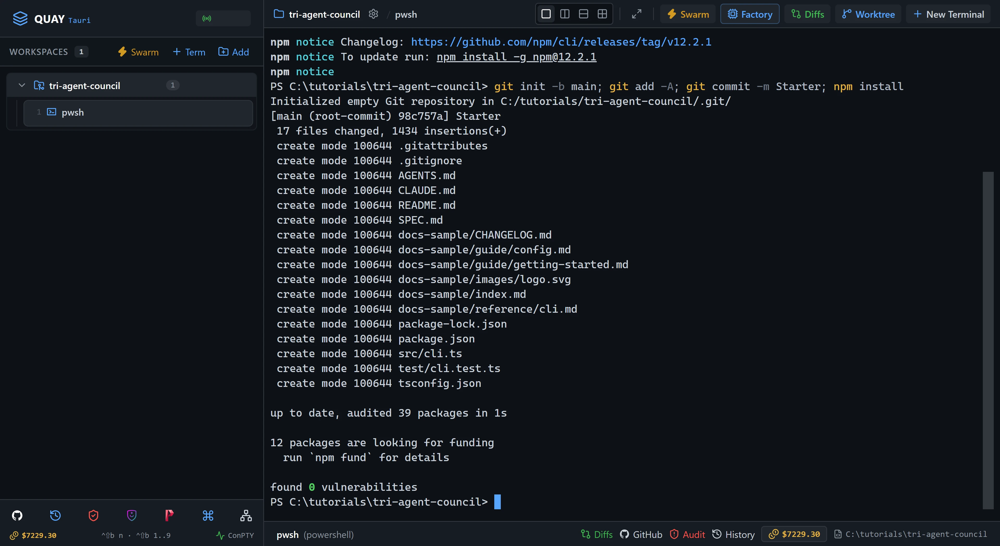
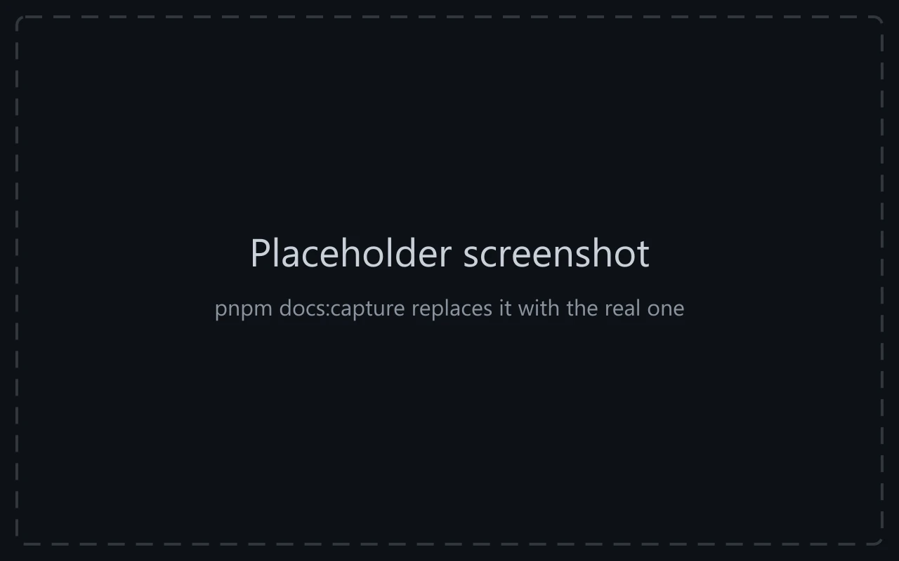

# Swarm 8: Tri-Agent Council: plan, build, verify

Launch Quay's Tri-Agent Council: three Claude Code agents that take one job in three stages. `planner-agent` reads a spec and writes a plan, `builder-agent` builds the plan until its tests pass, and `verifier-agent` runs the result and gives a verdict. The job is a link checker for a folder of Markdown files, and you finish by running it yourself, along with a check suite no agent has seen.

::: glance
- **Time**
- **Tokens**
- **Agents** 3 × Claude + 1 × PowerShell
- **Level** Intermediate
:::

**You'll learn:** how to launch the Tri-Agent Council, split one job into plan, build and verify so each agent owns one kind of file, hand work from one agent to the next through a plan file on disk, close a terminal from the rail, and check a verdict for yourself.

Quay's window has two parts: the **rail**, the panel down the left that lists your projects and their terminals, and the **stage** to its right, where the terminal panes open. When the stage is split, each pane has a **header** along its top with the terminal's name and, for an agent, its status. Every `Ctrl+B` shortcut is two key presses: press `Ctrl+B`, let go, then press the next key within a second and a half. `Ctrl+B` and a number moves focus to the terminal at that place in the rail's list for your project, so `Ctrl+B 1` is the first one listed. Each Paste box names the pane its line goes into: copy the line with the box's copy button, click into that pane, press `Ctrl+V` to paste it, then press Enter to run it or send it to the agent.

The starter project is a link checker that isn't written yet. `SPEC.md` says what it must do and ends with the exact output it must print for the sample docs in `docs-sample/`. `src/cli.ts` is where it gets built, and `AGENTS.md` says which agent may change which files. All three agents run on Claude Code's default model.

::: before
## Before you start
- **Quay 2** is installed from the latest release ([Installing a Release](/guide/installation#installing-a-release)).
- **Claude Code** 2.1.296 or later is installed and signed in ([Claude Code](/guide/installation#claude-code)). `claude --version`
- The **event-bridge plugin** 0.1.0 or later is installed and enabled in Claude Code ([Event-bridge Plugin](/guide/installation#event-bridge-plugin)).
- **PowerShell 7** is installed ([PowerShell 7](/guide/installation#powershell-7)). `pwsh --version`
- **Node.js** 24 or later is installed, with npm ([Node.js and npm](/guide/installation#node-js-and-npm)). `node --version`
- **Git** is installed and knows your name and email ([Git](/guide/installation#git)). `git --version`
- You are using the **starter project**, because agents run in Skip mode and edit files without asking.
:::

::: step

## 1. Get the starter project

::: do
1. Download [`tri-agent-council.zip`](/starters/tri-agent-council.zip) and unzip it into a new, empty folder. The zip has no folder of its own, so that folder now holds `SPEC.md`, `src` and the other files directly.
2. In Quay, click **Add** at the top of the rail, click **Browse...**, pick that folder and click **Add Project**.
3. Press `Ctrl+B N`, choose **PowerShell Console** and click **Start Terminal (Enter)**. The rail lists the new terminal under your project as `pwsh`.
:::

::: paste PowerShell pane
```text
git init -b main; git add -A; git commit -m Starter; npm install
```
:::

::: see

:::

::: must
- `git commit` prints `Starter` as the message.
- `npm install` ends with `found 0 vulnerabilities`.
:::

::: may
- The commit id, and the package counts and timings `npm install` prints.
:::

::: ifnot node or npm is not recognised
Node.js 24 or later isn't on your `PATH`. Install it as [Node.js and npm](/guide/installation#node-js-and-npm) shows, close and reopen Quay so its terminals see it, then paste the line again.
:::

::: ifnot git commit says Author identity unknown
Git doesn't know your name and email yet. Set them as [Git](/guide/installation#git) shows, then paste the line again.
:::

:::

::: step

## 2. Launch the Tri-Agent Council

::: do
1. In the rail, point at the `pwsh` terminal under your project and click the **×** at the right end of its row (**Close terminal**). The terminal closes at once. The Council brings its own PowerShell pane, so this one isn't needed.
2. Press `Ctrl+B S`. The Swarm Launcher opens with **Dev & Watcher** selected.
3. Click the **Tri-Agent Council** card.
4. Click **Launch Swarm Now**.
:::

::: see

:::

::: must
- Four panes in a 2x2 grid: `planner-agent` top-left, `builder-agent` top-right, `verifier-agent` bottom-left and `terminal-shell` bottom-right.
- The rail lists those four terminals under the project, in that order, and no others.
- The agents' first lines read `Role: Council Planner`, `Role: Council Builder` and `Role: Council Verifier`, and each agent waits for your task.
:::

::: may
- The wording of each agent's one-line reply.
- The port number in the rail header.
:::

::: ifnot an agent asks you to accept Bypass Permissions mode
Quay starts a swarm's Claude Code agents in Skip mode, which Claude Code calls Bypass Permissions mode, and Claude Code asks before its first session in that mode. Click into each pane that asks, choose **Yes, I accept** and press Enter. That agent then confirms its role.
:::

::: ifnot an agent shows the plugin hint
Quay isn't hearing from the event-bridge plugin. Install it as the hint says, then run `/reload-plugins` in each pane that shows the hint. The hint goes away as soon as Quay hears from the plugin.
:::

::: ifnot the rail lists five terminals, pwsh first
The PowerShell terminal from step 1 is still open, so every `Ctrl+B` number on this page would pick the terminal before the one you want. Close `pwsh` as in Do 1. The grid keeps its four panes.
:::

:::

::: step

## 3. Brief the Planner

::: do
1. Press `Ctrl+B 1` to move focus to `planner-agent`. Its border lights up.
:::

::: paste `planner-agent`
```text
Read SPEC.md and AGENTS.md, then write PLAN.md: the functions src/cli.ts needs and the order to build them, and the test cases test/cli.test.ts should hold, each tied to one rule in SPEC.md. Create or edit no other file. End your reply with the line PLAN.md written.
```
:::

::: see

:::

::: must
- `planner-agent`'s last line is `PLAN.md written`.
- At the end, `planner-agent`'s pane header shows a green dot and `Ready`.
- `builder-agent` and `verifier-agent` still show only their step 2 replies.
:::

::: may
- How long the plan is, and how it names the functions.
- How long `planner-agent` takes.
:::

::: ifnot planner-agent says it changed a file other than PLAN.md
Paste `Undo every change you made outside PLAN.md with git checkout -- src test, and keep only PLAN.md.` into `planner-agent`.
:::

:::

::: step

## 4. Brief the Builder

::: do
1. Press `Ctrl+B 2` to move focus to `builder-agent`. The plan travels on disk: `planner-agent` wrote `PLAN.md`, and `builder-agent` reads it, so your brief only has to point at it.
:::

::: paste `builder-agent`
```text
Read PLAN.md, SPEC.md and AGENTS.md, then build the plan: replace every it.todo in test/cli.test.ts with a real test and implement src/cli.ts until npm test and npm run typecheck both pass. Edit nothing outside src/ and test/. End your reply with the line npm test passing.
```
:::

::: see

:::

::: must
- `builder-agent`'s last line is `npm test passing`.
- At the end, `builder-agent`'s pane header shows a green dot and `Ready`.
- Every file its summary says it created or changed is under `src/` or `test/`.
:::

::: may
- How long it takes, which can be several minutes.
- How many tests it wrote, and whether it split the checker into more files under `src/`.
- The tools `builder-agent`'s pane header names while it works, beside a spinner.
:::

::: ifnot builder-agent says a test still fails after several attempts
Paste `Run npm test, read the first failing assertion against the rule it tests in SPEC.md, and fix the code until it passes. Do not change SPEC.md or docs-sample. End with the line npm test passing.` into `builder-agent`.
:::

::: ifnot builder-agent changed SPEC.md or a file in docs-sample
Paste `Undo your changes there with git checkout -- docs-sample SPEC.md, then finish inside src/ and test/ only. End with the line npm test passing.` into `builder-agent`.
:::

:::

::: step

## 5. Ask the Verifier

::: do
1. Press `Ctrl+B 3` to move focus to `verifier-agent`.
2. Press `Ctrl+B Z` to zoom it to the whole stage, so its report is easy to read.
:::

::: paste `verifier-agent`
```text
Run node src/cli.ts docs-sample and compare its stdout and exit code with the expected output at the end of SPEC.md, line for line. Then run npm test and npm run typecheck. Report what you ran and anything that differed, and end with one line: VERIFIED or REJECTED. Edit no file.
```
:::

::: see

:::

::: must
- `verifier-agent`'s last line is `VERIFIED`.
- Its report quotes `Checked 18 links in 5 files: 3 broken.` and exit code 1.
:::

::: may
- How `verifier-agent` lays out its report, and whether it reads `SPEC.md` again first.
:::

::: ifnot the last line is REJECTED
Press `Ctrl+B Z` to put the grid back and `Ctrl+B 2` to move focus to `builder-agent`. Paste `verifier-agent rejected the build. Run node src/cli.ts docs-sample, compare its output with the expected output at the end of SPEC.md, and fix src/cli.ts until they match exactly. End with the line npm test passing.` into `builder-agent`. When it ends with `npm test passing`, do this step once more from Do 1.
:::

::: ifnot the last line is REJECTED a second time
Stop asking here and go on to step 6. Its check runs the same comparison in front of you, and its If not covers what is still wrong.
:::

:::

::: step

## 6. Check it worked

::: do
1. Press `Ctrl+B Z` to put the grid back.
2. Download [`tri-agent-council-check.zip`](/starters/tri-agent-council-check.zip). Right-click it, choose **Extract All...**, set the destination to your project folder and click **Extract**. The zip holds one folder, `check`, which now sits beside `src`.
3. Press `Ctrl+B 4` to move focus to `terminal-shell`.
:::

::: paste `terminal-shell`
```text
node src/cli.ts docs-sample; "exit $LASTEXITCODE"; npx vitest run check; git status --short
```
:::

::: see

:::

::: must
- The checker prints these four lines, in this order, the same as the end of `SPEC.md`:
  `guide/config.md:18: ../reference/api.md (missing file)`,
  `guide/getting-started.md:17: config.md#enviroment-variables (missing anchor)`,
  `reference/cli.md:19: #exit-code (missing anchor)` and
  `Checked 18 links in 5 files: 3 broken.`
- The next line is `exit 1`.
- Vitest ends with `Tests  3 passed (3)`.
- `git status --short` lists `?? PLAN.md`, `?? check/` and the files `builder-agent` changed under `src/` and `test/`, and nothing else.
:::

::: may
- The test timings.
- Which files under `src/` and `test/` `git status` lists.
- The folder in the PowerShell prompt, which is wherever you unzipped the starter.
:::

::: ifnot the checker's lines differ from the end of SPEC.md
Press `Ctrl+B 2` and paste `node src/cli.ts docs-sample does not match the expected output at the end of SPEC.md. Fix src/cli.ts until it matches exactly, then end with the line npm test passing.` into `builder-agent`. When it ends with `npm test passing`, press `Ctrl+B 4` and paste this step's line into `terminal-shell` again.
:::

::: ifnot Vitest says No test files found
The `check` folder isn't beside `src`. Extract the zip into the project folder again, as in Do 2, so the project holds `check\cli.check.test.ts`, then paste this step's line again.
:::

::: ifnot a check test fails
Press `Ctrl+B 2` and paste `A test in check/cli.check.test.ts fails. Read it, read the rule it tests in SPEC.md, and fix src/cli.ts until npx vitest run check passes. Do not edit check/. End with the line npm test passing.` into `builder-agent`. When it ends with `npm test passing`, press `Ctrl+B 4` and paste this step's line into `terminal-shell` again.
:::

::: done
- ✅ `node src/cli.ts docs-sample` prints exactly the four lines at the end of `SPEC.md`, and exits 1.
- ✅ `npx vitest run check` passes all 3 tests.
- ✅ `git status --short` lists `PLAN.md`, the changes under `src/` and `test/`, and `check/`, and nothing else.
:::

:::

::: next
[Tutorials](/tutorials/)

The next tutorial in series order, Swarm 9: Polyglot Trio, isn't published yet. The Tutorials page lists every tutorial that is.
:::
