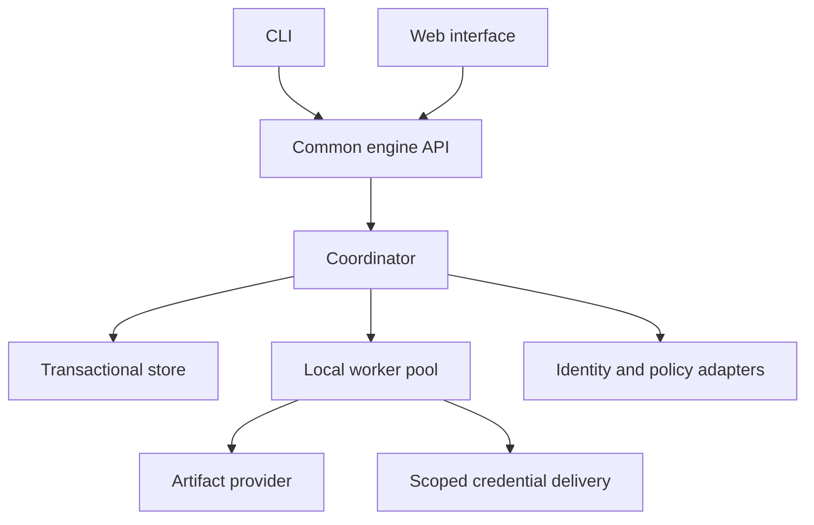

# M4 engine architecture — specification 1

Status: **M4 design specification complete. No runnable engine is delivered here.**
Accepted product choices are ED-01–ED-15 (not in this pack).
Concrete interfaces, transport and recovery mechanics below are the M4 specification,
not new exports from the existing SDK packages. M5 implements and exercises them.

## A. System boundary

The engine is a TypeScript/Node.js application independently developed for AIWS.
One active coordinator owns one installation database. Separate worker processes
execute on the same machine. A single launcher manages the coordinator, serves
the web interface and starts/stops the configured worker pool. Node release and
packaging versions will be pinned at implementation; no current-version promise
is inferred from this document.

The default listener is local-only. Worker transport is private inherited framed
JSON IPC as finalized in [WIRE.md](./WIRE.md); CLI/web use the same HTTPS application
command semantics. A local endpoint is not automatically trusted: use authenticated
sessions, exact origin checks and CSRF protection for browser commands. An engine
bootstrap establishes the local owner explicitly; loopback location is never human
identity. Organization-hosted exposure requires configured authentication and
transport protection. Serving remote human clients does not enable remote workers.

The engine exposes transport-neutral command handlers underneath HTTP. This permits
changing local transport without changing identity/accounting semantics. Worker
enrollment is restricted to processes launched by this installation. The bootstrap
secret travels through a private inherited channel, not a command-line argument.
Worker tokens bind installation, worker ID and coordinator epoch; they cannot serve
as human sessions. Credential delivery is separately scoped to an authorized attempt.

Application tasks may use any supported execution adapter/language. Python and Rust
SDK users communicate through the common versioned API. The engine does not require
three scheduler implementations. SDK wire identities and decimal accounting remain
cross-language contracts.

## B. Ownership and isolation

| Owner | Authoritative responsibility |
|---|---|
| Coordinator | Admission, scheduler, policy decisions, holds, accounting, state transitions and recovery |
| Transactional store | Atomic commit, revision conflicts, ordered events, durable queue/timer state and ownership epochs |
| Worker | Execute only an authorized attempt, report progress, submit evidence and acknowledge stop requests |
| Artifact provider | Durable immutable bytes, verification, access and retention operations |
| Credential provider | Secret resolution/refresh and narrowly scoped delivery |
| CLI/web | Present state and submit requests; never modify database rows directly |

Workers have no direct database credentials and cannot write arbitrary engine state.
All reports pass schema, attempt identity, revision and ownership checks. Rejected
stale results can still be retained as untrusted reconciliation evidence; they must
not be silently discarded when they may describe real cost or effects.

Only one coordinator owns an installation. Startup obtains an OS-level installation
lock and a database ownership epoch. A second coordinator must fail startup, not
start scheduling against the same files. Epoch checks fence old sessions. They do
not stop already-running external effects; actual containment and adapter idempotency
are separate controls. Single-host crash recovery is in scope; multiple-machine
execution, coordinator failover and distributed membership are deferred.

Workers provide process fault separation, not an adequate security boundary for
untrusted code. Task adapters declare permissions, workspace access, network access
and interruption capabilities. A host must reject unsupported required containment
instead of silently granting unrestricted access.

## C. Persistent records and transaction contract

An engine database contains logical records for installations/epochs; immutable
definitions; work orders/runs/segments; node occurrences; operations/attempts;
scope limits/reservations; holds/approvals; timers/waits; queue claims; handoff
manifests/deliveries/consumptions; artifact references; credential references;
command deduplication; events/outbox; and versioned materialized state.

Work order = mission. All operations retain the namespace and revision bindings in
WO-01–WO-08. Parent scope accounting is shared, never copied into child budgets.
Exactly one storage transaction must be able to update every applicable ancestor.
Database partitioning that splits one accounting tree across transactions is
unsupported in this version.

Use the existing pure SDK semantics as a foundation, with an engine repository/unit
of work surrounding them. Do not compose existing HandoffStore.apply and
LimitStore.apply calls and call them one transaction: those stores open their own
transactions in separate databases. Implement the new unit of work explicitly.

An accepted command atomically commits all applicable items:

1. Compare installation epoch and expected record/aggregate revisions.
2. Check verified actor, exact policy/approval basis and immutable work definition.
3. Apply workflow, hold, ownership and nested accounting changes.
4. Write the relevant queue, timer or handoff delivery intent.
5. Append audit events and external notification intent.
6. Record the idempotent command response and advance revisions.

Return success only after commit. Persist no partial set on error. Request IDs are
scoped to installation and verified principal, bound to a canonical command digest.
An exact retry returns the committed result; a changed command with that ID fails.
Repeat requests never reissue an external effect merely because the HTTP reply was
lost. Expected revisions apply to the affected aggregates; a single global revision
need not serialize unrelated work once the backend permits independent transactions.

SQLite is the first backend, on local storage, with short transactions and durable
journaling. Blocking database work must not monopolize the Node control/API event
loop. Keep a bounded dedicated storage execution path. PostgreSQL is optional and
unadvertised until equivalent transaction, crash and ordering tests pass. Define
one backend-independent transaction contract, not a generic CRUD interface that
cannot enforce atomic multi-record admission. Lock shared scopes in deterministic
ancestor order and retry only transactions known not to have committed.

Maintain current state and the append-only audit history in the same transaction.
Normal commands read materialized state rather than replaying all retained history.
Recovery validates version/integrity and replays only the necessary tail. A materialized
view is not permission to delete the events needed to verify or restore it. Full
compaction/archival restoration remains a later verified capability.

## D. Admission and dispatch

Eligibility requires ready dependencies, compatible pinned handoff inputs, required
human decisions, open work, no applicable holds, current authority, supported task
capabilities, valid artifacts/credentials, available human-approved execution capacity,
and all applicable time/cost/attempt bounds. Paid handoff uses only its approved
protected partition and still respects time/attempt bounds. Basic reports are free
of paid model admission.

Scheduling first creates a durable RESERVED attempt and claims it for a worker in
one transaction with all ancestor reservations and queue changes. Reserve the maximum
authorized cost and active time. Worker preparation cannot perform the material
external action. A failed pre-dispatch preparation may release only a reservation
proven never authorized for dispatch; attempts consumed remain in history.

Before authorizing dispatch, recheck current identity/policy, approvals, resources,
ownership, hold/pause status, credentials and artifact basis. Authorization adapters
run outside a long-held database lock; a short-lived decision is bound to exact
material and record revisions, and the final transaction rejects stale decisions.
New policy changes serialize through the coordinator. Revocation after external
dispatch is a stopping/reconciliation problem, not proof the action never occurred.

The dispatch transaction records DISPATCH_AUTHORIZED responsibility, increments the
required revisions and writes the dispatch message intent. Only then may the worker
act. For M3 accounting compatibility, this committed authorization starts DISPATCHED exposure and conservative active-time charging; a later worker-start message cannot reset the clock or attempts. The network call and database commit are not one transaction. After this point,
missing acknowledgement, response loss or process death must never automatically
refund the reservation or cause blind retry. Preserve a stable provider idempotency
key when the adapter supports one. A provider's idempotency behavior must be declared
and tested; the engine does not promise exactly-once external effects.

Result ingestion verifies attempt, operation/material revision, current ownership
and evidence. Atomic completion settles accounting, records accepted output state,
creates immutable handoff manifests/delivery intents and wakes dependencies. Durable
artifact bytes must precede the transaction announcing them. Stale material cannot
complete the current node. A worker assertion alone is not verified acceptance.

## E. Scheduling, capacity and timing

Human-configured execution limits apply per installation and optionally work order,
task class and provider. There is no arbitrary product ceiling on stored workflows.
Backpressure bounds the scheduler's in-memory queue and database connection usage.
Task fairness uses persisted round-robin among eligible work orders and oldest ready
sequence within a work order, as specified in [CAPACITY.md](./CAPACITY.md). No priority
override ships in the initial profile; fairness never bypasses authority/resource gates.

Do not equate a worker process with an executing attempt. Long waits with no live
effect release capacity; a paused/UNKNOWN effect continues occupying its approved
execution slot until a verified stopped/terminal outcome. Adaptive scheduling may
reduce active admissions within the approved ceiling. Human changes to that ceiling
are audited; lowering it waits for safe drain rather than killing tasks implicitly.

Timers persist absolute UTC due times, schedule identity/revision, next occurrence,
catch-up policy and a unique occurrence key. An in-memory timer only prompts a query.
The transaction creating a due occurrence also advances its schedule position, so a
crash cannot create a duplicate occurrence. Notifications accelerate wake-up; periodic
database reconciliation handles lost notifications. Poll cadence and batch sizes are
deployment tuning values, not semantic constants.

Default recurring catch-up creates one occurrence representing the missed interval.
SKIP advances to the next future occurrence; BOUNDED_REPLAY creates at most the
configured human-approved catch-up count, records skipped/coalesced occurrences and
never causes unbounded restart bursts. One-time waits become ready when due. Resume
does not extend elapsed/calendar deadlines or approval expiry. Fixed intervals and
absolute waits are the first targets. Cron/timezone/DST schedule support requires a
separate verified capability and is not implied by the adapter contract.

Use a monotonic clock for live-process elapsed measurements and trusted UTC wall
time for persisted deadlines. Never compare monotonic values from different boots.
Persisted active accounting follows M3's conservative unresolved-attempt semantics.
A wall-clock rollback or incompatible time basis creates a CLOCK_UNCERTAIN hold on
affected dispatch; it must not grant extra time. Forward jumps expire due bounds and
invoke the recorded catch-up policy. Clock provenance/tolerance follows [FAKE-CLOCK.md](./FAKE-CLOCK.md): backward movement
always holds; a within-boot wall/monotonic discrepancy over 1,000 ms holds; trusted
forward UTC still expires crossed bounds. Implementation must test the configured source.

A clock-asserted write (one that compares its time with the persisted high-water mark:
dispatch, a worker's claim and acknowledgement, access review registration, local
enrollment and the recurring-schedule writes) takes its own clock reading and checks it
in the same storage message. The storage executor reads the coordinator's clock in the
same synchronous turn as it sends the message, so readings reach the storage worker in
the order they were taken. The worker records the reading through the ordinary clock
observation, in its own transaction, then runs the write's transaction, which asserts
that the reading is still the latest observation and uses the time it set. Nothing is
handled between the two, so no other clock observation (a control request at any rate,
a step, the coordinator) can make the write stale, and a write that fails never rolls
back an anomaly its observation recorded (vector CT-13). The caller passes no time. Read-only requests
may still persist the high-water mark. Writes that store a time without comparing it
take it from the caller. The dynamic workflow repository, which does not run in the
storage worker yet, still asserts a time it is given.

## F. Lifecycle and recovery

Work-order lifecycle stays OPEN/SUSPENDED/CLOSED, with COMPLETED or CANCELED closure
disposition. Hold is an orthogonal control record; multiple holds coexist. Releasing
one does not release the rest. Closing COMPLETED requires current acceptance of all
required work, all children safely closed, terminal owned runs and no unsettled
material responsibility. Canceled closure does not imply success and cannot hide
UNKNOWN effects. Closed runs/work orders never reopen; corrective work is linked.

Startup has RECOVERING then AVAILABLE phases. RECOVERING permits inspection and
authorized reconciliation but no new ordinary dispatch. Verify schema/version and
installation ownership, recover committed queues/timers, inspect unfinished attempts,
reconcile claims and holds, and determine what is provably undispatched. Then expose
eligible work to the configured restart policy. Default unexpected-shutdown policy
requires human confirmation; approved automatic/rule modes still obey every gate.

A graceful shutdown stops admissions, records a checkpoint and attempts declared
safe stopping. Mark clean shutdown only after the durable record accurately identifies
all remaining responsibility; a running provider action is not secretly “clean.”
Worker disappearance/lease expiry creates a recovery condition. Leases prevent new
stale state changes; they do not prove a job ended. Bind lease renewal to the active
worker and epoch, and do not allow expired tokens to authorize new work.

See [RECOVERY.md](./RECOVERY.md) for the boundary matrix. Recovery must be driven by
committed state, provider evidence and explicit human decisions. A chat summary,
empty worker list, elapsed timeout or new process ID is insufficient authority.

## G. Approvals and host adapters

The default plan approval pins the plan/graph/contract revisions, material fingerprint,
actions/resources and limits the human accepted. Explicit approval nodes may add
gates. Only human-authorized policy changes may remove optional gates. Mandatory
human permission/resource adjustments and uncertain-outcome resolution remain fixed.

Authentication establishes identity and its assurance; authorization evaluates the
specific requested action; approval policy identifies necessary decisions. Interface
adapters cannot accept an agent's claim that it is a human. CLI and web use the same
handlers, including inspect access controls and audit records. Inspection is normally
available during holds to authorized users. Record approver identity, decision basis,
policy revision, timestamps and evidence; never raw session tokens or secrets.

See [HOST-CONTRACTS.md](./HOST-CONTRACTS.md). M4 specifies adapter contracts; it does not
yet ship SDK adapter exports or an identity-provider implementation.

## H. Artifacts, credentials and retention

Store artifact bytes separately from the database with content digest, size, schema,
media type, immutable source revision and access/retention references in the database.
Stage bytes privately, verify and durably publish, then announce availability in the
completion transaction. Orphan staged bytes are reclaimable only after verifying no
committed reference exists and observing a safe cleanup grace period.

Each task gets a scoped working directory. A worktree is not a durable artifact by
itself. Preserve source revision, patches/uncommitted required files and outputs before
declaring a resumable checkpoint. Separate task material from credentials. Restoring
a workspace verifies pinned artifacts and environment prerequisites; mismatches hold
work for repair instead of substituting “latest.”

Credential records store provider/reference identifiers, permitted audience/scope and
metadata, never actual secrets. The provider resolves and refreshes credentials for
the specific authorized attempt. Deliver them through a protected short-lived channel
with the minimum required access. Do not put secrets in command arguments, logs,
handoffs, queue payloads, checkpoints or ordinary database backups. Environment delivery
is adapter-dependent and must account for child-process inheritance. Workers cannot
broaden scope or refresh unrelated credentials. Authentication credentials for people
and execution credentials for tools are separate responsibilities.

Refresh before dispatch or resumed external work. Expiry/revocation/failed refresh
opens CREDENTIAL_REQUIRED and allows reconnection through CLI/web. Reconnection never
changes the accepted plan, grants or resource limits. After external dispatch, a
credential failure may leave UNKNOWN responsibility and requires reconciliation.

Apply the accepted retention defaults only when the required preservation mechanisms
exist. Open/unresolved work and live references pin history and artifacts across child
closure. Temporary cleanup cannot delete needed uncommitted work. Archives must retain
an index and verifiable linkage to decision/accounting history. Backups require database
consistency plus the referenced immutable artifacts; a copy of a live SQLite file alone
is not the backup contract. Daily/30-day retention does not claim zero recovery-point
loss. Destructive cleanup remains disabled until restore tests demonstrate safety.

## I. Platform and performance gates

| Target | Accepted family | M4/M6 verification still required |
|---|---|---|
| Windows | Windows 11 25H2 x64/arm64; native and Docker host | Native process trees, paths/ACLs, secret provider and shutdown tests |
| macOS Intel | macOS 15 x64; native and Docker host | Packaging, permissions, signals and recovery tests |
| macOS Apple Silicon | macOS 15 arm64; native and Docker host | Native dependencies, packaging, process handling and recovery tests |
| Linux | Ubuntu 24.04 LTS or Debian 13, amd64/arm64; native and Docker | Filesystem, signals, secret provider and recovery tests |

Exact runtime/minimums and the release matrix are finalized in [PLATFORMS.md](./PLATFORMS.md).
These are required targets, not a claim that binaries have been built/tested.
Do not require WSL as a substitute for accepted native Windows operation. Docker
volumes preserve database/artifacts across container replacement. Native and Docker
must enforce the same ledger and uncertainty semantics even if stop mechanics differ.

No throughput number has been benchmarked. [CAPACITY.md](./CAPACITY.md) defines eight
load ladders, provisional reference-cell targets, fairness, storage sizing and the
measurement protocol. Record scheduling/control latency, transaction wait, memory,
recovery duration and retained bytes; do not present targets as observed results.
Human-selected concurrency is an operating setting; tested capacity is evidence.

## J. M4 completion boundary

M4 is complete as a specification. [CONFORMANCE.md](./CONFORMANCE.md),
[FAKE-CLOCK.md](./FAKE-CLOCK.md), [CAPACITY.md](./CAPACITY.md) and REVIEW.md (not in this pack)
resolve the remaining test-design and lifecycle-review gates. COMPLETION.md (not in this pack)
records the M5 handoff and remaining implementation/release obligations. M5 runtime
behavior and M6 fault/retention/capacity evidence are not complete because this design exists.
